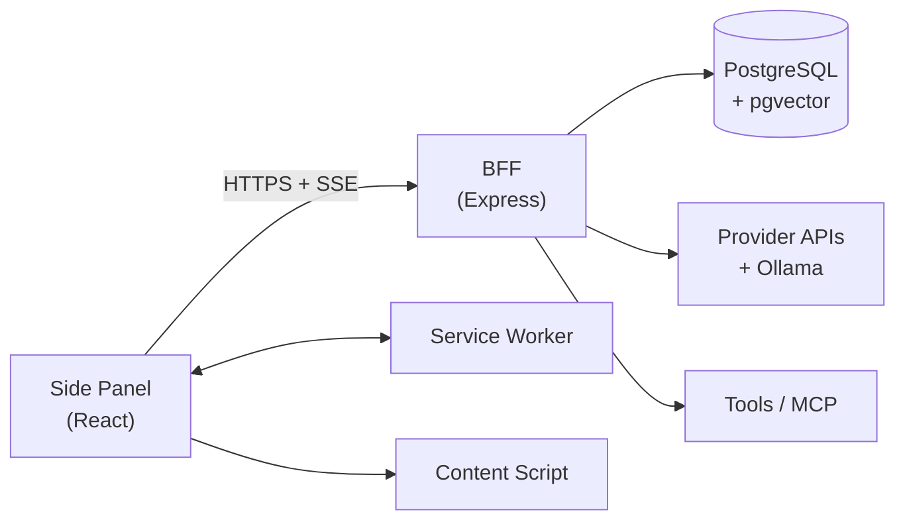

# AGENTS.md — Sidekick AI

> **Đọc file này đầu tiên khi bắt đầu chat mới.** Nó chứa đủ context để làm việc mà không cần đọc lại toàn bộ `docs/`.
> Nếu chi tiết cần → mở đúng file docs được trỏ tới ở §7.

---

## 1. Dự án là gì

**Sidekick AI** — Chrome Extension (Manifest V3) chat-bot sidebar cho đồ án môn học.
Mục tiêu: **feature parity** với **Edge Copilot Sidebar** và **Chrome Gemini in Chrome**, cộng thêm các tính năng mà 2 hệ thống đó không có (BYOK, multi-provider, MCP, RAG, log có cấu trúc, self-host, scheduler).

**Bắt buộc nộp:** bộ eval so sánh với Edge Copilot & Chrome Gemini (`docs/EVAL_REPORT.md`).

---

## 2. Stack đã chốt (KHÔNG đổi)

| Hạng mục | Chọn |
|---|---|
| Extension | Chrome **Manifest V3**, Side Panel API, Chrome ≥ 114 |
| UI | **React 18 + TypeScript + Vite + Tailwind CSS + shadcn/ui** (Radix, copy code vào repo) |
| Client state | **Zustand** |
| Backend | **BFF**: Node 20 + Express + TypeScript, chạy local qua **Docker Compose** |
| DB | **PostgreSQL 16 + Drizzle ORM + pgvector** |
| Repo | **Monorepo pnpm workspace**: `apps/extension`, `apps/server`, `apps/eval`, `packages/shared` |
| Shared | `packages/shared` — TypeScript types + Zod + SSE event union + error codes |
| Test | Vitest (unit/integration), Playwright + Chrome for Testing (E2E) |
| LLM | Multi-provider: Gemini (mặc định), OpenAI, Anthropic, OpenRouter, Groq, Ollama |

---

## 3. Kiến trúc (rút gọn)



**Điểm mấu chốt (đừng phá):**
- Streaming **trực tiếp** Side Panel → BFF. **Không** proxy qua service worker (SW bị kill sau ~30s).
- `activeTab` **không** dùng được khi user tương tác trong side panel → cần `tabs` + `scripting` + `sidePanel` + `storage` + `<all_urls>`.
- `chrome.sidePanel.open()` chỉ chạy được trong **user gesture** (click icon / context menu / command).
- Chỉ **1 side panel** mỗi cửa sổ browser.
- **3 nguồn API key**: `K1` team key (`.env` BFF) · `K2` BYOK mã hoá trong Postgres (qua BFF) · `K3` BYOK trực tiếp trong `chrome.storage.local` (dùng khi BFF down).

---

## 4. Lệnh quan trọng

```bash
pnpm install                 # cài deps (root)
docker compose up -d         # Postgres 16 + pgvector
pnpm db:migrate              # chạy migration Drizzle

pnpm dev                     # shared (watch) + extension + server song song
pnpm dev:ext                 # chỉ extension (vite HMR)
pnpm dev:server              # chỉ BFF (tsx watch)
pnpm dev:shared              # chỉ packages/shared (tsc --watch)

pnpm build                   # build tất cả
pnpm typecheck               # tsc --noEmit
pnpm lint                    # eslint
pnpm test                    # unit + integration
pnpm test:e2e                # Playwright
pnpm eval:run                # chạy eval harness
```

> `pnpm` chưa có? → `corepack enable` (Windows: `corepack enable pnpm`). Fallback: dùng `npm` — cấu trúc thư mục không đổi.

> **Lưu ý `packages/shared`:** lệnh `pnpm test` / `typecheck` / `build` / `dev` đều tự build `packages/shared` trước (qua `pre` hook) → **fresh clone chạy được ngay**, không cần `pnpm build` thủ công. Test của extension/server resolve `@sidekick/shared` từ **source** (`packages/shared/src`) chứ không phải `dist` → sửa shared là test thấy ngay. Chi tiết: [`SYSTEM_DESIGN.md`](docs/SYSTEM_DESIGN.md) §7.1.1.

---

## 5. Quy ước BẮT BUỘC (violate = task không Done)

1. **Sau mỗi phần viết code → cập nhật docs tương ứng**, rồi commit. Cụ thể:
   - đổi hành vi sản phẩm → `docs/REQUIREMENTS.md`
   - đổi API / schema / kiến trúc → `docs/SYSTEM_DESIGN.md`
   - đổi UI / token / component → `docs/DESIGN_SYSTEM_BRIEF.md`
   - đổi kế hoạch / task → `docs/IMPLEMENTATION_PLAN.md`
   - luôn thêm 1 dòng vào `docs/CHANGELOG.md`
   - cập nhật trạng thái ở `docs/HANDOFF.md` nếu task dang dở
2. **Ưu tiên:** parity (M1) > advanced (M2) > polish (M3) > workflow (M4).
3. **Không phá parity.** Nếu một thay đổi làm mất tính năng đã có trong checklist §E của `COMPARISON_MATRIX.md` → không được merge.
4. **Workflow (M4) implement cuối cùng**, chỉ khi thỏa `REQUIREMENTS.md` §9.4.
5. **Không hardcode màu/giá trị UI** — dùng design token (`var(--...)` hoặc class map tới token).
6. **Không dùng `any`** trong TypeScript. Không `eval`, không remote code.
7. **Không commit `.env`, key, hay transcript thô** (`apps/eval/results/raw/` bị ignore; `docs/EVAL_REPORT.md` thì **giữ**).
8. Comment viết bằng **tiếng Việt**.
9. Mỗi task = 1 commit. Message: `feat(scope):`, `fix(scope):`, `docs:`, `chore:`.

---

## 6. Trạng thái hiện tại

| Milestone | Trạng thái | Ghi chú |
|---|---|---|
| **M0 — Foundation** | ✅ Hoàn thành | 15/15 task · 91 unit test + 2 E2E · tag `v0.1` |
| **M1 — Parity** | 🚧 Đang làm | 10/25 task (T-M1-01, T-M1-04 ✅ hấp thụ, T-M1-05, T-M1-21, T-M1-22, T-M1-23, T-M1-02, T-M1-24, T-M1-25, T-M1-06 ✅) · 696 unit test + 32 E2E |
| **M2 — Advanced & Eval** | ⬜ Chưa bắt đầu | `EVAL_REPORT.md` là deliverable bắt buộc |
| **M3 — Polish & Deliverable** | ⬜ Chưa bắt đầu | |
| **M4 — Workflow** | ⬜ Tuỳ chọn | Chỉ sau M3 + đã có eval report |

**Trạng thái docs:** ✅ Requirements · ✅ Design System Brief · ✅ System Design · ✅ Implementation Plan · ✅ Comparison Matrix · ✅ Eval Plan · ✅ Handoff · ✅ Changelog

**Việc tiếp theo:** **T-M1-07** (markdown/code) → T-M1-08 (citation chip).

> **Onboarding (T-M1-25):** lần đầu mở panel sẽ hiện onboarding 3 bước (giải thích quyền → chọn provider + nhập API key (BYOK K2) hoặc dùng Ollama không cần key → thử câu hỏi bằng SSE thật). Skippable ở mọi bước; mở lại được từ nút "Hướng dẫn" trong header panel. Chi tiết: [`REQUIREMENTS.md`](docs/REQUIREMENTS.md) §4.9.1 · [`SYSTEM_DESIGN.md`](docs/SYSTEM_DESIGN.md) §7.6.

> **Mô hình context (T-M1-23):** context **chỉ** được gửi khi user **chủ động đính kèm** (nút "Thêm trang này" · `@` · bôi đen · upload file). Không đính kèm gì → chat thuần LLM (FR-CONTEXT-13). Chi tiết: [`SYSTEM_DESIGN.md`](docs/SYSTEM_DESIGN.md) §7.3.2.
>
> **Selection context (T-M1-02):** bôi đen trên trang → nút nổi "Hỏi Sidekick" (đường A) hoặc nút "Dính đoạn đã chọn" trong panel (đường B) → đoạn text vào context với `tier: 'selection'` (**cao nhất**). Panel đang đóng → đoạn chờ lưu `chrome.storage.local` (TTL 5 phút) → panel mở sau tự nhận. Chi tiết: [`SYSTEM_DESIGN.md`](docs/SYSTEM_DESIGN.md) §7.3.4.
>
> **Hash context + snapshot + cache (T-M1-06):** `request_logs.context_hash` = hash của **context thật đã gửi** (đã cắt ngân sách) — đổi câu hỏi không đổi hash. `context_snapshot` (jsonb) chỉ ghi khi bật `LOG_CONTEXT_SNAPSHOT` (mặc định **TẮT** vì chứa nội dung trang). Extension cache context theo URL+hash trong `chrome.storage.local` (TTL 30 phút) → không trích xuất lại trang đã đọc, fallback về bản cache khi trang lỗi. Chi tiết: [`SYSTEM_DESIGN.md`](docs/SYSTEM_DESIGN.md) §7.3.5.

---

## 7. Đọc file nào khi nào

| Tình huống | Đọc file |
|---|---|
| Bắt đầu chat mới / cần context | File này + `docs/HANDOFF.md` |
| Làm UI | `docs/DESIGN_SYSTEM_BRIEF.md` |
| Viết API / DB / backend | `docs/SYSTEM_DESIGN.md` |
| Biết cần làm task gì tiếp | `docs/IMPLEMENTATION_PLAN.md` |
| Cần biết FR nào ứng với ý tưởng | `docs/REQUIREMENTS.md` |
| So sánh với Edge/Gemini | `docs/COMPARISON_MATRIX.md` |
| Làm phần eval | `docs/EVAL_PLAN.md` |
| Thêm thay đổi vào docs | `docs/CHANGELOG.md` (xem format) |

---

## 8. Cấu trúc thư mục (rút gọn)

```text
apps/extension/    src/{sidepanel,background,content,lib,components/ui}
                   public/{manifest.json,icons/} · e2e/ · tests/
apps/server/       src/{routes,providers,services,middleware,config,db,lib}
apps/eval/         src/{cli.ts,dataset.ts,types.ts} · dataset/
packages/shared/   src/{types,schemas,events.ts,errors.ts,constants.ts}
design/            tokens.json tokens.css
docs/              9 file tài liệu (README, REQUIREMENTS, SYSTEM_DESIGN,
                   IMPLEMENTATION_PLAN, DESIGN_SYSTEM_BRIEF, COMPARISON_MATRIX,
                   EVAL_PLAN, HANDOFF, CHANGELOG)
```

---

## 9. Link nhanh

- Requirements: `docs/REQUIREMENTS.md`
- Comparison: `docs/COMPARISON_MATRIX.md`
- Eval plan: `docs/EVAL_PLAN.md`
- Design system: `docs/DESIGN_SYSTEM_BRIEF.md`
- System design: `docs/SYSTEM_DESIGN.md`
- Implementation plan: `docs/IMPLEMENTATION_PLAN.md`
- Handoff: `docs/HANDOFF.md`
- Changelog: `docs/CHANGELOG.md`
- Docs index: `docs/README.md`
