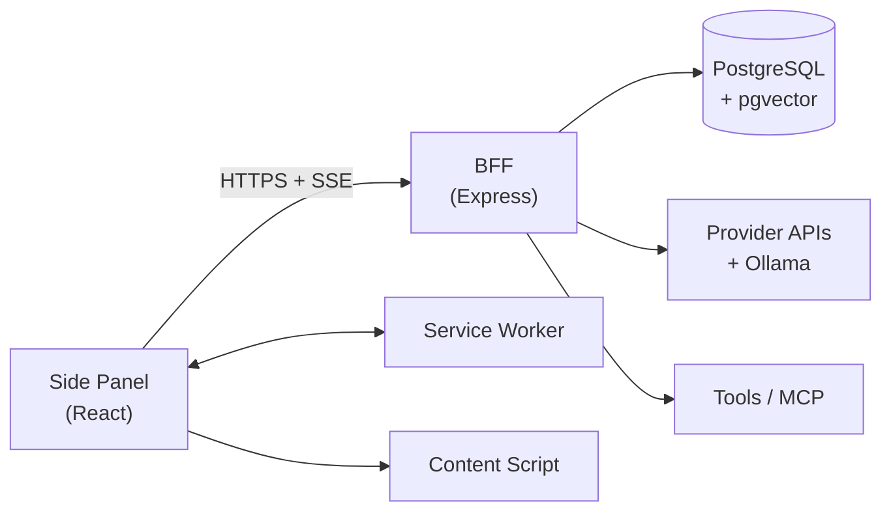

# AGENTS.md — Sidekick AI

> **Đọc file này đầu tiên khi bắt đầu chat mới.** Nó chứa đủ context để làm việc mà không cần đọc lại toàn bộ `docs/`.
> Nếu chi tiết cần → mở đúng file docs được trỏ tới ở §7.

---

## 1. Dự án là gì

**Sidekick AI** — Chrome Extension (Manifest V3) chat-bot sidebar cho đồ án môn học.
Mục tiêu: **feature parity** với **Edge Copilot Sidebar** và **Chrome Gemini in Chrome**, cộng thêm các tính năng mà 2 hệ thống đó không có (BYOK, multi-provider, MCP, RAG, log có cấu trúc, self-host, scheduler).

**Bắt buộc nộp:** bộ eval so sánh với Edge Copilot & Chrome Gemini (`docs/EVAL_REPORT.md`).

---

## 2. Stack đã chốt (KHÔNG đổi)

| Hạng mục | Chọn |
|---|---|
| Extension | Chrome **Manifest V3**, Side Panel API, Chrome ≥ 114 |
| UI | **React 18 + TypeScript + Vite + Tailwind CSS + shadcn/ui** (Radix, copy code vào repo) |
| Client state | **Zustand** |
| Backend | **BFF**: Node 20 + Express + TypeScript, chạy local qua **Docker Compose** |
| DB | **PostgreSQL 16 + Drizzle ORM + pgvector** |
| Repo | **Monorepo pnpm workspace**: `apps/extension`, `apps/server`, `apps/eval`, `packages/shared` |
| Shared | `packages/shared` — TypeScript types + Zod + SSE event union + error codes |
| Test | Vitest (unit/integration), Playwright + Chrome for Testing (E2E) |
| LLM | Multi-provider: Gemini (mặc định), OpenAI, Anthropic, OpenRouter, Groq, Ollama |

---

## 3. Kiến trúc (rút gọn)



**Điểm mấu chốt (đừng phá):**
- Streaming **trực tiếp** Side Panel → BFF. **Không** proxy qua service worker (SW bị kill sau ~30s).
- `activeTab` **không** dùng được khi user tương tác trong side panel → cần `tabs` + `scripting` + `sidePanel` + `storage` + `<all_urls>`.
- `chrome.sidePanel.open()` chỉ chạy được trong **user gesture** (click icon / context menu / command).
- Chỉ **1 side panel** mỗi cửa sổ browser.
- **3 nguồn API key**: `K1` team key (`.env` BFF) — nguồn duy nhất ở M1. `K2` BYOK (mã hoá trong Postgres) + `K3` BYOK direct (`chrome.storage.local`) đã **⏸ tạm dừng** (2026-11-08) — server giữ nguyên để mở lại được sau.

---

## 4. Lệnh quan trọng

```bash
pnpm install                 # cài deps (root)
docker compose up -d         # Postgres 16 + pgvector
pnpm db:migrate              # chạy migration Drizzle

pnpm dev                     # shared (watch) + extension + server song song
pnpm dev:ext                 # chỉ extension (vite HMR)
pnpm dev:server              # chỉ BFF (tsx watch)
pnpm dev:shared              # chỉ packages/shared (tsc --watch)

pnpm build                   # build tất cả
pnpm typecheck               # tsc --noEmit
pnpm lint                    # eslint
pnpm test                    # unit + integration
pnpm test:e2e                # Playwright
pnpm eval:run                # chạy eval harness
```

> `pnpm` chưa có? → `corepack enable` (Windows: `corepack enable pnpm`). Fallback: dùng `npm` — cấu trúc thư mục không đổi.

> **Lưu ý `packages/shared`:** lệnh `pnpm test` / `typecheck` / `build` / `dev` đều tự build `packages/shared` trước (qua `pre` hook) → **fresh clone chạy được ngay**, không cần `pnpm build` thủ công. Test của extension/server resolve `@sidekick/shared` từ **source** (`packages/shared/src`) chứ không phải `dist` → sửa shared là test thấy ngay. Chi tiết: [`SYSTEM_DESIGN.md`](docs/SYSTEM_DESIGN.md) §7.1.1.

---

## 5. Quy ước BẮT BUỘC (violate = task không Done)

1. **Sau mỗi phần viết code → cập nhật docs tương ứng**, rồi commit. Cụ thể:
   - đổi hành vi sản phẩm → `docs/REQUIREMENTS.md`
   - đổi API / schema / kiến trúc → `docs/SYSTEM_DESIGN.md`
   - đổi UI / token / component → `docs/DESIGN_SYSTEM_BRIEF.md`
   - đổi kế hoạch / task → `docs/IMPLEMENTATION_PLAN.md`
   - luôn thêm 1 dòng vào `docs/CHANGELOG.md`
   - cập nhật trạng thái ở `docs/HANDOFF.md` nếu task dang dở
2. **Ưu tiên:** parity (M1) > advanced (M2) > polish (M3) > workflow (M4).
3. **Không phá parity.** Nếu một thay đổi làm mất tính năng đã có trong checklist §E của `COMPARISON_MATRIX.md` → không được merge.
4. **Workflow (M4) implement cuối cùng**, chỉ khi thỏa `REQUIREMENTS.md` §9.4.
5. **Không hardcode màu/giá trị UI** — dùng design token (`var(--...)` hoặc class map tới token).
6. **Không dùng `any`** trong TypeScript. Không `eval`, không remote code.
7. **Không commit `.env`, key, hay transcript thô** (`apps/eval/results/raw/` bị ignore; `docs/EVAL_REPORT.md` thì **giữ**).
8. Comment viết bằng **tiếng Việt**.
9. Mỗi task = 1 commit. Message: `feat(scope):`, `fix(scope):`, `docs:`, `chore:`.

---

## 6. Trạng thái hiện tại

| Milestone | Trạng thái | Ghi chú |
|---|---|---|
| **M0 — Foundation** | ✅ Hoàn thành | 15/15 task · 91 unit test + 2 E2E · tag `v0.1` |
| **M1 — Parity** | ✅ **Đóng** (2026-11-09) | **23/25 task** (T-M1-15 + T-M1-16 ⏸ tạm dừng) · **1337 unit test + 88 E2E** · **tag `v0.2`** · gate đạt: checklist §E **32/35 = 91.4%** · dòng "Must" §A/§B **21/23 = 91.3%** |
| **M2 — Advanced & Eval** | 🟡 **Đang làm** | T-M2-02 ✅ (model picker + fallback) · T-M2-03 ✅ (token/cost UI) · T-M2-01 ⏸ đẩy · **1391 unit test + 91 E2E** · `EVAL_REPORT.md` là deliverable bắt buộc · **tiếp theo: T-M2-12 (dataset eval)** |
| **M3 — Polish & Deliverable** | ⬜ Chưa bắt đầu | |
| **M4 — Workflow** | ⬜ Tuỳ chọn | Chỉ sau M3 + đã có eval report |

**Trạng thái docs:** ✅ Requirements · ✅ Design System Brief · ✅ System Design · ✅ Implementation Plan · ✅ Comparison Matrix · ✅ Eval Plan · ✅ Handoff · ✅ Changelog

**Việc tiếp theo:** **M2 đang làm** — **T-M2-02 ✅** (model picker + fallback chain) · **T-M2-03 ✅** (token/cost UI) → **T-M2-12** (điền dataset eval thật — contract đã sẵn sàng ở `packages/shared/src/schemas/eval.ts`) → T-M2-13 (harness) → T-M2-14 (judge) → T-M2-15..17 (thu thập + **`docs/EVAL_REPORT.md` — deliverable bắt buộc**). T-M1-15 (K3 direct) + T-M1-16 (K2 BYOK UI) **⏸ tạm dừng** (2026-11-08) — server giữ nguyên để mở lại được.

> **M2 — T-M2-02 + T-M2-03 (2026-11-10):** **không thêm provider mới** (quyết định user) → `PROVIDER_IDS` giữ nguyên (`mock · groq · openrouter · gemini · ollama`), `packages/shared/src/constants.ts` **không đổi** → **T-M2-01 đẩy lại**.
> - **T-M2-02 (FR-PROVIDER-03/04):** `GET /api/providers/:id/models` → `ProviderAdapter.discoverModels?(apiKey)` (`openaiCompatible.ts` gửi `Authorization` · `gemini.ts` gửi `x-goog-api-key`) → `{ providerId, models, source: 'live'|'fallback' }`. Fallback chain runtime trong `apps/server/src/services/chatService.ts`: fallback **chỉ** khi lỗi `retryable` **và** `streamedToken === false` (đã stream dở → không fallback) · 401/403 → **không** fallback · provider không có key / không hỗ trợ vision → **bỏ qua** · khi chuyển provider → **tính lại** context budget + prompt. SSE event mới **`provider_switch`** `{from, to, reason, model}` → extension đổi chip provider + **toast** "Đã chuyển sang provider X". Cột mới `request_logs.fallback_from` (migration `apps/server/drizzle/0002_certain_vector.sql`). UI: `ModelPicker` (Radix Popover) ở header · lựa chọn lưu `chrome.storage.local` key `sidekick.modelSelection` → persist qua reload, gửi kèm mỗi lượt chat.
> - **T-M2-03 (FR-PROVIDER-05):** `UsageBadge` dưới bubble assistant (token vào/ra + `~ $0.0123`, 4 chữ số thập phân · provider local → chỉ hiện token) · section **"Chi phí & sử dụng"** trong Settings (`GET /api/usage` → tổng + bảng theo ngày, khoảng `today/7d/30d/all`). Chi phí do **server** tính từ `PROVIDER_PRICING` → UI không lệch. **Budget cap (FR-PROVIDER-06, priority C) chưa làm** → `TODO(T-M2-03b)`.
> - **Gate parity:** checklist §E **32/35 = 91.4%** → **33/35 = 94.3%** (đóng dòng "Token/cost hiển thị").
> Chi tiết: [`SYSTEM_DESIGN.md`](docs/SYSTEM_DESIGN.md) §7.22 + §7.23 · [`COMPARISON_MATRIX.md`](docs/COMPARISON_MATRIX.md) §E.1.3 · [`IMPLEMENTATION_PLAN.md`](docs/IMPLEMENTATION_PLAN.md) §4 (ghi chú phạm vi M2).

> **Đóng M1 (2026-11-09):** 3 task cuối — **T-M1-13 export** (commit `0a8d9d6`) · **E2E chứng minh parity "panel giữ nguyên khi chuyển tab"** (commit `07fb7ce`) · **đồng bộ contract eval** (commit `03a1d69`). Gate đạt: checklist §E **32/35 = 91.4%** + dòng "Must" §A/§B **21/23 = 91.3%** (cả 2 ≥ 90%). 3 dòng §E còn mở đều có task kế tiếp (Skills → T-M2-04/06/21 · token/cost UI → T-M2-03 · BYOK → T-M1-15/16). Chi tiết: [`IMPLEMENTATION_PLAN.md`](docs/IMPLEMENTATION_PLAN.md) §3.1u · [`COMPARISON_MATRIX.md`](docs/COMPARISON_MATRIX.md) §E.1.

> **Contract eval (2026-11-09):** shape dataset eval đã **có nguồn sự thật** → [`packages/shared/src/schemas/eval.ts`](packages/shared/src/schemas/eval.ts) (`evalTaskSchema` + `EVAL_GROUPS` **8 nhóm** theo [`EVAL_PLAN.md`](docs/EVAL_PLAN.md) §3.2) → `apps/eval` validate bằng đúng schema đó. Field **snake_case** (`snapshot_path` · `content_hash` · `key_points` · `must_include_facts` · `must_not_contain` · `expected_citations`). `apps/eval/dataset/tasks.json` hiện **rỗng `[]`** — đúng chuẩn M1, điền ở T-M2-12. Chi tiết: [`SYSTEM_DESIGN.md`](docs/SYSTEM_DESIGN.md) §4.5.

> **Bundle content script (fix sau T-M1-20):** `dist/content.js` đã **phình 151 kB** (T-M1-17: `lib/i18n.ts` → `lib/settings.ts` → `@sidekick/shared` barrel → **Zod**) rồi **~46 kB** (T-M1-20: kéo dictionary **đầy đủ** ~34 kB) → nay **17.27 kB** (gzip 6.65 kB). **2 tầng dictionary**: `i18n/format.ts` (thuần) · `i18n/outsidePanel.{vi,en}.ts` (**4 khoá** ngoài panel — nguồn sự thật) · `i18n/outsidePanel.ts` · `i18n/surface.ts` (union kiểu) · `lib/i18nSurface.ts` (`getSurfaceTranslator()` cho content script + SW) · `lib/storageKeys.ts` (khoá storage + đọc ngôn ngữ, **không** Zod). `i18n/vi.ts` + `en.ts` **spread** dictionary rút gọn → 1 nguồn sự thật. **Guard** `apps/extension/tests/contentBundleGuard.test.ts` duyệt **đệ quy đồ thị phụ thuộc** (grep từng file bị lọt) → chặn `@sidekick/shared` barrel · dictionary đầy đủ · `react` · `zod`; assert `dist/content.js` **≤ 40 kB**. Chi tiết: [`SYSTEM_DESIGN.md`](docs/SYSTEM_DESIGN.md) §7.5.1 + §7.5.2.

> **Responsive 320–640px + a11y pass (T-M1-20):** side panel **không tràn ngang** ở 320–640px (`#root` dùng `min-width: min(var(--panel-min-width), 100%)` · drawer + chip nguồn `max-w-full` · `min-w-0` cho bubble/textarea). **Focus ring** chuẩn hoá 1 token `--border-focus` (`focus-visible:outline-2 focus-visible:outline-offset-2 focus-visible:outline-[var(--border-focus)]`) — không còn `outline: none` trần. **Live region (NFR-A11Y-05)** đặt **chỉ** trên phần đang stream (`MessageContent`: `role="article"` + `aria-live="polite"` + `aria-atomic="false"`); thread `role="log"` **không** đặt `aria-live` → screen reader không đọc lại lịch sử cũ. **Skip-link** "Bỏ qua tới ô nhập" (`App.tsx` → `#sidekick-composer-input`) · **tap target ≥ 24px** (WCAG 2.2 §2.5.8) · `role="tab"`/`tabpanel` cho tab nhóm conversation · dọn 3 chuỗi literal còn sót từ T-M1-17 (`composer.hint` · `chat.oldVersions` · `chat.threadLabel` + nhãn đóng Dialog) → `useI18n` **chuyển** từ `sidepanel/hooks/` → `src/i18n/useI18n.ts`. Chi tiết: [`SYSTEM_DESIGN.md`](docs/SYSTEM_DESIGN.md) §7.19 · [`DESIGN_SYSTEM_BRIEF.md`](docs/DESIGN_SYSTEM_BRIEF.md) §5.

> **Keyboard shortcuts cấu hình được (T-M1-18):** Settings có section "Phím tắt" với **2 lớp** — (1) **lớp native của Chrome**: đọc shortcut đang gán bằng `chrome.commands.getAll()` + nút mở `chrome://extensions/shortcuts`; (2) **lớp nhanh của Sidekick**: lưu `chrome.storage.local` key `sidekick.shortcuts`, bấm "Đổi" để bắt phím, "Về mặc định" để reset, tổ hợp trùng **deny-list** 28 phím dành riêng của trình duyệt thì báo lỗi. **Ràng buộc Chrome MV3:** Chrome **không** có `chrome.commands.update()` / `reset()` (API riêng của Firefox) → thiết kế 2 lớp thay vì giả lập API không tồn tại. Module thuần: `lib/shortcuts.ts` · `lib/shortcutStorage.ts` · `lib/shortcutProtocol.ts` (không Zod → content script IIFE không kéo React/Zod) · `lib/shortcutBridge.ts` (SW) · `content/shortcutListener.ts`. Chi tiết: [`SYSTEM_DESIGN.md`](docs/SYSTEM_DESIGN.md) §7.18 · [`DESIGN_SYSTEM_BRIEF.md`](docs/DESIGN_SYSTEM_BRIEF.md) §3.7.1.

> **BYOK tạm dừng (2026-11-08):** theo quyết định của user, toàn bộ BYOK bị **gỡ khỏi sản phẩm** và đánh dấu **⏸ tạm dừng**:
> - Ô nhập API key đã **gỡ khỏi onboarding** (bước 2) → provider cần key mà chưa có **K1** chỉ hiện thông báo hướng dẫn (`onboarding-key-required`).
> - **Server giữ nguyên** `POST /api/providers/keys` · `GET/DELETE /api/providers/keys/:id` · `POST /api/providers/keys/:id/test` + bảng `provider_keys` (AES-256-GCM) → mở lại được bằng cách thêm lại UI, **không** migration.
> - Ở M1 nguồn key duy nhất là **K1** (team key trong `.env` BFF); Ollama local không cần key.
> Chi tiết: [`REQUIREMENTS.md`](docs/REQUIREMENTS.md) §4.6.1 · [`SYSTEM_DESIGN.md`](docs/SYSTEM_DESIGN.md) ADR-9/ADR-12.

> **i18n VI/EN (T-M1-17):** toàn bộ side panel đã dịch VI/EN — chọn ngôn ngữ trong Settings → UI đổi **ngay** (không reload) + persist qua `chrome.storage.local`. Module i18n tự viết, **không** thêm thư viện (`i18next`/`intl-messageformat`) → chỉ placeholder `{name}` qua `formatMessage()`. `apps/extension/src/i18n/vi.ts` là **nguồn sự thật** của danh sách key (`viDictionary` là `const` object → `TranslationKey = keyof typeof viDictionary`) → `en.ts` khai kiểu `Dictionary = Record<TranslationKey, string>` → **thiếu/thừa key = lỗi `pnpm typecheck`**. `useSettings()` **nâng lên `App.tsx`** → `I18nProvider` bọc **cả** onboarding lẫn chat (đổi ngôn ngữ đồng bộ); `SettingsDrawer` fallback về `useSettings()` khi không truyền props. `i18n/context.ts` **không JSX** → content script + service worker không kéo React vào bundle IIFE (kiểm chứng: `dist/content.js` không chứa React). Ngoài panel: 2 nhãn context menu lấy từ `getTranslator()` + SW nghe `storage.onChanged` → đăng ký lại menu (idempotent) → đổi nhãn **không cần reload trình duyệt**; nút nổi content script đọc storage → đổi text/aria-label. **Không** dịch gợi ý trang + `SUMMARY_PROMPT` (`packages/shared/src/pageProfile.ts`) → prompt đánh giá phải nhất quán cho eval. Chi tiết: [`SYSTEM_DESIGN.md`](docs/SYSTEM_DESIGN.md) §7.17 · [`DESIGN_SYSTEM_BRIEF.md`](docs/DESIGN_SYSTEM_BRIEF.md) §3.11.

> **Request logging (T-M1-14):** bảng `request_logs` **không còn là bảng chết** — **mọi** lượt chat (thành công **và** thất bại) đều ghi 1 dòng với provider · model · token in/out · `cost_usd` **thật** (tính từ `PROVIDER_PRICING` — là **ước lượng** theo bảng giá snapshot, không phải hoá đơn) · `ttft_ms` · `latency_ms` · `tool_calls` · `context_hash` · error code. `request_id` xuyên suốt **client → BFF → provider** (client sinh uuid → server sanitize → echo header) → hiện 6 ký tự ở dòng meta của bubble assistant. Log HTTP dạng **JSON** 1 dòng/request. **Retention 90 ngày** enforce thật (startup + mỗi 24 h). `GET /api/logs` · `GET /api/usage` trả **chỉ metadata** cho eval harness (`pnpm eval:run logs`). **Không** migration mới. Chi tiết: [`SYSTEM_DESIGN.md`](docs/SYSTEM_DESIGN.md) §7.16 · [`EVAL_PLAN.md`](docs/EVAL_PLAN.md) §5.3.1.

> **Chat CRUD (T-M1-09):** side panel có **drawer quản lý cuộc trò chuyện** (Radix Dialog trượt từ trái) — tạo · đổi tên · xoá (confirm dialog) · ghim · lưu trữ · search theo tên. Chọn conversation → tải lại lịch sử **kèm citations đã lưu**. Backend: `GET/POST /api/conversations` · `GET /api/conversations/:id/messages` · `PATCH/DELETE /api/conversations/:id` (phân trang keyset bằng cursor). **Phạm vi chốt:** ghim ở cấp **conversation** (cột `pinned` đã có sẵn từ M0 → không có migration mới); ghim tin nhắn để task sau. Chi tiết: [`SYSTEM_DESIGN.md`](docs/SYSTEM_DESIGN.md) §7.10.

> **Markdown render (T-M1-07):** nội dung assistant render qua `react-markdown` + `remark-gfm` → `rehype-highlight` → `rehype-sanitize` (allowlist thẩm: `span.hljs-*`, `code.language-*`, `href` chỉ `http/https/mailto`). Code block có **nhãn ngôn ngữ + copy 1-click** (toast "Đã sao chép", copy **source thô**); bảng GFM scroll ngang. Highlight **defer khi streaming** + `useDeferredValue` → không jank, không nhấp nháy. Chi tiết: [`SYSTEM_DESIGN.md`](docs/SYSTEM_DESIGN.md) §7.8.

> **Onboarding (T-M1-25):** lần đầu mở panel sẽ hiện onboarding 3 bước (giải thích quyền → chọn provider (BYOK nhập key đã gỡ — xem mục BYOK tạm dừng ở trên) hoặc dùng Ollama không cần key → thử câu hỏi bằng SSE thật). Skippable ở mọi bước; mở lại được từ nút "Hướng dẫn" trong header panel. Chi tiết: [`REQUIREMENTS.md`](docs/REQUIREMENTS.md) §4.9.1 · [`SYSTEM_DESIGN.md`](docs/SYSTEM_DESIGN.md) §7.6.

> **Mô hình context (T-M1-23):** context **chỉ** được gửi khi user **chủ động đính kèm** (nút "Thêm trang này" · `@` · bôi đen · upload file). Không đính kèm gì → chat thuần LLM (FR-CONTEXT-13). Chi tiết: [`SYSTEM_DESIGN.md`](docs/SYSTEM_DESIGN.md) §7.3.2.
>
> **Selection context (T-M1-02):** bôi đen trên trang → nút nổi "Hỏi Sidekick" (đường A) hoặc nút "Dính đoạn đã chọn" trong panel (đường B) → đoạn text vào context với `tier: 'selection'` (**cao nhất**). Panel đang đóng → đoạn chờ lưu `chrome.storage.local` (TTL 5 phút) → panel mở sau tự nhận. Chi tiết: [`SYSTEM_DESIGN.md`](docs/SYSTEM_DESIGN.md) §7.3.4.
>
> **Hash context + snapshot + cache (T-M1-06):** `request_logs.context_hash` = hash của **context thật đã gửi** (đã cắt ngân sách) — đổi câu hỏi không đổi hash. `context_snapshot` (jsonb) chỉ ghi khi bật `LOG_CONTEXT_SNAPSHOT` (mặc định **TẮT** vì chứa nội dung trang). Extension cache context theo URL+hash trong `chrome.storage.local` (TTL 30 phút) → không trích xuất lại trang đã đọc, fallback về bản cache khi trang lỗi. Chi tiết: [`SYSTEM_DESIGN.md`](docs/SYSTEM_DESIGN.md) §7.3.5.

> **Citation chip + popover (T-M1-08):** server đánh số nguồn **1-based** theo tier (`selection` > `attachment` > `currentTab`) → prompt render `--- Nguồn [1] (...) ---` + chèn `CITATION_INSTRUCTION` **chỉ khi có context**. LLM trả marker `[N]` → server parse, **loại số vượt phạm vi**, emit SSE `citation` (trước `done`) + lưu bảng `citations` (`idx`, `url`, `title`, `snippet`, `tabId`). Extension: remark plugin `citationPlugin` gắn `dataCitationIndex` (allowlist **tường minh**, không wildcard `data*`) → `CitationChip` inline + `CitationPopover` (Radix, xem **đoạn nguồn** + "Mở trang gốc") + `CitationList` tóm tắt nguồn dưới bubble. Chi tiết: [`SYSTEM_DESIGN.md`](docs/SYSTEM_DESIGN.md) §7.9.

> **Chat actions (T-M1-10):** trạng thái turn/variant/path lưu **phía server** trong jsonb có sẵn (`messages.meta`: `turnId`/`variantIndex`/`active`/`parentTurnId`/`aborted` + `conversations.meta.path`) → **không** migration mới, không mất khi reload panel. `operation` trong `POST /api/chat`: `send` · `regenerate` (tạo **biến thể**, không lặp user message) · `continue` (**UPDATE** message cũ `content = partial + text`) · `branch` (edit-resend → cắt `path`, nhánh cũ giữ trong DB ở mục "Phiên bản cũ"). Extension: `MessageActions` ("Tạo lại" · switcher "1/2" · "Tiếp tục" · "Sửa") · `MessageEditBox` · `ScrollToBottomButton` · auto-scroll chỉ khi ở đáy (ngưỡng 80px) · draft tự lưu (debounce 300 ms, TTL 30 ngày) · Enter gửi / Shift+Enter xuống dòng / Esc dừng. Chi tiết: [`SYSTEM_DESIGN.md`](docs/SYSTEM_DESIGN.md) §7.11.

> **Prompt gợi ý theo trang + Summarize 1-click (T-M1-11):** empty state hiện `PromptGallery` — **≥ 3 gợi ý đổi theo loại trang** (docs / article / forum / video / pdf / shopping / general) + nút refresh (xoay vòng deterministic trong cùng profile) + nút **"Tóm tắt trang này"** 1-click. Bộ luật phân loại đặt ở `packages/shared/src/pageProfile.ts` (`classifyPage` · `suggestionsForPage` · `generalSuggestions`) → dùng chung cho extension + eval. Bấm gợi ý / nút tóm tắt = hành động chủ động → **tự attach trang hiện tại trước khi gửi** (tương thích FR-CONTEXT-13: context không bao giờ tự ý gửi). Không có tab đọc được (`chrome://`) → 4 gợi ý chung (FR-UX-04), không hiện nút tóm tắt. Chi tiết: [`REQUIREMENTS.md`](docs/REQUIREMENTS.md) §4.9.2 · [`SYSTEM_DESIGN.md`](docs/SYSTEM_DESIGN.md) §7.12.

> **Toggle panel · context menu · phím tắt (T-M1-03):** side panel mở qua **3 đường** — (1) **bấm icon toolbar** dùng native `chrome.sidePanel.setPanelBehavior({ openPanelOnActionClick: true })` (Chrome 114+) → Chrome tự toggle mở/đóng; `action.onClicked` chỉ là **fallback** cho Chrome cũ (guard `getPanelBehavior()`); (2) **context menu** 2 mục — `sidekick-open` ("Mở Sidekick AI", `contexts: ['page']`) + `sidekick-ask-selection` ("Hỏi Sidekick với đoạn đã chọn", `contexts: ['selection']` → đoạn chọn vào context `tier: 'selection'`) — đăng ký lại **an toàn** qua `removeAll()` → `create()` (fix lỗi duplicate id khi update extension); (3) **phím tắt `Ctrl+Shift+K`** (macOS `Command+Shift+K`) — custom command `sidekick-toggle-panel` tự xử lý toggle (không dùng `_execute_action` vì bị native toggle nuốt) · trạng thái panel track bằng `chrome.storage.session['sidekick.panelOpen']` + event `sidePanel.onOpened`/`onClosed` (Chrome 141/142) → **không** mất khi SW bị kill ~30s. Logic tách 3 file thuần (`background/panelController.ts` · `contextMenus.ts` · `commands.ts`) → SW chỉ là wiring, test được trong jsdom; **không** migration, **không** dependency mới, **không** UI mới (đổi phím tắt → T-M1-18). Chi tiết: [`REQUIREMENTS.md`](docs/REQUIREMENTS.md) §4.9.3 · [`SYSTEM_DESIGN.md`](docs/SYSTEM_DESIGN.md) §7.13.

> **Settings (T-M1-12):** drawer **Cài đặt** (Radix Dialog trượt từ **phải**, mở bằng nút gear trong header) với 6 section — **theme** (sáng/tối/theo-OS · class `.dark` + `data-theme` → dùng token sẵn có, **không** hardcode màu) · **hiển thị** (cỡ chữ 4 mức `--font-scale` · mật độ 3 mức `--density-scale` · bề rộng 3 mức `--panel-max-width` → **không** sửa component nào) · **quyền riêng tư** (telemetry + history **OFF** mặc định) · **quản lý dữ liệu** (xoá lịch sử chat qua `DELETE /api/conversations` + xoá dữ liệu cục bộ theo prefix `sidekick.` — đều **có confirm**) · **máy chủ (BFF)** (validate `GET <url>/api/health` trước khi lưu) · **ngôn ngữ** (VI/EN — chỉ lưu lựa chọn, dịch UI → T-M1-17). Toàn bộ lưu `chrome.storage.local` key `sidekick.settings` → persist qua reload; hook `useSettings()` nghe `storage.onChanged` → đồng bý, áp dụng **ngay, không reload**. Xoá local **giữ** `sidekick.onboarding.*` + `sidekick.preferredProvider`. **Không** migration, **không** dependency mới. Chi tiết: [`REQUIREMENTS.md`](docs/REQUIREMENTS.md) §4.8.1 · [`SYSTEM_DESIGN.md`](docs/SYSTEM_DESIGN.md) §7.14.

> **States · retry · connection status (T-M1-19):** side panel có **4 trạng thái có UI riêng** trong `sidepanel/components/states/` — `LoadingState` (skeleton khi tải lịch sử hội thoại) · `EmptyState` (wrapper `PromptGallery`) · `ErrorState` (card lỗi inline) · `ConnectionBadge` (chip trạng thái ở header) + **banner offline** dưới header. Taxonomy lỗi ở `packages/shared/src/chatErrors.ts` (`ChatErrorKind` = network · rate-limit · auth · provider · server · unknown · `classifyChatError` · `isRetryableKind` · `shouldAutoRetry` · `defaultRetryAfterSeconds`) → server **không** còn hardcode `retryable: true` (`chunk.errorRetryable ?? isRetryableKind(classifyChatError(code))`) · provider đọc header `Retry-After` (429) và set `errorRetryable: false` (401/403). Extension: `ChatRequestError { code, status, retryable }` · retry **tự động 1 lần** backoff 800 ms (chỉ network/server/unknown — **không** retry auth) · `retryMessage(messageId)` gửi lại lượt (dùng `serverId` = uuid từ SSE `meta.messageId`) · hành động theo nhóm lỗi: **401 → "Kiểm tra API key"** (mở Settings) · **429 → đếm ngược** rồi bật "Thử lại" · **5xx/network → "Thử lại"**. Probe `GET /api/health` (backoff 5s → 15s → 30s) + `navigator.onLine` → badge "Đang kết nối / Đã kết nối / Offline / Máy chủ lỗi". **Không** migration, **không** dependency mới, **không** đổi manifest. Chi tiết: [`SYSTEM_DESIGN.md`](docs/SYSTEM_DESIGN.md) §7.15 · [`DESIGN_SYSTEM_BRIEF.md`](docs/DESIGN_SYSTEM_BRIEF.md) §3.9.

---

## 7. Đọc file nào khi nào

| Tình huống | Đọc file |
|---|---|
| Bắt đầu chat mới / cần context | File này + `docs/HANDOFF.md` |
| Làm UI | `docs/DESIGN_SYSTEM_BRIEF.md` |
| Viết API / DB / backend | `docs/SYSTEM_DESIGN.md` |
| Biết cần làm task gì tiếp | `docs/IMPLEMENTATION_PLAN.md` |
| Cần biết FR nào ứng với ý tưởng | `docs/REQUIREMENTS.md` |
| So sánh với Edge/Gemini | `docs/COMPARISON_MATRIX.md` |
| Làm phần eval | `docs/EVAL_PLAN.md` |
| Thêm thay đổi vào docs | `docs/CHANGELOG.md` (xem format) |

---

## 8. Cấu trúc thư mục (rút gọn)

```text
apps/extension/    src/{sidepanel,background,content,lib,components/ui}
                   public/{manifest.json,icons/} · e2e/ · tests/
apps/server/       src/{routes,providers,services,middleware,config,db,lib}
apps/eval/         src/{cli.ts,dataset.ts,types.ts} · dataset/
packages/shared/   src/{types,schemas,events.ts,errors.ts,constants.ts}
design/            tokens.json tokens.css
docs/              9 file tài liệu (README, REQUIREMENTS, SYSTEM_DESIGN,
                   IMPLEMENTATION_PLAN, DESIGN_SYSTEM_BRIEF, COMPARISON_MATRIX,
                   EVAL_PLAN, HANDOFF, CHANGELOG)
```

---

## 9. Link nhanh

- Requirements: `docs/REQUIREMENTS.md`
- Comparison: `docs/COMPARISON_MATRIX.md`
- Eval plan: `docs/EVAL_PLAN.md`
- Design system: `docs/DESIGN_SYSTEM_BRIEF.md`
- System design: `docs/SYSTEM_DESIGN.md`
- Implementation plan: `docs/IMPLEMENTATION_PLAN.md`
- Handoff: `docs/HANDOFF.md`
- Changelog: `docs/CHANGELOG.md`
- Docs index: `docs/README.md`
