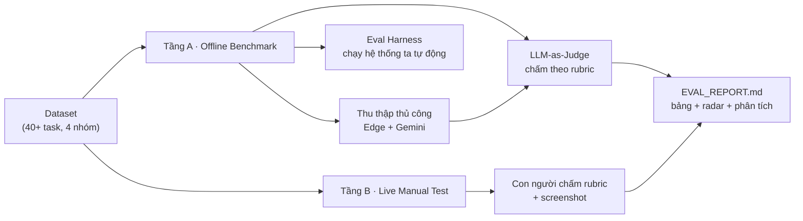
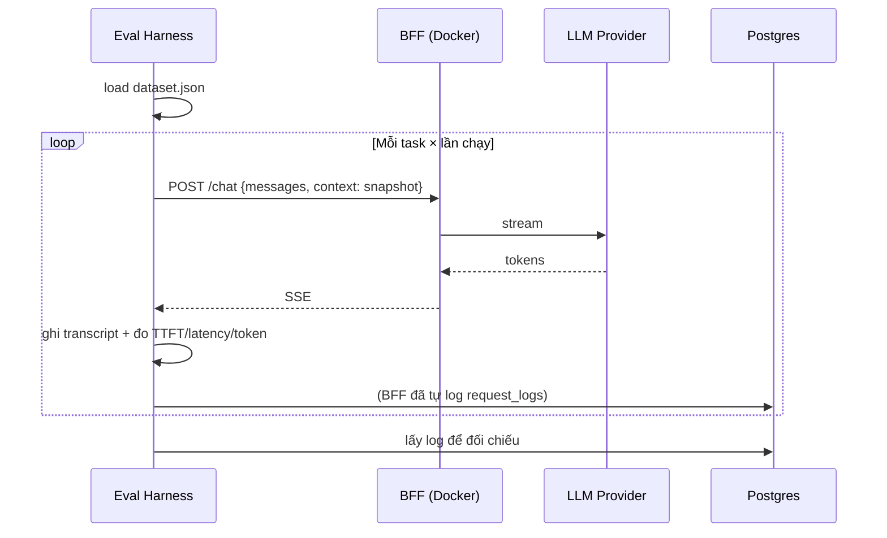

# Evaluation Plan — Sidekick AI vs Edge Copilot Sidebar vs Chrome Gemini Sidebar

**Version:** v1.4 · **Ngày:** 2026-11-09 · **Trạng thái:** Draft để thảo luận với giảng viên

---

## 1. Mục tiêu đánh giá

> **Lưu ý phạm vi:** phần eval này phục vụ **M2 — Advanced & Eval**, tức là **trước** khi workflow (M4) được implement. Nếu M4 không kịp, bỏ nhóm task `workflow` (§3.2.1) — kết luận eval vẫn hoàn chỉnh.

1. **Định lượng:** đo chất lượng câu trả lời, độ trễ, chi phí của 3 hệ thống trên cùng một bộ tác vụ, cùng ngữ cảnh trang.
2. **Định tính:** đánh giá trải nghiệm thực tế bằng rubric do con người chấm, có ảnh chụp màn hình.
3. **Minh bạch:** mọi điểm số đều truy được về transcript gốc và câu lệnh judge.
4. **Tái lập được:** người khác chạy lại `docker compose up && pnpm eval:run` là ra cùng kết quả (có seed, có version dataset).
5. **Công bằng:** điều khoản hóa những khác biệt không liên quan đến năng lực hệ thống (context, prompt, model class, số lần chạy).

### 1.1 Câu hỏi nghiên cứu (Research Questions)

| RQ | Câu hỏi | Metric chính |
|---|---|---|
| **RQ1** | Về chất lượng trả lời, Sidekick AI so với Edge Copilot và Chrome Gemini thì thế nào? | Overall rubric score (1–5) |
| **RQ2** | Trong các tác vụ **bám ngữ cảnh trang**, hệ thống nào grounded hơn? | Groundedness, Citation precision |
| **RQ3** | Đánh đổi **chất lượng ↔ độ trễ ↔ chi phí** ra sao? | TTFT, latency p50/p95, cost/task |
| **RQ4** | Ở nhóm tính năng **riêng tư / kiểm soát** (context theo domain, BYOK, log, self-host), hệ thống nào vượt trội? | Privacy transparency rubric |
| **RQ5** | Ngôn ngữ tiếng Việt có làm thay đổi thứ hạ không? | Per-language breakdown |
| **RQ6** | Người dùng thực (nếu có user study) đánh giá hệ thống nào tốt nhất? | CSAT / SUS / task time |

### 1.2 Điều KHÔNG nên tuyên bố

- ❌ "Hệ thống của chúng tôi tốt hơn Gemini" khi model nền khác nhau → phải ghi rõ phần đóng góp của *hạ tầng/tính năng* so với *model*.
- ❌ So sánh latency giữa hệ thống built-in (chạy trong browser, không qua network thêm) và extension (qua BFF local) mà không nêu điều kiện đo.
- ❌ Dùng nhiều prompt khác nhau cho mỗi hệ thống.
- ❌ Bỏ qua các task mà hệ thống ta thua — phải công bố đầy đủ.

---

## 2. Chiến lược 2 tầng



| | Tầng A — Offline Benchmark | Tầng B — Live Manual Test |
|---|---|---|
| **Mục đích** | Số liệu định lượng, tái lập được | Đánh giá trải nghiệm thực, tính năng, UX |
| **Đơn vị** | Task × hệ thống | Task × hệ thống (lặp lại, người chấm khác nhau) |
| **Chấm điểm** | LLM-as-judge (deterministic prompt, nhiệt độ 0) | Rubric do con người chấm, có bình chọn 2 người chấm độc lập |
| **Dữ liệu** | JSON tự động từ log hệ thống ta + transcript nhập tay | Screenshot + transcript |
| **Số lượng** | ≥ 40 task × 3 hệ thống × 3 lần = ≥ 360 lượt | ≥ 12 task × 3 hệ thống |
| **Công cụ** | `apps/eval/` harness (Node/TS) | Bảng rubric (Markdown sheet) |
| **Kết quả** | Bảng số + biểu đồ radar | Nhận xét định tính + ảnh |

---

## 3. Tập tác vụ (Dataset)

### 3.1 Cấu trúc

> **Contract đã hiện thực:** schema của 1 task nằm ở [`packages/shared/src/schemas/eval.ts`](../packages/shared/src/schemas/eval.ts) (`evalTaskSchema` — Zod) → dùng chung cho `apps/eval` (validate dataset) và server (sau này). Bản JSON bên dưới là **nguồn sự thật**; khi sửa 1 trong 2 → sửa cả 2.

```json
{
  "id": "pg-qa-001",
  "group": "page_qa",
  "lang": "vi",
  "page": {
    "url": "https://example.com/article",
    "title": "...",
    "snapshot_path": "eval/snapshots/article-2026-11-03.txt",
    "content_hash": "sha256:..."
  },
  "prompt": "Tóm tắt 5 ý chính của bài này và nêu 2 con số nổi bật.",
  "reference": {
    "key_points": ["...", "..."],
    "must_include_facts": ["87%", "..."],
    "must_not_contain": ["..."]
  },
  "expected_citations": 3,
  "tags": ["news", "vi"]
}
```

| Field | Bắt buộc | Kiểu | Ghi chú |
|---|---|---|---|
| `id` | ✅ | `string` | `<group>-<nguoi-tao>-<so>` |
| `group` | ✅ | enum 8 nhóm | xem §3.2 |
| `lang` | ✅ | `'vi' \| 'en'` | ≥ 40% tiếng Việt |
| `page.url` | ✅ | `string` (URL hợp lệ) | |
| `page.title` | ✅ | `string` | |
| `page.snapshot_path` | ✅ | `string` | tương đối repo root |
| `page.content_hash` | ✅ | `string` | phát hiện thay đổi snapshot |
| `prompt` | ✅ | `string` | |
| `reference.key_points` | ⬜ | `string[]` | |
| `reference.must_include_facts` | ⬜ | `string[]` | |
| `reference.must_not_contain` | ⬜ | `string[]` | |
| `expected_citations` | ⬜ | `number` (≥ 0) | metric citation precision |
| `tags` | ⬜ | `string[]` | |
| `notes` | ⬜ | `string` | VD provider limitation |

### 3.2 Bốn nhóm tác vụ

| Nhóm | Mã | Mô tả | Số task tối thiểu |
|---|---|---|---|
| **Page QA** | `page_qa` | Hỏi đáp dựa trên nội dung trang đang mở | 12 |
| **Summarize** | `summarize` | Tóm tắt, trích xuất danh sách, làm study guide/quiz | 10 |
| **Cross-tab compare** | `cross_tab` | So sánh/tổng hợp từ 2–3 tab | 10 |
| **Writing & analysis** | `writing` | Viết lại, dịch, so sánh phong cách, phân tích văn bản | 8 |
| *(bổ sung)* | `vision` | Hỏi về ảnh trên trang / **upload ảnh kèm câu hỏi** (T-M1-24: paste · drag-drop · file picker) | 4 |
| *(bổ sung)* | `doc_extract` | Đọc file PDF (text-based) — đối chiếu khả năng tương đương Edge Copilot (A20) | 2 |
| *(bổ sung)* | `video_transcript` | Tóm tắt video YouTube từ transcript — đối chiếu Chrome Gemini (B10) | 2 |
| *(bổ sung)* | `general_qa` | **Chat không cần trang/tài liệu** — hỏi đáp kiến thức chung, viết code, giải thích khái niệm (đo đường "chat thuần LLM" — FR-CONTEXT-13) | 4 |

**Tổng ≥ 52 task.** Mỗi nhóm có cả task tiếng Việt và tiếng Anh (≥ 40% tiếng Việt).

> **Contract đã hiện thực (2026-11-09):** 8 nhóm trên được khai báo bằng `EVAL_GROUPS` trong [`packages/shared/src/schemas/eval.ts`](../packages/shared/src/schemas/eval.ts) → `apps/eval` validate dataset bằng đúng danh sách này. Nhóm `workflow` (§3.2.1) **cố ý không có** trong `EVAL_GROUPS` — nó thuộc M4 và chỉ chạy khi đã implement workflow → thêm sau, không làm dataset M2 bị reject.

> **Nhóm `vision` cập nhật 2026-11-05 (T-M1-24):** giờ nhóm này đo **2 đường** khác nhau và phải tách số liệu khi tổng hợp:
> - **Đường A — upload ảnh (user chủ động đính kèm):** Sidekick AI hỗ trợ đầy đủ từ T-M1-24 (paste / drag-drop / file picker → Gemini `inline_data` hoặc OpenAI-compatible `image_url`). Edge Copilot (B17) và Chrome Gemini (A12) đều làm được → so sánh trực tiếp, công bằng.
> - **Đường B — ảnh nằm trong trang đang mở (không upload):** Sidekick AI **chưa** tự động lấy ảnh từ DOM (``) vào request → ở M1 chỉ làm được nếu user tải ảnh về rồi upload. Ghi rõ điều này vào `notes` của run để không bị bias khi đối chiếu A12.
> - **Ràng buộc provider:** task `vision` chỉ chạy được khi provider đang chọn hỗ trợ vision (Gemini / Groq / OpenRouter với model vision). Nếu provider không hỗ trợ → hệ thống trả `PROVIDER_VISION_UNSUPPORTED` → **không tính là điểm 0 của hệ thống**, mà ghi là "provider limitation" (ghi `provider` vào `notes` của task).
>
> **Nhóm `doc_extract` + `video_transcript` thêm 2026-11-04** do `FR-CONTEXT-05` (PDF) và `FR-CONTEXT-06` (YouTube) được nâng lên **Must** (T-M1-21/22) → cần số liệu đối chiếu trong `EVAL_REPORT.md`. 2 task mỗi nhóm (≥ 1 tiếng Việt) là mức tối thiểu để có số liệu; tăng nếu còn thời gian.
>
> **Nhóm `general_qa` thêm 2026-11-04 (T-M1-23):** trước T-M1-23, panel **tự** gửi nội dung tab active ở mọi lượt → không đo được đường "chat không cần context". Sau T-M1-23, Sidekick AI hỗ trợ đúng đường này (toggle context TẮT mặc định → request không có payload `context`). Nhóm này đo đường đó cho cả 3 hệ thống.
> - **Lưu ý công bằng:** ở M1, model của Sidekick **không** tự tra web (web search = FR-TOOLS-03, bật ở M2). Các task `general_qa` phải được chọn sao cho **kiến thức nằm trong pretrained model** (không cần tra cứu sự kiện mới nhất) → nếu không, cả 3 hệ thống đều thua → đo được "nguồn lực" chứ không phải "chất lượng". Ghi rõ điều này vào `notes` của run.

### 3.2.1 Nhóm `workflow` (M4 — chỉ chạy nếu đã implement workflow)

| Nhóm | Mã | Mô tả | Số task |
|---|---|---|---|
| **Workflow reliability** | `workflow` | Đo độ tin cậy của scheduler + workflow đã cài | 5 |

Cách đo riêng cho nhóm này (không dùng LLM judge — đây là hành vi hệ thống):

| Metric | Định nghĩa | Nguồn dữ liệu |
|---|---|---|
| `schedule_fire_accuracy` | % lần chạy đúng giờ (sai lệch ≤ 60s) | `workflow_runs.started_at` so với `trigger_spec` |
| `workflow_success_rate` | % run có `status = success` | `workflow_runs.status` |
| `step_completion_rate` | % bước chạy xong (không bị skipped) | `workflow_step_runs.status` |
| `approval_gate_compliance` | % hành động có tác dụng phụ **đã** dừng chờ xác nhận | `workflow_step_runs.approval_required` vs `approved_by_user` |
| `manual_vs_scheduled_parity` | Chênh lệch output giữa chạy thủ công và chạy theo lịch | So sánh 2 run cùng input |
| `resource_cost_per_run` | Token + cost + thời gian mỗi lần chạy | `workflow_runs` |

> **Lưu ý công bằng:** 2 hệ thống đối chiếu **không có** scheduler trong sidebar (Edge → M365 Copilot Tasks, cần license; Chrome → Gemini Apps, ngoài sidebar). Vì vậy nhóm này **không so sánh điểm với Edge/Gemini** — nó đo năng lực riêng của hệ thống ta, trình bày ở bảng riêng trong `EVAL_REPORT.md` và dùng làm điểm cộng về tính năng. Nếu không implement M4 → bỏ nhóm này, không ảnh hưởng các nhóm khác.

### 3.3 Nguồn trang thật

- Trang tài liệu/chính sách công khai (có số liệu kiểm chứng được).
- Bài blog kỹ thuật, trang docs, trang sản phẩm có bảng giá/spec.
- PDF công khai (kèm transcript fallback).
- Trang tiếng Việt (báo cáo, tài liệu nhà trường, blog).

**Quy tắc bất biến của dataset:** mỗi task có **một đáp án tham chiếu** (`key_points`, `must_include_facts`) để judge chấm được định lượng, không chỉ dựa vào cảm nhận.

### 3.4 Snapshot & tính tái lập

Nội dung trang có thể đổi theo thời gian → mỗi task lưu **snapshot text** tại thời điểm thu thập. Hệ thống của nhóm chạy trên snapshot đó; Edge/Gemini cũng phải chạy trên cùng trang (ghi rõ thời điểm). Nếu trang thay đổi giữa các lần chạy → ghi nhận vào `notes` của run.

#### 3.4.1 `context_hash` — khoá tái lập lượt chat (T-M1-06)

> Nguồn: [`SYSTEM_DESIGN.md`](SYSTEM_DESIGN.md) §7.3.5 · [`REQUIREMENTS.md`](REQUIREMENTS.md) FR-CONTEXT-12.

Mỗi lượt chat của hệ thống ta ghi 1 dòng `request_logs` với:

| Cột | Vai trò trong eval |
|---|---|
| `context_hash` | **Khoá tái lập**: hash deterministic của **context đã cắt ngân sách và đã gửi cho provider**. Cùng `context_hash` → cùng context → 2 lượt chat **cùng điều kiện đầu vào** |
| `context_snapshot` | Nội dung context đầy đủ (jsonb) — **mặc định TẮT** (`LOG_CONTEXT_SNAPSHOT`), bật khi cần truy vết chi tiết |

**Cách dùng trong eval harness:**

1. Chạy N lần cùng 1 task → lấy `context_hash` từ `request_logs` → **phải giống nhau** ở mọi lần (cùng context đã gửi).
2. So sánh 2 hệ thống (ta vs Edge/Gemini): dùng `context_hash` + `page_snapshot_hash` trong front-matter của transcript thủ công để **chứng minh** 2 hệ thống thực sự nhìn cùng nội dung trang → loại trừ bias "khác context".
3. Khi một lượt cho kết quả bất thường → bật `LOG_CONTEXT_SNAPSHOT=true` để dump đúng context đã gửi, tái lập lượt đó.

> **Không dùng cache extension làm nguồn sự thật cho eval.** Cache (`chrome.storage.local`, TTL 30 phút) chỉ là tối ưu trích xuất + fallback khi trang lỗi. Eval luôn dùng **snapshot trong dataset** để đảm bảo công bằng (xem §6.1: "dựng context từ snapshot (không đọc trang live)").

> **Lưu ý:** `context_hash` dùng FNV-1a 32-bit → xác định *cùng hay khác context*, **không** phải khoá mã hoá. Đừng dùng để bảo mật.

---

## 4. Rubric chấm điểm

### 4.1 Tiêu chí (thang 1–5)

| # | Tiêu chí | 1 | 3 | 5 |
|---|---|---|---|---|
| R1 | **Groundedness** — câu trả lời bám đúng nội dung nguồn, không bịa | Có thông tin sai lệch rõ rệt | Đúng chủ đề nhưng thiếu chi tiết/không rõ nguồn | Mọi thông tin đều có trong nguồn, không bịa |
| R2 | **Correctness / Relevance** — trả lời đúng câu hỏi | Trả lời lệch đề | Đúng ý chính | Trả lời đúng, đầy đủ, còn bổ sung hữu ích |
| R3 | **Completeness** — bao phủ hết các ý cần thiết | Thiếu phần lớn | Thiếu 1 ý phụ | Bao phủ hết `must_include_facts` |
| R4 | **Instruction following** — tuân thủ định dạng/ngôn ngữ/ràng buộc yêu cầu | Bỏ qua yêu cầu | Làm một phần | Tuân thủ đầy đủ (VD: tiếng Việt, ≤ 200 từ, 5 bullet) |
| R5 | **Citation quality** — trích dẫn đúng, có thể verify | Không có trích dẫn hoặc sai | Có trích dẫn nhưng chung chung/không bám đoạn | Trích dẫn cụ thể, trỏ đúng đoạn nguồn |
| R6 | **UX & Latency** — tốc độ cảm nhận, dễ đọc, định dạng đẹp | Rất chậm (>10s TTFT) hoặc định dạng hỏng | Chấp nhận được | Phản hồi tức thì, format rõ ràng |
| R7 | **Privacy transparency** — người dùng biết dữ liệu nào đang được dùng/chia sẻ | Không có dấu hiệu, không kiểm soát | Có dấu hiệu nhưng không tắt được | Chỉ rõ tab nào đang share, tắt được ngay lập tức, không gửi khi tắt |
| R8 | **Overall usefulness** — nếu là người dùng thật, tôi dùng tiếp? | Không dùng lại | Có thể dùng | Dùng hằng ngày |

**Điểm tổng:** trung bình trọng số (R1–R5 weight 2; R6–R8 weight 1) → quy đổi thang 100.

> **R6 (UX & Latency) — hỗ trợ bởi T-M1-07 (2026-11-06).** Tiêu chí R6 chấm **"định dạng đẹp / dễ đọc"** và **"phản hồi tức thì"** — T-M1-07 cung cấp nền tảng cho cả hai vế:
> - *Định dạng đẹp:* Markdown (GFM: heading, list, bảng, strikethrough, task list), code block có **nhãn ngôn ngữ + syntax highlight + copy 1-click**, bảng scroll ngang → format rõ ràng ở panel 320 px.
> - *Phản hồi tức thì:* `useDeferredValue` + **highlight defer khi streaming** → không jank, không nhấp nháy unhighlighted (NFR-PERF-02). TTFT đo ở Tầng A (metrics máy) — xem §7 (FC-9).
> - **Lưu ý:** R6 được chấm **bởi con người** ở Tầng B (xem ghi chú §4.4) → cần chụp **screenshot** panel sau khi có câu trả lời có code block + bảng để chấm "định dạng đẹp".

> **R5 (Citation quality) — hỗ trợ bởi T-M1-08 (2026-11-06).** T-M1-08 cho phép **verify trích dẫn bằng máy**: server lưu `snippet` của từng nguồn được trích dẫn vào bảng `citations` → judge LLM đối chiếu `snippet` với claim → chấm được mức "trỏ **đúng đoạn**" thay vì chỉ "có trích dẫn". Định nghĩa đo chi tiết ở §5.1.1.
> - **Khi chấm thủ công (Tầng B):** ảnh chụp panel phải **bấm vào chip `[N]`** để mở popover → có ảnh popover đoạn nguồn làm bằng chứng cho R5 của Sidekick.

### 4.2 Trọng số theo nhóm tác vụ

| Nhóm | Trọng số rubric |
|---|---|
| `page_qa` | R1, R2, R3, R5 nặng nhất |
| `summarize` | R1, R3, R4 |
| `cross_tab` | R1, R2, R5 (citation chéo nguồn) |
| `writing` | R2, R4, R6 |
| `vision` | R1, R2 |

### 4.2.1 Ngoài phạm vi đo — onboarding (FR-UX-02, T-M1-25)

> **Onboarding KHÔNG nằm trong rubric eval.**

| Lý do | Giải thích |
|---|---|
| Đồ án đo **chất lượng chat**, không đo **setup** | Rubric R1–R8 chấm *câu trả lời* (groundedness, correctness, citation, instruction following…). Onboarding là màn hình thiết lập 1 lần, không sinh ra câu trả lời nào để chấm. |
| Không công bằng | Edge Copilot / Chrome Gemini không có onboarding 3 bước kiểu này → đưa vào rubric sẽ so sánh "màn hình setup" với "không có màn hình setup" → lệch tiêu chí đo. |
| Không chấm được bằng số | Trạng thái onboarding là biến boolean trong `chrome.storage.local` — không có metric định lượng tự nhiên (không TTFT, không cost, không citation). |

Cách đối chiếu onboarding **không tính điểm số** → dùng **ảnh chụp màn hình** trong phần Tầng B (live manual test) như một dòng mô tả tính năng ở bảng "Tính năng mở cho mọi người" (§8.1 Bảng 1), **không** đưa vào điểm trung bình.

| Mục | Giá trị |
|---|---|
| Edge Copilot | Không có onboarding kiểu này (mở panel là vào thẳng chat) |
| Chrome Gemini | Không có onboarding kiểu này (mở panel là vào thẳng chat) |
| Sidekick AI | ✅ 3 bước lần đầu (T-M1-25) — quyền → chọn provider/BYOK → thử câu hỏi · skippable |

> Việc cấu hình provider trước khi chat là **tiền đề** của mọi task eval — eval harness luôn dùng sẵn key (K1 env hoặc K2 đã lưu từ onboarding) và **không** tính thời gian setup vào `latency_total_ms`.

### 4.3 Judge prompt (bản dùng thật)

System prompt:

```text
You are a strict, impartial evaluator of AI assistants.

You will be given:
- a USER QUESTION
- the SOURCE MATERIAL (ground truth context)
- the ASSISTANT RESPONSE to score

Score the response on these criteria, each 1-5:
R1 Groundedness, R2 Correctness/Relevance, R3 Completeness,
R4 Instruction following, R5 Citation quality, R7 Privacy transparency.

Rules:
- Use ONLY the SOURCE MATERIAL to verify factual claims. If a claim is not
  supported by the source, lower R1 and R2.
- The source is the ground truth, not your own world knowledge.
- Score the RESPONSE AS SHOWN, not what you imagine the model intended.
- Be strict but consistent: apply the same bar to every response.
- Do not reward length or formatting over substance.
- Return STRICT JSON, no prose outside it.

Output schema:
{
  "scores": {"R1": int, "R2": int, "R3": int, "R4": int, "R5": int, "R7": int},
  "missing_key_points": ["..."],
  "hallucinated_claims": ["..."],
  "citation_check": {"cited": int, "verified": int},
  "reasoning": "<=120 words, one short paragraph>"
}
```

> **Lưu ý:** R6 (UX/Latency) và R8 (Overall) được chấm **bởi con người** ở Tầng B, vì judge LLM không quan sát được độ trễ hay cảm nhận thị giác.

### 4.4 Kiểm chứng độ tin cậy của judge

- **Human–LLM agreement**: 20% task được chấm cả bởi 2 người và bởi judge → báo cáo **Pearson r** và **Spearman ρ** giữa điểm người và điểm judge. Mục tiêu ρ ≥ 0.6.
- **Inter-human agreement**: 2 người chấm độc lập → Cohen's κ hoặc ICC ≥ 0.6.
- **Judge swap**: chạy 2 judge model khác nhau trên 30% task → kiểm tra độ ổn định điểm.
- Nếu ρ < 0.6 → phải hiện cảnh báo trong báo cáo và tăng tỉ lệ chấm tay.

---

## 5. Metrics định lượng

### 5.1 Chất lượng

| Metric | Định nghĩa |
|---|---|
| `overall_score` | Điểm rubric tổng hợp (0–100), trung bình trọng số theo nhóm |
| `groundedness_rate` | % claim trong `must_include_facts` được hỗ trợ bởi nguồn |
| `citation_precision` | Trong các trích dẫn, % trỏ đúng đoạn nguồn |
| `citation_recall` | % số trích dẫn kỳ vọng (`expected_citations`) được cung cấp |
| `hallucination_rate` | Số claim không có trong nguồn / tổng claim kiểm chứng được |
| `task_success_rate` | % task đạt ≥ 4.0 ở R1, R2, R3 |

#### 5.1.1 Đo `citation_precision` / `citation_recall` với cơ chế T-M1-08 (2026-11-06)

Cơ chế đã implement: LLM trả marker `[N]` trong câu trả lời → server parse (`packages/shared/src/citation.ts`) → **loại số vượt phạm vi** → SSE `citation` (kèm `idx`, `url`, `title`, `snippet`, `tabId`) → extension render chip `[N]` + popover đoạn nguồn.

| Metric | Cách đo trên output Sidekick | Ánh xạ metric của Edge/Gemini |
|---|---|---|
| `citation_recall` | Số marker `[N]` **hợp lệ** trong câu trả lời ÷ `expected_citations` | Edge: đếm số nguồn được trích dẫn trong câu trả lời (dạng số đoạn) · Gemini: đếm số tham chiếu hiển thị |
| `citation_precision` | Trong các citation nhận được, % mà `snippet` **thực sự chứa** nội dung hỗ trợ claim được trích dẫn (judge LLM đối chiếu `snippet` với claim) | Cùng cách — nhưng Edge/Gemini **không** công bộ đoạn nguồn → chỉ chấm được mức "có trỏ đúng nguồn hay không", ta chấm được mức chặt hơn (đúng **đoạn**) |
| `hallucination_rate` | Claim **không** có marker `[N]` nào bám theo → tính vào claim không được hỗ trợ | Tương đương |

> **Lưu ý công bằng khi so sánh:** Edge Copilot / Chrome Gemini hiển thị trích dẫn ở dạng **số đoạn/số nguồn** (không mở được đoạn nguồn để đối chiếu). Vì lậy trong `EVAL_REPORT.md` (deliverable M2 — T-M2-17) phải ghi rõ:
> 1. `citation_precision` của ta đo **chặt hơn** (đúng đoạn nguồn) → **không** so sánh thẳng điểm tuyệt đối với Edge/Gemini nếu hệ thống đối chiếu không mở được đoạn.
> 2. Metric **cùng định nghĩa** cho cả 3 hệ thống phải là `citation_recall` (số trích dẫn kỳ vọng có mặt) → đây mới là phép so sánh công bằng.
> 3. Marker `[N]` **không** phải thứ Edge/Gemini dùng → khi chấm thủ công, **bỏ qua** phần hiển thị của ta (chip) để chấm nội dung câu trả lời như nhau.

### 5.2 Hiệu năng

| Metric | Cách đo |
|---|---|
| `ttft_ms` | Từ lúc gửi request → token đầu tiên nhận được (client-side timestamp) |
| `latency_total_ms` | Từ gửi → stream kết thúc |
| `tokens_per_second` | Tổng token out / (thời gian stream) |
| `p50 / p95` | Qua tất cả task, theo từng hệ thống |
| `ui_fps` | Frame rate khi render streaming (Chrome DevTools/Performance API) |

**Điều kiện đo (bắt buộc ghi trong báo cáo):**
- Máy: CPU/RAM cụ thể, mạng (Wi-Fi hay LAN), có/không có VPN.
- Provider mà hệ thống ta dùng + model.
- Với Edge/Gemini: đo bằng timestamp trên **video quay màn hình** hoặc Performance panel → ghi rõ độ chính xác (±100ms).

### 5.3 Chi phí & tài nguyên

| Metric |
|---|
| `tokens_in` / `tokens_out` mỗi lượt |
| `cost_usd` mỗi lượt (theo bảng giá provider tại thời điểm đo) |
| `cost_per_correct_task` = tổng cost / số task đạt ≥ 4.0 |
| `bff_memory_mb`, `bff_cpu` (đo khi chạy Docker) |

#### 5.3.1 Nguồn sự thật của metric: bảng `request_logs` (T-M1-14 ✅)

Từ T-M1-14, **mọi lượt chat đều tự ghi 1 dòng** vào `request_logs` (thành công **và** thất bại). Harness **không** tự đo lại token / cost / latency — nó **đọc** từ bảng này:

| Metric trong báo cáo | Nguồn | Ghi chú |
|---|---|---|
| `tokens_in` / `tokens_out` | `request_logs.tokens_in` · `tokens_out` | Do provider báo, không suy đoán |
| `cost_usd` | `request_logs.cost_usd` | **Ước lượng** theo `PROVIDER_PRICING` (xem cảnh báo bên dưới) |
| `ttft_ms` | `request_logs.ttft_ms` | Đo server-side (nhận token đầu tiên từ provider) |
| `latency_total_ms` | `request_logs.latency_ms` | Đo server-side (tới khi stream kết thúc) |
| `error` | `request_logs.error` | Error code chuẩn — dùng để tính `success_rate` |
| `tool_call_count` | `request_logs.tool_calls` | Luôn `0` ở M1 (tool thật ở M2) |

**Cách đọc (đã implement):**

```bash
# Xem các dòng log gần đây + tổng
pnpm eval:run logs -- --limit 20

# Tổng hợp usage theo ngày
curl -s "$BFF/api/usage?from=2026-11-01&to=2026-11-07"
```

> **API đọc log chỉ trả metadata** (`GET /api/logs`, `GET /api/usage`) — không có `prompt_text` / `response_text` / `context_snapshot`. Transcript đầy đủ vẫn do harness ghi vào `apps/eval/results/ours/<run_id>/<task_id>.json`.

> **Cảnh báo về chi phí (bắt buộc ghi trong `EVAL_REPORT.md`):**
> `cost_usd` được tính từ **bảng giá snapshot** trong `packages/shared/src/pricing.ts` (`PROVIDER_PRICING`), **không** phải hoá đơn thực tế từ provider. Vì vậy:
> 1. Báo cáo **phải** nêu rõ giá đã dùng (provider + model + USD/1M token input/output) tại thời điểm đo.
> 2. Nếu provider đổi giá → cập nhật `PROVIDER_PRICING` rồi **tính lại** phần chi phí (không cần chạy lại toàn bộ eval).
> 3. So sánh **chi phí với Edge Copilot / Chrome Gemini** là **ước lượng** ở cả hai phía → phải ghi rõ phương pháp ước lượng cho từng phía, không được trình bày như số đo của provider.

> **Retention 90 ngày** (`LOG_RETENTION_DAYS`) → log cũ hơn 90 ngày bị xoá tự động. Khi chốt báo cáo, **export** kết quả ra `apps/eval/results/` (bị git-ignore) trước khi bị prune.

---

## 6. Quy trình thu thập dữ liệu

### 6.1 Hệ thống của nhóm (tự động)



Harness (`eval/runners/ours.ts`):
- Nạp `apps/eval/dataset/tasks.json`
- Với mỗi task: dựng context từ **snapshot** (không đọc trang live → đảm bảo công bằng & tái lập)
- Gọi `POST /chat` của BFF, đo thời gian, đếm token
- Ghi `apps/eval/results/ours/<run_id>/<task_id>.json` với transcript đầy đủ
- Retry tối đa 2 lần khi lỗi mạng; đánh dấu `status: error` thay vì lặp vô hạn

### 6.2 Edge Copilot & Chrome Gemini (thủ công — không có API)

Vì hai hệ thống này **built-in, không có API, không cho export transcript**, cần quy trình thu thập chuẩn hoá:

**Bước 1 — Chuẩn bị**
1. Mở đúng trang của task (có snapshot kèm theo).
2. Bật **Context Clues** (Edge) / giữ **share tab** (Chrome) → tương đương với việc ta bật context.
3. Bật chế độ **không dùng lịch sử chat** để match điều kiện của ta.

**Bước 2 — Chạy**
4. Dán **đúng prompt** của task (copy từ `tasks.json`, không sửa).
5. **Ghi lại màn hình** (OBS / screen recording) để đo latency và lấy ảnh minh hoạ.
6. Copy **toàn bộ câu trả lời** (kể cả phần citation/trích dẫn nếu hiển thị) vào clipboard.

**Bước 3 — Nhập về format chuẩn**
7. Dán vào `apps/eval/results/manual/<system>/<task_id>.md` theo template:

```markdown
---
task_id: pg-qa-001
system: edge_copilot
run: 1
model: "Copilot (model không công khai)"
page_url: https://example.com/article
page_snapshot_hash: sha256:...
started_at: 2026-11-03T10:00:00+07:00
ttft_ms: ~1200        # ước lượng từ video
latency_total_ms: ~8000
notes: "Không có citation dạng link, chỉ có số đoạn"
---

## PROMPT
<prompt đúng dùng>

## RESPONSE
<toàn bộ câu trả lời, giữ nguyên format>
```

8. Chạy `pnpm eval:import -- --system edge_copilot --run 1` để chuẩn hoá về JSON.

**Bước 4 — Lặp lại**
- Mỗi task chạy **3 lần** (`run: 1|2|3`) → tính trung bình + độ lệch, tránh ảnh hưởng của tính ngẫu nhiên.
- Ưu tiên **task của cùng một người** (một thành viên nhóm) để giảm biến thiên giữa người chấm/thao tác.

**Giảm thiểu bias:**
- **Blind judging**: file transcript của hệ thống ta được đặt tên ngẫu nhiên (`system_A` / `system_B` / `system_C`) trước khi đưa cho judge.
- **Thứ tự ngẫu nhiên**: thứ tự hiển thị task ngẫu nhiên cố định bằng seed.
- **Không sửa prompt**: nếu hệ thống bị lỗi, chấp nhận lỗi và ghi `status: error` — không retry "cải thiện".

### 6.3 Tự động hoá dần (nếu có thời gian)

- **Playwright + Chrome for Testing** trong Docker Compose → mở side panel extension, gõ prompt, chụp DOM → tự động hoá phần của hệ thống ta.
- Với Edge/Chrome built-in: Playwright **không** điều khiển được UI của assistant → vẫn phải thủ công, nhưng có thể dùng script để lấy timestamp từ video.
- Phương án thay thế: dùng **Gemini API / Edge không có API** → với Chrome Gemini, có thể dùng Gemini API với cùng model để đại diện "model capability", tách biệt đánh giá **UX layer** và **model layer**. Đây là phân tích rất đáng làm cho báo cáo.

---

## 7. Công cụ & cấu trúc repo eval

> **Cập nhật 2026-11-11 (T-M2-12/13/14)** — cây thư mục dưới đây **khớp code thật**. Chi tiết thiết kế: [`SYSTEM_DESIGN.md`](SYSTEM_DESIGN.md) §7.28.

```text
apps/eval/
├─ dataset/
│  ├─ tasks.json              # 52 task / 8 nhóm (T-M2-12)
│  ├─ dataset_meta.json       # version, ngày, URL nguồn, license, checksum
│  ├─ snapshots/              # 47 file text — nội dung trang đóng băng
│  └─ assets/                 # 4 ảnh PNG nhỏ cho nhóm `vision`
├─ scripts/
│  └─ build-tasks.mjs         # script sinh lại `tasks.json`
├─ src/
│  ├─ cli.ts                  # dispatcher: collect | run | judge | report | logs
│  ├─ cliFlags.ts             # parse cờ CLI dùng chung (readFlag/readNumberFlag/…)
│  ├─ commands/               # 1 file = 1 subcommand (mỗi file < 300 dòng)
│  │  ├─ collect.ts
│  │  ├─ run.ts
│  │  ├─ judge.ts
│  │  ├─ report.ts
│  │  └─ logs.ts
│  ├─ logs.ts                 # fetchLogs() + fetchUsage() + summarizeLogs() (T-M1-14)
│  ├─ dataset.ts              # loader + validate bằng `evalTaskSchema`
│  ├─ types.ts                # re-export từ `@sidekick/shared`
│  ├─ snapshot.ts             # htmlToText() + sha256 + đọc/ghi snapshot
│  ├─ collect.ts              # thu thập trang thật (45 nguồn)
│  ├─ sse.ts                  # SSE client Node (đo TTFT/latency)
│  ├─ runners/
│  │  └─ ours.ts              # gọi BFF của nhóm + ghi transcript
│  ├─ judge/
│  │  ├─ prompt.ts            # rubric + prompt judge (§4.3)
│  │  ├─ blind.ts             # blind map deterministic (FC-6)
│  │  └─ run_judge.ts         # gọi LLM judge, temperature 0
│  ├─ metrics/
│  │  └─ aggregate.ts         # overall, p50/p95, success rate, cost
│  ├─ results/
│  │  └─ judgeStore.ts        # kiểu + đọc/ghi kết quả judge (trung lập)
│  └─ ...
├─ results/                   # ⚠️ git-ignore — dữ liệu thô
│  ├─ ours/<run_id>/          # transcript hệ thống của nhóm
│  ├─ judged/<run_id>/        # điểm judge
│  └─ <run_id>/blind_map.json # map thật ↔ nhãn giả (mở sau khi chấm)
├─ reports/
│  └─ summary-<run_id>.json   # ✅ commit — bản tổng hợp
└─ tests/                     # snapshot · datasetQuality · aggregate · judge · blind · sse · cliFlags · mergeRuns
```

> Đường dẫn repo là monorepo pnpm: `apps/eval/`. Bản `docs/EVAL_REPORT.md` được **commit** vào repo; `apps/eval/results/**` bị git-ignore (dữ liệu thô) — chỉ `apps/eval/reports/summary-*.json` được commit.

### 7.1 Lệnh vận hành

```bash
# 0. Đọc log đã ghi (metadata) — dùng để đối chiếu metric
pnpm eval:run logs --limit 20

# 1. Thu thập snapshot trang thật (idempotent — chạy lại không hỏng dataset)
pnpm eval:collect

# 2. Chạy hệ thống của nhóm trên dataset (n=3 theo FC-5)
pnpm eval:run -- run --runs 3 --provider gemini --model gemini-2.5-flash

# 3. Chấm điểm bằng LLM judge (temperature 0 + blind mapping)
pnpm eval:judge -- --run <run_id>

# 4. Tổng hợp + sinh báo cáo
pnpm eval:report -- --run <run_id>
```

**Lệnh dùng khi BFF chưa chạy / Docker tắt:** `pnpm eval:run -- run --dry-run` — in kế hoạch chạy, **không** gọi mạng.

**Yêu cầu môi trường:** BFF đang chạy ở `http://127.0.0.1:8787` (đổi bằng `--base-url` hoặc env `SIDECKICK_BFF_URL`) + Postgres (Docker Compose) + **key provider** trong `apps/server/.env`.

#### 7.1.1 Cờ của subcommand `run`

| Cờ | Mặc định | Ý nghĩa |
|---|---|---|
| `--run-id <id>` | `run-<ngày>-<uuid6>` | Tên thư mục kết quả. Dùng lại id cũ + `--merge` để chạy tiếp. |
| `--runs <n>` | `EVAL_RUNS_PER_TASK` = 3 | Số lần chạy mỗi task (FC-5). |
| `--tasks <a,b,…>` | tất cả | Chỉ chạy các task id này (danh sách phân tách bằng **phẩy hoặc khoảng trắng** — một số shell biến phẩy thành khoảng trắng). |
| `--group <g>` / `--lang <l>` | — | Lọc theo nhóm task / ngôn ngữ. |
| `--limit <n>` | — | Giới hạn số task (chạy thử). |
| `--provider` / `--model` | `gemini` / `gemini-2.5-flash` | Provider + model đo. |
| `--base-url <url>` | `http://127.0.0.1:8787` | BFF. |
| `--delay <ms>` | `1500` | **Nghỉ giữa 2 lượt** — provider free tier (Gemini) giới hạn RPM. |
| `--merge` | tắt | Gộp kết quả vào run cũ: lượt **mới thành công** ghi đè lượt lỗi, lượt **đã thành công** được giữ nguyên. |
| `--dry-run` | tắt | Chỉ in kế hoạch, không gọi BFF. |

> **`--merge` chỉ chạy lại lượt bị lỗi.** Provider free tier rất hạn chế (Gemini 429 quota · Groq 413/TPM · OpenRouter 402 hạn mức ngày) → chạy lại toàn bộ sẽ vừa tốn quota vừa có nguy cơ đè kết quả tốt đã có. Khi gặp lỗi provider tạm thời, chạy lại đúng lệnh cũ kèm `--merge` là đủ.

### 7.2 Blind labeling

Trước khi judge, mapping thật → nhãn giả được lưu ở `apps/eval/results/<run_id>/blind_map.json` (chỉ mở sau khi chấm xong). Judge chỉ nhận nhãn giả.

- Map **deterministic** theo seed (FNV-1a) → cùng `run_id` cho ra cùng map → **tái lập được** (không random thuần → không tái lập metric).
- Nhãn dùng trong judge: `system_A` · `system_B` · `system_C` (3 hệ thống: Sidekick · Edge Copilot · Chrome Gemini).
- Quan hệ **1-1** → mỗi hệ thống đúng 1 nhãn.

---

## 8. Công bố kết quả

### 8.1 Template bảng chính (`docs/EVAL_REPORT.md`)

**Bảng 1 — Tính năng mở cho mọi người (free tier / không cần gói thuê bao):**

| Tiêu chí | Edge Copilot | Chrome Gemini | Sidekick AI |
|---|---|---|---|
| Overall (0–100) | x.x | x.x | x.x |
| Groundedness (1–5) | x.x | x.x | x.x |
| Correctness / Relevance | x.x | x.x | x.x |
| Completeness | x.x | x.x | x.x |
| Instruction following | x.x | x.x | x.x |
| Citation quality | x.x | x.x | x.x |
| Privacy transparency | x.x | x.x | x.x |
| UX & Latency (human) | x.x | x.x | x.x |
| Task success rate (%) | x% | x% | x% |
| Hallucination rate (%) | x% | x% | x% |
| TTFT p50 / p95 (ms) | x / x | x / x | x / x |
| Total latency p50 / p95 (ms) | x / x | x / x | x / x |
| Tokens/task (in+out) | n/a | n/a | x |
| Cost/task (USD) | n/a | n/a | $x.xxx |

**Bảng 2 — Tính năng bị gate theo gói / điều kiện (chấm riêng, đánh dấu N/A nếu không đủ điều kiện):**

| Tính năng | Edge Copilot | Chrome Gemini | Sidekick AI |
|---|---|---|---|
| Voice chat | N/A (cần M365) | ✅ | ➖ (chưa triển khai) |
| Screen sharing / Vision | N/A (cần M365) | ➖ | ⚠️ (screenshot vùng) |
| Upload ảnh (vision input) | ✅ (B17) | ✅ (A12) | ✅ (T-M1-24 — Gemini + Groq/OpenRouter · ⚠️ provider không hỗ trợ vision → fallback hoặc `PROVIDER_VISION_UNSUPPORTED`) |
| Agentic browse | ✅ Actions | N/A (cần AI Pro/Ultra) | ⚠️ (cần xác nhận) |
| Skills | ➖ | ✅ (cần Chrome ≥ 147, en-US, không managed account) | ✅ (không ràng buộc) |
| Image generation | ✅ | ✅ | ➖ (M2, tùy provider) |
| Connected apps | ✅ (M365) | ✅ | ➖ (qua MCP) |

**Bảng 3 — Năng lực hệ thống (không phụ thuộc tài khoản hãng):**

| Hạng mục | Edge Copilot | Chrome Gemini | Sidekick AI |
|---|---|---|---|
| Chọn được model | ❌ | ❌ | ✅ |
| Tự mang API key | ❌ | ❌ | ✅ |
| Self-host / chạy offline | ❌ | ❌ | ✅ |
| MCP tools | ❌ | ❌ | ✅ |
| Request log cho audit | ❌ | ❌ | ✅ |
| Token & cost visibility | ❌ | ❌ | ✅ |
| Context theo từng domain | ⚠️ (global) | ❌ | ✅ |

### 8.2 Biểu đồ

- **Radar chart** 8 tiêu chí rubric × 3 hệ thống.
- **Bar chart** TTFT p50/p95 và total latency.
- **Stacked bar** thành phần điểm rubric.
- **Scatter** quality (overall) vs latency vs cost → vị trí của mỗi hệ thống.

### 8.3 Kết luận bắt buộc phải có

1. Ở hạng mục nào chúng ta **thắng**, ở hạng mục nào **thua**, và **vì sao** (phân rã nguyên nhân: model vs UI vs tool vs context).
2. Phần nào do **hạn chế model free tier** → nêu rõ và dự kiến cải thiện thế nào nếu dùng key trả phí.
3. Hệ thống đắt nhất tính theo **cost per correct task**.
4. Đề xuất cải thiện cụ thể cho 3–5 hạng mục thấp nhất (dựa trên `hallucinated_claims` và `missing_key_points`).
5. Với các tính năng bị gate (M365 / AI Pro), nêu rõ hệ thống nào bị giới hạn và ảnh hưởng bao nhiêu phần trăm điểm tổng.

---

## 9. Kiểm soát công bằng (Fairness controls) — checklist bắt buộc

| # | Control | Cách thực hiện | Nơi ghi |
|---|---|---|---|
| FC-1 | Cùng prompt | Copy nguyên văn từ `tasks.json` | mọi file transcript |
| FC-2 | Cùng ngữ cảnh | Dùng snapshot cho hệ thống ta; hệ thống built-in mở đúng trang đó | `snapshot_hash` |
| FC-3 | Cùng model class | Chọn provider/model gần nhất với Gemini (VD: Gemini API 2.5 Pro) để so với Chrome Gemini | `meta.json` |
| FC-4 | Không dùng lịch sử chat | Tắt context lịch sử ở cả 3 hệ thống (Edge: tắt Context Clues history; Chrome: bắt đầu chat mới) | `notes` |
| FC-5 | Nhiều lần chạy | n=3, báo cáo trung bình + độ lệch chuẩn | `run` |
| FC-6 | Blind judging | Nhãn giả ngẫu nhiên | `blind_map.json` |
| FC-7 | Cùng điều kiện đo | Cùng máy, cùng mạng, cùng thời điểm trong ngày | §5.2 |
| FC-8 | Cùng người thao tác | Một thành viên nhóm chịu trách nhiệm chạy Edge/Gemini | `operator` |
| FC-9 | Điều kiện phụ thuộc hệ sinh thái được ghi rõ | M365-only, AI-Pro-only, yêu cầu đăng nhập Google/Microsft được đánh dấu | `notes` |
| FC-10 | Công khai giới hạn | Mục 1.2 + §8.3 | `EVAL_REPORT.md` |
| FC-11 | Tính năng bị gate theo gói tính **đánh dấu N/A, không tính 0** | VD: Copilot Voice (chỉ M365), Auto Browse (chỉ AI Pro/Ultra), Skills (chỉ Chrome ≥ 147 + en-US) → ghi "N/A (cần M365)" thay vì 0 điểm | `notes`, bảng kết quả |
| FC-12 | **Trạng thái context giống nhau** (thêm 2026-11-04 — T-M1-23) | Ghi rõ từng lượt: lượt nào **có** đính kèm trang/tài liệu, lượt nào **không**. Với Sidekick: toggle context **TẮT** + không đính kèm → request không có payload `context`. Với Edge/Gemini: tắt context / bắt đầu chat mới trước khi hỏi. Không so sánh "Edge/Gemini share tab mặc định" với "Sidekick đính kèm chủ động" như cùng một hành vi | `notes` (mỗi task), `dataset_meta.json` |
| FC-13 | **Cách hiển thị trích dẫn khác nhau** (thêm 2026-11-06 — T-M1-08) | Sidekick hiển thị chip `[N]` + popover đoạn nguồn; Edge/Gemini hiển thị **số nguồn/đoạn**. Khi chấm, **đếm số trích dẫn** (`citation_recall`) chứ **không** chấm khác biệt về hình thức hiển thị; `citation_precision` chỉ so sánh được nếu cả 3 hệ thống đều mở được đoạn nguồn — nếu không → đánh dấu **N/A (không mở được đoạn)** thay vì tính 0 | `notes` (mỗi task), `EVAL_REPORT.md` §5 |

> **Lưu ý về tính công bằng:** điểm 0 cho một tính năng bị khóa theo gói thuê bao sẽ làm kết quả thiên lệch về phía hệ thống ta (hệ thống ta cho mọi tính năng với user free). Cách xử lý đúng: tách bảng kết quả thành **"tính năng mở cho mọi người"** và **"tính năng bị gate"**, chấm riêng từng bảng, và nêu rõ trong kết luận.

> **Lưu ý về cơ chế context (FC-12, T-M1-23):** Sidekick AI dùng mô hình **đính kèm chủ động** (toggle mặc định TẮT), còn Edge Copilot / Chrome Gemini **mặc định share tab**. Đây là khác biệt thiết kế có chủ ý, không phải thiếu sót. Cách so sánh công bằng:
> 1. Với task `page_qa` / `summarize` / `cross_tab` / `doc_extract` / `video_transcript` → **cả 3 hệ thống** đều phải có cùng nguồn context → ghi rõ nguồn trong `notes`.
> 2. Với task `general_qa` → **cả 3 hệ thống** đều **không** có context ngoài lịch sử hội thoại → đây là nơi Sidekick có lợi thế về "không gửi gì thừa" nhưng cũng là nơi Edge/Gemini có lợi thế nếu đã bật web search.
> 3. Trong phần kết luận (`EVAL_REPORT.md` §8.3) phải nêu rõ **cơ chế** của từng hệ thống, không để người đọc tưởng Sidekick "quên" gửi context.

---

## 10. Kế hoạch triển khai Eval

> **Mốc:** phần Eval nằm hoàn toàn trong **M2** và là **deliverable bắt buộc** cho giảng viên. Nhóm `workflow` (đánh giá scheduler) chỉ chạy ở **M4** — nếu M4 không được implement thì **bỏ hẳn nhóm đó** khỏi dataset, đánh số task từ 44 xuống còn 40 và ghi rõ trong báo cáo. Xem [`REQUIREMENTS.md`](REQUIREMENTS.md) §9.3–9.4.

| Tuần | Công việc | Đầu ra |
|---|---|---|
| W1 (M2 đầu) | Soạn dataset 52 task + snapshot trang + `must_include_facts` | `tasks.json` v1.0 |
| W1 | Viết harness `runners/ours.ts` + `aggregate.ts` | Chạy được trên hệ thống ta |
| W2 | Thu thập thủ công Edge + Gemini (n=3) | `results/manual/**` |
| W2 | Viết judge prompt + `run_judge.ts` + chạy judge | `results/judged/**` |
| W3 | Chấm tay Tầng B (12 task × 3 hệ thống, 2 người) | `human_rubric.csv` |
| W3 | Tổng hợp, sinh báo cáo + radar chart | `EVAL_REPORT.md` draft |
| W4 | Kiểm chứng judge (ρ, κ), viết kết luận & đề xuất | `EVAL_REPORT.md` final |
| *(M4, tuỳ chọn)* | Thu thập + chấm nhóm task `workflow` | `apps/eval/results/manual/workflow/**` |

**Deliverable cho thầy:**
1. `docs/EVAL_REPORT.md` — bảng, biểu đồ, phân tích, kết luận
2. `apps/eval/` — harness tái lập được (`docker compose up && pnpm eval:run`)
3. `apps/eval/dataset/tasks.json` — dataset có version
4. Ảnh chụp màn hình 3 hệ thống trên cùng task
5. Slide tóm tắt 2–3 trang

---

## 11. Rủi ro của phần Eval & phương án dự phòng

| Rủi ro | Ảnh hưởng | Dự phòng |
|---|---|---|
| Thu thập transcript thủ công tốn thời gian | Có | Ưu tiên 20 task cốt lõi × n=3 thay vì 52 task × n=3; tự động hoá phần của hệ thống ta trước |
| Không đo được latency chính xác của built-in | Medium | Đo từ video quay màn hình, ghi rõ sai số ±150ms |
| Model free tier kém hơn → thua rõ | Cao | Bổ sung "điểm hạ tầng/tính năng" (privacy, BYOK, MCP, log, self-host) vào bảng so sánh; phân tích theo 2 nhóm: *model capability* vs *assistant system* |
| Judge LLM thiên lệch về câu trả lời dài/đẹp | Cao | Blind labeling + prompt chặt + kiểm chứng với human score + câu hỏi đối chiếu độ dài |
| Edge/Gemini yêu cầu tài khoản phí (M365 / AI Pro) | Trung bình | Dùng tài khoản free; tính năng gate bị loại thì đánh dấu "N/A" thay vì tính 0 — và nói rõ trong báo cáo |
| Không có user study | Thấp | Chấp nhận; bổ sung self-assessment của 3–5 người trong nhóm dùng thử 1 tuần |

---

## 12. Phụ lục — Checklist bắt đầu Eval

- [ ] Dataset ≥ 48 task, có `must_include_facts` cho ≥ 80% task
- [ ] ≥ 40% task tiếng Việt
- [ ] Có nhóm `doc_extract` (PDF) và `video_transcript` (YouTube) — để đối chiếu A20 / B10
- [ ] Có nhóm `general_qa` (chat không cần context) — đo FR-CONTEXT-13 · task chỉ dùng kiến thức pretrained (không cần web search)
- [ ] Nhóm `vision` tách được **đường upload** (Sidekick ✅ T-M1-24) và **đường ảnh trong DOM** (Sidekick ⬜) — không gộp số liệu
- [ ] Mọi task `vision` chạy với provider hỗ trợ vision — ghi `provider` vào `notes`
- [ ] Snapshot cho 100% task
- [ ] Harness chạy được 1 lệnh, log đủ TTFT/latency/token/cost
- [ ] Transcript Edge/Gemini đúng template, có `notes` về điều kiện phụ thuộc gói
- [ ] Blind map tồn tại và chưa mở trước khi judge xong
- [ ] Judge chạy ở temperature 0, model ghi rõ trong báo cáo
- [ ] ρ (human vs judge) và κ (human vs human) được tính và báo cáo
- [ ] Báo cáo có mục "điều chúng ta thua" và "điểm yếu do model"
- [ ] Ảnh chụp màn hình cho ít nhất 12 task × 3 hệ thống
- [ ] Radar chart + scatter quality/latency/cost
- [ ] Kết luận có đề xuất cải thiện cụ thể cho hạng mục thấp nhất
- [ ] Nhóm task `workflow` chỉ đưa vào dataset **nếu M4 đã implement**; nếu không → bỏ nhóm, ghi rõ trong báo cáo (task count điều chỉnh 48 → 44)
- [ ] `EVAL_REPORT.md` được commit vào repo (không git-ignore) — đây là sản phẩm nộp bài
