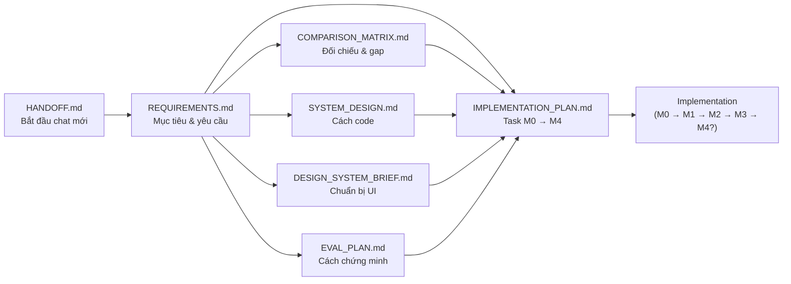

# Documentation Index — Sidekick AI (Chrome Extension Chat Sidebar)

**Dự án:** Extension chat-bot sidebar cho trình duyệt, cạnh tranh với Edge Copilot Sidebar và Chrome Gemini Sidebar.
**Giai đoạn hiện tại:** **M0 (Foundation) ✅** (tag `v0.1`) · **M1 (Parity) ✅ ĐÓNG** (tag `v0.2`) — **23/25 task** (T-M1-13 export ✅ 2026-11-09) · **M2 đang làm** (T-M2-02 model picker + fallback ✅ · T-M2-03 token/cost UI ✅ 2026-11-10) — **1391 unit test + 91 E2E** · tiếp theo: **T-M2-12 (dataset eval)** → `docs/EVAL_REPORT.md` (deliverable bắt buộc).
**Entry point cho agent:** [`../AGENTS.md`](../AGENTS.md) · [`HANDOFF.md`](HANDOFF.md)

---

## Cấu trúc tài liệu

| Tài liệu | Vai trò | Nội dung | Đọc khi nào |
|---|---|---|---|
| [`REQUIREMENTS.md`](REQUIREMENTS.md) | **Nguồn sự thật cho sản phẩm** | Mục tiêu, parity summary, 14 user stories, 83 FR, 29 NFR, kiến trúc, data model, rủi ro, roadmap M0–M4, **bảng FR ↔ Task (§11.1)** | Khi cần biết "cần làm gì" và "vì sao" |
| [`COMPARISON_MATRIX.md`](COMPARISON_MATRIX.md) | **Đối chiếu & gap** | 28 tính năng Edge (A1–A28), 28 tính năng Chrome Gemini (B1–B28), 15 tính năng độc quyền (C1–C15), nguồn trích dẫn, checklist parity M1 & M4 | Nghiên cứu thêm feature, hoặc nghiên cứu thêm feature để bổ sung |
| [`EVAL_PLAN.md`](EVAL_PLAN.md) | **Chứng minh chất lượng** | Dataset 48 task (5+1 nhóm), rubric 8 tiêu chí, judge prompt, metrics, quy trình thu thập transcript Edge/Gemini, 11 fairness controls, timeline | **Yêu cầu bắt buộc của giảng viên** — đọc kỹ |
| [`DESIGN_SYSTEM_BRIEF.md`](DESIGN_SYSTEM_BRIEF.md) | **Ràng buộc UI** | 7 design principles, design tokens, component inventory, state chuẩn hoá, checklist WCAG 2.2 AA, traceability ↔ FR | Khi làm UI hoặc thêm component mới |
| [`SYSTEM_DESIGN.md`](SYSTEM_DESIGN.md) | **Cách code** | Kiến trúc tổng thể, 12 ADR, cấu trúc thư mục, hợp đồng API (31 endpoint), giao thức SSE (9 event), data model Drizzle, bảo mật, chiến lược test, rủi ro kỹ thuật | Khi viết API, schema, hoặc backend |
| [`IMPLEMENTATION_PLAN.md`](IMPLEMENTATION_PLAN.md) | **Kế hoạch thực thi** | 82 task có mã `T-Mx-xx` theo M0–M4, DoD, timeline 13 tuần, phân công 3 thành viên, kịch bản thiếu thời gian, **bảng FR → Task rút gọn (§3.2)** | Khi bắt đầu task, cập nhật trạng thái task |
| [`HANDOFF.md`](HANDOFF.md) | **Chuyển phiên chat** | Checklist bắt đầu chat mới (≤ 5 phút), trạng thái hiện tại, quyết định đã chốt, mẹo tiết kiệm token | **Đọc đầu tiên khi mở chat mới** |
| [`CHANGELOG.md`](CHANGELOG.md) | **Lịch sử thay đổi** | Mọi thay đổi docs + code, mới → cũ | Xem gần đây đã làm gì |
| [`MANUAL_TEST_GUIDE.md`](MANUAL_TEST_GUIDE.md) | **Hướng dẫn cài đặt & test tay** | Cài extension + chạy hạ tầng local · checklist test tay **từng tính năng** M1 · xử lý sự cố | **Khi bạn muốn tự dùng thử sản phẩm** |
| [`CONTEXT_HANDOFF_2026-11-09.md`](CONTEXT_HANDOFF_2026-11-09.md) | **Bàn giao context** (snapshot 1 lần) | Tóm tắt context để chuyển sang chat mới mà không đọc lại toàn bộ `docs/` | Khi cần nhanh 1 trang tóm tắt |

---

## Thứ tự đọc đề xuất

**Cách nhanh nhất (khi bắt đầu chat mới):**
`HANDOFF.md` → `AGENTS.md` → task trong `IMPLEMENTATION_PLAN.md` → mở `SYSTEM_DESIGN.md` § liên quan.

---

## Quyết định kiến trúc đã chốt

| Hạng mục | Quyết định |
|---|---|
| Nền tảng | Chrome Extension Manifest V3 (Side Panel API, Chrome ≥ 114) |
| Frontend | React 18 + TypeScript + Vite + **Tailwind CSS + shadcn/ui** (Radix, copy code vào repo) |
| Client state | Zustand |
| Backend | BFF proxy chạy local qua **Docker Compose** (Node 20 + Express + TS) |
| Database | **PostgreSQL 16 + Drizzle ORM + pgvector** |
| Repo | **Monorepo pnpm workspace**: `apps/extension` · `apps/server` · `apps/eval` · `packages/shared` |
| LLM | Multi-provider adapter (Gemini, OpenAI, Anthropic, OpenRouter, Groq, Ollama); free tier trước |
| Chế độ dự phòng | 3 nguồn key: **K1** team key (`.env`) · **K2** BYOK qua BFF (mã hoá trong Postgres) · **K3** BYOK direct (`chrome.storage.local`, khi BFF tắt) — xem `REQUIREMENTS.md` §4.6.1 — **⏸ K2/K3 tạm dừng 2026-11-08**, M1 chỉ dùng **K1** + Ollama local |
| Phạm vi | Full parity 2 hệ thống + tính năng nâng cao (MCP, RAG, Skills, multi-provider, log). **Workflow automation = M4, implement cuối cùng** |
| Đánh giá | Offline benchmark (LLM-as-judge) **+** live manual test (rubric con người) |
| Streaming | Trực tiếp Side Panel → BFF (không qua service worker — MV3 SW bị kill ~30s) |

Chi tiết lý do & hệ quả: [`SYSTEM_DESIGN.md`](SYSTEM_DESIGN.md) §2 (12 ADR).

---

## Tóm tắt các điểm khác biệt so với 2 hệ thống có sẵn

1. **Multi-provider + BYOK** — không phụ thuộc model của hãng. *(BYOK ⏸ tạm dừng 2026-11-08 — hiện chỉ còn K1 team key + Ollama local)*
2. **Self-hostable** — toàn bộ server chạy local, dữ liệu không rời máy.
3. **MCP-native** — mở rộng tool bất kỳ qua Model Context Protocol.
4. **Traceable** — log request đầy đủ, phục vụ audit và eval.
5. **Cost visibility** — token & chi phí theo từng lượt.
6. **Privacy theo domain** — không chỉ bật/tắt toàn cục.
7. **Công cụ eval tích hợp** — đo được, so sánh được, tái lập được.
8. **Workflow automation** — scheduler chạy nền trong sidebar, self-hosted, không cần license (M4, ngoài đường găng). Ở Edge/Gemini, tính năng này bị đẩy ra khỏi sidebar sang M365 Copilot Tasks / Gemini Apps.

---

## Ưu tiên triển khai

> **Workflow (M4) là tính năng implement cuối cùng**, chỉ bắt đầu khi M0–M3 đã ổn định và đã có báo cáo eval. Nếu thiếu thời gian, bỏ hẳn M4 mà **không** mất điểm ở các tiêu chí đã đạt. Chi tiết: [`REQUIREMENTS.md`](REQUIREMENTS.md) §9.3 (thứ tự cắt) và §9.4 (điều kiện bắt đầu).

---

## Quy trình bắt buộc: cập nhật docs sau mỗi thay đổi

> Nguồn chính: [`../AGENTS.md`](../AGENTS.md) §5 và `.cursor/rules/docs-sync.mdc`.

1. Code xong → cập nhật `docs/` tương ứng (bảng ánh xạ trong `docs-sync.mdc` §1).
2. Thêm 1 entry vào [`CHANGELOG.md`](CHANGELOG.md).
3. Task dang dở → cập nhật [`HANDOFF.md`](HANDOFF.md) §2.
4. Commit.

**Task chưa cập nhật docs = chưa Done.**

---

## Trạng thái tài liệu

| Tài liệu | Phiên bản | Ngày | Trạng thái |
|---|---|---|---|
| REQUIREMENTS.md | v2.3 | 2026-11-10 | ✅ Đã cập nhật — §4.6 AC của FR-PROVIDER-03/04/05 (T-M2-02 · T-M2-03) |
| COMPARISON_MATRIX.md | v2.3 | 2026-11-10 | ✅ Đã cập nhật — §E đóng dòng "Token/cost hiển thị" → **33/35 = 94.3%** + **§E.1.3** (mới) |
| EVAL_PLAN.md | v1.4 | 2026-11-09 | ✅ Đã cập nhật — §3.1 bảng field bắt buộc + ghi chú contract `evalTaskSchema` |
| DESIGN_SYSTEM_BRIEF.md | v2.0 | 2026-11-08 | ✅ Đã cập nhật — §5 + §5.1 checklist a11y — T-M1-20 |
| SYSTEM_DESIGN.md | v2.4 | 2026-11-10 | ✅ Đã cập nhật — **§7.22** model picker + fallback chain + **§7.23** token & chi phí (mới) |
| IMPLEMENTATION_PLAN.md | v2.3 | 2026-11-10 | ✅ Đã cập nhật — T-M2-02/T-M2-03 ✅ · T-M2-01 ⏸ đẩy · ghi chú phạm vi M2 |
| HANDOFF.md | v2.4 | 2026-11-10 | ✅ Đã cập nhật — tiến độ M2 (T-M2-02 · T-M2-03) |
| CHANGELOG.md | v2.4 | 2026-11-10 | ✅ Đang theo dõi |
| MANUAL_TEST_GUIDE.md | v1.1 | 2026-11-10 | ✅ Đã cập nhật — **§11b** test model picker + fallback + chi phí (mới) |

## Trạng thái milestone

| Milestone | Nội dung | Trạng thái |
|---|---|---|
| **M0 — Foundation** (2 tuần) | Monorepo, shared types, Docker/Postgres, Drizzle, BFF skeleton, provider Gemini, SSE, side panel shell | ✅ Xong (tag `v0.1`) |
| **M1 — Parity** (3 tuần) | Content extraction (HTML + PDF + YouTube transcript), context đính kèm chủ động + ngân sách token, `@` multi-tab, selection, citations, markdown/code, conversation CRUD, chat actions (regenerate/edit-resend/stop/continue), gợi ý theo trang + tóm tắt 1-click, toggle panel + context menu + phím tắt, settings, upload ảnh, onboarding, **error/loading/empty states + retry + connection status**, **request logging đầy đủ vào `request_logs`** (request-id xuyên suốt · cost thật · retention 90 ngày · API đọc metadata cho eval), **i18n VI/EN** (dictionary có kiểu · đổi ngôn ngữ áp dụng ngay), **phím tắt cấu hình được** (2 lớp: native Chrome + nhanh Sidekick), **responsive 320–640px + a11y pass cơ bản** (focus ring chuẩn hoá · live region streaming · skip-link · tap target 24px), **export conversation Markdown/JSON**, K2/K3 | ✅ **Xong (tag `v0.2`)** — 23/25 task (T-M1-15 + T-M1-16 ⏸ tạm dừng) · gate đạt: checklist §E **32/35 = 91.4%** · dòng "Must" §A/§B **21/23 = 91.3%** |
| **M2 — Advanced & Eval** (3 tuần) | Multi-provider, skills, tool registry + MCP, RAG, token/cost UI, **EVAL_REPORT** | 🟡 **Đang làm** — T-M2-02 ✅ (model picker động + fallback chain runtime + event `provider_switch` + log `fallback_from`) · T-M2-03 ✅ (badge token/chi phí + section "Chi phí & sử dụng" theo ngày, có bộ chọn khoảng thời gian `today/7d/30d/all`) · T-M2-01 ⏸ đẩy (không thêm provider mới) · **tiếp theo: T-M2-12** |
| **M3 — Polish & Deliverable** (1 tuần) | Design system, states, a11y audit, i18n, demo video, slide, README, backup DB, ADR | ⬜ Chưa bắt đầu |
| **M4 — Workflow** (tuỳ chọn, 2 tuần) | Scheduler, workflow CRUD, run log, import/export, notification | ⬜ Ngoài đường găng |

Chi tiết task: [`IMPLEMENTATION_PLAN.md`](IMPLEMENTATION_PLAN.md).

---

## Điều kiện cần để bắt đầu implement M1

- [x] Giảng viên duyệt hướng tiếp cận (requirements + eval plan)
- [x] Chốt stack UI (Tailwind + shadcn/ui) và data layer (Drizzle + Postgres)
- [x] Chốt cấu trúc repo (monorepo pnpm) và versioning (git local)
- [ ] Chốt provider dùng để đối chiếu công bằng với Chrome Gemini (`REQUIREMENTS.md` §10, Q1)
- [ ] Chốt ngân sách API key cho eval (§10, Q3)
- [ ] Xác nhận có/không làm user study (§10, Q4)
