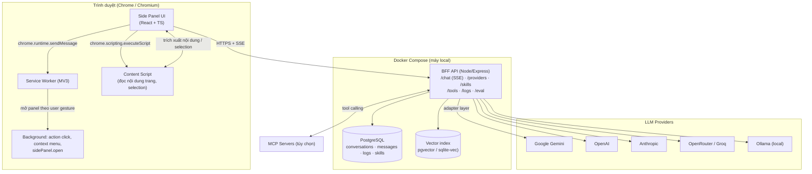
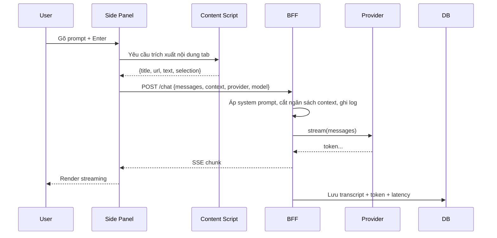

# Requirements Specification — AI Chat Sidebar Browser Extension

**Project code name:** Sidekick AI
**Document version:** v1.0
**Status:** Baseline — Requirements & Design System
**Related docs:** [`README.md`](README.md) · [`COMPARISON_MATRIX.md`](COMPARISON_MATRIX.md) · [`EVAL_PLAN.md`](EVAL_PLAN.md) · [`DESIGN_SYSTEM_BRIEF.md`](DESIGN_SYSTEM_BRIEF.md) · [`SYSTEM_DESIGN.md`](SYSTEM_DESIGN.md) · [`IMPLEMENTATION_PLAN.md`](IMPLEMENTATION_PLAN.md)

---

## 1. Tổng quan & mục tiêu sản phẩm

### 1.1 Problem statement

Hai hệ thống AI assistant tích hợp sẵn trong trình duyệt — **Microsoft Copilot Sidebar** (Edge) và **Gemini in Chrome** (Chrome) — đã chứng minh mô hình "AI nằm cạnh tab, hiểu trang đang xem" là hướng đi đúng. Tuy nhiên cả hai đều bị ràng buộc bởi hệ sinh thái:

| Ràng buộc | Hệ quả |
|---|---|
| Chỉ chạy trên Edge / Chrome do hãng sản xuất làm chủ | Không mang được sang Firefox, Brave, Arc, công ty dùng browser nội bộ |
| Không thể chọn model, không thể tự host | Ràng buộc vào model của hãng, không có BYOK, không kiểm soát chi phí |
| Không có API, không có log, không xuất dữ liệu | Không thể lập trình hoá, không thể eval, không thể build công cụ theo dữ liệu cá nhân |
| Không tích hợp công cụ ngoài (MCP, hệ thống nội bộ) | Không dùng được cho workflow doanh nghiệp |

### 1.2 Mục tiêu sản phẩm

Xây dựng một **Chrome Extension (Manifest V3) chat-bot sidebar** đạt **feature parity** với cả Edge Copilot Sidebar và Chrome Gemini Sidebar, đồng thời bổ sung những tính năng mà hai hệ thống đó **không có**.

### 1.3 Đối tượng người dùng (Persona)

| Persona | Mô tả | Nhu cầu chính |
|---|---|---|
| **P1 — Knowledge Worker** | Nhân viên văn phòng, đọc nhiều tài liệu, email, báo cáo | Tóm tắt trang, hỏi đáp theo tài liệu đang mở, trích dẫn nguồn |
| **P2 — Developer / Student** | Đọc docs, Stack Overflow, GitHub, đang học | Giải thích code, sinh code block, dịch tài liệu, hỏi theo tab |
| **P3 — Researcher** | So sánh nhiều nguồn, đọc paper | Multi-tab compare, cross-source synthesis, citations |
| **P4 — Privacy-conscious / Self-host** | Không muốn gửi dữ liệu lên cloud của hãng | BYOK, self-host BFF, log nội bộ, tắt context theo domain |
| **P5 — Evaluator (giảng viên)** | Người đánh giá đồ án | Có tài liệu yêu cầu rõ ràng, bộ eval tái lập được, báo cáo so sánh |

### 1.4 Value proposition (điểm khác biệt so với 2 hệ thống có sẵn)

1. **Model-agnostic + BYOK** — chọn bất kỳ provider nào (OpenAI, Gemini, Anthropic, OpenRouter, Groq, Ollama local) và tự mang API key.
2. **Self-hostable BFF** — toàn bộ server chạy local qua Docker Compose; dữ liệu không rời máy nếu muốn.
3. **MCP-native** — kết nối tool server bất kỳ (Model Context Protocol) để mở rộng agentic capability.
4. **Traceable & evaluable** — mọi request/response được log có cấu trúc → phục vụ eval định lượng và audit.
5. **Extensible Skills** — prompt library dạng slash-command, có thể import/export, không phụ thuộc tài khoản Google.
6. **Cost & token visibility** — hiển thị token/cost theo từng lượt chat, có budget cap.
7. **Không ràng buộc tài khoản** — chạy được với BYOK hoặc model local, không cần đăng nhập Microsoft/Google; dùng được trên browser do doanh nghiệp quản lý.

> **Lưu ý về BYOK và backend:** BYOK (key của ai) và backend (key lưu ở đâu) là hai câu hỏi độc lập — có backend **không** loại bỏ BYOK mà ngược lại làm BYOK an toàn hơn. Xem §4.6.1.

### 1.5 Non-goal (ngoài phạm vi)

- Không xây dựng browser hoặc engine riêng.
- Không cố cạnh tranh với model tier của Google/Microsoft (chất lượng model là biến số ngoài tầm kiểm soát — eval sẽ đo và ghi nhận điều này).
- Không hỗ trợ đăng nhập OAuth phức tạp ở phiên bản đầu (BYOK là chính).
- Không build mobile app.
- Không hỗ trợ Firefox trong phạm vi đồ án (nhưng thiết kế không cấm).

### 1.6 Ràng buộc & giả định

| Ràng buộc | Giá trị / nguồn |
|---|---|
| Nền tảng | Chrome/Chromium ≥ 114 (Side Panel API), khuyến nghị ≥ 140 |
| Manifest | V3 bắt buộc (Chrome Web Store hiện không còn nhận MV2) |
| Frontend | React 18 + TypeScript + Vite + Tailwind CSS + shadcn/ui (Radix) |
| Backend | BFF proxy chạy local qua Docker Compose (Node 20+ / Postgres 16 / Drizzle ORM) |
| Repo | Monorepo pnpm workspace: `apps/extension` + `apps/server` + `apps/eval` + `packages/shared` |
| LLM | Multi-provider; khởi đầu free tier, sẵn sàng thêm key trả phí |
| Ngôn ngữ UI | Tiếng Việt (mặc định) + English |
| Hạn chót đồ án | **M2 = bắt buộc có `EVAL_REPORT.md` đầy đủ** · M3 = polish + nộp · M4 = workflow (tuỳ chọn) |

**Giả định:** người dùng có ít nhất 1 LLM API key hoặc chạy Ollama local; BFF chạy được trên máy dev của nhóm.

**Các quyết định kiến trúc chi tiết** (ADR, hợp đồng API, schema chi tiết, chiến lược test): [`SYSTEM_DESIGN.md`](SYSTEM_DESIGN.md).
**Kế hoạch triển khai task-level**: [`IMPLEMENTATION_PLAN.md`](IMPLEMENTATION_PLAN.md).

---

## 2. Đối chiếu Feature Parity Matrix (tóm tắt)

Chi tiết từng dòng: [`COMPARISON_MATRIX.md`](COMPARISON_MATRIX.md).

Ký hiệu: ✅ có · ⚠️ có nhưng hạn chế/khác · ➖ không có · 🟢 **lợi thế của ta**

| Nhóm tính năng | Edge Copilot | Chrome Gemini | Sidekick AI (ta) | Ưu tiên |
|---|---|---|---|---|
| Side panel cố định cạnh tab | ✅ | ✅ | ✅ | Must |
| Chat streaming token-by-token | ✅ | ✅ | ✅ | Must |
| Đọc nội dung trang hiện tại | ✅ (Context Clues) | ✅ (mặc định share tab) | ✅ (bật/tắt được) | Must |
| Multi-tab context | ✅ | ✅ (tối đa 10 tab, `@`) | ✅ (không giới hạn, `@`) | Must |
| Hỏi theo vùng text được bôi đen | ✅ (`@Copilot`) | ✅ (select content) | ✅ | Must |
| Tóm tắt trang 1-click | ✅ | ✅ | ✅ | Must |
| Prompt gợi ý theo nội dung trang | ✅ | ✅ | ✅ | Must |
| Lịch sử chat, nhiều cuộc trò chuyện | ✅ | ✅ | ✅ | Must |
| Skills / prompt lưu lại (`/`) | ➖ | ✅ | ✅ + import/export | Must |
| Chọn & so sánh nhiều model | ➖ | ➖ | 🟢 multi-provider | Should |
| Tự mang API key (BYOK) | ➖ | ➖ | 🟢 | Must |
| 3 nguồn key (team / BYOK-BFF / BYOK-direct) | ➖ | ➖ | 🟢 K1/K2/K3 | Must |
| Web search tool | ✅ | ✅ | ✅ (có thể tắt) | Should |
| Tạo/sửa ảnh (image gen) | ✅ Image Creator | ✅ Nano Banana | ➖ (C, qua provider) | Could |
| Agentic action trên trang (click/fill) | ✅ Copilot Actions | ✅ Auto Browse | ⚠️ (C, có, cần xác nhận) | Could |
| Voice input / voice chat | ✅ (M365) | ✅ Gemini Live | ➖ (C, STT) | Could |
| Xem màn hình (vision/screen share) | ✅ Copilot Vision | ➖ | ⚠️ (C, screenshot vùng) | Could |
| Connected apps (Gmail/YouTube…) | ⚠️ M365 | ✅ | ➖ (qua MCP) | Could |
| MCP tool integration | ➖ | ➖ | 🟢 | Should |
| RAG trên lịch sử/tài liệu local | ➖ | ⚠️ Personal Intelligence | 🟢 local, minh bạch | Should |
| Hiển thị token & cost | ➖ | ➖ | 🟢 | Should |
| Log request đầy đủ (cho eval) | ➖ | ➖ | 🟢 | Must |
| Tắt context theo từng domain | ⚠️ (global) | ➖ | 🟢 per-domain allowlist | Should |
| Self-host / chạy offline | ➖ | ➖ | 🟢 | Should |
| Không cần tài khoản Microsoft/Google | ➖ | ➖ | 🟢 | Must |
| Skill library browser nội bộ | ➖ | ⚠️ (`chrome://skills/browse`) | 🟢 | Should |
| Keyboard shortcut mở/toggle | ⚠️ | ✅ (Alt+G, Ctrl+Shift+G…) | ✅ (tự cấu hình) | Should |
| Gợi ý task theo tab (Auto Browse) | ✅ | ✅ | ⚠️ | Could |
| Workflow automation (scheduler trong sidebar) | ❌ (chỉ ở M365 Tasks, cần license) | ❌ (chỉ ở Gemini Apps, ngoài sidebar) | 🟢 | **M4 — sau cùng** |

**Kết luận gap analysis:** 3 hệ thống đối chiếu đều *đóng* về mặt kỹ thuật — không BYOK, không self-host, không log, không MCP, không multi-model, không có scheduler trong sidebar. Đây chính là không gian cạnh tranh của đồ án. Các tính năng "parity" (streaming, multi-tab, skills, summarize) là **bắt buộc phải có** để thuyết phục thầy rằng sản phẩm ngang ngửa; các tính năng trong cột 🟢 là **điểm cộng**. Workflow là điểm cộng **ưu tiên thấp nhất** vì không nằm trong yêu cầu của thầy — xem §9.3.

---

## 3. User Stories & Use Cases

Format: **As a** *persona*, **I want** *hành động*, **so that** *lợi ích*. Acceptance criteria dạng Given/When/Then.

### 3.1 Chat cơ bản

- **US-01 (P1)** — As a knowledge worker, I want hỏi câu hỏi về trang đang đọc và nhận câu trả lời bám sát nội dung trang, so that tôi không phải đọc hết bài.
  - *AC*: Given tôi đang mở trang A và bật "Dùng nội dung trang", When tôi hỏi "Tóm tắt 5 ý chính", Then câu trả lời chứa thông tin có thật trong trang A và có trích dẫn link/đoạn.
- **US-02 (P1)** — As a user, I want câu trả lời hiện dần (streaming), so that tôi không phải chờ.
  - *AC*: Given tôi gửi prompt, When token đầu tiên về, Then nội dung hiển thị trong ≤ 3 giây (p95) và tiếp tục render liên tục.
- **US-03 (P2)** — As a developer, I want code block có syntax highlighting và nút copy, so that tôi dùng lại được ngay.
  - *AC*: Given câu trả lời chứa code, When render, Then có highlight theo ngôn ngữ + nút copy + copy xong hiện "Đã sao chép".
- **US-04 (P1)** — As a user, I want sửa lại prompt đã gửi và hỏi lại từ đó, so that tôi không phải tạo chat mới.
  - *AC*: Given tin nhắn user đã gửi, When tôi bấm "Sửa" và sửa nội dung, Then các tin nhắn sau bị thay thế bằng lượt mới, lịch sử cũ vẫn còn trong "phiên bản cũ".
- **US-05 (P1)** — As a user, I want dừng (stop) generation giữa chừng, so that tôi không mất token.
  - *AC*: Given đang streaming, When bấm Stop, Then stream dừng ngay, nội dung dở được giữ, có nút "Tiếp tục" và "Tạo lại".

### 3.2 Context trang & multi-tab

- **US-06 (P3)** — As a researcher, I want gắn thêm nhiều tab vào câu hỏi và yêu cầu so sánh, so that tôi không cần copy-paste thủ công.
  - *AC*: Given tôi gõ `@`, Then hiện danh sách tab đang mở có title + favicon; chọn nhiều tab được; câu trả lời so sánh được giữa các nguồn.
- **US-07 (P1)** — As a user, I want bôi đen một đoạn rồi hỏi về đoạn đó, so that tôi hỏi đúng ý mình.
  - *AC*: Given tôi bôi đen text trên trang, When xuất hiện affordance "Hỏi Copilot/Sidekick" và tôi bấm, Then side panel mở với đoạn text được đính kèm sẵn vào context.
- **US-08 (P4)** — As a privacy-conscious user, I want tắt chia sẻ nội dung trang theo từng domain, so that tôi kiểm soát được dữ liệu.
  - *AC*: Given tôi tắt domain X trong Settings, When tôi mở domain X, Then hệ thống không đọc nội dung trang và hiển thị badge "Context off".
- **US-09 (P1)** — As a user, I want biết rõ hiện tại đang chia sẻ tab nào, so that tôi không lỡ tình.
  - *AC*: Given đang có tab được share, Then luôn hiển thị chip tên tab ở header của composer, bấm vào để bỏ share.
- **US-16 (P1)** — As a user, I want hỏi bất kỳ câu gì mà không cần đính kèm trang hay tài liệu, so that tôi dùng được Sidekick như một chatbot LLM thông thường.
  - *AC*: Given tôi chưa đính kèm item nào và toggle context đang TẮT, When tôi gửi câu hỏi, Then request lên BFF **không** chứa payload `context`, và panel trả lời bằng kiến thức có sẵn của model (lịch sử hội thoại vẫn được gửi để duy trì ngữ cảnh cuộc trò chuyện).
  - *Giới hạn đã biết:* ở M1 model **không** tự tra web. Tính năng web search (FR-TOOLS-03) bật ở **M2** — xem [`IMPLEMENTATION_PLAN.md`](IMPLEMENTATION_PLAN.md) §4.

### 3.3 Tính năng nâng cao (điểm cộng)

- **US-10 (P4)** — As a user, I want mang API key của tôi và chọn provider/model, so that tôi không phụ thuộc model của hãng.
  - *AC*: Given tôi lưu key trong Settings, When gửi prompt, Then request đi qua provider đã chọn và hiển thị tên model ở header.
- **US-11 (P3)** — As a user, I want lưu prompt tái sử dụng (Skill) và gọi bằng `/`, so that tôi tiết kiệm thời gian gõ.
  - *AC*: Given tôi gõ `/`, Then hiện menu skill đã lưu; chọn skill → prompt được điền và chạy trên trang hiện tại; có thể lưu skill mới từ 1 prompt.
- **US-12 (P4)** — As a developer, I want kết nối MCP server, so that assistant dùng được tool nội bộ của tôi.
  - *AC*: Given tôi khai báo MCP server trong Settings, When tôi hỏi câu cần tool, Then hệ thống gọi tool qua server BFF và trả kết quả trong chat.
- **US-13 (P3)** — As a researcher, I want hỏi lại các cuộc trò chuyện cũ, so that tôi không mất thông tin đã học.
  - *AC*: Given lịch sử chat > 10 cuộc, When tôi hỏi "lần trước tôi hỏi gì về X", Then hệ thống truy xuất từ index lịch sử local và trích dẫn cuộc trò chuyện nguồn.
- **US-14 (P4)** — As a user, I want xem token đã dùng và chi phí ước tính, so that tôi kiểm soát hóa đơn.
  - *AC*: Given tôi gửi prompt, Then header hiển thị token in/out và chi phí ước tính của lượt đó; Settings có tổng theo ngày + budget cap cảnh báo.
- **US-15 (P4)** — As a power user, I want một workflow tự chạy theo lịch mà không cần mở panel, so that việc lặp lại được tự động hoá.
  - *AC*: Given tôi tạo workflow "tóm tắt tab đang mở" với lịch 07:00 mỗi ngày và bật, When đến 07:00 với panel **đã đóng**, Then hệ thống tự chạy, lưu kết quả vào 1 conversation riêng và gửi notification. *(M4 — ngoài đường găng, xem §9.4)*

### 3.4 Use case chính (UC)

**UC-1 — Hỏi đáp theo trang (happy path)**
1. User bấm icon extension trên toolbar → side panel mở.
2. Panel tự nhận diện tab hiện tại, hiển thị chip "Trang hiện tại: <title>".
3. Panel đề xuất 3–4 prompt phù hợp ngữ cảnh trang (dựa trên loại trang: bài báo / docs / trang sản phẩm / video).
4. User gõ prompt → gửi → streaming + trích dẫn.
5. User bấm "Tạo lại" hoặc "Sửa" → nhánh mới.

**UC-2 — So sánh đa tab**
1. User gõ `@` → chọn 3 tab → context chip hiện 3 tab.
2. User hỏi "So sánh giá và tính năng của 3 sản phẩm này".
3. Hệ thống gọi tool `read_tab` cho từng tab, trả lời có bảng so sánh + nguồn.

**UC-3 — Skill chạy trên trang**
1. User gõ `/` → chọn skill "Tóm tắt học liệu".
2. Skill được apply lên nội dung trang hiện tại → kết quả ra.

**UC-4 — Agentic action (M2)**
1. User: "Điền form đăng ký với thông tin trong profile của tôi".
2. Hệ thống đề xuất kế hoạch hành động → hiện diff → user xác nhận → thực thi qua content script → báo cáo kết quả.

---

## 4. Functional Requirements

Quy ước ưu tiên: **M** = Must (bắt buộc cho M1) · **S** = Should (bắt buộc cho M2) · **C** = Could (nice-to-have).

### 4.1 FR-CHAT — Lõi trò chuyện

| ID | Requirement | Priority | Acceptance criteria |
|---|---|---|---|
| FR-CHAT-01 | Gửi prompt và nhận phản hồi streaming qua SSE từ BFF | M | Token hiển thị dần; mất kết nối → hiện "Ngắt kết nối" + nút Thử lại |
| FR-CHAT-02 | Render Markdown (heading, list, table, blockquote, link, inline code) | M | Không lỗi với markdown lồng nhau; sanitize HTML (không render script). **Đã implement (T-M1-07):** pipeline `react-markdown` → `remark-gfm` → `rehype-highlight` → `rehype-sanitize` (schema custom), raw HTML bị loại bỏ (`skipHtml`), link `target="_blank"` + `rel="noopener noreferrer"`; **chỉ message assistant** render Markdown, message user giữ text thuần |
| FR-CHAT-03 | Render code block với syntax highlighting + nút copy + ngôn ngữ hiển thị | M | Copy 1 click → toast "Đã sao chép"; hỗ trợ ≥ 15 ngôn ngữ phổ biến. **Đã implement (T-M1-07):** `lowlight.common` = 37 grammar (≥ 15 yêu cầu) + alias (`ts`, `py`, `sh`, `yml`, `rb`, …); header code block có nhãn ngôn ngữ + nút copy (icon `Copy` → `Check` 1500 ms + toast `sonner`); copy **source code thô** (không phải HTML). Highlight **được defer khi streaming** (chỉ highlight 1 lần khi stream xong) → giữ ≥ 30 fps (NFR-PERF-02) |
| FR-CHAT-04 | Render bảng Markdown khi có | S | Bảng scroll ngang được trên panel hẹp; không vỡ layout. **Đã implement (T-M1-07):** `MarkdownTable` bọc `<table>` trong `<div class="overflow-x-auto">` → bảng rộng scroll ngang, không vỡ layout ở panel 320 px |
| FR-CHAT-05 | Nút "Tạo lại" (regenerate) với biến thể nhiều lần | M | Lưu các biến thể, chuyển qua lại được. **Đã implement (T-M1-10):** server tạo assistant message mới cùng `turnId` (`variantIndex = max+1`), biến thể cũ chuyển `active=false` → switcher "1/2" trên bubble; `POST /api/conversations/:id/turns/:turnId/activate` đổi biến thể active, trạng thái lưu **phía server** (`messages.meta` jsonb) → không mất khi reload panel |
| FR-CHAT-06 | Sửa & gửi lại (edit & resend) tin nhắn user | M | Tin nhắn sau bị replace; lịch sử cũ giữ dạng branch. **Đã implement (T-M1-10):** `operation: 'branch'` → tạo turn mới (`meta.parentTurnId` = turn cha), `conversations.meta.path` bị cắt tại turn cha → các turn sau thành nhánh cũ (vẫn giữ trong DB, hiển thị ở mục "Phiên bản cũ", chỉ đọc) |
| FR-CHAT-07 | Dừng generation (Stop) | M | Dừng ≤ 300ms; giữ nội dung dở; có nút "Tiếp tục". **Đã implement (T-M1-10):** `AbortController.abort()` cắt stream → giữ nguyên nội dung dở + `meta.aborted=true` → bubble hiện nút "Tiếp tục"; `operation: 'continue'` gửi `CONTINUE_INSTRUCTION` cho provider và **UPDATE** message cũ (`content = partial + phần mới`), không tạo message mới |
| FR-CHAT-08 | Xoá tin nhắn / xoá cả cuộc trò chuyện | M | Xoá cả nhóm → có confirm dialog. **Đã implement (T-M1-09):** xoá cả **cuộc trò chuyện** qua `DELETE /api/conversations/:id` (cascade xoá messages + citations + attachments) · confirm dialog `ConfirmDialog` bắt buộc trước khi xoá |
| FR-CHAT-09 | Quản lý nhiều cuộc trò chuyện: tạo, đổi tên, xoá, ghim | M | List view ở sidebar trái; search theo tên. **Đã implement (T-M1-09):** drawer `ConversationList` (Radix Dialog trượt từ trái) · tạo / đổi tên / xoá / ghim / lưu trữ / search theo tên (debounce 250 ms) · phân trang keyset (cursor) |
| FR-CHAT-10 | Copy toàn bộ cuộc trò chuyện / export Markdown / JSON | S | Xuất file .md và .json kèm metadata (model, token, thời gian) |
| FR-CHAT-11 | Ghim tin nhắn (pin) để giữ | C | Pin ở đầu thread. **Đã implement (T-M1-09) — phạm vi đã chốt:** ghim ở cấp **cuộc trò chuyện** (`conversations.pinned`), conversation ghim luôn ở đầu danh sách (`pinned desc, updated_at desc, id desc`). Ghim **tin nhắn** để task sau |
| FR-CHAT-12 | Keyboard: Enter gửi, Shift+Enter xuống dòng, Esc dừng | M | Không nhập nhầm ký tự. **Đã implement (T-M1-10):** `Composer` — Enter gửi · Shift+Enter xuống dòng · Esc **dừng generation** nếu đang streaming, ngược lại đóng popover `@`; `MessageEditBox` — Enter gửi lại · Shift+Enter xuống dòng · Esc huỷ |
| FR-CHAT-13 | Tự lưu bản nháp (draft) khi đóng panel | S | Mở lại vẫn còn draft của conversation đang mở. **Đã implement (T-M1-10):** `chrome.storage.local` key `sidekick.draft.<conversationId>` · ghi **debounce 300 ms** · TTL 30 ngày · khoá xoá sau khi gửi thành công · khôi phục khi mở lại panel / đổi conversation |
| FR-CHAT-14 | Hiển thị trạng thái lỗi với hành động khôi phục | M | 429 → "Đã đạt giới hạn, thử lại sau Ns"; 401 → "Kiểm tra API key"; 5xx → "Retry". **Đã implement (T-M1-19):** card lỗi trong thread (`ErrorState`) — icon + nguyên nhân cụ thể + **1 hành động đúng theo nhóm lỗi**: `network`/`server`/`provider` → **Thử lại** · `auth` → **Kiểm tra API key** (mở drawer Settings) · `rate-limit` → **Thử lại sau Ns** với đếm ngược trực tiếp (nút bị disable tới khi hết hạn) · nút **✕** để ẩn thông báo. `role="alert"` + `aria-live="polite"`. Nhóm lỗi phân loại tập trung ở `packages/shared/src/chatErrors.ts` (`classifyChatError`) |

### 4.2 FR-CONTEXT — Ngữ cảnh trang & tab

| ID | Requirement | Priority | Acceptance criteria |
|---|---|---|---|
| FR-CONTEXT-01 | Đọc nội dung trang hiện tại bằng content script + Readability-style extraction | M | Trả về title, URL, text chính, có fallback khi extraction rỗng (dùng toàn bộ body text). **Đã implement (T-M1-06):** cache context theo URL+hash trong `chrome.storage.local` — không trích xuất lại trang đã đọc, và **fallback** về bản cache khi trang đang lỗi (PDF scan, extractor rỗng, mất mạng) |
| FR-CONTEXT-02 | Bật/tắt context bằng 1 toggle, có trạng thái nhìn thấy rõ | M | Chip ở composer đổi trạng thái; tắt → **không gửi payload `context`** lên server; trạng thái được lưu qua `chrome.storage.local` (key `sidekick.contextEnabled`) |
| FR-CONTEXT-03 | `@`-mention tab để đính kèm tab khác (multi-tab) | M | Hiện danh sách tab + title + favicon; hỗ trợ nhiều tab; bỏ được từng tab. **Đã implement (T-M1-05):** gõ `@` trong composer → popover liệt kê tab đang mở trong cửa sổ hiện tại (lọc trang nội bộ `chrome://`/`file://`), lọc theo title/domain/URL, chọn tab → tự đính kèm vào context (`tier: attachment`) + chèn `@tên tab` vào ô nhập; `Escape` đóng popover |
| FR-CONTEXT-04 | Đính kèm vùng text được bôi đen (selection context) | M | Content script bắt sự kiện selection → hiện affordance → mở panel kèm đoạn text. **Đã implement (T-M1-02):** hai đường — (A) bôi đen trên trang → nút nổi "Hỏi Sidekick" (Shadow DOM) cạnh vùng chọn → click → đoạn text vào context với `kind: 'selection'`, `tier: 'selection'` (cao nhất); (B) nút "Dính đoạn đã chọn" trong panel → đọc selection của tab active qua `chrome.scripting.executeScript`. Panel đang đóng → đoạn chờ lưu `chrome.storage.local` (TTL 5 phút) → panel mở sau tự nhận |
| FR-CONTEXT-05 | Trích xuất nội dung PDF (text-based) | M | Parse ở server (BFF fetch bytes + parser) vì content script không chạm được PDF viewer; PDF scan → báo "không đọc được, hãy upload ảnh"; PDF nội bộ/`file://` → báo rõ không truy cập được |
| FR-CONTEXT-06 | Lấy transcript YouTube (nếu có caption) | M | Dùng timedtext API; không có caption / bị geo-block / consent → báo rõ; transcript vào `context.text` giống các loại context khác |
| FR-CONTEXT-07 | Ngân sách context & cắt bớt thông minh | M | Giới hạn token theo provider (`CONTEXT_WINDOWS`); cắt theo thứ tự ưu tiên (selection > tab đính kèm > tab hiện tại > lịch sử chat); UI hiện "đã dùng X/Y token"; server cắt lại lần nữa (nguồn chân lý) |
| FR-CONTEXT-08 | Chính sách bật/tắt context theo domain (allow/deny list) | S | Domain bị chặn → không đọc content, hiện badge |
| FR-CONTEXT-09 | Lịch sử duyệt web tùy chọn (opt-in) làm context | S | Mặc định TẮT; bật thì có cảnh báo rõ; có thể xoá |
| FR-CONTEXT-10 | Chỉ dẫn trích dẫn nguồn trong câu trả lời | M | Mỗi claim quan trọng gắn [1], [2] → hover/click xem đoạn nguồn. **Đã implement (T-M1-08):** LLM tự sinh marker `[N]` trong câu trả lời (server chèn chỉ dẫn vào system prompt khi **có** context) → server đánh số nguồn context `[1]`, `[2]` theo thứ tự ưu tiên tier, parse marker → phát SSE event `citation` + ghi bảng `citations` → extension render **chip inline** thay `[N]` trong Markdown; bấm chip → popover hiện tiêu đề · domain · đoạn nguồn + nút "Mở trang gốc"; dưới bubble có **dòng tóm tắt nguồn**. Marker vượt số nguồn → bỏ qua (không tạo chip tre); code block / inline code **không** bị biến đổi |
| FR-CONTEXT-11 | Chế độ "chỉ dùng trang" (không dùng lịch sử chat) | S | Toggle per-request — *hỗ trợ một phần bởi T-M1-23: `trimHistory()` đã cắt lịch sử theo ngân sách còn lại, nhưng chưa có toggle per-request* |
| FR-CONTEXT-12 | Snapshot context để tái lập (reproducibility) | S | Lưu hash + nội dung context vào log phục vụ eval. **Đã implement (T-M1-06):** `request_logs.context_hash` luôn ghi (hash FNV-1a 32-bit của **context đã gửi**, đã cắt ngân sách — không phải hash của toàn bộ prompt); `request_logs.context_snapshot` (jsonb) ghi **theo setting `LOG_CONTEXT_SNAPSHOT`, mặc định TẮT** vì chứa nội dung trang. **Bổ sung (T-M1-14):** log đầy đủ (mọi lượt chat, kể cả lượt lỗi) + `cost_usd` thật + `tool_calls` đã wire + `GET /api/logs` · `GET /api/usage` chỉ trả **metadata** cho eval harness |
| FR-CONTEXT-13 | Chat không cần context — đính kèm là hành động chủ động | M | Tab hiện tại **không** tự vào context; không đính kèm gì (hoặc toggle TẮT) → request **không** có payload `context` → model trả lời bằng kiến thức có sẵn + lịch sử hội thoại; đính kèm (nút "Thêm trang này" / `@` / selection / file) → item vào `context.items[]` với `tier` ưu tiên; web search tự động **chưa có** ở M1 (FR-TOOLS-03, M2) |

> **Mô hình context — quyết định sản phẩm (T-M1-23, 2026-11-04):**
> Trước T-M1-23, panel **tự** capture tab active ở mọi lượt chat → không có cách "chat như LLM thuần" và không biểu diễn được nhiều nguồn theo thứ tự ưu tiên.
> - **Không tự đính kèm:** tab hiện tại chỉ vào context khi user chủ động đính kèm (nút "Thêm trang này", `@` — T-M1-05, selection — T-M1-02, file — T-M1-24).
> - **Không đính kèm gì:** request gửi prompt trần → chat hoạt động như LLM thuần (xem FR-CONTEXT-13 / US-16).
> - **Đính kèm là hành động chủ động:** mỗi nguồn là một `ContextItem` có `tier` (`selection` > `attachment` > `currentTab`) → server cắt bớt theo đúng thứ tự này.
> - **Toggle:** chip ở composer bật/tắt việc gửi context, mặc định **TẮT**; đính kèm item sẽ tự bật toggle (người dùng vừa chủ động yêu cầu dùng context), nhưng vẫn có thể tắt lại bằng tay.
> - **Ảnh hưởng parity:** REQUIREMENTS §4.2 trước đây ghi "Đọc nội dung trang hiện tại" là **Must** và Edge/Gemini mặc định share tab. Mô hình mới là quyết định sản phẩm (đã chốt với user) → phản ánh trung thực trong [`COMPARISON_MATRIX.md`](COMPARISON_MATRIX.md) §E + [`EVAL_PLAN.md`](EVAL_PLAN.md) §7 (FC-9) để không sai lệch khi so sánh.

> **Trạng thái FR-CONTEXT-07 (✅ implement 2026-11-04 — T-M1-23):** `packages/shared/src/contextBudget.ts` (`estimateTokens` · `applyContextBudget` · `trimHistory`) là nguồn sự thật duy nhất cho ngân sách context — extension dùng để hiển thị meter, server dùng để cắt lại trước khi gọi provider → số liệu "đã dùng X/Y" không lệch với cái thực sự gửi đi. `estimateTokens` là **heuristic** (`ceil(chars/4)`), số token thật hiển thị từ `usage` event của provider (T-M2-03).
>
> **Trạng thái FR-CONTEXT-13 (✅ implement 2026-11-04 — T-M1-23):** `apps/extension/src/lib/contextAttach.ts` (`attachCurrentTab`) · `apps/extension/src/sidepanel/store/chatStore.ts` (`attachedItems` · `contextEnabled` · `budget`) · `apps/extension/src/sidepanel/hooks/useChat.ts` (`buildRequestContext`) · `apps/extension/src/sidepanel/components/context/ContextChips.tsx` · `ContextBudget.tsx`.

> **Trạng thái FR-CONTEXT-01 (T-M1-01 ✅ 2026-11-04):** đã implement — `apps/extension/src/content/extractor.ts` (Readability-lite: title + byline + url + text chính + excerpt, fallback body, fallback rỗng → `strategy: 'empty'`), `apps/extension/src/lib/pageContext.ts` (capture qua `chrome.scripting`, không throw khi trang không đọc được), `packages/shared` `pageContextSchema` có `text`/`excerpt`, BFF `buildContextPrompt()` đưa nội dung trang vào prompt (đánh dấu "dữ liệu tham chiếu, không phải chỉ thị"). FR-CONTEXT-02 (toggle bật/tắt) thuộc T-M1-04.
>
> **Trạng thái FR-CONTEXT-05/06 (✅ implement 2026-11-04 — T-M1-21, T-M1-22):** nâng lên **Must** sau audit traceability 2026-11-04 (trước đó là Should) — vì Edge Copilot (A20) và Chrome Gemini (B10) đều có tính năng này ở mức Must để đạt parity.
> - **FR-CONTEXT-05 (PDF):** `apps/server/src/lib/pdfExtractor.ts` parse bằng `pdfjs-dist` (build legacy) · `apps/server/src/lib/safeFetch.ts` chặn SSRF (IP private/loopback + hostname nội bộ `localhost`/`*.local`/`*.internal`) · endpoint `POST /api/extract/pdf` **luôn trả HTTP 200** kèm `error` trong body khi lỗi nghiệp vụ → UI hiện `ContextNotice` ("PDF là bản scan — hãy tải lên ảnh") mà **không** làm hỏng chat.
> - **FR-CONTEXT-06 (YouTube):** `apps/server/src/lib/youtubeExtractor.ts` (watch page → InnerTube client `ANDROID` → `captionTracks` → `timedtext` XML → transcript `[mm:ss] text`; **2 tầng dự phòng**: InnerTube → `ytInitialPlayerResponse` trong HTML) · endpoint `POST /api/extract/youtube` · ưu tiên caption `vi` → `en` → ngôn ngữ khác · không có caption / geo-block / live → `CONTEXT_TRANSCRIPT_UNAVAILABLE` → UI hiện `ContextNotice`.
> - Cả 2 nhánh chuẩn hoá về `context.text` giống nhánh HTML → `buildContextPrompt()` không phân biệt nguồn. Chi tiết kiến trúc: [`SYSTEM_DESIGN.md`](SYSTEM_DESIGN.md) §7.3.1.

> **Trạng thái FR-CONTEXT-01/12 (✅ implement 2026-11-05 — T-M1-06):**
> - **Hash context (FR-CONTEXT-12):** `packages/shared/src/contextHash.ts` cung cấp `hashString()` (FNV-1a 32-bit → hex) + `hashContextItems()` (hash **deterministic**: sắp xếp theo `CONTEXT_TIER_ORDER` rồi `id`, nối `id|kind|tier|url|title|sourceKind|text` bằng `\u0000`). Server tính hash trên **đúng danh sách context đã cắt ngân sách và đã gửi cho provider** (`resolveContextItems()` — một nguồn sự thật duy nhất) → `request_logs.context_hash` khớp với context thật. Không có context → `null`.
> - **Snapshot (FR-CONTEXT-12):** `request_logs.context_snapshot` (jsonb) chứa `[{ id, kind, tier, url, title, sourceKind, text, excerpt, truncated }]` — **chỉ ghi khi** `LOG_CONTEXT_SNAPSHOT=true` (mặc định TẮT). Không gộp với cờ `logFullContent` để không vô tình bật lưu nội dung trang.
> - **Cache context (FR-CONTEXT-01):** `apps/extension/src/lib/contextCache.ts` lưu bản capture theo URL chuẩn hoá (`contextHashKey()` — bỏ fragment/query, lowercase host) trong `chrome.storage.local` (key `sidekick.contextCache`), kèm `contentHash` (hash của text) + `capturedAt`. TTL 30 phút, tối đa 20 entry. `attachTab()` ghi cache khi trích xuất thành công, và **fallback** về bản cache khi trang đang lỗi. Nội dung không đổi → không ghi lại (TTL không bị reset).
>
> Chi tiết kiến trúc: [`SYSTEM_DESIGN.md`](SYSTEM_DESIGN.md) §7.3.5.

> **Trạng thái FR-CONTEXT-10 (✅ implement 2026-11-06 — T-M1-08):** citation chip + popover.
> - **Contract:** `packages/shared/src/citation.ts` — `CITATION_MARKER_PATTERN` (`/\[(\d{1,2})\]/g`) · `CITATION_INSTRUCTION` · `parseCitationMarkers()` (distinct + tăng dần, thuần).
> - **Server:** `buildContextPrompt()` gán nhãn `--- Nguồn [1] ([Đã bôi đen]) ---` theo thứ tự ưu tiên tier (`numberedContextItems()` — cùng thứ tự cho prompt lẫn citation event) · `buildProviderMessages()` chèn `CITATION_INSTRUCTION` vào system prompt **chỉ khi có context** · `citationService.ts` (`extractCitations()` thuần · `persistCitations()` ghi bảng `citations`) · `createChatStream()` phát SSE `citation` **sau** `token*`, **trước** `done`.
> - **Extension:** `citationPlugin.ts` (remark plugin thuần — chỉ đụng node `text`, **không** đụng `code`/`inlineCode`) · `markdownSchema.ts` cho phép `dataCitationIndex` trên `span` (không dùng `data*` allow-all) · `CitationChip` · `CitationPopover` (Radix Popover — tieu đề · domain · snippet · nút "Mở trang gốc") · `CitationList` (dòng tóm tắt nguồn dưới bubble) · `chatStore.addCitation()` · `useChat` xử lý `case 'citation'`.
> - **Ngoài phạm vi:** RAG/vector search sinh citation tự động (T-M2-*); citation cho câu trả lời **không** có context (không có nguồn để trích); export citation ra file (T-M1-13).
>
> Chi tiết kiến trúc: [`SYSTEM_DESIGN.md`](SYSTEM_DESIGN.md) §7.9.

### 4.3 FR-VISION — Ảnh & thị giác

| ID | Requirement | Priority | Acceptance criteria |
|---|---|---|---|
| FR-VISION-01 | Upload ảnh (paste, drag-drop, file picker) | M | Preview trước khi gửi; xoá được; gửi kèm văn bản |
| FR-VISION-02 | Chụp ảnh vùng đang xem (screenshot element/region) | S | Chọn vùng bằng overlay; ảnh gắn vào message |
| FR-VISION-03 | OCR ảnh đính kèm | C | Trả text trích xuất |
| FR-VISION-04 | Sinh/sửa ảnh qua image-capable provider | C | Provider không hỗ trợ → ẩn tính năng, không lỗi |
| FR-VISION-05 | Hiển thị mô tả ảnh tự động (alt text) trong lịch sử | C | Lưu alt để tiết kiệm token khi reload |

**FR-VISION-01 — chi tiết (T-M1-24, ✅ đã triển khai):**

| Hạng mục | Hành vi thực tế |
|---|---|
| Nguồn ảnh | **Paste** từ clipboard · **drag-drop** vào composer · **file picker** (nút 📎 bên cạnh nút gửi) |
| Định dạng cho phép | `image/png` · `image/jpeg` · `image/webp` · `image/gif` |
| Giới hạn | 5 MB / ảnh · 4 ảnh / lượt · 12 MB tổng / lượt |
| Preview | Thumbnail trong `AttachmentTray` ngay trên composer; **xoá từng ảnh** bằng nút ✕ |
| Kích thước pixel | Đo tự động (`createImageBitmap` → fallback `Image`) → hiển thị trong tooltip; đo lỗi **không** chặn việc đính kèm |
| Lỗi | Thông báo **tiếng Việt** trong tray; ảnh lỗi **không** được gửi đi |
| Gửi | Ảnh đi kèm trong `messages[].attachments[]` (base64) — **không** phụ thuộc toggle `contextEnabled` |
| Lưu trữ | Server lưu vào bảng `message_attachments` (`bytea`) → `GET /api/attachments/:id` trả binary |
| Multi-turn | Lượt 2 (chỉ text) vẫn thấy ảnh của lượt 1 (server tự tải từ DB) |
| Provider | Gemini (`inline_data`) · OpenAI-compatible (`image_url` data URL). Provider/model không hỗ trợ → **tự fallback** provider khác; không còn provider nào → lỗi `PROVIDER_VISION_UNSUPPORTED` (không crash) |

> **Không cần permission mới**: paste / drag-drop / file picker đều không yêu cầu quyền Chrome.
> Chi tiết kỹ thuật: [`SYSTEM_DESIGN.md`](SYSTEM_DESIGN.md) §7.4.

### 4.4 FR-TOOLS — Tooling & agentic

| ID | Requirement | Priority | Acceptance criteria |
|---|---|---|---|
| FR-TOOLS-01 | Tool registry: khai báo tool nội bộ + MCP server | S | Settings → Tools; kết nối/thử tool; lỗi cấu hình hiện rõ |
| FR-TOOLS-02 | Gọi tool theo vòng lặp (agent loop) có giới hạn số vòng | S | Tool call hiển thị trong chat dạng collapsible "Đang dùng tool: X"; max 5 vòng |
| FR-TOOLS-03 | Web search tool (tùy chọn, bật/tắt) | S | Kết quả có nguồn + ngày; nếu tắt thì model không được gọi |
| FR-TOOLS-04 | Agentic action trên trang: click, nhập liệu, submit | C | Luôn có bước **xác nhận** hiển thị plan + diff; có thể dừng |
| FR-TOOLS-05 | RAG: index lịch sử chat + tài liệu local (PDF/MD/TXT) | S | Vector store local (sqlite-vec/pgvector); trả kèm trích dẫn nguồn |
| FR-TOOLS-06 | Tool call audit log (đầu vào cho eval) | M | Log: tên tool, args, kết quả, thời gian, status |

### 4.5 FR-SKILL — Skills / Prompt library

| ID | Requirement | Priority | Acceptance criteria |
|---|---|---|---|
| FR-SKILL-01 | Gọi skill bằng `/` trong composer | M | Menu lọc theo prefix; Enter chọn; Tab autocomplete |
| FR-SKILL-02 | Tạo skill mới từ 1 prompt đã dùng | M | Lưu tên + prompt + optional model |
| FR-SKILL-03 | Sửa / xoá / nhân bản skill | M | Bảng quản lý skill |
| FR-SKILL-04 | Skill có sẵn (built-in) cho các use case phổ biến | S | ≥ 8 skill mẫu: tóm tắt, giải thích đơn giản, dịch, so sánh, trích xuất dữ liệu, viết email, sinh quiz, kiểm tra hiểu |
| FR-SKILL-05 | Import/export skill dạng JSON | S | Round-trip không mất dữ liệu |
| FR-SKILL-06 | Skill có thể gắn điều kiện (chạy trên tab hiện tại / kèm tab khác) | C | |
| FR-SKILL-07 | Trang duyệt skill library: xem/lọc/tìm kiếm skill đã lưu + skill mẫu | S | Lọc theo tag/tên; click để chạy ngay |

### 4.6 FR-PROVIDER — Provider & model

| ID | Requirement | Priority | Acceptance criteria |
|---|---|---|---|
| FR-PROVIDER-01 | Multi-provider adapter (OpenAI, Gemini, Anthropic, OpenRouter, Groq, Ollama) | M | Interface chung: `stream(messages, tools, options)`; thêm provider mới không sửa UI |
| FR-PROVIDER-02 | Lưu API key (BYOK) mã hoá trong storage phía server | M | Key không bao giờ render ra UI sau khi lưu; hiện dạng `sk-…abcd` |
| FR-PROVIDER-03 | Chuyển model trong lúc chat (dropdown ở header) | M | Đổi model giữa cuộc trò chuyện không mất lịch sử |
| FR-PROVIDER-04 | Fallback khi provider lỗi (429/5xx) sang provider dự phòng | S | Có log; người dùng được thông báo "đã chuyển sang provider X" |
| FR-PROVIDER-05 | Hiển thị token in/out + chi phí ước tính theo lượt | S | Cập nhật sau mỗi lượt; tổng theo ngày trong Settings — **phần server đã implement (T-M1-14):** `cost_usd` thật trong `request_logs` (tính từ `PROVIDER_PRICING`) + SSE `usage` mang `costUsd` thật + `GET /api/usage` tổng hợp theo ngày; **UI hiển thị** (UsageBadge) → T-M2-03 |
| FR-PROVIDER-06 | Budget cap: cảnh báo khi vượt ngưỡng, tuỳ chọn chặn | C | |
| FR-PROVIDER-07 | Chế độ offline: dùng Ollama/local model, không gọi cloud | S | Tự phát hiện provider local khả dụng |
| FR-PROVIDER-08 | Team key (shared key) cấu hình qua biến môi trường server | S | Không có key team → extension tự chuyển sang chế độ BYOK/direct và báo rõ |
| FR-PROVIDER-09 | Chọn được "key source" cho mỗi conversation: Team key / BYOK của user | S | Hiển thị nguồn đang dùng ở header; đổi được giữa chừng |

#### 4.6.1 Ba nguồn API key (không mâu thuẫn với việc có backend)

BYOK trả lời câu *"key của ai?"*, không trả lời *"key nằm ở đâu?"*. Hệ thống hỗ trợ 3 nguồn key độc lập:

| # | Nguồn key | Ai cấu hình | Dùng khi nào | Lưu ở đâu | Rủi ro |
|---|---|---|---|---|---|
| K1 | **Team key** (shared) | Nhóm đặt trong `.env` của BFF | Dev/demo nhanh, 1 người dùng | File `.env` trong container (không commit) | Quota dùng chung → ai đó lạm dụng là hết quota của nhóm |
| K2 | **BYOK qua BFF** | Từng user nhập trong Settings | Nhiều người dùng; tách chi phí về đúng người | Postgres, mã hoá at-rest (AES-256) | Phải có BFF chạy |
| K3 | **BYOK direct** | Từng user nhập trong Settings | BFF không chạy / không muốn dùng Docker | `chrome.storage.local` trên máy user | Key nằm trên máy user → cần cảnh báo rõ khi bật |

**Thứ tự ưu tiên triển khai:** K1 (nhanh, ~1 giờ) → K3 (fallback, ~1 ngày) → K2 (M2, cần UI Settings + mã hoá).

**Quy tắc bắt buộc:**
- Ở chế độ K2, API key **không bao giờ** quay lại client sau khi lưu; response chỉ trả `sk-…abcd` (4 ký tự cuối).
- Chuyển đổi K1 ↔ K2 ↔ K3 không làm mất lịch sử conversation.
- UI phải hiển thị rõ **đang dùng nguồn key nào** (chip ở header) để người dùng không tưởng đang dùng key nhà trường.
- K3 phải kèm cảnh báo: *"Key sẽ được lưu trên máy này và gửi trực tiếp tới provider. Chỉ dùng trên máy bạn tin cậy."*
- Ở K3, các tính năng phụ thuộc server (MCP, RAG, log đầy đủ, cost tracking theo ngày) phải **tắt hoặc chuyển sang lưu local**, và UI phải nói rõ điều đó chứ không âm thầm bỏ qua.

### 4.7 FR-WORKFLOW — Workflow & Automation

> ⚠️ **Trạng thái: DEFERRED — implement sau cùng (M4).**
> Module này **không nằm trên đường găng**. Chỉ bắt đầu khi M0–M3 đã ổn định và đã có báo cáo eval (xem §9.4). Thiết kế ở đây nhằm đảm bảo nếu có thời gian thì làm được nhanh, không phải để làm ngay.
> Tài liệu vẫn giữ đầy đủ vì: (1) giúp chứng minh tầm nhìn sản phẩm khi trình bày; (2) schema DB đã có sẵn nên không tốn thêm công sau này.

> **Vì sao module này tồn tại:** Skills (FR-SKILL) là *"làm thế nào"*, còn Workflow là *"làm cho tôi tự động"*. Nghiên cứu đối chiếu cho thấy:
> - **Chrome Gemini sidebar** chỉ có Skills one-click — **không** có scheduler. Tính năng Gemini Tasks/Schedules (chạy nền theo lịch: hourly/daily/weekly/monthly, Gmail monitor, topic monitor) nằm ở **Gemini Apps** (`gemini.google.com`), **không** nằm trong sidebar.
> - **Edge Copilot** chỉ có Copilot Actions = tác vụ **một lần** có giám sát. Tính năng chạy theo lịch nằm ở **M365 Copilot Tasks**, cần **Copilot license**, là sản phẩm khác hoàn toàn.
>
> ⇒ **Đưa scheduler chạy nền vào trong sidebar, self-hosted, không cần license** là lợi thế cạnh tranh thật sự.

**Mô hình 3 khối (theo đúng cách Google mô tả, nhưng đưa vào sidebar):**

| Khối | Ý nghĩa | Thuộc module |
|---|---|---|
| **Task** (what) | Mục tiêu cấp cao, một project có thể nhiều bước | FR-WORKFLOW-01 |
| **Schedule** (when) | Trigger: theo thời gian hoặc theo sự kiện | FR-WORKFLOW-03 |
| **Skill** (how) | Cách thực hiện — dùng lại được | FR-SKILL-* |

**Phạm vi cam kết cho M4 (nếu có thời gian):** Tầng 1 + 2 — skill + lịch, workflow nhiều bước, log, import/export, notification.
**Ngoài phạm vi M4 (đẩy M5, có thể bỏ):** approval gate, trigger theo sự kiện, if/then branching, agentic action tích hợp.

| ID | Requirement | Priority | Acceptance criteria |
|---|---|---|---|
| FR-WORKFLOW-01 | Workflow = chuỗi bước có trạng thái, chạy nền không cần mở panel | S | Mỗi workflow có: mục tiêu, danh sách bước, trạng thái (idle/running/paused/done/failed), lịch chạy, log từng lần chạy |
| FR-WORKFLOW-02 | Trigger thủ công: chạy ngay 1 workflow, chạy lại với input khác | S | Chạy 1 lần → kết quả nằm trong 1 conversation riêng có gắn workflow id |
| FR-WORKFLOW-03 | Trigger theo lịch: hằng giờ / ngày / tuần / tháng, hoặc cron biểu tự do | S | Scheduler chạy ở BFF (không phụ thuộc panel mở); lịch theo múi giờ máy user; hiển thị lần chạy kế tiếp |
| FR-WORKFLOW-04 | Trigger theo sự kiện: khi tab mới mở khớp pattern / khi trang chứa từ khoá X | C | ⚠️ Có rủi ro MV3: `tabs.onUpdated` không đáng tin (SW bị kill ~30s) → dùng `chrome.alarms` ≥ 30s hoặc polling danh sách tab. Regex + allowlist domain; không tự ý đọc domain nhạy cảm |
| FR-WORKFLOW-05 | Mỗi bước gọi đúng 1 skill + ngữ cảnh (tab hiện tại / tab đã ghim / file) | S | Bước ghi rõ skill dùng và nguồn context; lỗi 1 bước → bước sau bị đánh dấu skipped |
| FR-WORKFLOW-06 | Điều kiện phân nhánh: nếu/khi thì (if/then) giữa các bước | C | Điều kiện do model đánh giá từ output bước trước; hiển thị rõ nhánh đã chọn |
| FR-WORKFLOW-07 | **Bước xác nhận bắt buộc** cho hành động có tác dụng phụ (gửi email, submit form, xoá) | C | Workflow dừng ở bước đó, hiện diff + nút Phê duyệt/Từ chối. **Cần state machine + polling** → đẩy M5 |
| FR-WORKFLOW-08 | Quản lý vòng đời workflow: tạo, sửa, xoá, bật/tắt, nhân bản, chạy lại | S | Danh sách workflow trong Settings; template có sẵn |
| FR-WORKFLOW-09 | Lịch sử mỗi lần chạy: log đầy đủ, xem lại, export | S | Mỗi run lưu: input, từng bước, output, token, chi phí, thời gian, lỗi |
| FR-WORKFLOW-10 | Import/export workflow dạng JSON (để chia sẻ trong nhóm / với lớp) | S | Round-trip không mất dữ liệu |
| FR-WORKFLOW-11 | Thông báo khi workflow chạy xong (badge trên icon extension + notification) | C | Dùng `chrome.notifications`; tắt được |
| FR-WORKFLOW-12 | **Giới hạn an toàn bắt buộc**: mỗi workflow ≤ 10 bước, ≤ 1 lần chạy/ngày theo lịch tự do, tổng quota chạy/ngày có thể đặt | M | Vượt → từ chối khi tạo; hiển thị rõ giới hạn trong UI |
| FR-WORKFLOW-13 | Chế độ **dry-run**: chạy thử mà không thực thi hành động có tác dụng phụ | S | Ghi rõ "mô phỏng" trong log; dùng để demo an toàn |

#### 4.7.1 Workflow mẫu tích hợp (built-in)

| Workflow | Mô tả | Cần tool |
|---|---|---|
| **Tóm tắt học liệu hằng ngày** | Mỗi sáng 7:00, quét các tab đang mở → tóm tắt → lưu vào 1 conversation "Nhật ký hằng ngày" | — |
| **So sánh giá sản phẩm** | Khi mở tab sản phẩm mới → so sánh với các tab sản phẩm đã ghim → bảng so sánh | — |
| **Theo dõi chủ đề** | Mỗi 2 giờ, web search về chủ đề đã lưu → chỉ báo khi có tin mới | Web search (FR-TOOLS-03) |
| **Rà soát lịch sử chat** | Hằng tuần, tổng hợp các cuộc trò chuyện → sinh bản tóm tắt "những gì tôi đã hỏi" | RAG (FR-TOOLS-05) |
| **Chuẩn bị form** | Điền sẵn form từ dữ liệu trong hồ sơ → **dừng chờ xác nhận** | Agentic action (FR-TOOLS-04) |

### 4.8 FR-SETTINGS — Cấu hình

| ID | Requirement | Priority | Acceptance criteria |
|---|---|---|---|
| FR-SETTINGS-01 | Theme: light / dark / system, theo dõi `prefers-color-scheme` | M | ✅ T-M1-12 — xem AC chi tiết §4.8.1. Áp dụng tức thì, không reload |
| FR-SETTINGS-02 | Cỡ chữ, chiều rộng panel, mật độ hiển thị | M | ✅ T-M1-12 — xem AC chi tiết §4.8.1. Lưu theo user, áp dụng ngay |
| FR-SETTINGS-03 | Quản lý dữ liệu: xoá lịch sử, export toàn bộ, xoá cache index | M | ✅ T-M1-12 — xem AC chi tiết §4.8.1. Xoá có confirm; export → file JSON |
| FR-SETTINGS-04 | Bật/tắt telemetry, chia sẻ context, dùng history | M | ✅ T-M1-12 (cờ) — xem AC chi tiết §4.8.1. Mặc định: telemetry OFF, history OFF. *Hành vi telemetry thật → T-M2-19* |
| FR-SETTINGS-05 | Đổi endpoint BFF (cho dev / self-host) | S | ✅ T-M1-12 — xem AC chi tiết §4.8.1. Validate endpoint khi lưu |
| FR-SETTINGS-06 | Ngôn ngữ UI: VI / EN | M | ✅ T-M1-12 (lưu lựa chọn) · ✅ **T-M1-17** (dịch toàn bộ UI) — xem AC chi tiết §4.8.1 |
| FR-SETTINGS-07 | Import/export toàn bộ settings | C | ✅ T-M1-12 — xem AC chi tiết §4.8.1 |

#### 4.8.1 FR-SETTINGS — AC chi tiết (T-M1-12 ✅)

Settings nằm trong **drawer** (Radix `Dialog` trượt từ phải), mở bằng nút gear (`Settings`, `data-testid="settings-button"`) trong header panel. Toàn bộ setting lưu ở `chrome.storage.local` key `sidekick.settings` → **persist qua reload panel** (AC FR-SETTINGS-01/02).

| ID | Acceptance criteria (đã hiện thực) |
|---|---|
| FR-SETTINGS-01 | 3 lựa chọn `Sáng` / `Tối` / `Theo hệ điều hành`. Theme áp bằng class `.dark` + `data-theme` trên `<html>` (dùng token sẵn có trong `design/tokens.css`, **không** hardcode màu). Chế độ `system` nghe `matchMedia('(prefers-color-scheme: dark)')` → OS đổi nền → panel đổi ngay, **không reload** |
| FR-SETTINGS-02 | Cỡ chữ 4 mức (0.9 / 1 / 1.1 / 1.2) → biến `--font-scale` trên `<html>`. Mật độ 3 mức (compact / cozy / comfortable) → biến `--density-scale` (nhân vào token `--space-*`). Bề rộng panel 3 mức (narrow 400px / default 640px / wide 960px) → biến `--panel-max-width`. Tất cả áp dụng **ngay** (effect trong `useSettings`) |
| FR-SETTINGS-03 | 2 hành động, đều **có confirm dialog** (`destructive`): (1) "Xoá lịch sử chat" → `DELETE /api/conversations` (server, cascade messages/citations); (2) "Xoá dữ liệu cục bộ" → xoá mọi khoa `sidekick.*` trong `chrome.storage.local`, **giữ** `sidekick.onboarding.completed` + `sidekick.preferredProvider` (không bắt user làm lại onboarding). Export → file JSON (`sidekick-settings.json`) |
| FR-SETTINGS-04 | 2 toggle: telemetry + history. **Mặc định OFF** (AC đạt). Task này chỉ **lưu cờ** — hành vi telemetry thật thuộc T-M2-19 (M2) → UI ghi rõ "chưa dùng trong phiên bản này" để không nói dối user |
| FR-SETTINGS-05 | Input URL + nút "Kiểm tra & lưu" → gọi `GET <url>/api/health`; chỉ khi HTTP 2xx mới ghi vào `sidekick.bffUrl` (khoá dùng bởi `apiClient`) **và** `sidekick.settings.bffUrl`. URL không phải http/https → báo lỗi, không lưu |
| FR-SETTINGS-06 | Radio `Tiếng Việt` / `English` → lựa chọn được lưu & persist ngay. **T-M1-17**: chọn ngôn ngữ → **toàn bộ UI side panel đổi ngay** (không reload) + context menu extension + nút nổi content script đổi theo. Dictionary có **kiểu** (`vi.ts` là nguồn sự thật) → thiếu/thừa key = lỗi `pnpm typecheck`. Chi tiết: [`SYSTEM_DESIGN.md`](SYSTEM_DESIGN.md) §7.17 |
| FR-SETTINGS-07 | "Xuất cài đặt" → tải file JSON chứa toàn bộ settings. "Nhập cài đặt" → đọc file, validate qua `settingsSchema` (Zod) của `packages/shared`; JSON sai / thiếu field → thông báo lỗi rõ ràng, **không** crash |

> **Giới hạn đã biết (ghi rõ trong UI):** chiều rộng panel do người dùng kéo trong Chrome → extension chỉ đặt thêm `max-width`. Không thể cưỡng chế bề rộng tuyệt đối.

### 4.9 FR-UX — Trải nghiệm người dùng

| ID | Requirement | Priority | Acceptance criteria |
|---|---|---|---|
| FR-UX-01 | Mở/toggle panel bằng icon toolbar + phím tắt tự cấu hình | M | ✅ T-M1-03 — xem AC chi tiết §4.9.3. `chrome.sidePanel.open()` chỉ trong user gesture; native toggle `openPanelOnActionClick` + context menu + `Ctrl+Shift+K` |
| FR-UX-02 | Onboarding lần đầu (3 bước: quyền, chọn provider, thử câu hỏi) | M | ✅ T-M1-25 — xem AC chi tiết §4.9.1 |
| FR-UX-03 | Empty state với prompt gợi ý theo ngữ cảnh trang | M | ✅ T-M1-11 — xem AC chi tiết §4.9.2. ≥ 3 gợi ý; refresh theo loại trang |
| FR-UX-04 | Empty state khi chưa có context: gợi ý câu hỏi chung | M | ✅ T-M1-11 — xem AC chi tiết §4.9.2. Có nút "Tóm tắt trang này" 1-click |
| FR-UX-05 | Scroll: tự cuộn theo stream; dừng auto-scroll khi user cuộn lên | M | Có nút "Cuộn xuống" khi đang lệch. **Đã implement (T-M1-10):** `ChatWorkspace` theo dõi `scrollHeight - scrollTop - clientHeight` → chỉ auto-scroll khi ≤ 80 px từ đáy; lệch → hiện nút tròn "Cuộn xuống" (`ScrollToBottomButton`), bấm → cuộn về đáy |
| FR-UX-06 | Panel chịu được chiều rộng 320–640px; không vỡ layout | M | ✅ T-M1-12 — nút gear trong header → drawer Settings trượt từ phải (giữ ≥ 90% context chat, DP-2). Bề rộng điều chỉnh được 400/640/960px (`--panel-max-width`); layout không vỡ ở cả 3 mức |
| FR-UX-07 | Focus ring rõ, điều hướng bằng bàn phím đầy đủ | M | Tab order hợp lý, focus không bị kẹt |
| FR-UX-08 | Toast / banner thông báo lỗi & trạng thái, không che nội dung | M | Auto-dismiss 5s, có dismiss thủ công. **Đã implement (T-M1-19):** lỗi trong thread → card inline `ErrorState` (không che nội dung, có ✕ dismiss thủ công) · lỗi **kết nối BFF** → **banner offline** ngay dưới header (`offline-banner`) kèm nút "Thử lại" (không tự ẩn — lỗi kết nối là trạng thái kéo dài, không phải toast 5 s) · trạng thái kết nối tức thời hiện ở **badge trong header** (`ConnectionBadge`). Toast 5 s (`sonner`) vẫn dùng cho thao tác one-shot (xoá lịch sử, đổi biến thể…) |
| FR-UX-09 | Responsive: hỗ trợ zoom 200%, font nhỏ không vỡ | M | |
| FR-UX-10 | Hoạt ảnh tối giản, tôn trọng `prefers-reduced-motion` | M | |

#### 4.9.1 FR-UX-02 — Onboarding 3 bước (AC chi tiết — T-M1-25 ✅)

Onboarding hiển thị **thay** nội dung chat trong side panel khi lần đầu mở (`sidekick.onboarding.completed` chưa được set trong `chrome.storage.local`).

| # | Bước | Nội dung | Acceptance criteria |
|---|---|---|---|
| 1 | `permissions` | Giải thích các quyền extension đang dùng (`sidePanel`, `scripting`, `tabs`, `storage`, `contextMenus`, `<all_urls>`) và **vì sao** cần | Chỉ **giải thích**, **không** đổi `manifest.json`; có nút "Mở cài đặt trình duyệt" (mở `chrome://extensions/?id=<id>`, fallback hiện extension id để copy) |
| 2 | `provider` | Radio list provider lấy từ `GET /api/providers` — hiện `keySource` (`K2`/`K1`/`none`), `available`, `note` | Provider **cần key** và chưa có key → hiện ô `<input type="password">` + nút "Lưu & kiểm tra" (`POST /api/providers/keys` → `POST /api/providers/keys/:id/test`); provider **không cần key** (Ollama/mock) → không hiện ô nhập key; có nút "Bỏ qua bước này" |
| 3 | `try` | Ô nhập câu hỏi + nút "Thử" | Dùng **SSE thật** qua `POST /api/chat` (không mock) → hiện câu trả lời stream trong panel; hiện trạng thái lỗi nếu provider lỗi |

Quy tắc chung:

- **Skippable**: nút "Bỏ qua" ở mỗi bước → set `sidekick.onboarding.completed = true` → panel chuyển sang chat.
- **Mở lại được**: nút "Hướng dẫn" (`CircleHelp`) trong header panel → reset cờ → hiện lại onboarding (thay thế tạm cho entry trong Settings T-M1-12).
- **BYOK K2**: API key nhập ở bước 2 được mã hoá **AES-256-GCM** bởi BFF (`MASTER_KEY`) rồi lưu vào bảng `provider_keys`; client **không bao giờ** nhận lại key gốc — chỉ `masked` (`****abcd`).
- **Ollama**: provider local, `requiresKey = false`; BFF probe `GET /api/tags` (timeout 1.5 s) để đánh dấu `available`; khi không chạy → `note` tiếng Việt cho user.
- **Provider ưu tiên**: provider user chọn ở bước 2 được lưu (`sidekick.preferredProvider`) và **đặt đầu** chuỗi provider khi chat, nhưng chuỗi fallback vẫn được giữ phía sau (FR-PROVIDER-04).
- **Không phá parity**: onboarding chỉ là lớp UI; luồng chat hiện tại giữ nguyên (panel vẫn là 1 màn hình chính, DP-2).

> Không nằm trong scope T-M1-25: Settings đầy đủ (T-M1-12) · Anthropic/OpenAI-native adapter (T-M2-01) · model picker (FR-PROVIDER-03) · K3 direct mode (T-M1-15).

#### 4.9.2 FR-UX-03 / FR-UX-04 — Gợi ý theo trang + Tóm tắt 1-click (AC chi tiết — T-M1-11 ✅)

Empty state của side panel hiển thị `PromptGallery` thay cho khối text tĩnh.

**Phân loại trang** — `classifyPage(url, title)` trong `packages/shared/src/pageProfile.ts`:

| Profile | Nhận diện |
|---|---|
| `pdf` | URL kết thúc `.pdf` |
| `video` | YouTube (`extractYouTubeVideoId`) + vimeo / tiktok / twitch / dailymotion |
| `forum` | stackoverflow / stackexchange / reddit / quora / news.ycombinator + path `/forum/`, `/community/`, `/questions/`, `/discussion/` |
| `docs` | developer.mozilla.org, host `docs.*` / `developer.*`, readthedocs, github.com/blob + path `/docs/`, `/api/`, `/reference/`, `/guide/`, `/manual/` |
| `article` | arxiv / medium / substack / wikipedia + path `/blog/`, `/post/`, `/article/`, `/news/` |
| `shopping` | amazon / shopify + path `/product/`, `/shop/`, `/cart/` |
| `general` | fallback (kể cả `chrome://`, `file://`) |

Acceptance criteria:

- **≥ 3 gợi ý** theo profile (thực tế 4) — `suggestionsForPage(profile, pageTitle)`; placeholder `{title}` được điền bằng tiêu đề trang, **không** còn placeholder sau khi điền.
- **Refresh theo loại trang**: nút `↻` xoay vòng **deterministic** (offset + 1) trong *cùng* profile; đổi tab → đổi profile → reset offset về 0.
- **Gợi ý chung** (FR-UX-04): không có tab đọc được (`chrome://`) hoặc không có tab → `generalSuggestions()` (4 câu hỏi chung), **không** hiện nút "Tóm tắt trang này".
- **Tóm tắt 1-click**: nút "Tóm tắt trang này" gửi `SUMMARY_PROMPT` (đặt ở `packages/shared/src/constants.ts`, trùng wording dataset eval `summarize` — `EVAL_PLAN.md` §3).
- **Tự đính kèm trang**: bấm gợi ý hoặc nút tóm tắt = hành động chủ động của user → `attachCurrentTab()` chạy **trước** khi `send(prompt)` → request luôn có `context.items[0]`. Không đính kèm gì → chat thuần LLM (FR-CONTEXT-13 giữ nguyên).
- **Minh bạch (DP-3)**: dưới nút tóm tắt hiện dòng "Sẽ tự đính kèm trang này khi bạn chọn gợi ý".

> Không nằm trong scope T-M1-11: gợi ý do LLM sinh động (T-M2) · gợi ý theo lịch sử chat (T-M1-19) · settings gợi ý tuỳ chỉnh (T-M1-12).

#### 4.9.3 FR-UX-01 — Mở / toggle panel · context menu · phím tắt (AC chi tiết — T-M1-03 ✅)

Ba đường mở side panel — tất cả đều là **user gesture** nên `chrome.sidePanel.open()` hợp lệ.

**1. Toolbar click (toggle)** — dùng native API của Chrome:

- `chrome.sidePanel.setPanelBehavior({ openPanelOnActionClick: true })` được gọi ở **top-level** của service worker (API có từ **Chrome 114** → khớp `minimum_chrome_version`) → Chrome tự quản lý mở/đóng khi bấm icon.
- Vì native toggle đã bật thì Chrome **không** dispatch `action.onClicked` → listener `action.onClicked` chỉ là **fallback** cho Chrome cũ / `setPanelBehavior` lỗi (guard bằng `getPanelBehavior()` để không mở 2 lần).
- Manifest **không** có `default_popup` (rule mv3-chrome.mdc §4) — nếu có popup thì popup chiếm ưu tiên.

**2. Context menu** — 2 mục:

| Id | Nhãn | `contexts` | Hành vi |
|---|---|---|---|
| `sidekick-open` | "Mở Sidekick AI" | `['page']` | Mở panel (không kèm context) |
| `sidekick-ask-selection` | "Hỏi Sidekick với đoạn đã chọn" | `['selection']` | Ghi `PendingSelection` vào `chrome.storage.local` → panel tự nhận (`useSelection` → `consumePendingSelection`) → chip `tier: 'selection'` (cao nhất) → mở panel |

- Menu được tạo lại **an toàn**: `chrome.contextMenus.removeAll()` chạy **trước** `create()` → không lỗi "duplicate id" khi update extension.
- Đăng ký ở `runtime.onInstalled` **và** `runtime.onStartup`.
- `selectionText` rỗng / quá ngắn → **không** ghi, **không** mở panel (tránh mở panel vô nghĩa).

**3. Phím tắt** — custom command `sidekick-toggle-panel`:

- Manifest: `suggested_key` = `Ctrl+Shift+K` (Windows/Linux) · `Command+Shift+K` (macOS) → **không** trùng shortcut mặc định của Chrome.
- **Không** dùng `_execute_action` (bị native `openPanelOnActionClick` "ăn" → không kiểm soát được toggle) → tự xử lý toggle.
- Trạng thái panel đang mở hay không được track bằng `chrome.storage.session['sidekick.panelOpen']` + event `sidePanel.onOpened` (Chrome 141) / `onClosed` (Chrome 142) → `storage.session` sống suốt phiên browser nên **không** mất khi service worker bị kill (~30s).
- Đóng panel dùng `chrome.sidePanel.close({ windowId })` (Chrome 141+) với **feature detection** → Chrome < 141 thì phím tắt chỉ mở (không throw).

Acceptance criteria:

- **Không** có `any` trong TypeScript; mọi hàm của service worker bọc `try/catch` → **không bao giờ** crash SW.
- **Không** thêm permission mới (`commands` không cần permission; `contextMenus` đã có từ trước).
- **Không** có UI mới trong task này — đổi phím tắt là **T-M1-18** (`settings/ShortcutsSettings.tsx`).
- Vòng đời: mở panel → `sidekick.panelOpen = true`; đóng → `false` (quan sát được qua `chrome.storage.session`).

> Không nằm trong scope T-M1-03: cho user **tự cấu hình** phím tắt (T-M1-18) · hiển thị trạng thái panel trong UI (T-M1-12) · chặn theo domain (T-M2-19).

---

## 5. Non-functional Requirements

### 5.1 Hiệu năng

| ID | Requirement | Target |
|---|---|---|
| NFR-PERF-01 | Time-to-first-token (TTFT) — chưa gồm độ trễ mạng tới provider | p50 ≤ 1.5s, p95 ≤ 3.5s (BFF local) |
| NFR-PERF-02 | Render streaming ≥ 30 fps, không jank khi response dài (>3000 token) | không frame nào > 100 ms. **Đã implement (T-M1-07):** `useDeferredValue(content)` cho parse Markdown + highlight **defer khi streaming** (chỉ chạy 1 lần khi stream xong) |
| NFR-PERF-03 | Mở side panel từ cold start → nội dung khung đầu tiên hiện | ≤ 1.2s |
| NFR-PERF-04 | Trích xuất nội dung trang (đọc + parse) | ≤ 800ms cho trang ≤ 2MB DOM |
| NFR-PERF-05 | Memory khi stream response rất dài | không rò rỉ > 50MB sau 50 lượt |
| NFR-PERF-06 | Bundle size extension | ≤ 3MB (unpacked), code-split provider SDK |

### 5.2 An toàn & riêng tư

| ID | Requirement |
|---|---|
| NFR-SEC-01 | API key chỉ tồn tại phía server, mã hoá at-rest; không ghi vào log, không trả về client sau khi lưu. **Ngoại lệ duy nhất:** chế độ K3 (direct mode) lưu key trong `chrome.storage.local` của máy user — phải có cảnh báo hiển thị và tắt được bằng 1 thao tác |
| NFR-SEC-02 | Không gửi nội dung trang lên provider khi context bị tắt hoặc domain bị chặn (kiểm chứng được bằng test tự động) |
| NFR-SEC-03 | Không dùng `eval`, không remote code; tuân thủ MV3 CSP (`script-src 'self'`) |
| NFR-SEC-04 | Sanitize HTML/Markdown render — chặn XSS, chặn `javascript:` URL. **Đã implement (T-M1-07):** `rehype-sanitize` với schema custom (chỉ `http`/`https`/`mailto` cho `href`), raw HTML bị loại bỏ hoàn toàn (`skipHtml`) → không thể thực thi script trong nội dung LLM |
| NFR-SEC-05 | BFF xác thực origin của extension (allowlist) để chống CSRF/abuse từ website khác |
| NFR-SEC-06 | Không đọc nội dung trang trên domain nhạy cảm mặc định (ví dụ: ngân hàng, bệnh viện, email) — cần opt-in |
| NFR-SEC-07 | Cho phép xoá toàn bộ dữ liệu local (chat + index + log) bằng 1 thao tác | ✅ T-M1-12 — 2 hành động trong drawer Settings, đều **có confirm dialog**: (1) "Xoá lịch sử chat" → `DELETE /api/conversations` (cascade messages/citations); (2) "Xoá dữ liệu cục bộ" → xoá mọi khoa `sidekick.*` (cache context, draft, lựa chọn đang chờ, settings) trong `chrome.storage.local`, **giữ** trạng thái onboarding + provider đã chọn |
| NFR-SEC-08 | Dependency audit (npm audit) không có high/critical |

### 5.3 Độ tin cậy

| ID | Requirement |
|---|---|
| NFR-REL-01 | Không mất tin nhắn đã gửi khi panel đóng hoặc service worker bị kill (MV3) |
| NFR-REL-02 | Tự retry 1 lần khi lỗi mạng, có backoff; không retry khi lỗi xác thực |
| NFR-REL-03 | Nếu BFF không chạy → extension hiện thông báo rõ + cho nhập key để chạy direct mode |
| NFR-REL-04 | Trạng thái kết nối hiển thị trực quan (đang kết nối / đã kết nối / offline) |
| NFR-REL-05 | Database BFF có backup tự động (pg_dump cron) — phục vụ tái lập eval |

**Chi tiết T-M1-19 (FR-CHAT-14 · FR-UX-08 · NFR-REL-02 · NFR-REL-04):**

- **Taxonomy lỗi** (`packages/shared/src/chatErrors.ts`): `classifyChatError(code) → 'network' | 'rate-limit' | 'auth' | 'provider' | 'server' | 'unknown'` · `isRetryableKind(kind)` (false cho `auth`) · `shouldAutoRetry(kind)` (true cho `network`/`server`/`unknown`) · `defaultRetryAfterSeconds(kind)` (60 s cho `rate-limit`) · `AUTO_RETRY_BACKOFF_MS = 800`.
- **Retry tự động**: `useChat` thử lại **đúng 1 lần** sau backoff 800 ms khi lỗi là `network`/`server`/`unknown` **và** turn chưa được server tạo (`meta` chưa về). **Không** retry `auth` (key sai → retry vô ích) · **không** retry `rate-limit` (phải đợi hết hạn) · **không** retry `provider` (model sai → retry cũng lỗi).
- **Server báo lỗi thật**: `chatService` suy ra `retryable` từ `errorCode` (`chunk.errorRetryable ?? isRetryableKind(classifyChatError(code))`) — **không** hardcode `true`; forward `retryAfterSeconds` từ provider (đọc header `Retry-After` khi HTTP 429, ghim tối đa 600 s).
- **Trạng thái kết nối**: `useConnectionStatus` probe `GET <bffUrl>/api/health` (timeout 3 s) → `connecting` / `connected` / `degraded` / `offline`; backoff probe **5 s → 15 s → 30 s**; nghe `navigator.onLine` để báo offline tức thời; badge trong header + banner offline dưới header.

### 5.4 Khả dụng & tiếp cận

| ID | Requirement |
|---|---|
| NFR-A11Y-01 | Tuân thủ WCAG 2.2 AA cho toàn bộ UI của side panel |
| NFR-A11Y-02 | Tương phản text ≥ 4.5:1 (≥ 3:1 cho text lớn) ở cả light và dark theme |
| NFR-A11Y-03 | Mọi icon-button có `aria-label`; trạng thái loading dùng `aria-live="polite"` |
| NFR-A11Y-04 | Toàn bộ luồng chat dùng được bằng bàn phím, focus luôn nhìn thấy |
| NFR-A11Y-05 | Screen reader đọc được nội dung streaming (không spam từng token) |

### 5.5 Bảo trì & mở rộng

| ID | Requirement |
|---|---|
| NFR-MAINT-01 | TypeScript strict, ESLint + Prettier, CI chạy lint + typecheck + unit test |
| NFR-MAINT-02 | Unit test coverage ≥ 70% cho core logic (context builder, provider adapter, skill engine, RAG retriever) |
| NFR-MAINT-03 | Provider/tool/skill đều đăng ký qua interface → thêm mới không sửa code UI |
| NFR-MAINT-04 | Logging có cấu trúc (JSON) với request-id xuyên suốt client → BFF → provider — **T-M1-14 ✅**: log HTTP JSON 1 dòng/request (`{ ts, level, event, requestId, method, path, status, durationMs }`) · `X-Request-Id` xuyên suốt client → BFF → provider (echo response + SSE `meta`) · **mọi** lượt chat (thành công **và** thất bại) ghi 1 dòng `request_logs` với `cost_usd` thật · `GET /api/logs` + `GET /api/usage` chỉ trả **metadata** (T-M1-14) |
| NFR-MAINT-05 | Tài liệu kiến trúc (ADR) cho các quyết định lớn (streaming qua BFF, lựa chọn Postgres, chiến lược RAG) |

---

## 6. Kiến trúc & ràng buộc kỹ thuật

### 6.1 Kiến trúc tổng thể



### 6.2 Luồng một lượt chat có context trang



### 6.3 Ràng buộc MV3 bắt buộc phải tuân thủ

| Ràng buộc | Ảnh hưởng | Cách xử lý |
|---|---|---|
| `activeTab` **không** được kích hoạt khi user bấm nút bên trong side panel | Không đọc được nội dung trang | Dùng `permissions: ["tabs","scripting","sidePanel","storage"]` + `host_permissions: ["<all_urls>"]` |
| `chrome.sidePanel.open()` chỉ gọi được trong user gesture | Không mở được panel bằng code tự động | Mở qua `chrome.action.onClicked` (bỏ `default_popup`); hoặc context menu / keyboard command |
| Service worker bị kill sau ~30s idle | Mất state, mất SSE nếu proxy qua SW | Side panel dùng trực tiếp `fetch` tới BFF (extension page có quyền network); chỉ dùng SW cho lifecycle events |
| Side panel chỉ có 1 instance/window | Không mở 2 chat song song trong 1 cửa sổ | Chấp nhận; hỗ trợ nhiều **conversation** thay vì nhiều panel |
| CSP MV3 cấm remote code & eval | Không tải script từ CDN | Bundle mọi thứ; provider SDK chạy server-side |
| `chrome.sidePanel.setOptions({tabId})` giới hạn theo tab | Một số domain không muốn hiện panel | Cho phép user chặn domain |
| Content script không chạy trên `chrome://`, store của browser, PDF viewer mặc định | Không đọc được PDF nội bộ bằng content script | **Xử lý riêng:** extension gửi `url` PDF lên BFF → BFF fetch bytes + parse server-side → trả text về `context.text` (FR-CONTEXT-05, T-M1-21). PDF nội bộ/`file://` không fetch được → báo rõ "không đọc được, hãy upload ảnh" |
| Fetch cross-origin từ extension cần host permission | Gọi BFF ở `localhost`/`127.0.0.1` | Khai báo host permission cho endpoint BFF |

### 6.4 Manifest V3 (skeleton)

```json
{
  "manifest_version": 3,
  "name": "Sidekick AI",
  "version": "1.0.0",
  "permissions": ["sidePanel", "tabs", "scripting", "storage", "contextMenus"],
  "host_permissions": ["<all_urls>", "http://localhost:8787/*"],
  "background": { "service_worker": "service-worker.js", "type": "module" },
  "side_panel": { "default_path": "sidepanel/index.html" },
  "action": { "default_title": "Mở Sidekick AI" },
  "content_scripts": [
    { "matches": ["<all_urls>"], "js": ["content-script.js"], "run_at": "document_idle" }
  ],
  "commands": {
    "toggle-panel": {
      "suggested_key": { "default": "Ctrl+Shift+K" },
      "description": "Mở/toggle Sidekick AI"
    }
  }
}
```

### 6.5 Cấu trúc thư mục dự kiến

Monorepo **pnpm workspace**. Chi tiết đầy đủ (kèm quy ước đặt tên, dependency graph) nằm ở [`SYSTEM_DESIGN.md`](SYSTEM_DESIGN.md) §3.

> **Trạng thái M0 + T-M1-01 (2026-11-04):** cây dưới là cấu trúc **đích** (M0–M4). M0 đã implement `apps/extension/src/{sidepanel,background,content,lib,components/ui}`, `apps/server/src/{routes,services,providers,middleware,config,db,lib}`, `apps/eval/src/`, `packages/shared/src/`, `design/`. T-M1-01 bổ sung `apps/extension/src/content/extractor.ts` + `apps/extension/src/lib/pageContext.ts`. Phần còn lại thuộc M1–M4.

```text
uddn_extension_chat/
├─ apps/
│  ├─ extension/                     # Chrome Extension (MV3)
│  │  ├─ public/                    # manifest.json, icons
│  │  └─ src/
│  │     ├─ sidepanel/               # React UI
│  │     │  ├─ components/           # Chat, Composer, Message, CodeBlock, ContextChips...
│  │     │  │  └─ ui/               # shadcn/ui components đã copy vào repo
│  │     │  ├─ hooks/
│  │     │  ├─ state/                # store (Zustand)
│  │     │  └─ styles/               # design tokens (giai đoạn Design System)
│  │     ├─ background/              # service worker
│  │     ├─ content/                 # content script (extraction, selection)
│  │     ├─ lib/                     # api client, sse client, storage helpers
│  │     └─ shared/                  # constants
│  ├─ server/                        # BFF (Node + Express + TS)
│  │  ├─ src/routes/                # /chat /providers /skills /tools /logs /eval /workflows
│  │  ├─ src/providers/             # adapter multi-provider
│  │  ├─ src/tools/                 # tool registry, MCP client
│  │  ├─ src/rag/
│  │  ├─ src/scheduler/
│  │  ├─ src/db/                    # Drizzle schema + migrations
│  │  └─ Dockerfile
│  └─ eval/                         # harness eval
│     ├─ dataset/
│     ├─ runners/
│     ├─ judge/
│     ├─ metrics/
│     ├─ results/
│     └─ reports/
├─ packages/shared/                 # types, Zod schemas, SSE event union, constants
├─ design/                          # tokens.json, tokens.css, components.md, patterns.md
├─ docs/
├─ docker-compose.yml
├─ AGENTS.md
├─ .cursorrules
├─ .cursor/rules/
└─ .gitignore
```

---

## 7. Data model & chiến lược lưu trữ

### 7.1 Nguyên tắc

- **Client (`chrome.storage.local`)**: settings, cache context trang gần nhất, draft, danh sách conversation id, API endpoint. Dung lượng `unlimitedStorage` nếu cần.
- **Server (PostgreSQL)**: nguồn sự thật cho conversation đầy đủ, log request, skill, tool registry, eval dataset & kết quả.
- **Offline-first khi BFF không chạy**: extension vẫn chat được qua direct mode (BYOK), lưu conversation vào local.

### 7.2 Schema (rút gọn)

```text
conversations
  id            uuid pk
  title         text
  created_at    timestamptz
  updated_at    timestamptz
  pinned        bool
  archived      bool
  meta          jsonb          -- provider, model, tags, source_page

messages
  id             uuid pk
  conversation_id uuid fk
  role           text          -- user | assistant | system | tool
  content        text
  content_json   jsonb         -- blocks: markdown, code, image, table, citations
  provider       text
  model          text
  tokens_in      int
  tokens_out     int
  cost_usd       numeric(10,6)
  latency_ms     int
  ttft_ms        int
  parent_id      uuid          -- branch khi edit/regenerate
  created_at     timestamptz

citations
  id          uuid pk
  message_id  uuid fk
  source_kind text          -- tab | selection | url | file | rag | web | memory
  source_ref  text          -- url / tab_id / file_id
  quote       text
  start_char  int
  end_char    int

tool_calls
  id          uuid pk
  message_id  uuid fk
  tool_name   text
  arguments   jsonb
  result      jsonb
  status      text          -- ok | error | denied
  duration_ms int
  created_at  timestamptz

skills
  id          uuid pk
  name        text
  slash_name  text unique
  prompt      text
  model       text nullable
  tags        text[]
  builtin     bool
  created_at  timestamptz

workflows                  -- workflow automation (FR-WORKFLOW)
  id            uuid pk
  name          text
  description   text
  goal          text          -- mục tiêu cấp cao (task = what)
  steps         jsonb         -- [{order, skill_id, context_spec, condition, requires_approval}]
  trigger_type  text          -- manual | cron | interval | event
  trigger_spec  jsonb         -- {cron, interval_min, event_pattern, domain_allowlist}
  timezone      text
  enabled       bool
  provider      text nullable -- provider/model dùng cho workflow
  model         text nullable
  daily_quota   int default 10
  created_at    timestamptz
  updated_at    timestamptz

workflow_runs
  id            uuid pk
  workflow_id   uuid fk
  trigger_type  text
  status        text          -- running | success | failed | awaiting_approval | skipped
  input         jsonb
  result        jsonb
  conversation_id uuid         -- conversation chứa kết quả
  started_at    timestamptz
  finished_at   timestamptz
  tokens_in     int
  tokens_out    int
  cost_usd      numeric(10,6)
  error         text

workflow_step_runs
  id            uuid pk
  workflow_run_id uuid fk
  step_order    int
  skill_id      uuid nullable
  skill_name    text
  status        text          -- ok | error | skipped | awaiting_approval | denied
  input         jsonb
  output        text
  approval_required bool
  approved_by_user bool nullable
  started_at    timestamptz
  finished_at   timestamptz

request_logs              -- nguồn dữ liệu cho eval (T-M1-14: mọi lượt chat đều ghi 1 dòng)
  id             uuid pk
  request_id     text unique     -- X-Request-Id xuyên suốt client → BFF → provider
  conversation_id uuid
  provider       text
  model          text
  prompt_text    text            -- CHỈ ghi khi LOG_FULL_CONTENT=true (mặc định TẮT)
  context_hash   text            -- hash của context đã gửi (luôn ghi)
  context_snapshot jsonb  -- snapshot nội dung context (LOG_CONTEXT_SNAPSHOT, mặc định TẮT)
  response_text  text            -- CHỈ ghi khi LOG_FULL_CONTENT=true (mặc định TẮT)
  tokens_in      int
  tokens_out     int
  cost_usd       numeric(10,6)   -- T-M1-14: chi phí THẬT (tính từ PROVIDER_PRICING)
  ttft_ms        int
  latency_ms     int
  tool_calls     jsonb           -- T-M1-14: đã wire (null khi không có tool call — tool thật ở M2)
  error          text
  created_at     timestamptz

eval_datasets
  id            uuid pk
  version       text unique    -- ví dụ: v1.0
  task_count    int
  source        text           -- github | synthetic | manual
  tasks         jsonb          -- snapshot task đầy đủ để tái lập run
  checksum      text           -- hash nội dung dataset
  created_at    timestamptz

eval_runs
  id            uuid pk
  dataset_id    uuid fk
  dataset_version text
  judge_model   text
  started_at    timestamptz
  finished_at   timestamptz
  notes         text

eval_results
  id          uuid pk
  run_id      uuid fk
  task_id     text
  system      text       -- edge_copilot | chrome_gemini | sidekick
  rubric      jsonb      -- {criterion: score}
  overall     numeric(3,2)
  judge_raw   text
  created_at  timestamptz

eval_judgments             -- log từng lần chấm để audit tính lặp lại
  id          uuid pk
  result_id   uuid fk
  criterion   text
  score       int
  reasoning   text
  judge_model text
  judge_prompt_hash text
  created_at  timestamptz
```

### 7.3 Retention policy

| Dữ liệu | Mặc định | Tuỳ chọn |
|---|---|---|
| Conversation + messages | Không xoá tự động | "Xoá sau 30 ngày" |
| Request log (full text) | 30 ngày | 7 / 90 / không bao giờ; hoặc chỉ lưu metadata |
| Context snapshot | Theo setting eval | Bật/tắt độc lập |
| RAG index | Song song với conversation | Rebuild được |
| Skill | Vĩnh viễn | |
| Workflow definition | Vĩnh viễn | |
| Workflow run log | 90 ngày | 7 / 30 / 180 / không bao giờ |
| Workflow run đã xác nhận (approval) | 90 ngày | Không tự xoá dưới 30 ngày (để truy vết) |

---

## 8. Rủi ro & giảm thiểu

| ID | Rủi ro | Mức độ | Giảm thiểu |
|---|---|---|---|
| R-01 | Chất lượng model thấp hơn Gemini/Copilot (free tier) → thua ở eval chất lượng | Cao | Chọn model mạnh nhất trong free tier; dùng cùng model class khi đối chiếu; trình bày eval theo nhóm metric (chất lượng vs độ trễ vs riêng tư); bổ sung tính năng mà 2 hệ thống không có để cân bằng |
| R-02 | Độ trễ cao hơn built-in (do qua BFF local + extension overhead) | Trung bình | TTFT p50 < 1.5s; preload context; dùng streaming; đo và công bố minh bạch |
| R-03 | Không thu được transcript tự động từ Edge Copilot / Chrome Gemini (không có API) | Cao | Quy trình thu thập thủ công chuẩn hoá (bảng transcript → JSON cùng format); dùng LLM-as-judge để chấm công bằng |
| R-04 | MV3 service worker bị kill giữa luồng | Trung bình | Streaming trực tiếp từ side panel tới BFF, không đi qua SW |
| R-05 | Chrome Web Store từ chối do `<all_urls>` host permission | Trung bình | Ghi rõ lý do trong store listing; dùng `optional_host_permissions` + user opt-in theo domain nếu cần |
| R-06 | Đọc nội dung trang gây sự cố riêng tư | Cao | Default context OFF ở domain nhạy cảm; indicator rõ; allowlist domain; nút "Tắt context" 1 click |
| R-07 | Content script không chạy trên một số trang (SPA, extension pages, PDF) | Trung bình | Fallback về `chrome.tabs` + fetch HTML; thông báo "không đọc được nội dung" |
| R-08 | RAG/PDF parsing tốn thời gian, chậm demo | Trung bình | Chỉ parse khi user yêu cầu; cache theo hash file; progress indicator |
| R-09 | Đồ án quá tầm, không kịp deadline | Cao | Roadmap M0/M1/M2 với acceptance gate rõ; tính năng C (Could) cắt được không ảnh hưởng tính điểm |
| R-10 | Docker Compose không chạy được trên máy thầy / thành viên | Trung bình | Cung cấp script `setup.sh`/`setup.ps1` một lệnh; hỗ trợ direct mode không cần Docker |
| R-11 | MCP server yêu cầu binary cài đặt phức tạp | Thấp | MCP là Should, không nằm trên đường găng; chuẩn bị sẵn adapter + mock server |
| R-12 | Workflow tự động gây hại (spam, submit nhầm form, xoá nhầm dữ liệu) | **Cao** | Bước xác nhận bắt buộc cho mọi hành động có tác dụng phụ (FR-WORKFLOW-07); mặc định dry-run cho workflow mới (FR-WORKFLOW-13); quota chạy/ngày (FR-WORKFLOW-12); allowlist domain cho trigger theo sự kiện; danh sách domain nhạy cảm bị chặn (NFR-SEC-06) |
| R-13 | Scheduler phụ thuộc BFF còn sống — tắt Docker thì workflow không chạy | Trung bình | Ghi rõ trong UI khi BFF offline ("workflow đã tạm dừng"); option chuyển sang trigger thủ công qua extension |
| R-14 | Workflow tự chạy tiêu quota API không kiểm soát được | Trung bình | `daily_quota` mặc định 10 lần/ngày; cảnh báo khi chạm; tắt workflow khi vượt quota |

---

## 9. Roadmap & acceptance gate

| Milestone | Nội dung | Acceptance gate |
|---|---|---|
| **M0 — Foundation** (2 tuần) | Repo structure, MV3 manifest, side panel shell, design tokens v1, BFF skeleton + Docker Compose, Postgres schema, provider adapter Gemini, streaming chat cơ bản, **K1 team key qua `.env`** | Chat 1-1 với Gemini hoạt động end-to-end qua Docker; `docker compose up` thành công từ máy sạch |
| **M1 — Parity** (3 tuần) | Đọc nội dung trang (HTML **+ PDF + transcript YouTube**), multi-tab `@`, selection context, citations, markdown + code block, lịch sử nhiều conversation, settings, theme, i18n VI/EN, logging đầy đủ, **K3 direct mode fallback** | Đạt ≥ 90% các dòng "Must" trong COMPARISON_MATRIX; context extraction hoạt động trên ≥ 8/10 trang thật (HTML) + PDF text-based + video YouTube có caption; log đủ để chạy eval |
| **M2 — Advanced & Eval** (3 tuần) | **K2 BYOK qua BFF** (mã hoá), Skills (`/`), multi-provider + model picker + fallback, tool registry + MCP, RAG lịch sử, token/cost UI, agentic action (nếu kịp), **eval harness + dataset + judge**, EVAL_REPORT | Bộ eval ≥ 40 task × 3 hệ thống; judge chấm xong; báo cáo eval có bảng + phân tích + radar chart; kết luận rõ điểm mạnh/yếu |
| **M3 — Polish** (1 tuần) | Design system hoàn thiện, animation, empty/loading/error states, accessibility audit, tài liệu, demo video, slide trình bày | Lighthouse a11y ≥ 95; không còn lỗi console; README + slide sẵn sàng |
| **M4 — Workflow & Automation** (tùy chọn, 2 tuần) | Scheduler ở BFF (cron/interval), workflow CRUD + template mẫu, lịch sử run, import/export, notification. **Approval gate và event trigger đẩy sang M5 (nếu còn thời gian)** | ≥ 3 workflow mẫu chạy thật; 1 workflow theo lịch tự động fire đúng giờ (demo được) |

> **Nguyên tắc ưu tiên:** Workflow là tính năng **implement sau cùng**, chỉ bắt đầu khi M0–M3 đã ổn định và **đã nộp/đã có báo cáo eval**. Nếu hết thời gian, bỏ hẳn M4 — điều đó **không** làm giảm điểm ở các tiêu chí đã đạt (parity, MCP/RAG/multi-provider, eval). Xem §9.3.

### 9.1 Definition of Done cho một Functional Requirement

Một FR được coi là **Done** khi:
1. Đã implement và merge vào `main`.
2. Có unit test hoặc E2E test cover hành vi chính.
3. Acceptance criteria trong bảng FR được kiểm chứng (có checklist tick trong PR).
4. Không phá vỡ regression (CI xanh).
5. Đã cập nhật UI docs / token nếu có thay đổi giao diện.

### 9.2 Điều kiện cho điểm "vượt trội"

Nhóm cần đạt tối thiểu:
- Full parity các dòng Must ở M1.
- ≥ 4 tính năng cột 🟢 (BYOK/multi-provider, self-host, MCP, RAG local, log/cost) hoạt động thật ở M2.
- Eval hoàn chỉnh 3 hệ thống có số liệu + phân tích.

### 9.3 Thứ tự ưu tiên khi thiếu thời gian (quyết định cắt)

Nếu deadline siết, cắt theo thứ tự sau — mỗi bước cắt đều **không** làm mất tiêu chí bắt buộc:

| Thứ tự cắt | Cắt gì | Lý do an toàn |
|---|---|---|
| 1 | **M4 Workflow** (toàn bộ) | Đây là module "wow" nhưng **không** nằm trong yêu cầu của thầy. Không ảnh hưởng parity, không ảnh hưởng eval |
| 2 | Agentic action (FR-TOOLS-04) | Rủi ro bảo mật cao, thời gian lớn, demo khó |
| 3 | RAG (FR-TOOLS-05) | Đã có log + export transcript để thay thế một phần |
| 4 | Voice / Vision (FR-VISION-02/03) | Edge/Gemini cũng phải trả phí (M365 / AI Pro) → đánh dấu N/A trong eval |
| 5 | Skill import/export (FR-SKILL-05) | Chỉ tiện, không cốt lõi |
| 6 | Bảng Markdown (FR-CHAT-04) | Chrome Gemini cũng chưa làm tốt ở panel hẹp |

**Không được cắt:** streaming chat, đọc nội dung trang, multi-tab `@`, selection context, citations, lịch sử conversation, settings, logging đầy đủ, và toàn bộ phần eval. Đây là nền tảng để chứng minh "ngang ngửa 2 hệ thống đối chiếu" + "có eval như thầy yêu cầu".

### 9.4 Điều kiện bắt đầu M4 (Workflow)

Chỉ bắt đầu M4 khi **đồng thời** thỏa:
1. M0–M3 đã xong và **demo được** trước giảng viên.
2. `EVAL_REPORT.md` đã có bảng + phân tích + kết luận.
3. Còn ≥ 2 tuần trước deadline.
4. Đã có ít nhất 1 workflow tích hợp chạy thật ở chế độ thủ công (trigger "chạy ngay") — để scheduler chỉ là phần bổ sung.

---

## 10. Open questions

| # | Câu hỏi | Người quyết | Deadline |
|---|---|---|---|
| Q1 | Chọn provider chính để đối chiếu công bằng với Chrome Gemini (đề xuất: Gemini API, cùng model class) | Nhóm | Trước M2 |
| Q2 | Có nộp lên Chrome Web Store thật không, hay chỉ load unpacked? (ảnh hưởng thời gian review) | Nhóm + thầy | M2 |
| Q3 | Ngân sách API key cho eval — dùng free tier hay mua thêm? | Nhóm | Trước M2 |
| Q4 | Có giới hạn số người dùng thử (user study) không? | Thầy | M2 |
| Q5 | Bản thân nhóm có dùng tiếng Việt trong eval không (đã đề xuất có) | Thầy | M1 |

---

## 11. Traceability

| Tài liệu / nguồn | Ánh xạ |
|---|---|
| Edge Copilot feature list | `COMPARISON_MATRIX.md` §A → FR-CONTEXT, FR-UX-03 |
| Chrome Gemini feature list | `COMPARISON_MATRIX.md` §B → FR-SKILL, FR-CONTEXT-03 |
| Chrome Side Panel API docs | §6.3 → FR-UX-01 |
| MV3 service worker lifecycle | §6.3, R-04 → NFR-REL-01 |
| Yêu cầu eval của giảng viên | `EVAL_PLAN.md` → NFR-MAINT-04, `REQUIREMENTS.md` §7.2 (`request_logs`) |
| Design System | `DESIGN_SYSTEM_BRIEF.md` §2 (tokens), §3 (components), §5 (a11y) → FR-UX-06, FR-SETTINGS-01/02, NFR-A11Y-01/02 |
| System Design | `SYSTEM_DESIGN.md` §4 (API + SSE), §5 (data model), §6 (bảo mật) → FR-PROVIDER-*, FR-TOOLS-*, NFR-REL-* |
| Implementation Plan | `IMPLEMENTATION_PLAN.md` → mapping task-level ↔ FR, gate từng milestone |

### 11.1 FR ↔ Task traceability

> **Nguồn chân lý:** bảng này là bản đồ FR → task. Task chi tiết (output files, AC, estimate) nằm ở [`IMPLEMENTATION_PLAN.md`](IMPLEMENTATION_PLAN.md) §3–§6.
> **Quy ước:** `T-…` = task code · `✅` = đã xong · `⏭ M5` = deferred (ngoài scope M0–M4, xem §9.4) · NFR là yêu cầu xuyên suốt nên có thể nằm ở nhiều task.

> **Audit 2026-11-04:** trước đó còn **31 FR + 27 NFR (58 yêu cầu)** chưa được map tới task nào trong cột FR của plan — đặc biệt `FR-CONTEXT-06` (YouTube), `FR-CONTEXT-07` (ngân sách context), `FR-VISION-01` (upload ảnh), `FR-UX-02` (onboarding), `FR-CHAT-07/08/11/12` (Stop / xoá / pin / keyboard). Ngoài ra `FR-CONTEXT-05` (PDF) chỉ xuất hiện ở T-M1-06 nhưng **nhãn sai** (task đó là "truyền context sang BFF"). Đã bổ sung task card cho tất cả — xem [`IMPLEMENTATION_PLAN.md`](IMPLEMENTATION_PLAN.md) §3.2.

#### FR-CHAT — Lõi trò chuyện

| FR | Priority | Task | Milestone |
|---|---|---|---|
| FR-CHAT-01 | M | T-M0-10 ✅ · T-M0-13 ✅ | M0 |
| FR-CHAT-02 | M | T-M1-07 ✅ | M1 |
| FR-CHAT-03 | M | T-M1-07 ✅ | M1 |
| FR-CHAT-04 | S | T-M1-07 ✅ | M1 |
| FR-CHAT-05 | M | T-M1-10 | M1 |
| FR-CHAT-06 | M | T-M1-10 | M1 |
| FR-CHAT-07 | M | T-M1-10 | M1 |
| FR-CHAT-08 | M | T-M1-09 ✅ | M1 |
| FR-CHAT-09 | M | T-M1-09 ✅ | M1 |
| FR-CHAT-10 | S | T-M1-13 | M1 |
| FR-CHAT-11 | C | T-M1-09 ✅ (cấp conversation) | M1 |
| FR-CHAT-12 | M | T-M1-10 | M1 |
| FR-CHAT-13 | S | T-M1-10 | M1 |
| FR-CHAT-14 | M | T-M1-19 ✅ | M1 |

#### FR-CONTEXT — Ngữ cảnh trang & tab

| FR | Priority | Task | Milestone |
|---|---|---|---|
| FR-CONTEXT-01 | M | T-M1-01 ✅ · **T-M1-06 ✅ (cache URL+hash)** | M1 |
| FR-CONTEXT-02 | M | **T-M1-04 ✅ (hấp thụ bởi T-M1-23)** · **T-M1-06 ✅** | M1 |
| FR-CONTEXT-03 | M | **T-M1-05 ✅** · **T-M1-06 ✅** | M1 |
| FR-CONTEXT-04 | M | **T-M1-02 ✅** | M1 |
| FR-CONTEXT-05 | M | **T-M1-21 ✅** | M1 |
| FR-CONTEXT-06 | M | **T-M1-22 ✅** | M1 |
| FR-CONTEXT-07 | M | T-M1-06 · **T-M1-23 ✅** | M1 |
| FR-CONTEXT-08 | S | **T-M2-19** | M2 |
| FR-CONTEXT-09 | S | **T-M2-19** | M2 |
| FR-CONTEXT-10 | M | **T-M1-08 ✅** | M1 |
| FR-CONTEXT-11 | S | **T-M2-19** | M2 |
| FR-CONTEXT-12 | S | **T-M1-06 ✅** · **T-M1-14 ✅** (log đầy đủ + API đọc metadata-only) | M1 |
| FR-CONTEXT-13 | M | **T-M1-23 ✅** | M1 |

#### FR-VISION — Ảnh & thị giác

| FR | Priority | Task | Milestone |
|---|---|---|---|
| FR-VISION-01 | M | **T-M1-24 ✅** | M1 |
| FR-VISION-02 | S | **T-M2-22** | M2 |
| FR-VISION-03 | C | **T-M2-22** | M2 |
| FR-VISION-04 | C | **T-M2-22** | M2 |
| FR-VISION-05 | C | **T-M2-22** | M2 |

#### FR-TOOLS — Tools & MCP

| FR | Priority | Task | Milestone |
|---|---|---|---|
| FR-TOOLS-01 | M | T-M2-07 · T-M2-08 | M2 |
| FR-TOOLS-02 | M | T-M2-07 · T-M2-09 | M2 |
| FR-TOOLS-03 | S | **T-M2-20** | M2 |
| FR-TOOLS-04 | C | T-M2-18 | M2 |
| FR-TOOLS-05 | S | T-M2-10 · T-M2-11 | M2 |
| FR-TOOLS-06 | M | T-M2-09 | M2 |

#### FR-SKILL — Skills / Prompt library

| FR | Priority | Task | Milestone |
|---|---|---|---|
| FR-SKILL-01 | M | T-M2-04 | M2 |
| FR-SKILL-02 | M | T-M2-04 | M2 |
| FR-SKILL-03 | M | T-M2-04 | M2 |
| FR-SKILL-04 | S | **T-M2-21** | M2 |
| FR-SKILL-05 | S | T-M2-05 | M2 |
| FR-SKILL-06 | C | **T-M2-21** | M2 |
| FR-SKILL-07 | S | T-M2-06 | M2 |

#### FR-PROVIDER — Provider & model

| FR | Priority | Task | Milestone |
|---|---|---|---|
| FR-PROVIDER-01 | M | T-M0-07 ✅ · T-M0-08 ✅ · T-M2-01 | M0→M2 |
| FR-PROVIDER-02 | M | T-M1-16 | M1 |
| FR-PROVIDER-03 | M | T-M0-08 ✅ · T-M2-01 · T-M2-02 | M0→M2 |
| FR-PROVIDER-04 | S | T-M2-02 | M2 |
| FR-PROVIDER-05 | S | T-M2-03 | M2 |
| FR-PROVIDER-06 | C | T-M2-03 | M2 |
| FR-PROVIDER-07 | S | T-M2-01 | M2 |
| FR-PROVIDER-08 | S | T-M1-15 | M1 |
| FR-PROVIDER-09 | S | T-M1-15 | M1 |

#### FR-WORKFLOW — Workflow & Automation

| FR | Priority | Task | Milestone |
|---|---|---|---|
| FR-WORKFLOW-01 | S | T-M4-02 | M4 |
| FR-WORKFLOW-02 | S | T-M4-02 | M4 |
| FR-WORKFLOW-03 | S | T-M4-01 | M4 |
| FR-WORKFLOW-04 | C | ⏭ M5 — deferred (event trigger, rủi ro MV3 `tabs.onUpdated`) | M5 |
| FR-WORKFLOW-05 | S | T-M4-03 | M4 |
| FR-WORKFLOW-06 | C | T-M4-03 | M4 |
| FR-WORKFLOW-07 | C | T-M4-07 | M4 |
| FR-WORKFLOW-08 | S | T-M4-02 | M4 |
| FR-WORKFLOW-09 | S | T-M4-04 | M4 |
| FR-WORKFLOW-10 | S | T-M4-05 | M4 |
| FR-WORKFLOW-11 | C | T-M4-06 | M4 |
| FR-WORKFLOW-12 | M | T-M4-08 | M4 |
| FR-WORKFLOW-13 | S | T-M4-08 | M4 |

#### FR-SETTINGS — Cấu hình

| FR | Priority | Task | Milestone |
|---|---|---|---|
| FR-SETTINGS-01 | M | T-M0-14 ✅ · **T-M1-12 ✅** | M0→M1 |
| FR-SETTINGS-02 | M | **T-M1-12 ✅** | M1 |
| FR-SETTINGS-03 | M | **T-M1-12 ✅** | M1 |
| FR-SETTINGS-04 | M | **T-M1-12 ✅** (cờ) · **T-M2-19** (hành vi thật) | M1→M2 |
| FR-SETTINGS-05 | S | **T-M1-12 ✅** | M1 |
| FR-SETTINGS-06 | M | T-M0-14 ✅ · **T-M1-12 ✅** (lưu lựa chọn) · **T-M1-17 ✅** (dịch UI) | M0→M1 |
| FR-SETTINGS-07 | C | **T-M1-12 ✅** | M1 |

#### FR-UX — Trải nghiệm người dùng

| FR | Priority | Task | Milestone |
|---|---|---|---|
| FR-UX-01 | M | **T-M1-03 ✅** · T-M1-18 | M1 |
| FR-UX-02 | M | **T-M1-25 ✅** | M1 |
| FR-UX-03 | M | **T-M1-11 ✅** · T-M1-19 ✅ | M1 |
| FR-UX-04 | M | **T-M1-11 ✅** · T-M1-19 ✅ | M1 |
| FR-UX-05 | M | T-M1-10 | M1 |
| FR-UX-06 | M | **T-M1-12 ✅** (drawer Settings + bề rộng) · T-M1-20 | M1 |
| FR-UX-07 | M | T-M1-20 | M1 |
| FR-UX-08 | M | T-M1-19 ✅ | M1 |
| FR-UX-09 | M | T-M1-20 | M1 |
| FR-UX-10 | M | T-M1-20 · T-M3-04 | M1→M3 |

#### NFR — Hiệu năng, an toàn, độ tin cậy, a11y, bảo trì

| NFR | Task | Milestone |
|---|---|---|
| NFR-PERF-01 (TTFT) | T-M1-14 · T-M2-13 | M1→M2 |
| NFR-PERF-02 (≥30 fps) | T-M1-07 ✅ · T-M3-04 | M1→M3 |
| NFR-PERF-03 (cold start ≤1.2s) | T-M1-20 | M1 |
| NFR-PERF-04 (extract ≤800ms) | T-M1-01 ✅ | M1 |
| NFR-PERF-05 (memory) | T-M3-02 | M3 |
| NFR-PERF-06 (bundle ≤3MB) | T-M0-11 ✅ · T-M3-09 | M0→M3 |
| NFR-SEC-01 (key at-rest) | T-M0-09 ✅ · T-M1-15 · T-M1-16 | M0→M1 |
| NFR-SEC-02 (không gửi khi context off) | T-M1-04 · **T-M2-19** | M1→M2 |
| NFR-SEC-03 (không eval/remote code) | T-M0-12 ✅ | M0 |
| NFR-SEC-04 (sanitize markdown) | T-M1-07 ✅ | M1 |
| NFR-SEC-05 (origin allowlist) | T-M0-06 ✅ | M0 |
| NFR-SEC-06 (domain nhạy cảm opt-in) | **T-M2-19** | M2 |
| NFR-SEC-07 (xoá toàn bộ dữ liệu) | **T-M1-12 ✅** | M1 |
| NFR-SEC-08 (npm audit) | T-M0-02 ✅ | M0 |
| NFR-REL-01 (không mất tin nhắn) | T-M1-10 · T-M1-14 | M1 |
| NFR-REL-02 (retry 1 lần) | T-M1-19 ✅ | M1 |
| NFR-REL-03 (BFF down → direct) | T-M1-15 | M1 |
| NFR-REL-04 (trạng thái kết nối) | T-M1-19 ✅ | M1 |
| NFR-REL-05 (backup DB) | **T-M3-10** | M3 |
| NFR-A11Y-01 (WCAG 2.2 AA) | T-M1-20 · T-M3-03 | M1→M3 |
| NFR-A11Y-02 (độ tương phản) | T-M1-20 · T-M3-03 | M1→M3 |
| NFR-A11Y-03 (aria-label / aria-live) | T-M1-20 · T-M3-03 | M1→M3 |
| NFR-A11Y-04 (bàn phím + focus) | T-M1-20 · T-M3-03 | M1→M3 |
| NFR-A11Y-05 (screen reader streaming) | T-M1-20 | M1 |
| NFR-MAINT-01 (strict TS + CI) | T-M0-02 ✅ | M0 |
| NFR-MAINT-02 (coverage ≥70%) | T-M2-13 · T-M3-03 | M2→M3 |
| NFR-MAINT-03 (interface registry) | T-M0-07 ✅ · T-M2-04 · T-M2-07 | M0→M2 |
| NFR-MAINT-04 (logging có cấu trúc) | T-M0-10 ✅ · T-M1-14 ✅ · T-M2-12..17 · T-M4-09 | M0→M4 |
| NFR-MAINT-05 (ADR) | **T-M3-11** | M3 |
