# System Design — Sidekick AI

**Version:** v2.6 · **Ngày:** 2026-11-10 · **Trạng thái:** Baseline
**Yêu cầu:** [`REQUIREMENTS.md`](REQUIREMENTS.md) · **Đối chiếu tính năng:** [`COMPARISON_MATRIX.md`](COMPARISON_MATRIX.md) · **UI:** [`DESIGN_SYSTEM_BRIEF.md`](DESIGN_SYSTEM_BRIEF.md)

> Tài liệu này trả lời "**code viết như thế nào**". Nó không lặp lại requirement — mỗi requirement đã có ở `REQUIREMENTS.md`.

---

## 1. Kiến trúc tổng thể

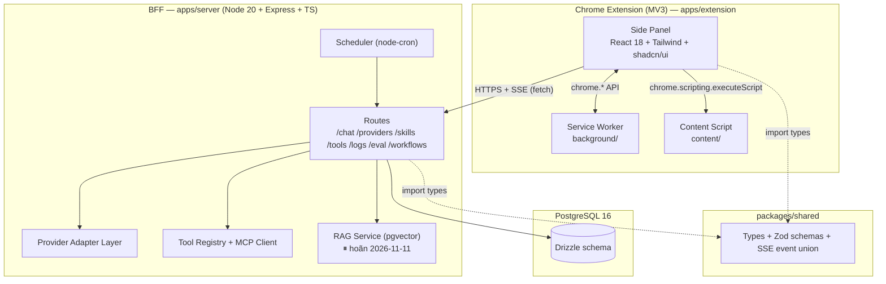

### 1.1 Ranh giới trách nhiệm

| Tầng | Trách nhiệm | KHÔNG được làm |
|---|---|---|
| **Side Panel** | Render, thu thập input, điều khiển trạng thái UI, gọi BFF, đọc `chrome.storage.local` | Không giữ API key dạng rõ khi đang ở chế độ K2; không tự gọi provider API (trừ K3 fallback) |
| **Service Worker** | Điều phối tab, mở/đóng panel, context menu, shortcut, lưu draft | **Không** proxy streaming; **không** giữ state phiên |
| **Content Script** | Trích xuất nội dung trang, đọc selection, gửi về panel | Không tự gọi BFF (tránh leak token); không ghi log |
| **BFF** | Chọn provider, quản lý key, build prompt, gọi provider, stream lại, log, MCP, scheduler | Không chứa logic UI; không tự quyết định UX · *RAG ⏸ hoãn 2026-11-11* |
| **packages/shared** | Type, Zod schema, event union, constants, error codes | Không chứa logic runtime |

---

## 2. Quyết định kiến trúc (ADR)

> Mỗi ADR: **Bối cảnh → Quyết định → Lý do → Hệ quả.**

### ADR-1 — Dùng Side Panel API, không dùng popup
- **Bối cảnh:** popup đóng khi mất focus → không chat được nhiều lượt; Edge Copilot & Gemini đều là panel cố định.
- **Quyết định:** `chrome.sidePanel` (Chrome ≥ 114), mở qua toolbar action.
- **Lý do:** Parity + trải nghiệm multi-turn đúng như hệ thống đối chiếu.
- **Hệ quả:** 1 panel/window; cần `sidePanel` permission; không có `default_popup`.

### ADR-2 — Streaming trực tiếp Side Panel → BFF, không đi qua Service Worker
- **Bối cảnh:** MV3 service worker bị terminate sau ~30s idle; một luồng chat có thể kéo dài vài phút.
- **Quyết định:** Side Panel tự mở `fetch` tới BFF với `Accept: text/event-stream`, đọc stream bằng `ReadableStream` reader.
- **Lý do:** SW không đảm bảo sống suốt stream → phải nối lại hoặc mất dữ liệu.
- **Hệ quả:** Stream không sống sót nếu đóng panel → cần persist message vào DB **ngay khi nhận `done`**, và báo user "đã lưu".

### ADR-3 — SSE thay vì WebSocket
- **Bối cảnh:** Luồng dữ liệu là 1 chiều server → client (token, citation, tool result). Không cần server gọi ngược client giữa chừng.
- **Quyết định:** `text/event-stream` qua HTTP thường.
- **Lý do:** Đơn giản hơn, đi qua proxy dễ, tự reconnect được, không cần lib WS.
- **Hệ quả:** Không có push server→client ngoài luồng chat (notification workflow dùng `chrome.notifications` từ SW, không qua SSE).

### ADR-4 — Drizzle ORM + PostgreSQL 16
- **Bối cảnh:** Cần lưu conversation, log có cấu trúc (cho eval), vector search (RAG).
- **Quyết định:** Drizzle + `pg` driver, `pgvector` extension.
- **Lý do:** Type-safe end-to-end với `packages/shared`; migration SQL đọc được; hỗ trợ `vector` type thuần Postgres.
- **Hệ quả:** Drizzle không có admin UI → dùng `drizzle-kit studio` khi dev.

### ADR-5 — Monorepo pnpm workspace
- **Bối cảnh:** Extension, BFF, eval harness, shared types phải dùng chung type.
- **Quyết định:** `pnpm-workspace.yaml` với `apps/*` + `packages/*`.
- **Lý do:** Một nguồn type; CI cache dễng; deploy tách bạch.
- **Hệ quả:** Cần `build:packages/shared` trước khi build extension. Fallback `npm` nếu pnpm chưa cài.

### ADR-6 — Tailwind CSS + shadcn/ui (copy code vào repo)
- **Bối cảnh:** Cần UI nhanh, nhất quán, accessible, và có thể tự sửa.
- **Quyết định:** Tailwind + shadcn/ui components **copy vào** `apps/extension/src/components/ui/`.
- **Lý do:** Sở hữu 100% code, không phụ thuộc npm runtime, có thể chỉnh sửa sâu; Radix primitives xử lý focus/keyboard/aria đúng chuẩn.
- **Hệ quả:** Phải tự cập nhật component khi shadcn ra bản mới (chấp nhận được).

### ADR-7 — Zustand cho client state
- **Bối cảnh:** State: conversation list, context tabs, settings, streaming buffer.
- **Quyết định:** Zustand (không Redux Toolkit).
- **Lý do:** Nhẹ, selector granular → không re-render toàn bộ thread khi streaming.
- **Hệ quả:** Không có devtools middleware mặc định → thêm `zustand/devtools` ở dev build.

### ADR-8 — Chia dữ liệu: `chrome.storage.local` vs Postgres
- **Bối cảnh:** Extension có thể chạy khi BFF down.
- **Quyết định:** Settings, draft, cache context, conversation id list → `chrome.storage.local`. Nội dung conversation đầy đủ, log, skill, eval → Postgres.
- **Lý do:** Cho phép offline-first; Postgres là nguồn sự thật khi có BFF.
- **Hệ quả:** Cần cơ chế "pending sync" cho conversation tạo ở chế độ K3 → queue trong `chrome.storage.local`, flush khi BFF lên.

### ADR-9 — Ba nguồn API key: K1 / K2 / K3

> ⏸ **Cập nhật 2026-11-08 — K2 + K3 tạm dừng.** Theo quyết định của user, toàn bộ BYOK bị đánh dấu tạm dừng và gỡ khỏi UI:
> - **M1 chỉ dùng K1** (team key trong `.env` của BFF) + Ollama local (không cần key).
> - UI nhập API key đã gỡ khỏi onboarding (bước 2) → provider cần key mà chưa có K1 chỉ hiện thông báo hướng dẫn.
> - **Server giữ nguyên** toàn bộ K2 code: `POST /api/providers/keys` · `GET/DELETE /api/providers/keys/:id` · `POST /api/providers/keys/:id/test` + bảng `provider_keys` (AES-256-GCM). Mở lại = thêm lại UI, **không** migration.
> - K3 (client-side provider pipeline) **chưa** implement — không có file nào trong `apps/extension/src/lib/` cho direct provider.
> - Bảng dưới đây giữ nguyên để giữ tầm nhìn sản phẩm và mở lại nhanh khi cần.

- **Bối cảnh:** Nhóm cần demo nhanh (không ai nhập key), nhưng người dùng thật cần BYOK an toàn, và demo có thể chạy khi Docker chưa bật.
- **Quyết định:**

| Nguồn | Nơi lưu | Bắt buộc BFF? | Dùng khi |
|---|---|---|---|
| **K1 — Team key** | `.env` của BFF (`TEAM_API_KEY`) | Có | Demo/dev, mặc định M0–M1 |
| **K2 — BYOK qua BFF** | Postgres, mã hoá AES-256-GCM | Có | User thật, M2+ |
| **K3 — BYOK direct** | `chrome.storage.local` (đã mã hoá bằng WebCrypto, key sinh từ passphrase) | **Không** | BFF down / offline |

- **Lý do:** Ba nguồn độc lập về mặt vòng đời; K3 cho fallback khi BFF sập.
- **Hệ quả:** Code phải có `ProviderResolutionService` duy nhất chọn nguồn, trả về `{ key, source, model }` — không nơi nào khác đụng tới key.

### ADR-10 — RAG dùng pgvector, không dùng sqlite-vec
- **Bối cảnh:** Cần search trong lịch sử chat / tài liệu đã lưu.
- **Quyết định:** Extension `vector` + index `ivfflat` (hoặc `hnsw`), embed 384 chiều (`all-MiniLM-L6-v2` chạy local qua Ollama hoặc ONNX).
- **Lý do:** Cùng DB, cùng backup, cùng retention policy; không thêm hệ thống file.
- **Hệ quả:** Embedding model phải cố định theo `embedding_model` trong bảng `rag_documents`; đổi model → re-embed toàn bộ.
- **Trạng thái (2026-11-11 — quyết định user):** ADR này **vẫn hiệu lực về mặt thiết kế** nhưng **RAG (T-M2-10/11) đã ⏸ hoãn** → chưa có bảng `rag_documents`, chưa có `apps/server/src/rag/`, chưa có embedder/retriever/indexer. Nền đã có sẵn nếu mở lại: `pgvector/pgvector:pg16` chạy trong `docker-compose.yml` (extension `vector`) · cột `citations.score` đã có. Lý do hoãn: xem [`REQUIREMENTS.md`](REQUIREMENTS.md) §9.3 + [`IMPLEMENTATION_PLAN.md`](IMPLEMENTATION_PLAN.md) §4.1.5.

### ADR-11 — Eval harness chạy trong `apps/eval`, dùng chung type với BFF
- **Bối cảnh:** Harness phải gọi đúng endpoint chat như extension thật.
- **Quyết định:** `apps/eval` là CLI Node dùng `packages/shared` + gọi HTTP vào BFF (không import code UI).
- **Lý do:** Tái lập được, chạy được 1 lệnh, tách biệt UI.
- **Hệ quả:** BFF phải expose API ổn định — mọi thay đổi breaking phải bump version.

### ADR-12 — Không đưa API key vào extension bundle
- **Bối cảnh:** Extension là file .zip có thể bị mở.
- **Quyết định:** K1 và K2 **chỉ** tồn tại ở BFF. Extension không bao giờ nhận key dạng rõ trừ chế độ K3 (user tự nhập, mã hoá local, và đây là lựa chọn của chính user).
- **Lý do:** An toàn mặc định.
- **Hệ quả:** BFF là single point of failure → ADR-9 K3 là đường lùi.
- **Cập nhật 2026-11-08:** K3 **tạm dừng** → BFF **là** single point of failure thực tế ở M1. Người dùng không thể tự mang key; khi BFF chết, panel báo offline (NFR-REL-04) và không chat được.

---

## 3. Cấu trúc thư mục chi tiết

> **Trạng thái M1 (2026-11-04, sau T-M1-23):** cây bên dưới là cấu trúc **đích**. M0 đã implement các phần in đậm; T-M1-01 bổ sung `content/extractor.ts` + `lib/pageContext.ts`; T-M1-23 bổ sung `lib/contextAttach.ts` + `lib/storage.ts` + `components/context/{ContextChips,ContextBudget}.tsx`. Các thư mục còn lại (`chat/`, `skills/`, `tools/`, `settings/`, `workflow/`, `selection.ts`) sẽ được tạo ở M1–M4.
>
> Thực tế M0 + T-M1-01 + T-M1-23 đã có:
> ```text
> apps/extension/
> ├─ public/{manifest.json, icons/{16,32,48,128}.png}
> ├─ sidepanel.html                 # entry HTML (build ra dist/sidepanel.html)
> ├─ src/
> │  ├─ sidepanel/{App.tsx, main.tsx, index.css,
> │  │            components/{PanelHeader,MessageBubble,Composer}.tsx,
> │  │            components/context/{ContextNotice,ContextChips,ContextBudget}.tsx,
> │  │            hooks/useChat.ts, store/chatStore.ts}
> │  ├─ components/ui/{button,input,textarea}.tsx   # shadcn/ui
> │  ├─ background/serviceWorker.ts
> │  ├─ content/{contentScript.ts, extractor.ts}   # extractor = Readability-lite
> │  ├─ lib/{apiClient,sseClient,pageContext,contextAttach,storage,utils}.ts
> │  └─ types/globals.d.ts
> ├─ e2e/{fixtures.ts,sidepanel.spec.ts,extractor.spec.ts,extract.spec.ts,context.spec.ts}
> ├─ tests/{apiClient,chatStore,sseClient,useChat,extractor,pageContext,contextAttach,sharedAlias}.test.ts
> ├─ vite.config.ts                  # side panel + service worker (ESM)
> ├─ vite.content.config.ts          # content script (IIFE, 1 file — §7.5)
> ├─ vitest.config.ts                # alias @sidekick/shared → packages/shared/src (§7.1.1)
> ├─ playwright.config.ts
> ```
> `packages/shared/src/` hiện có: `constants.ts` · `contextBudget.ts` · `errors.ts` · `events.ts` · `pageKind.ts` · `schemas/{chat,extract,provider}.ts` · `types/entities.ts`.
> `apps/server/src/` hiện có: `routes/{health,chat,extract}.ts` · `services/chatService.ts` · `providers/*` · `middleware/*` · `config/env.ts` · `db/*` · `lib/{crypto,safeFetch,pdfExtractor,youtubeExtractor}.ts`.

```text
uddn_extension_chat/
├─ apps/
│  ├─ extension/
│  │  ├─ public/
│  │  │  ├─ manifest.json
│  │  │  └─ icons/{16,32,48,128}.png
│  │  ├─ src/
│  │  │  ├─ sidepanel/
│  │  │  │  ├─ App.tsx
│  │  │  │  ├─ components/
│  │  │  │  │  ├─ ui/            # shadcn/ui đã copy (button, dialog, popover...)
│  │  │  │  │  ├─ chat/          # MessageList, UserMessage, AssistantMessage, Composer...
│  │  │  │  │  ├─ context/       # ContextChips, MentionPopover, CitationChip
│  │  │  │  │  ├─ skills/        # SkillMenu, SkillSettings
│  │  │  │  │  ├─ tools/         # ToolCallBlock, McpSettings
│  │  │  │  │  ├─ settings/      # SettingsPanel + sections
│  │  │  │  │  └─ workflow/      # M4
│  │  │  │  ├─ hooks/            # useChat, useSse, useContextTabs, useShortcuts
│  │  │  │  ├─ state/            # Zustand stores
│  │  │  │  └─ styles/           # tokens.css import
│  │  │  ├─ background/
│  │  │  │  ├─ index.ts          # entry service worker
│  │  │  │  ├─ sidepanel.ts      # mở/đóng panel
│  │  │  │  └─ contextMenu.ts
│  │  │  ├─ content/
│  │  │  │  ├─ index.ts
│  │  │  │  ├─ extractor.ts      # Readability-lite
│  │  │  │  └─ selection.ts
│  │  │  ├─ lib/
│  │  │  │  ├─ apiClient.ts
│  │  │  │  ├─ sseClient.ts
│  │  │  │  ├─ storage.ts
│  │  │  │  └─ crypto.ts
│  │  │  └─ shared/              # constants dùng nội bộ extension
│  │  ├─ vite.config.ts
│  │  └─ tailwind.config.ts
│  ├─ server/
│  │  ├─ src/
│  │  │  ├─ index.ts              # bootstrap
│  │  │  ├─ app.ts                # express app
│  │  │  ├─ routes/
│  │  │  ├─ providers/            # adapter + registry
│  │  │  ├─ tools/                # registry, mcp client, executors
│  │  │  ├─ rag/
│  │  │  ├─ scheduler/
│  │  │  ├─ db/
│  │  │  │  ├─ schema.ts
│  │  │  │  └─ client.ts
│  │  │  ├─ middleware/           # auth, error, origin, ratelimit
│  │  │  └─ lib/                  # logger, crypto, config
│  │  ├─ drizzle.config.ts
│  │  └─ Dockerfile
│  └─ eval/
│     ├─ dataset/
│     │  ├─ tasks.json
│     │  └─ snapshots/
│     ├─ runners/                 # ours.ts, aggregate.ts
│     ├─ judge/                   # prompt.ts, run_judge.ts
│     ├─ metrics/
│     ├─ results/
│     │  ├─ raw/                  # git-ignore
│     │  └─ manual/
│     └─ reports/
├─ packages/shared/
│  └─ src/
│     ├─ index.ts
│     ├─ types/                   # conversation, message, provider, skill...
│     ├─ schemas/                 # Zod
│     ├─ events.ts                # SSE event union
│     ├─ errors.ts                # error codes
│     ├─ contextBudget.ts         # estimateTokens · applyContextBudget · trimHistory
│     └─ constants.ts
├─ design/
│  ├─ tokens.json
│  ├─ tokens.css
│  ├─ components.md
│  ├─ patterns.md
│  └─ a11y-audit.md
├─ docs/
├─ docker-compose.yml
├─ package.json                   # root scripts (pnpm -r)
├─ pnpm-workspace.yaml
├─ AGENTS.md
├─ .cursorrules
├─ .cursor/rules/
└─ .gitignore
```

### 3.1 Dependency graph

```text
packages/shared  ←  apps/extension
                 ←  apps/server
                 ←  apps/eval
```

`packages/shared` **không** được import ngược lại từ apps. Không có import chéo giữa `apps/extension` ↔ `apps/server`.

### 3.2 Scripts gốc (root `package.json`)

| Script | Lệnh | Ý nghĩa |
|---|---|---|
| `pnpm dev` | `pnpm -r --parallel dev` | Chạy song song extension (vite HMR) + server (tsx watch) |
| `pnpm dev:ext` | `pnpm --filter @sidekick/extension dev` | Chỉ extension |
| `pnpm dev:server` | `pnpm --filter @sidekick/server dev` | Chỉ BFF |
| `pnpm build` | `pnpm -r build` | Build tất cả (shared → extension → server) |
| `pnpm build:ext` | `pnpm --filter @sidekick/extension build` | Build extension ra `dist/` |
| `pnpm db:migrate` | `pnpm --filter @sidekick/server db:migrate` | Chạy migration Drizzle |
| `pnpm db:studio` | `pnpm --filter @sidekick/server db:studio` | Mở Drizzle Studio |
| `pnpm test` | `pnpm -r test` | Unit + integration |
| `pnpm test:e2e` | `pnpm --filter @sidekick/eval test:e2e` | Playwright E2E |
| `pnpm eval:run` | `pnpm --filter @sidekick/eval run` | Chạy eval harness |
| `pnpm lint` / `pnpm typecheck` | `eslint .` / `tsc --noEmit` | |

---

## 4. Hợp đồng API (Extension ↔ BFF)

**Base URL mặc định:** `http://localhost:8787/api` (cấu hình được trong Settings, lưu `chrome.storage.local`).

**Headers bắt buộc:**
```
Content-Type: application/json
X-Sidekick-Client: extension      // để BFF áp origin allowlist
X-Request-Id: <uuid v4>            // idempotency + tracing
```

**Error format thống nhất** (mọi endpoint):
```json
{
  "error": {
    "code": "PROVIDER_QUOTA_EXCEEDED",
    "message": "Đã vượt quota của provider.",
    "retryable": true,
    "details": { "provider": "gemini", "retryAfterMs": 30000 }
  }
}
```

### 4.1 Bảng endpoint

| Method | Path | Request | Response | Error codes |
|---|---|---|---|---|
| GET | `/health` | — | `{ status, version, db, uptime }` | — |
| GET | `/providers` | — | `{ items: ProviderInfo[] }` (id, name, models, keySource `K2\|K1\|none`, requiresKey, available, note?) | — |
| GET | `/providers/:id/models` ✅ | — | `ProviderModelsResponse` = `{ providerId, models: string[], source: 'live'\|'fallback' }` — danh sách model **động** gọi API provider thật (có auth header); lỗi → `source: 'fallback'` + danh sách tĩnh (T-M2-02) | `VALIDATION_ERROR`, `NOT_FOUND` |
| GET | `/providers/keys` | — | `{ items: ProviderKeyRecord[] }` (chỉ metadata + masked, **không** trả key gốc) | — |
| POST | `/providers/keys` | `{ providerId, apiKey, label? }` | `201` + `ProviderKeyRecord` (id, providerId, label, masked, createdAt) | `VALIDATION_ERROR`, `MASTER_KEY_NOT_CONFIGURED` |
| DELETE | `/providers/keys/:id` | — | `204` | `NOT_FOUND` |
| POST | `/providers/keys/:id/test` | — | `{ ok, latencyMs, error? }` | `NOT_FOUND`, `MASTER_KEY_NOT_CONFIGURED`, `INVALID_API_KEY` |
| POST | `/chat` | `ChatRequest` | **SSE stream** | `VALIDATION_ERROR`, `NO_KEY_AVAILABLE`, `RATE_LIMITED`, `PROVIDER_VISION_UNSUPPORTED` |
| GET | `/attachments/:id` | — | **binary** (`Content-Type` = mime của ảnh) | `NOT_FOUND` |
| POST | `/extract/pdf` | `{ url }` | `{ text, title?, excerpt?, truncated, error? }` | `VALIDATION_ERROR`, `CONTEXT_PDF_NOT_READABLE`, `CONTEXT_PDF_UNREACHABLE` |
| POST | `/extract/youtube` | `{ url }` | `{ text, title?, excerpt?, truncated, error? }` | `VALIDATION_ERROR`, `CONTEXT_TRANSCRIPT_UNAVAILABLE` |
| POST | `/extract/document` ✅ | `{ fileName, mimeType, data (base64) }` | `{ kind: 'pdf'\|'docx'\|'text', text, title?, excerpt?, truncated, error?, errorMessage? }` — **luôn HTTP 200** cho lỗi nghiệp vụ (FR-CONTEXT-14, T-M2-23) | `VALIDATION_ERROR` (400), `DOCUMENT_TOO_LARGE` (413), `PAYLOAD_TOO_LARGE` (413), `DOCUMENT_UNSUPPORTED_TYPE` / `DOCUMENT_NOT_READABLE` / `DOCUMENT_EMPTY` (trong body, HTTP 200) |
| GET | `/conversations` | `?q=&archived=&limit=&cursor=` ✅ | `{ items, nextCursor }` | `VALIDATION_ERROR` |
| POST | `/conversations` | `{ title? }` ✅ | `201` + `ConversationSummary` | `VALIDATION_ERROR` |
| GET | `/conversations/:id/messages` | — ✅ | `{ conversation, messages, path, turns }` (kèm `citations[]` đã lưu + `turnId`/`variantIndex`/`active`/`aborted`; `path` = đường đi active, `turns` = turn + biến thể) | `VALIDATION_ERROR`, `NOT_FOUND` |
| POST | `/conversations/:id/turns/:turnId/activate` | `{ variantIndex }` ✅ | `{ path, turns }` | `VALIDATION_ERROR`, `NOT_FOUND` |
| PATCH | `/conversations/:id` | `{ title?, pinned?, archived? }` ✅ | `ConversationSummary` | `VALIDATION_ERROR`, `NOT_FOUND` |
| DELETE | `/conversations/:id` | — ✅ | `204` | `VALIDATION_ERROR`, `NOT_FOUND` |
| DELETE | `/conversations` | — ✅ | `200` + `{ deleted: number }` (xoá toàn bộ lịch sử chat — FR-SETTINGS-03 + NFR-SEC-07, T-M1-12) | — |
| GET | `/skills` ✅ | `?scope=builtin\|user&q=` | `{ items: Skill[] }` — gộp **built-in** (registry trong code) + skill của user trong DB (T-M2-04) | `VALIDATION_ERROR` |
| POST | `/skills` ✅ | `{ name, description?, promptTemplate, tags?, model? }` | `201` + `Skill` — tên được chuẩn hoá thành slug (T-M2-04) | `VALIDATION_ERROR`, `CONFLICT` |
| PATCH | `/skills/:id` ✅ | `{ name?, description?, promptTemplate?, enabled?, tags?, model? }` | `Skill` (T-M2-04) | `VALIDATION_ERROR`, `NOT_FOUND`, `FORBIDDEN` |
| DELETE | `/skills/:id` ✅ | — | `204` — xoá **built-in** bị từ chối `FORBIDDEN` (T-M2-04) | `NOT_FOUND`, `FORBIDDEN` |
| GET | `/tools` | — | `ToolInfo[]` (builtin + MCP servers + trạng thái kết nối) | — |
| POST | `/tools/mcp/servers` | `{ name, command, args?, env? }` | `McpServer` | `VALIDATION_ERROR` |
| DELETE | `/tools/mcp/servers/:id` | — | `204` | `NOT_FOUND` |
| POST | `/tools/invoke` | `{ toolName, args }` | `{ output, ok }` | `TOOL_ERROR`, `APPROVAL_REQUIRED` |
| GET | `/logs` | `?limit=&offset=&provider=&from=&to=&conversationId=` ✅ | `{ items, total }` — **chỉ metadata**, không có `promptText`/`responseText`/`contextSnapshot` (T-M1-14) | `VALIDATION_ERROR` |
| GET | `/usage` | `?from=&to=` ✅ | `{ totalTokens, totalCostUsd, byDay[] }` — tổng hợp token + chi phí theo ngày (T-M1-14) | `VALIDATION_ERROR` |
| GET | `/budget` | — ✅ | `BudgetStatus` = `{ settings, spentUsd, limitUsd, remainingUsd, percentUsed, state, period, periodStart, periodEnd }` — cấu hình + chi phi đã dùng trong kỳ (T-M2-03b) | — |
| PUT | `/budget` | `BudgetSettingsPatch` (partial) ✅ | `BudgetStatus` — sau khi upsert (T-M2-03b) | `VALIDATION_ERROR` |
| POST | `/rag/search` | `{ query, topK? }` | `{ documents: [{ id, title, snippet, score }] }` | — |
| GET | `/rag/documents` | `?q=&limit=` | `RagDocument[]` | — |
| DELETE | `/rag/documents/:id` | — | `204` | `NOT_FOUND` |
| POST | `/eval/run` | `{ datasetVersion, taskIds?, systems? }` | `{ runId }` | `VALIDATION_ERROR` |
| GET | `/eval/runs` | — | `EvalRun[]` | — |
| GET | `/eval/runs/:id/results` | — | `EvalResult[]` | `NOT_FOUND` |
| POST | `/workflows` | `WorkflowInput` | `Workflow` | `VALIDATION_ERROR` |
| GET | `/workflows` | — | `Workflow[]` | — |
| PATCH | `/workflows/:id` | `Partial<WorkflowInput>` | `Workflow` | `NOT_FOUND` |
| DELETE | `/workflows/:id` | — | `204` | `NOT_FOUND` |
| POST | `/workflows/:id/run` | `{ dryRun?: boolean }` | `{ runId, status }` | `WORKFLOW_ERROR` |
| GET | `/workflow-runs` | `?workflowId=&limit=` | `WorkflowRun[]` | — |
| GET | `/workflow-runs/:id` | — | `WorkflowRun` (kèm step runs) | `NOT_FOUND` |

> Endpoint `/workflows*` chỉ tồn tại khi M4 được implement — extension phải **feature-detect** qua `GET /health` → `capabilities: { workflows: boolean }`.
>
> Endpoint `/extract/pdf` và `/extract/youtube` đã **implement** (T-M1-21, T-M1-22). Body request là `{ kind, url }` với `kind ∈ { 'pdf', 'youtube' }` (validate bằng `extractRequestSchema`). **Lỗi nghiệp vụ trả HTTP 200** kèm `{ error, errorMessage }` trong body — client không phân biệt theo status, chỉ 400 khi body sai schema. Chi tiết luồng & ràng buộc bảo mật ở §7.3.1.
>
> Endpoint `/conversations*` đã **implement** (T-M1-09). `GET /conversations/:id/messages` thay cho `GET /conversations/:id` (trả **kèm** messages + citations trong 1 response để hydrate thread chỉ cần 1 request). Chi tiết ở §7.10.

### 4.2 Shape của `ChatRequest`

> **Shape đang chạy thật (M0 + T-M1-01 + T-M1-23 + T-M1-24)** — nguồn sự thật là `packages/shared/src/schemas/chat.ts`:
>
> ```ts
> interface ChatRequest {
>   messages: Array<{
>     role: 'user' | 'assistant' | 'system'
>     content: string
>     attachments?: ImageAttachment[]   // FR-VISION-01 — xem §4.2.2
>   }>
>   conversationId?: string
>   provider?: 'mock' | 'groq' | 'openrouter' | 'gemini' | 'ollama'
>   model?: string
>   systemPrompt?: string
>   context?: ContextBundle   // xem §4.2.1
>   temperature?: number
>   maxOutputTokens?: number
>   stream?: boolean
>   skillId?: string              // FR-SKILL-01 — T-M2-04, xem §7.25
> }
> ```
>
> Giới hạn: `MAX_PAGE_TEXT_CHARS = 40_000` (nội dung trang) · `MAX_EXCERPT_CHARS = 500` · `MAX_CONTEXT_CHARS = 100_000` · `MAX_CONTEXT_ITEMS = 20`.

#### 4.2.1 Hợp đồng `context` — bundle item + tier ưu tiên (T-M1-23)

> **Mô hình mới: chỉ những gì user chủ động đính kèm.** Trước T-M1-23, `context` là 1 object phẳng đại diện cho tab active và **luôn** được gửi ở mọi lượt chat.

```ts
/** Một nguồn context do user đính kèm. */
interface ContextItem {
  id: string                    // định danh để gỡ / cập nhật trong UI
  kind: 'selection' | 'tab' | 'file'
  tier: 'selection' | 'attachment' | 'currentTab'  // ưu tiên khi cắt bớt
  url?: string
  title: string
  text?: string                 // nội dung đã trích (có thể bị cắt)
  excerpt?: string              // trích đoạn ngắn để preview trên chip
  sourceKind?: 'html' | 'pdf' | 'youtube'
  tabId?: number
}

/** Bundle gửi lên BFF. */
interface ContextBundle {
  items: ContextItem[]          // tối đa 20 item
}
```

**Quy tắc:**

1. **Không tự đính kèm** — tab active **không** tự vào context. Chỉ vào khi user bấm "Thêm trang này" / `@` (T-M1-05) / bôi đen (T-M1-02) / upload file (T-M1-24).
2. **Không đính kèm gì → không gửi `context`** — request chỉ có `messages` → chat hoạt động như LLM thuần (FR-CONTEXT-13). Lịch sử hội thoại **vẫn** được gửi để duy trì ngữ cảnh cuộc trò chuyện.
3. **Ưu tiên khi cắt** — `selection` > `attachment` > `currentTab`; lịch sử chat cắt sau cùng (bằng `trimHistory`).
4. **Toggle** — chip ở composer bật/tắt việc gửi context, mặc định **TẮT**; trạng thái lưu ở `chrome.storage.local` key `sidekick.contextEnabled`.
5. **Backward compatible** — `chatRequestSchema.context` dùng `z.preprocess(normalizeContext, …)` nên vẫn nhận shape cũ phẳng `{ url, title, text, … }` → bọc thành `items[0]` (tier `currentTab`) + item `selection` nếu có `selectedText`. Eval harness / client cũ không vỡ.

**Ngân sách context 2 tầng (FR-CONTEXT-07):**

| Tầng | Nơi chạy | Vai trò |
|---|---|---|
| 1 — client | `apps/extension` (`buildRequestContext`) | Tính **ước lượng** để hiển thị meter "Đã dùng X/Y token" và tiết kiệm băng thông |
| 2 — server | `apps/server` (`buildProviderMessages`) | **Cắt lại lần nữa** trước khi gọi provider → server là nguồn chân lý (client có thể gửi bản siêu lớn) |

Cả 2 tầng dùng **cùng một hàm** `applyContextBudget()` trong `packages/shared/src/contextBudget.ts` → số liệu meter không lệch với cái thực sự gửi đi.

> **Shape đích (M2+)** — multi-tab, skills, tools, settings:
>
> ```ts
> interface ChatRequest {
>   conversationId?: string;          // không có → tạo mới
>   message: string;
>   contextTabs: Array<{
>     tabId: number;
>     url: string;
>     title: string;
>     content?: string;               // đã trích xuất ở client
>     excerpt?: string;               // selection context
>     favicon?: string;
>   }>;
>   providerId: string;
>   model: string;
>   keySource: 'K1' | 'K2' | 'K3';    // client chỉ đề xuất; BFF quyết định thực tế
>   settings: {
>     temperature?: number;
>     maxTokens?: number;
>     enableWebSearch?: boolean;
>     enableRag?: boolean;
>     language?: 'vi' | 'en';
>   };
>   tools?: string[];                 // danh sách tool được phép dùng
>   skills?: string[];                // skill được user chọn
> }
> ```

#### 4.2.2 Hợp đồng `attachments` — ảnh đính kèm (FR-VISION-01, T-M1-24)

> **Ảnh KHÔNG phải `ContextItem`.** Ảnh là **đầu vào trực tiếp** của câu hỏi, không phải context thứ cấp. Vì vậy nó **không** phụ thuộc toggle `contextEnabled` và **không** bị `applyContextBudget()` cắt theo số ký tự.

```ts
/** Một ảnh đính kèm trong một turn hội thoại. */
interface ImageAttachment {
  id: string                    // uuid do client sinh → upsert idempotent, render ngay trong UI
  mimeType: 'image/png' | 'image/jpeg' | 'image/webp' | 'image/gif'
  data: string                  // base64 THUẦN (không prefix `data:<mime>;base64,`)
  bytes: number                 // kích thước byte ảnh gốc
  width?: number
  height?: number
  fileName?: string
}
```

**Giới hạn (`VISION` trong `packages/shared/src/constants.ts`):**

| Hằng | Giá trị | Ý nghĩa |
|---|---|---|
| `MAX_IMAGE_BYTES` | 5 000 000 | 5 MB / ảnh |
| `MAX_IMAGES_PER_MESSAGE` | 4 | 4 ảnh / lượt |
| `MAX_TOTAL_IMAGE_BYTES` | 12 000 000 | 12 MB tổng / lượt |
| `TOKEN_ESTIMATE_PER_IMAGE` | 258 | ước lượng token để cắt ngân sách context |

**Luồng server (`apps/server`):**

```
POST /api/chat { messages[].attachments[] }
  → validate ở biên (Zod: imageAttachmentListSchema)
  → persistAttachments() giải mã base64 → bảng message_attachments (bytea)
  → loadRecentAttachments() lấy ảnh gần nhất của conversation
  → mergeImages() hợp nhất ảnh lượt này + ảnh lượt trước (dedup theo base64)
  → buildProviderMessages() gắn ảnh vào USER TURN CUỐI CÙNG
  → provider adapter map sang payload đúng chuẩn (xem §4.4)
```

**Multi-turn:** lượt 2 chỉ gửi text → server tự tải ảnh của lượt 1 từ DB → model vẫn "thấy" ảnh. Extension **không** phải upload lại base64.

**Token budget:** `buildProviderMessages` trừ `images.length * TOKEN_ESTIMATE_PER_IMAGE` khỏi `historyBudget` trước khi `trimHistory` → ảnh không làm tràn context window.

### 4.3 Giao thức SSE
**Event union (dùng chung, `packages/shared/src/events.ts`):**

```ts
type ChatEvent =
  | { type: 'meta'; messageId: string; conversationId: string; provider: string; model: string; keySource: string; requestId: string }
  | { type: 'token'; delta: string; index: number }
  | { type: 'citation'; index: number; url: string; title: string; snippet: string; tabId?: number }
  | { type: 'tool_call'; id: string; name: string; args: unknown }
  | { type: 'tool_result'; id: string; ok: boolean; output: string; durationMs: number }
  | { type: 'usage'; tokensIn: number; tokensOut: number; costUsd: number }
  | { type: 'provider_switch'; from: string; to: string; reason: string; model?: string }
  | { type: 'budget'; state: 'disabled' | 'ok' | 'warning' | 'exceeded'; spentUsd: number; limitUsd: number; percentUsed: number; period: 'daily' | 'monthly' }
  | { type: 'error'; code: string; message: string; retryable: boolean; retryAfterSeconds?: number }
  | { type: 'done'; finishReason: 'stop' | 'length' | 'tool' | 'aborted' | 'error'; messageId: string };
```

**Format wire:**
```
event: token
data: {"type":"token","delta":"Xin","index":0}

event: done
data: {"type":"done","finishReason":"stop","messageId":"..."}
```

**Quy tắc:**
1. Luôn gửi `meta` đầu tiên (client cần `conversationId` để lưu).
2. `token` mang `delta` (phần text tăng thêm), **không** gửi toàn bộ message → giảm băng thông.
3. `done` là event cuối cùng, **bắt buộc** — client dùng nó để finalize (persist, tính cost).
4. Khi lỗi: gửi `event: error` rồi `event: done` với `finishReason:'error'`.
5. Client **phải** xử lý `done` cả khi stream bị cắt đột ngột (network drop) → coi như `finishReason:'aborted'`, hiện nút "Tiếp tục"/"Tạo lại".
6. Reconnect: client không tự reconnect giữa luồng (mất context). Thay vào đó bấm "Tạo lại" (regenerate) — đơn giản và tránh trùng nội dung.
7. `budget` (T-M2-03b) được emit **trước** `meta` (server kiểm tra hạn mức trước khi gọi provider) và **thêm 1 lần** sau lượt (đã cộng `costUsd` của lượt) → banner cập nhật ngay.
7. Server gửi heartbeat comment `: ping` mỗi 15s để giữ kết nối qua proxy.
8. `citation` (FR-CONTEXT-10 — T-M1-08) phát **sau** toàn bộ `token*`, **trước** `usage`/`done` — server chỉ biết marker `[N]` sau khi stream kết thúc. Chi tiết: [§7.9](#79-citation-marker-n--sse--chip-fr-context-10--t-m1-08).
9. `error` mang **thông tin lỗi thật** (T-M1-19): `code` (error code chuẩn) · `retryable` (**suy ra từ `code`**, không hardcode `true`) · `retryAfterSeconds` (từ header `Retry-After` của provider khi HTTP 429). Chi tiết: [§7.15](#715-states--retry--connection-status-fr-chat-14--fr-ux-08--nfr-rel-02--nfr-rel-04--t-m1-19).
10. `provider_switch` (FR-PROVIDER-04 — T-M2-02) phát **giữa** luồng (sau `meta`, trước `token` đầu tiên của provider mới) khi server fallback sang provider dự phòng. Chi tiết: [§7.22](#722-model-picker-động--fallback-chain-runtime-fr-provider-0304--t-m2-02).

### 4.4 Chiến lược provider & fallback

```
resolveKey(providerId, keySource)
  → K2: tìm key active trong DB, decrypt bằng MASTER_KEY
  → K1: đọc TEAM_API_KEY từ env
  → K3: không có ở server → trả lỗi NO_KEY_AVAILABLE, client tự gọi provider trực tiếp
```

Fallback chain: provider chính → provider dự phòng (cấu hình trong settings) → trả lỗi kèm gợi ý cấu hình.

#### 4.4.2 Provider ưu tiên (preferred-first) — T-M1-25

Khi client gửi `ChatRequest.provider` (provider user chọn ở onboarding), `chatService` **đặt provider đó ở đầu** chuỗi thay vì **thay thế** toàn bộ chain:

```ts
const chain = request.provider
  ? [...new Set([request.provider, ...registry.getFallbackChain()])]
  : registry.getFallbackChain()
```

→ Provider ưu tiên được dùng trước, nhưng nếu provider đó lỗi (thiếu key, 5xx, timeout) thì vẫn **fallback** được như cũ (FR-PROVIDER-04). Không có `request.provider` → hành vi không đổi.

#### 4.4.3 Provider không cần API key — Ollama (T-M1-25)

`OpenAiCompatibleProvider` nhận thêm option `requiresKey?: boolean` (mặc định `true`). Ollama — provider local, không cần key — được đăng ký với `requiresKey: false` → `chatService` **bỏ qua** bước resolve key, và `buildHeaders` trả `{}` (không gửi header `Authorization`).

| Provider | `requiresKey` | `keySource` khi không có key |
|---|---|---|
| `mock` | `false` | `none` |
| `ollama` | `false` | `none` |
| `groq` / `openrouter` / `gemini` | `true` | `K2` (DB) → `K1` (env) → `none` |

**Probe Ollama**: `detectOllama(baseUrl, timeoutMs = 1500)` gọi `GET /api/tags` (endpoint native, trả `{ models: [{ name }] }`) → `{ available, models, error }`. Timeout ngắn để onboarding không bị treo khi user chưa bật Ollama. Kết quả dùng cho `ProviderInfo.available` + `ProviderInfo.note` (tiếng Việt) hiển thị ở bước 2 của onboarding.

> Env: `OLLAMA_BASE_URL` (mặc định `http://127.0.0.1:11434/v1`) · `OLLAMA_MODEL` (mặc định `llama3.2`).

#### 4.4.1 Hỗ trợ vision của provider (FR-VISION-01, T-M1-24)

Mỗi `ProviderAdapter` phải cài `supportsVision(model: string): boolean`. Khi request có ảnh, `createChatStream` **bỏ qua** provider/model không hỗ trợ vision và chuyển sang provider tiếp theo trong chain. Nếu hết chain → trả lỗi `PROVIDER_VISION_UNSUPPORTED` (không crash, không mất tiến trình).

| Provider | `supportsVision()` | Payload ảnh |
|---|---|---|
| `gemini` | **luôn `true`** | `parts: [{ text }, { inline_data: { mime_type, data } }]` |
| `openrouter` | theo tiền tố model (`google/gemini`, `openai/gpt-4o`, `anthropic/claude-3`, `anthropic/claude-4`, `meta-llama/llama-3.2`, `qwen/qwen2-vl`, `google/gemma`) | `content: [{ type:'text' }, { type:'image_url', image_url: { url: 'data:<mime>;base64,<data>' } }]` |
| `groq` | theo tiền tố model (`meta-llama/llama-4-scout`, `meta-llama/llama-4-maverick`, `meta-llama/llama-3.2-11b-vision`, `meta-llama/llama-3.2-90b-vision`) | như OpenAI-compatible |
| `mock` | `true` (để test end-to-end) | echo số ảnh trong text: `[mock] Nhan duoc 1 anh (image/png)` |
| `ollama` | theo tiền tố model (`llama3.2-vision`, `llava`, `bakllava`, `qwen2-vl`, `qwen2.5-vl`, `minicpm-v`, `moondream`, `gemma3`) | như OpenAI-compatible |

> **Lưu ý:** model mặc định của Groq (`openai/gpt-oss-120b`) **không** hỗ trợ ảnh → khi user đính kèm ảnh, server tự fallback sang `openrouter` hoặc `gemini`. Người dùng không cần chỉnh tay.

### 4.5 Contract eval dataset (T-M2-12 — nền cho eval harness)

> Nguồn sự thật cho shape: [`EVAL_PLAN.md`](EVAL_PLAN.md) §3.1 (1 task) + §3.2 (8 nhóm).
> Nguồn sự thật cho **code**: [`packages/shared/src/schemas/eval.ts`](../packages/shared/src/schemas/eval.ts) (Zod).

#### 4.5.1 Vì sao đặt ở `packages/shared`?

| Consumer | Dùng để |
|---|---|
| `apps/eval` (`src/dataset.ts`) | Validate `dataset/tasks.json` — reject dataset sai shape **trước** khi chạy |
| `apps/server` (tương lai) | Nếu sau này phục vụ dataset / nhận dataset từ client → dùng **cùng 1 schema** |

→ 1 nguồn sự thật, không viết 2 bản. **Không** thêm dependency mới cho `apps/eval` (Zod đã có sẵn trong repo).

#### 4.5.2 Schema

```ts
export const EVAL_GROUPS = [
  'page_qa', 'summarize', 'cross_tab', 'writing',
  'vision', 'doc_extract', 'video_transcript', 'general_qa',
] as const

export const evalGroupSchema = z.enum(EVAL_GROUPS)
export const evalLangSchema = z.enum(['vi', 'en'])

export const evalPageSchema = z.object({
  url: z.string().url(),
  title: z.string(),
  snapshot_path: z.string().min(1),
  content_hash: z.string().min(1),
})

export const evalReferenceSchema = z.object({
  key_points: z.array(z.string().min(1)).optional(),
  must_include_facts: z.array(z.string().min(1)).optional(),
  must_not_contain: z.array(z.string().min(1)).optional(),
})

export const evalTaskSchema = z.object({
  id: z.string().min(1),
  group: evalGroupSchema,
  lang: evalLangSchema,
  page: evalPageSchema,
  prompt: z.string().min(1),
  reference: evalReferenceSchema.optional(),
  expected_citations: z.number().int().nonnegative().optional(),
  tags: z.array(z.string().min(1)).optional(),
  notes: z.string().optional(),
  // T-M2-12: mo rong
  pages: z.array(evalPageSchema).optional(),
  assets: z.array(evalAssetSchema).optional(),
  context_mode: evalContextModeSchema.optional(),
})

export const evalTaskListSchema = z.array(evalTaskSchema)
```

**Mở rộng T-M2-12 (2026-11-11):** contract thêm **3 field optional** + **1 schema output** (mọi thứ **optional** → dataset M1 chỉ có `page` vẫn hợp lệ):

| Field / schema | Ý nghĩa |
|---|---|
| `pages?: EvalPage[]` | Nhóm `cross_tab` — 2–3 tab. `page` luôn là tab đầu, `pages` chứa các tab còn lại |
| `assets?: EvalAsset[]` | Nhóm `vision` (ảnh) + `doc_extract` (PDF) — **chỉ lưu đường dẫn + metadata**, **không** nhét base64 vào JSON |
| `context_mode?: 'none' \| 'page' \| 'pages'` | Nhóm `general_qa` dùng `'none'` → request **không** có payload `context` (đo đường "chat thuần LLM" — FC-12) |
| `evalAssetSchema` | `{ kind: 'image' \| 'pdf', path, mime_type, bytes, description? }` |
| `evalContextModeSchema` | `z.enum(['none', 'page', 'pages'])` |
| `evalJudgeScoresSchema` | Output judge: `R1`–`R5` + `R7` (số nguyên 1–5) |
| `evalJudgeResultSchema` | Output judge đầy đủ: `{ scores, missing_key_points[], hallucinated_claims[], citation_check: { cited, verified }, reasoning }` |

**Quy ước field:** **snake_case** (`snapshot_path` · `content_hash` · `key_points` · `must_include_facts` · `must_not_contain` · `expected_citations`) — vì dataset là JSON **interchange**, dùng chung với transcript thủ công của Edge/Gemini.

**Nhóm `workflow` không có trong `EVAL_GROUPS`** — nó thuộc M4 (`EVAL_PLAN.md` §3.2.1) và chỉ chạy khi đã implement workflow → thêm sau, không làm dataset M2 bị reject.

#### 4.5.3 Validator của `apps/eval`

`apps/eval/src/dataset.ts` → `validateTask()` dùng `evalTaskSchema.safeParse()`:

- Lỗi → `throw` kèm **đường dẫn field** cụ thể (`must_include_facts: Expected array, received string`).
- `apps/eval/src/types.ts` **re-export** từ `@sidekick/shared` → `EvalGroup` · `EvalLang` · `EvalTask` · `EVAL_GROUPS` (không còn bản sao trong `apps/eval`).

#### 4.5.4 Trạng thái dataset

`apps/eval/dataset/tasks.json` — **T-M2-12 đã điền** (2026-11-11): **52 task / 8 nhóm**, 26 VI + 26 EN, **100%** có `must_include_facts`.

| Nhóm | Số task | Nhóm | Số task |
|---|---|---|---|
| `page_qa` | 12 | `vision` | 4 |
| `summarize` | 10 | `doc_extract` | 2 |
| `cross_tab` | 10 | `video_transcript` | 2 |
| `writing` | 8 | `general_qa` | 4 |

- **Snapshot:** 47 file text trong `dataset/snapshots/` (đóng băng nội dung trang thật) + `dataset_meta.json` (URL nguồn · license · sha256 checksum).
- **Assets:** `dataset/assets/` — 4 ảnh PNG nhỏ (logo PostgreSQL / Python / Rust / W3C) cho nhóm `vision`.
- **Tái lập:** hash `content_hash` của mỗi snapshot được **verify** bằng test (`datasetQuality.test.ts`) → dataset hỏng thì CI đỏ.

#### 4.5.5 Kiểm thử

`apps/eval/tests/dataset.test.ts` (11 test) — fixture hợp lệ cho **từng** group trong 8 group · giữ nguyên field snake_case · field optional không bắt buộc · reject: group sai · `must_include_facts` sai kiểu · thiếu `page.snapshot_path` · thiếu `id` · `lang` sai · dataset không phải array · `filterTasks` lọc theo group + lang.

`packages/shared/tests/evalSchema.test.ts` (mới — T-M2-12) — validate `evalAssetSchema` · `evalContextModeSchema` · `evalJudgeResultSchema` (reject score ngoài 1–5 · `missing_key_points` mặc định `[]` · `citation_check` mặc định `{cited:0, verified:0}`).

`apps/eval/tests/datasetQuality.test.ts` (mới — T-M2-12) — kiểm tra dataset **thật**: ≥ 44 task · ≥ 80% có `must_include_facts` · ≥ 40% VI · đủ 8 nhóm · **mỗi nhóm có cả VI + EN** · file snapshot tồn tại + `content_hash` khớp.

---

## 5. Data model (Drizzle / PostgreSQL 16)

> Bản rút gọn ở [`REQUIREMENTS.md`](REQUIREMENTS.md) §7.2. Ở đây là bản đầy đủ kèm index & retention.

### 5.1 Bảng chính

| Bảng | Cột chính | Index |
|---|---|---|
| `conversations` | id uuid pk, title text, created_at, updated_at, pinned bool, archived bool, meta jsonb | `(archived, updated_at desc)`, `(pinned, updated_at desc)` |
| `messages` | id uuid pk, conversation_id fk, role text, content text, meta jsonb, created_at | `(conversation_id, created_at)` |
| `message_attachments` | id uuid pk (client sinh), message_id fk, conversation_id fk, mime_type text, byte_size int, ord int, width int, height int, file_name text, **data bytea**, created_at | `(message_id)`, `(conversation_id, created_at desc)`, unique `(message_id, ord)` |
| `citations` | id uuid pk, message_id fk, idx int, url text, title text, snippet text, tab_id int, score real | `(message_id)` |
| `tool_calls` | id uuid pk, message_id fk, name text, args jsonb, output text, status text, approval_required bool, approved_by_user bool, started_at, finished_at | `(message_id)` |
| `skills` | id uuid pk, name text unique, description text, prompt_template text, scope text, enabled bool, tags text[], **model text nullable**, created_at, updated_at | `(scope, enabled)`, unique `(name)` |
| `tool_registry` | id uuid pk, name text unique, kind text (builtin\|mcp), server_id uuid nullable, schema jsonb, enabled bool | `(kind)` |
| `mcp_servers` | id uuid pk, name text unique, transport text (stdio\|http), command text, args jsonb, env jsonb, enabled bool, last_connected_at | — |
| `rag_documents` *(chưa tạo — ⏸ hoãn 2026-11-11)* | id uuid pk, source_type text (message\|file\|url), ref_id text, title text, content text, embedding vector(384), embedding_model text, metadata jsonb, created_at | HNSW/IVFFlat trên `embedding` |
| `workflows` | id uuid pk, name text, description text, steps jsonb, schedule text nullable, enabled bool, created_at, updated_at | `(enabled)` |
| `workflow_runs` | id uuid pk, workflow_id fk, status text, started_at, finished_at, error text, output text | `(workflow_id, started_at desc)` |
| `workflow_step_runs` | id uuid pk, workflow_run_id fk, step_index int, status text, input jsonb, output text, tokens int, cost_usd numeric, error text | `(workflow_run_id, step_index)` |
| `request_logs` | id uuid pk, request_id text unique, conversation_id, provider, model, key_source, prompt_text, context_hash, context_snapshot jsonb, response_text, tokens_in, tokens_out, cost_usd numeric, ttft_ms, latency_ms, tool_calls jsonb, error text, created_at | `(created_at desc)`, `(provider, created_at desc)` |
| `provider_keys` | id uuid pk, provider_id text, label text, ciphertext text, iv text, auth_tag text, hint text (4 ký tự cuối), is_active bool, created_at, last_used_at | `(provider_id, is_active)` |
| `budget_settings` | **id text pk** (`'default'` — singleton), enabled bool, limit_usd numeric(12,6), warn_threshold_percent int, period text (`daily`\|`monthly`), hard_block bool, created_at, updated_at | — |
| `eval_datasets` | id uuid pk, version text unique, task_count int, source text, tasks jsonb, checksum text, created_at | — |
| `eval_runs` | id uuid pk, dataset_id fk, dataset_version, judge_model, started_at, finished_at, notes | `(dataset_version)` |
| `eval_results` | id uuid pk, run_id fk, task_id, system, rubric jsonb, overall numeric, judge_raw text, created_at | `(run_id, task_id)` |
| `eval_judgments` | id uuid pk, result_id fk, criterion, score int, reasoning, judge_model, judge_prompt_hash, created_at | `(result_id)` |

### 5.2 Retention policy

| Bảng | Mặc định | Tuỳ chọn |
|---|---|---|
| `messages`, `citations`, `tool_calls` | Giữ vô hạn (lịch sử chat của user) | Xoá theo conversation |
| `request_logs` | 90 ngày | 30 / 365 / vô hạn — **đã enforce** (T-M1-14): `pruneRequestLogs()` chạy lúc khởi động + mỗi 24 h, đọc `LOG_RETENTION_DAYS` |
| `context_snapshot` | **Tắt mặc định** (chỉ lưu `context_hash`) | Bật để debug — qua setting `LOG_CONTEXT_SNAPSHOT` (T-M1-06) |
| `rag_documents` *(chưa tạo — ⏸ hoãn)* | Giữ cùng với nguồn | Xoá thủ công |
| `eval_runs` / `eval_results` | Vô hạn (bằng chứng đồ án) | — |
| `provider_keys` | Giữ đến khi user xoá | — |

> **`request_logs` là dữ liệu nhạy cảm.** Mặc định **không** lưu `prompt_text`/`response_text` đầy đủ mà chỉ lưu hash + metadata. Bật lưu đầy đủ là một setting riêng, có cảnh báo rõ trong UI (FR-SETTINGS-04).

### 5.3 Migration

- `drizzle-kit generate` → file SQL trong `apps/server/drizzle/` → `drizzle-kit migrate` khi khởi động container.
- Migration chạy tự động trong entrypoint của Docker image (trước khi start server).

**Danh sách migration hiện có:**

| Migration | Nội dung |
|---|---|
| `0000_adorable_sister_grimm.sql` | Schema gốc (conversations, messages, citations, tool_calls, request_logs…) |
| `0001_puzzling_mathemanic.sql` | `message_attachments` (FR-VISION-01 — T-M1-24) |
| `0002_certain_vector.sql` | `request_logs.fallback_from` (T-M2-02) |
| `0003_good_mimic.sql` | `budget_settings` (FR-PROVIDER-06 — T-M2-03b) |
| `0004_worthless_earthquake.sql` | **Bảng `skills`** (FR-SKILL-01/02/03 — T-M2-04): `id` · `name` unique · `description` · `prompt_template` · `scope` · `enabled` · `tags text[]` · `model` · `created_at` · `updated_at` + index `skills_name_idx` (unique) + `skills_scope_enabled_idx` |
| `0005_skill_tab_condition.sql` | `skills.tab_condition` **jsonb** nullable (FR-SKILL-06 — T-M2-21) — `{ useCurrentTab, useSelectedTabs }` |

---

## 6. Bảo mật

### 6.1 Mã hoá API key

- Thuật toán: **AES-256-GCM**.
- `MASTER_KEY`: biến môi trường 32 bytes (base64). Không commit. `.env.example` chỉ có placeholder.
- Mỗi key lưu: `ciphertext` + `iv` (12 bytes random) + `auth_tag`.
- `hint`: 4 ký tự cuối để user nhận ra key nào là key nào, **không** đủ để dùng.
- Khi `MASTER_KEY` đổi → key cũ không decrypt được → `POST /providers/keys/:id/test` trả `INVALID_API_KEY` kèm hướng dẫn nhập lại key.
- BFF **chưa có** `MASTER_KEY` → `POST /providers/keys` trả `MASTER_KEY_NOT_CONFIGURED` (500) — không lưu được key thay vì lưu plaintext rỗng.

### 6.2 Origin allowlist (BFF)

BFF chỉ nhận request từ extension. Kiểm tra header `Origin` / `X-Sidekick-Client`:
- Allow: `chrome-extension://<extension-id>` (id thật nằm trong `.env` → `ALLOWED_ORIGINS`), `http://localhost:*` cho dev.
- CORS: `origin` cụ thể (không dùng `*`), `credentials: false`.
- BFF **không** lộ ra internet: bind `127.0.0.1` mặc định trong docker-compose.
- `X-Request-Id` nằm trong `allowedHeaders` **và** `exposedHeaders` (T-M1-14) → client gửi và đọc được id.

### 6.2.1 Log format & dữ liệu nhạy cảm (T-M1-14)

| Nội dung log | Mặc định | Bật/tắt bằng |
|---|---|---|
| Log HTTP **JSON** (method · path · status · duration · request-id) | **BẬT** | `LOG_LEVEL` |
| `request_logs` — metadata (provider · model · token · cost · ttft · latency · `context_hash`) | **BẬT** | `LOG_REQUESTS=true` |
| `request_logs.prompt_text` / `response_text` | **TẮT** | `LOG_FULL_CONTENT=true` (chứa nội dung người dùng) |
| `request_logs.context_snapshot` | **TẮT** | `LOG_CONTEXT_SNAPSHOT=true` (chứa nội dung trang) |
| API `GET /api/logs` · `GET /api/usage` | **Chỉ metadata** | Luôn luôn — không bao giờ trả nội dung |

> **Không bao giờ** ghi API key hay body request vào log. Id trong log phải qua bộ lọc charset (`A-Za-z0-9._:/-`, ≤ 200 ký tự) để chống **log injection**. Chi tiết: §7.16.

### 6.3 MV3 extension security

- `manifest.json`:
  - `permissions`: `["sidePanel", "scripting", "storage", "tabs", "contextMenus", "notifications"]`
  - `host_permissions`: `["<all_urls>"]` — **bắt buộc** vì `activeTab` không được cấp khi user tương tác trong side panel.
  - `content_security_policy.extension_pages`: `"script-src 'self'; object-src 'self'"` — không cho `unsafe-eval`, không remote script.
- Không `eval`, không remote code, không `innerHTML` với dữ liệu người dùng.
- Markdown render: `react-markdown` + `remark-gfm` + `rehype-highlight` + `rehype-sanitize` (allowlist thẩm — xem §7.8).
- Link trong nội dung: `rel="noopener noreferrer"` + `target="_blank"`.
- Secret KHÔNG đặt trong `manifest.json`; không đưa vào bundle Vite (dùng biến môi trường build-time chỉ cho endpoint mặc định).

### 6.4 Rủi ro đã biết & giảm thiểu

| Rủi ro | Mức | Giảm thiểu |
|---|---|---|
| `<all_urls>` bị coi là over-permission | Trung bình | Ghi rõ lý do trong mô tả store listing; thêm toggle "tắt context theo domain" |
| Key nằm trong DB của BFF local | Thấp | AES-256-GCM + `MASTER_KEY` ngoài DB; `.env` git-ignore |
| BFF lộ ra mạng LAN | Trung bình | Bind `127.0.0.1`; origin allowlist |
| Prompt injection từ nội dung trang | Trung bình | Tách system prompt, đánh dấu context là "dữ liệu không phải lệnh"; không tự động gọi tool khi chưa duyệt |
| Agentic action ghi dữ liệu | Cao | Approval gate + diff preview (FR-TOOLS-04); **cắt được** theo `REQUIREMENTS.md` §9.3 |

---

## 7. Chiến lược test

| Tầng | Công cụ | Phạm vi | Ngưỡng |
|---|---|---|---|
| **Unit** | Vitest | Context builder, provider adapter, skill engine, key resolver, cost calculator | Coverage ≥ 70% cho `packages/shared` và `apps/server/src/{providers,tools}` *(thư mục `rag` chưa tồn tại — RAG ⏸ hoãn 2026-11-11)* |
| **Integration** | Vitest + supertest | Từng route BFF: request → response, validation, error mapping, SSE format | Mọi endpoint trong §4.1 có ≥ 1 test; SSE có test đầy đủ 9 event type |
| **Contract** | Vitest | Response shape khớp `packages/shared` schemas (validate bằng Zod ở test) | 100% endpoint có schema |
| **E2E** | Playwright + Chrome for Testing | Load unpacked extension → mở side panel → gửi prompt → nhận stream → kiểm tra citations | ≥ 6 kịch bản lõi (happy path, offline, BFF down, stop, edit-resend, context toggle) |
| **Manual** | Checklist | `docs/REQUIREMENTS.md` §E của COMPARISON_MATRIX + checklist M1 | Trước mỗi milestone demo |
| **Eval** | `apps/eval` | Chất lượng so với Edge/Gemini | Theo `EVAL_PLAN.md` |

### 7.1 Mock provider trong test

Một `MockProvider` implement cùng interface `ProviderAdapter`, trả stream token giả với delay → dùng cho unit/integration/E2E **không cần network, không cần key**. Bắt buộc để CI chạy được và để demo offline.

### 7.1.1 Nguyên tắc: test phải chạy trên SOURCE, không phải bản build

> Bắt buộc — nếu vi phạm, test có thể **xanh trong khi code sai**.

`packages/shared` là package dùng chung cho extension · server · eval. Theo mặc định, Node/Vite resolve `@sidekick/shared` qua `package.json` `exports` → **`packages/shared/dist/`** (bản build `tsc`).

Hệ quả nếu để nguyên:

| Vấn đề | Mô tả |
|---|---|
| **Test chạy code cũ** | Sửa `packages/shared/src/**` mà quên `pnpm build` → test extension/server vẫn xanh dù source đã hỏng → *"test pass nhưng code sai"* |
| **Fresh clone fail** | `packages/shared/dist` bị `.gitignore` → `pnpm install && pnpm test` **fail** với `Cannot find module "@sidekick/shared"` |
| **CI rò rỉ** | `pnpm test` ở root không build shared trước → trạng thái phụ thuộc thứ tự chạy trước đó |

**Giải pháp (đã implement):**

1. **Alias trong vitest config** — `apps/extension/vitest.config.ts`, `apps/server/vitest.config.ts`, `apps/eval/vitest.config.ts` trỏ `@sidekick/shared` → `packages/shared/src/index.ts` (và subpath `@sidekick/shared/constants` → `packages/shared/src/constants.ts`).
   - Subpath phải khai báo **trước** alias chung, nếu không sẽ bị che.
   - Kết quả: test luôn chạy trên source hiện tại, **không cần build**.
2. **`pre` hooks ở root** (`package.json`) — `pretest` · `pretest:coverage` · `pretest:e2e` · `pretypecheck` · `prebuild` · `predev` đều build `packages/shared` trước, vì `tsc --noEmit` và `vite build` vẫn cần `dist/*.d.ts` để resolve type.
3. **`dev:shared`** — `tsc -p tsconfig.build.json --watch` chạy song song với `dev:ext` + `dev:server` (thêm vào `pnpm dev`) → sửa `packages/shared/src` được hot-reload.

**Guard chống regression:** `apps/extension/tests/sharedAlias.test.ts` + `apps/server/tests/sharedAlias.test.ts` assert alias tồn tại, trỏ đúng `packages/shared/src`, và `@sidekick/shared` resolve về **cùng instance module** với import source trực tiếp (nếu alias bị xoá → 2 instance khác nhau → test fail).

> **Bằng chứng:** trước khi có alias, inject `throw` vào `packages/shared/src/contextBudget.ts` → test extension **vẫn PASS 16/16** (chạy `dist`). Sau khi có alias → test **FAIL** đúng chỗ, báo `packages/shared/src/contextBudget.ts:26`.

> **Lưu ý:** alias chỉ áp dụng cho **test**. `vite build` (đóng gói extension) và `tsx` (chạy server) vẫn resolve qua `dist` — đó là hành vi đúng, vì production cần JS đã compile.

### 7.2 Trạng thái test M0 (2026-11-04)

| Tầng | Trạng thái | Vị trí |
|---|---|---|
| Unit | ✅ 120 test — shared 22 · server 55 · extension 43 | `packages/shared/tests/` · `apps/server/tests/` · `apps/extension/tests/` |
| Integration | ✅ BFF `/api/health` + `POST /api/chat` (SSE format, validation, error mapping) | `apps/server/tests/` |
| Contract | ✅ Zod schema ở biên route + `isChatEvent` cho SSE client | `packages/shared/src/schemas/` · `apps/extension/src/lib/sseClient.ts` |
| E2E | ✅ 3 kịch bản — render panel · gõ prompt nhận token thật + provider chip + design token · **content script trích nội dung trang thật** | `apps/extension/e2e/{sidepanel,extractor}.spec.ts` |
| Verify provider | ✅ script check 3 provider stream thật (Groq / OpenRouter / Gemini Direct) | `scripts/verify-providers.mjs` |

> **T-M1-01 bổ sung:** `apps/extension/tests/extractor.test.ts` (8 fixture HTML) · `apps/extension/tests/pageContext.test.ts` (5) · `apps/extension/tests/useChat.test.ts` (+3 test context) · `packages/shared/tests/chatSchema.test.ts` (7) · `apps/server/tests/contextPrompt.test.ts` (6) · `apps/extension/e2e/extractor.spec.ts` (1 kịch bản thật).

Các kịch bản E2E còn lại (offline, BFF down, stop, edit-resend, context toggle) thuộc M1.

### 7.2.1 Trạng thái test hiện tại (2026-11-07)

| Tầng | Số test | Vị trí |
|---|---|---|
| Unit | **983** — shared 177 · server 312 · extension 494 | `packages/shared/tests/` · `apps/server/tests/` · `apps/extension/tests/` |
| E2E | **52** | `apps/extension/e2e/` |

> **T-M1-07 bổ sung:** `apps/extension/tests/messageContent.test.tsx` (25) · `tests/messageContentDefer.test.tsx` (2) · `tests/markdownSchema.test.ts` (17) · `e2e/markdown.spec.ts` (4 kịch bản).
>
> **T-M1-08 bổ sung:** `packages/shared/tests/citation.test.ts` (12) · `apps/server/tests/citationService.test.ts` (12) · `apps/server/tests/citationStream.test.ts` (5) · `apps/server/tests/contextPrompt.test.ts` (+7) · `apps/extension/tests/citationPlugin.test.ts` (11) · `tests/citationChip.test.tsx` (9) · `tests/messageContentCitation.test.tsx` (9) · `tests/chatStore.test.ts` (+4) · `tests/useChat.test.ts` (+2) · `e2e/citation.spec.ts` (4 kịch bản).
>
> **T-M1-09 bổ sung:** `packages/shared/tests/conversationSchema.test.ts` · `apps/server/tests/conversationService.test.ts` (28) · `apps/server/tests/conversationsRoute.test.ts` (13) · `apps/server/tests/helpers/fakeConversationDb.ts` (fake Drizzle DB — **không cần Docker**) · `apps/extension/tests/conversationStore.test.ts` (15) · `apps/extension/tests/conversationClient.test.ts` · `apps/extension/tests/conversationList.test.tsx` · `e2e/conversation.spec.ts` (7 kịch bản).
>
> **T-M1-10 bổ sung:** `packages/shared/tests/chatOperation.test.ts` · `apps/server/tests/turnService.test.ts` · `apps/server/tests/chatOperations.test.ts` · `apps/extension/tests/chatTurns.test.ts` · `apps/extension/tests/useChatOperations.test.ts` · `apps/extension/tests/messageActions.test.tsx` · `apps/extension/tests/draftStorage.test.ts` · `e2e/chatActions.spec.ts` (5 kịch bản).

### 7.2.2 Audit chất lượng test bằng mutation testing (2026-11-04)

> Đã thực hiện 5 vòng mutation audit thủ công (scratch script, không commit) để kiểm tra test có thực sự bắt lỗi hay không.

**Phương pháp:** backup source → áp 1 mutation (đổi logic) → chạy test → nếu test **vẫn PASS** thì mutation sống sót → khôi phục source.

**Kết quả vòng 1:** ~78 mutation trên logic cốt lõi → phần lớn bị bắt (đảo thứ tự tier, bỏ `trimHistory`, bỏ `applyContextBudget`, xoá `attachedItems` khi reset, bo filter `role=system`, bỏ guard `empty prompt`, bỏ `AbortError` handling…). **Không có bằng chứng test bị "tình cho đúng".**

**Blind spot đã phát hiện (đã fix — xem bảng bên dưới):**

| # | Vị trí | Vấn đề |
|---|---|---|
| 1 | `apps/extension/tests/extractor.test.ts` | Test *"fallback ve body"* thực tế đi qua nhánh `strategyOf(div)`, **không** phải nhánh fallback `doc.body` → mutation tắt fallback vẫn pass |
| 2 | `apps/extension/tests/extractor.test.ts` | Test *"bo qua block nam trong block da lay"* dùng `<div><p>` — `div` không thuộc `BLOCK_SELECTOR` nên **không** kích hoạt nhánh dedup `if (nested) continue` |
| 3 | `apps/extension/tests/extractor.test.ts` | Test *"bo qua sidebar"* — sidebar bị loại vì chọn node `article`, **không** phải vì `NEGATIVE_PATTERN` → tắt pattern vẫn pass |
| 4 | `apps/extension/tests/extractor.test.ts` | Thiếu fixture biên: chỉ `<title>` (không `og:title`) · chỉ `<h1>` · trang link-density cao · `textContent` vs `innerText` (jsdom không mô phỏng layout) |
| 5 | `packages/shared/tests/contextBudget.test.ts` | Chỉ assert **độ dài** sau khi cắt, không assert **phần nào được giữ lại** → cắt đầu vs cắt cuối không phân biệt được (cắt cuối giữ phần đầu bài — quan trọng nhất) |
| 6 | `packages/shared/tests/chatSchema.test.ts` | Không test `role` sai (`z.enum` → `z.string()` vẫn pass) · không test `id` rỗng · không test vượt `MAX_HISTORY_MESSAGES` |
| 7 | `apps/extension/tests/` | **Không có test file cho `lib/storage.ts`** → persist toggle context qua `chrome.storage.local` chưa được kiểm chứng |
| 8 | `apps/server/tests/` | `chatService.ts` coverage **25%** · provider thật (`gemini.ts` 7%, `openaiCompatible.ts` 6.6%) chưa từng được test — E2E chỉ dùng `MockProvider` |

**Vòng 2 — đã fix toàn bộ 8 blind spot (2026-11-04, T-M1-05 + remediation):**

| # | Fix | Test mới |
|---|---|---|
| 1 | Fixture fallback **thật** (mọi block < `MIN_BLOCK_LENGTH` → mọi node điểm 0 → rơi vào nhánh `doc.body`) | `extractor.test.ts` — *"FALLBACK THAT: khi moi node diem < 20 → dung body"* |
| 2 | Dedup lồng nhau dùng `<blockquote><p>` (`blockquote` **có** trong `BLOCK_SELECTOR` → kích hoạt `if (nested) continue`) | `extractor.test.ts` — *"dedup block long: blockquote chua <p> khong bi lap noi dung"* |
| 3 | `NEGATIVE_PATTERN` **bên trong** node được chọn (`.ad-banner` / `.comment` lồng trong `<article>`) | `extractor.test.ts` — *"loai bo vung nhieu (class/id am) NGUOI TRONG candidate node"* |
| 4 | Fixture biên: chỉ `<title>` · chỉ `<h1>` · link-density cao | `extractor.test.ts` — 3 test `bien: ...` |
| 5 | Assert **phần đầu được giữ** (không chỉ độ dài) | `contextBudget.test.ts` — *"cat GIU phan dau (head slice)"*, *"cat dung so ky tu = token con lai * CHARS_PER_TOKEN"* |
| 6 | Validate `role` sai · `id` rỗng · vượt `MAX_HISTORY_MESSAGES` · `kind`/`tier` sai | `chatSchema.test.ts` — `describe('contextItemSchema')` + 4 test role/history |
| 7 | Test file cho `lib/storage.ts` | `apps/extension/tests/storage.test.ts` (10 test) — đọc/ghi, giá trị không phải boolean, storage lỗi → không throw |
| 8 | Test `chatService` (SSE event + fallback chain + context prompt) & `openaiCompatible` (parse SSE + retry/fallback model) | `apps/server/tests/chatService.test.ts` (14 test) · `apps/server/tests/openaiCompatible.test.ts` (13 test) |

**Mutation re-check vòng 2 (5 mutation, đều bị bắt):**

| Mutation | Kết quả |
|---|---|
| `contextBudget.ts`: `text.slice(0, n)` → `text.slice(len - n)` (cắt cuối) | ✅ Bị bắt — *"cat GIU phan dau"* fail |
| `useMention.ts`: bỏ guard "trước `@` phải là khoảng trắng" | ✅ Bị bắt — *"KHONG bat @ nam giua email"* fail |
| `tabList.ts`: bỏ filter `detectPageKind() === 'unknown'` | ✅ Bị bắt — *"loai bo trang dac biet"* fail |
| `openaiCompatible.ts`: bỏ `404` khỏi `retryable` | ✅ Bị bắt — 2 test fallback 404 fail |
| `chatService.ts`: bỏ nhánh thêm context vào prompt | ✅ Bị bắt — *"them context vao cuoi"* fail |

**Mức độ thực tế của từng tầng:**

| Tầng | Mức độ thực tế |
|---|---|
| Unit `packages/shared` | ✅ Thật — logic thuần, không mock |
| Unit `apps/server` | ✅ Đã test provider adapter (SSE parse + fallback) + `chatService` (orchestration + context prompt) — DB vẫn mock |
| Unit `apps/extension` | ⚠️ jsdom + mock `chrome.*` — logic store/hook thật, không có Chrome thật |
| E2E `extractor.spec.ts` | ✅ Thật — content script trong isolated world Chrome thật, `chrome.scripting.executeScript` thật |
| E2E `sidepanel.spec.ts` | ✅ Thật — extension load unpacked + BFF thật + SSE streaming thật (provider = `mock`) |
| E2E `context.spec.ts` · `extract.spec.ts` · `mention.spec.ts` | ⚠️ Chrome thật nhưng BFF **bị stub** bằng `page.route` → chỉ kiểm phía client |

**Kết luận & hệ quả:** sau vòng 2, **cả 8 blind spot đã được đóng** bằng test cụ thể, và 5 mutation re-check đều bị bắt → không có bằng chứng test bị "tình cho đúng".

**Vòng 3 — T-M1-06 (2026-11-05):** 5 mutation spot-check cho hash context / snapshot / cache — **tất cả đều bị bắt**:

| # | Mutation | Test bắt được |
|---|---|---|
| 1 | Bỏ `sort` trong `hashContextItems()` | `packages/shared/tests/contextHash.test.ts` — "thu tu item khac → CUNG hash" |
| 2 | `context_hash` lấy hash của **prompt** (hành vi cũ) | `apps/server/tests/requestLogContext.test.ts` — 3 test fail (hash context · đổi câu hỏi · không có context → null) |
| 3 | Bỏ nhánh `logContextSnapshot` (luôn `null`) | `apps/server/tests/requestLogContext.test.ts` — "bat → context_snapshot chua id/url/title/text" |
| 4 | Bỏ check `contentHash` khi ghi cache | `apps/extension/tests/contextAttach.test.ts` — "noi dung KHONG doi → giu nguyen capturedAt" |
| 5 | Bỏ `prune()` khi vượt giới hạn entry | `apps/extension/tests/contextCache.test.ts` — "vuot gioi han → giu entry moi nhat" |

> Mutation #4 ban đầu **sống sót** (test chỉ kiểm text cuối cùng → ghi đè hay không cho kết quả giống nhau) → đã bổ sung test khẳng định `capturedAt` **không** bị reset khi nội dung không đổi → mutation bị bắt.

**Vòng 4 — T-M1-07 (2026-11-06):** 6 mutation spot-check cho pipeline Markdown — **tất cả đều bị bắt**:

| # | Mutation | Test bắt được |
|---|---|---|
| 1 | Bỏ `rehype-sanitize` khỏi plugin list | `apps/extension/tests/messageContent.test.tsx` — "sanitize loại class không được phép" + "sanitize giới hạn protocol href (chặn `irc:`)" |
| 2 | Bỏ `rel="noopener noreferrer"` | `apps/extension/tests/messageContent.test.tsx` — "link mở tab mới + chặn opener" |
| 3 | Đổi allowlist `href` (`http/https/mailto` → `http/https/irc/xmpp`) | `apps/extension/tests/markdownSchema.test.ts` — "giới hạn protocol href" + `messageContent.test.tsx` — "chặn `irc:`" |
| 4 | Bỏ nhánh defer-highlight khi streaming | `apps/extension/tests/messageContent.test.tsx` — "đang stream → CHƯA có token highlight" |
| 5 | Bỏ `useDeferredValue(content)` | `apps/extension/tests/messageContentDefer.test.tsx` — "gọi `useDeferredValue` với nội dung hiện tại" (file riêng vì mock `react` áp dụng cho cả file) |
| 6 | Bỏ `overflow-x-auto` ở wrapper bảng | `apps/extension/tests/messageContent.test.tsx` — "render table có wrapper overflow-x-auto" |

**Vòng 5 — T-M1-08 (2026-11-06):** 6 mutation spot-check cho cơ chế citation — **tất cả đều bị bắt**:

| # | Mutation | Test bắt được |
|---|---|---|
| 1 | Bỏ `CITATION_INSTRUCTION` khỏi system prompt | `apps/server/tests/contextPrompt.test.ts` — 2 test fail (có/không instruction theo context) |
| 2 | Đảo thứ tự tier trong `numberedContextItems()` | `apps/server/tests/contextPrompt.test.ts` — 3 test fail (thứ tự đánh số nguồn) |
| 3 | Cho phép số `N` vượt phạm vi trong `extractCitations()` | `apps/server/tests/citationService.test.ts` — 2 test fail (bỏ số vượt phạm vi) |
| 4 | Bỏ `dataCitationIndex` khỏi allowlist `span` | `apps/extension/tests/messageContentCitation.test.tsx` — 5 test fail (chip không render · span không còn attribute) |
| 5 | Bỏ `case 'citation'` trong `useChat` | `apps/extension/tests/useChat.test.ts` — 2 unit fail + `e2e/citation.spec.ts` — 3 kịch bản fail |
| 6 | Ép **mọi** `span` thành chip (bỏ phân biệt `dataCitationIndex` / token highlight) | `apps/extension/tests/messageContentCitation.test.tsx` — 4 test fail (token `.hljs-*` bị biến thành chip) |

### 7.3 Trích xuất nội dung trang (T-M1-01)

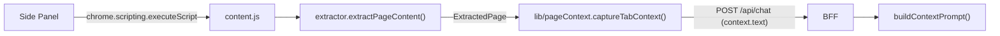

- `apps/extension/src/content/extractor.ts` — thuật toán rút gọn Readability: clone `Document` → xoá script/style/nav/footer/aside + phần tử có class/id khớp pattern âm → chấm điểm các node `article, main, [role=main], section, div` (điểm theo độ dài text block, trừ theo link density > 0.5, cộng/trừ theo class/id) → chọn node điểm cao nhất → fallback `body` → ghép text chuẩn hoá whitespace.
- Kết quả: `{ title, byline, url, text, excerpt, strategy, wordCount }` với `strategy ∈ article | main | body | empty`.
- `apps/extension/src/lib/pageContext.ts` — `captureTabContext(tabId)` + `getActiveTabId()`; **không bao giờ throw** (trang `chrome://`, không có quyền → trả context tối thiểu). Tự inject `content.js` rồi thử lại nếu content script chưa có.
- `buildContextPrompt()` ở BFF đánh dấu rõ context là "dữ liệu tham chiếu, không phải chỉ thị" (chống prompt injection — §6.4).
- **Lưu ý MV3:** content script chạy trong *isolated world* → không chia sẻ `window` với page script hay `page.evaluate` của Playwright. Muốn đọc kết quả phải đi qua `chrome.scripting.executeScript` (từ SW hoặc panel).

### 7.3.1 Nhánh trích xuất PDF & YouTube (T-M1-21, T-M1-22)

Content script **không đủ** cho PDF và YouTube:
- **PDF**: PDF viewer là plugin native của Chrome → content script không inject được → không thể đọc text bằng DOM.
- **YouTube**: transcript nằm ở `captionTracks` trong `ytInitialPlayerResponse` (không phải DOM text) → cần đọc qua player API hoặc gọi `timedtext` API.

→ Cả hai nhánh đều **fetch ở server side (BFF)** rồi chuẩn hoá về cùng shape `context.text` như nhánh HTML, để `buildContextPrompt()` không phân biệt nguồn.

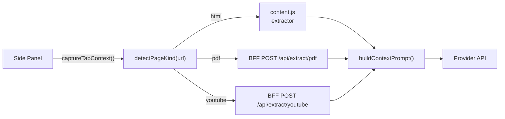

| Nhánh | Detect | BFF làm gì | Fallback khi lỗi |
|---|---|---|---|
| **PDF** | URL kết thúc `.pdf` (server xác thực bằng cách parse thử, không phụ thuộc `Content-Type`) | `fetch` bytes → parse text server-side (`pdfjs-dist`) | PDF scan (không có text layer) → lỗi `CONTEXT_PDF_NOT_READABLE` → UI hiện "không đọc được, hãy upload ảnh". PDF nội bộ / `file://` → không fetch được → lỗi `CONTEXT_PDF_UNREACHABLE` |
| **YouTube** | host `youtube.com` / `youtu.be` + video id trong URL | đọc `captionTracks` → fetch `timedtext` → ghép transcript theo timestamp | không có caption / geo-block / consent → lỗi `CONTEXT_TRANSCRIPT_UNAVAILABLE` → UI báo rõ |

**Nguyên tắc:** cả 3 nhánh đều **không được làm hỏng chat**. Lỗi trích xuất → trả context rỗng kèm `error` message → panel vẫn gửi prompt được (giống hành vi `captureTabContext()` hiện tại: không bao giờ throw).

**Bảo mật:**
- Chỉ fetch URL do user đang xem (panel gửi `url` kèm `referer`/origin) → BFF kiểm tra origin allowlist như endpoint chat (chống SSRF).
- Chặn `localhost` / mạng nội bộ (`127.0.0.0/8`, `10.0.0.0/8`, `169.254.0.0/16`) trong fetcher.
- Giới hạn kích thước: PDF ≤ 20 MB · transcript ≤ 40 000 ký tự (khớp `LIMITS.MAX_PAGE_TEXT_CHARS`).

**Contract mới (`packages/shared` — đã implement):**
- `pageKind.ts`: `detectPageKind(url)` → `'html' | 'pdf' | 'youtube' | 'unknown'` · `extractYouTubeVideoId(url)` · `isPdfUrl(url)`
- `schemas/extract.ts`: `extractRequestSchema`: `{ kind: 'pdf' | 'youtube', url: string }` · `extractResponseSchema`: `{ kind, text, title?, excerpt?, truncated, error?, errorMessage? }` · `pageKindSchema` (validate `sourceKind` từ client)
- `errors.ts`: thêm `CONTEXT_PDF_NOT_READABLE` (422) · `CONTEXT_PDF_UNREACHABLE` (502) · `CONTEXT_TRANSCRIPT_UNAVAILABLE` (422) · `CONTEXT_EXTRACT_FAILED` (500)
- `constants.ts`: `LIMITS.MAX_PDF_BYTES = 20_000_000` · `LIMITS.MAX_EXTRACT_TEXT_CHARS = 40_000` · `LIMITS.EXTRACT_FETCH_TIMEOUT_MS = 15_000` · `API_ROUTES.extractPdf` / `API_ROUTES.extractYoutube`
- `schemas/chat.ts`: `pageContextSchema` thêm `sourceKind?` · `contextError?` · `contextErrorMessage?` để UI hiện lỗi trích xuất

**Cơ chế đã implement (T-M1-21):**
- `apps/server/src/lib/safeFetch.ts` — lớp chống SSRF: chỉ `http:`/`https:` · **chặn hostname nội bộ** (`localhost`, `*.local`, `*.internal`, `*.localdomain`) · resolve DNS rồi chặn loopback (`127/8`) · private (`10/8`, `172.16/12`, `192.168/16`) · link-local (`169.254/16`) · CGNAT (`100.64/10`) · IPv6 (`::1`, `fc00::/7`, `fe80::/10`) · IPv4-mapped (`::ffff:x.x.x.x`) · tự đi theo redirect (tối đa 3 hop, kiểm tra lại từng hop) · timeout 15s · giới hạn size khi đọc stream.
- `apps/server/src/lib/pdfExtractor.ts` — `pdfjs-dist@^4.10.38` (build `legacy`, Node ≥ 20) · gom text item theo tọa độ Y (`transform[5]`) để giữ newline · truyền `standardFontDataUrl` cho PDF dùng font chuẩn non-embedded · PDF không có text layer → `CONTEXT_PDF_NOT_READABLE`.
- `apps/server/src/routes/extract.ts` — `POST /extract/pdf` · `POST /extract/youtube` · **luôn trả 200** cho lỗi nghiệp vụ.

**Cơ chế đã implement (T-M1-22):**
- `apps/server/src/lib/youtubeExtractor.ts` — `GET watch page` (lấy `INNERTUBE_API_KEY` + `VISITOR_DATA` bằng regex) → `POST youtubei/v1/player` với client `ANDROID` (`clientVersion 20.10.38`, `androidSdkVersion 34`, header `X-Youtube-Client-Name: 3`) → đọc `captions.playerCaptionsTracklistRenderer.captionTracks[]` → `fetch captionTracks[].baseUrl` với `User-Agent` Android → parse XML timedtext (`<p t d>` hoặc `<text start dur>`) thành `[mm:ss] text`.
- Chọn track: ưu tiên ngôn ngữ `vi` → `en` → ngôn ngữ còn lại; trong cùng ngôn ngữ ưu tiên track thủ công (`kind !== 'asr'`).
- **2 tầng dự phòng** (InnerTube là API không chính thức): tầng 1 InnerTube → tầng 2 `ytInitialPlayerResponse` nhúng trong HTML watch page (parse bằng bộ đếm ngoặc, không regex) → hết cả 2 → `CONTEXT_TRANSCRIPT_UNAVAILABLE`.

> **Ghi chú vận hành:** InnerTube là API **không chính thức** của YouTube → có thể đổi. Khi hỏng → `CONTEXT_TRANSCRIPT_UNAVAILABLE` → UI báo rõ, chat vẫn chạy bình thường.

### 7.3.2 Mô hình "đính kèm chủ động" & ngân sách context (T-M1-23)

> **Vấn đề đã giải quyết (T-M1-23):** trước đây `captureActiveContext()` **luôn** gửi nội dung tab active ở mọi lượt chat → (a) không có cách "chat như LLM thuần", (b) `context` chỉ biểu diễn được 1 nguồn → không cắt bớt theo thứ tự ưu tiên, (c) không có ngân sách token.

#### Mô hình attach

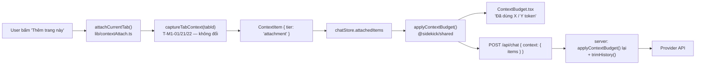

| Khái niệm | Giá trị |
|---|---|
| Nguồn context | Chỉ những gì user **chủ động** đính kèm: nút "Thêm trang này" · `@` (T-M1-05) · vùng bôi đen (T-M1-02) · file (T-M1-24) |
| Không đính kèm | Request **không** có payload `context` → chat thuần LLM (FR-CONTEXT-13) |
| Toggle | Chip ở composer bật/tắt context, mặc định **TẮT**, lưu ở `chrome.storage.local` key `sidekick.contextEnabled` |
| Tier | `selection` (cao nhất) > `attachment` > `currentTab` — quyết định thứ tự cấp phát ngân sách |
| Vị trí state | `chatStore` (side panel) — **không** đặt trong service worker (MV3 SW bị kill ~30s) |

**Các file liên quan:**

| File | Vai trò |
|---|---|
| `packages/shared/src/contextBudget.ts` | `estimateTokens()` · `applyContextBudget()` · `trimHistory()` — **nguồn sự thật duy nhất** cho ngân sách |
| `packages/shared/src/schemas/chat.ts` | `contextItemSchema` · `contextBundleSchema` · `normalizeContext()` (backward compatible) |
| `apps/extension/src/lib/contextAttach.ts` | `attachCurrentTab()` — bọc `captureTabContext()` thành `ContextItem`; không throw |
| `apps/extension/src/lib/storage.ts` | `readContextEnabled()` / `writeContextEnabled()` — persist toggle |
| `apps/extension/src/sidepanel/store/chatStore.ts` | `attachedItems` · `contextEnabled` · `budget` + actions |
| `apps/extension/src/sidepanel/hooks/useChat.ts` | `buildRequestContext()` — dựng payload `context` theo budget |
| `apps/extension/src/sidepanel/components/context/ContextChips.tsx` | Chip item + toggle + nút "Thêm trang này" |
| `apps/extension/src/sidepanel/components/context/ContextBudget.tsx` | Meter "Đã dùng X / Y token" |
| `apps/server/src/services/chatService.ts` | `buildContextPrompt()` render theo tier · `buildProviderMessages()` cắt lại + `trimHistory()` |

#### Ngân sách token theo provider

`maxTokens = contextWindow − reservedOutputTokens − CONTEXT_SAFETY_MARGIN_TOKENS`

| Provider | `CONTEXT_WINDOWS` (token) |
|---|---|
| `gemini` | 1 000 000 |
| `groq` | 128 000 |
| `openrouter` | 128 000 |
| `ollama` | 32 000 |
| `mock` | 8 000 |

- `CONTEXT_SAFETY_MARGIN_TOKENS = 2_000` — margin cho output + system prompt.
- `MAX_CONTEXT_ITEMS = 20` — số item tối đa trong 1 bundle.

**Cơ chế cắt bớt:**

1. Cấp phát theo thứ tự tier: `selection` giữ trọn → `attachment` giữ trọn nếu còn chỗ → `currentTab` chỉ dùng phần dư.
2. Item vượt chỗ → **cắt đầu** (`head slice`) + `truncated: true` + `droppedChars`.
3. Hết chỗ → `droppedItems` tăng (UI báo "N nguồn bị cắt khỏi context").
4. Phần dư ngân sách → `historyBudget` → `trimHistory()` cắt lượt chat **cũ** trước, **luôn giữ** lượt user cuối cùng.
5. `estimateTokens()` là **heuristic** (`ceil(chars / 4)`) → xấp xỉ, ghi rõ trong docs. Số token thật hiển thị từ `usage` event của provider (T-M2-03).

**Hai tầng, một hàm:** extension dùng `applyContextBudget()` để hiển thị meter + dựng payload; server gọi **cùng hàm** để cắt lại trước khi gọi provider (nguồn chân lý — client có thể gửi bản siêu lớn).

### 7.3.3 `@`-mention multi-tab (T-M1-05)

> **FR-CONTEXT-03.** Gõ `@` trong composer → popover liệt kê các tab đang mở → chọn 1 tab → tab đó được đính kèm vào context (`tier: attachment`) và tên tab được chèn vào ô nhập.

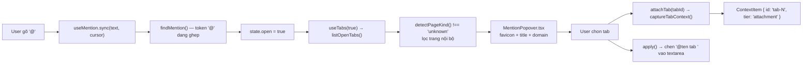

**Quy tắc phát hiện token `@`:**

| Quy tắc | Lý do |
|---|---|
| `@` phải ở đầu chuỗi hoặc sau khoảng trắng | `@` trong email (`a@b.com`) **không** bật popover |
| Token không chứa khoảng trắng | Chỉ lọc theo 1 từ khóa |
| Con trỏ phải nằm **sau** token | Token `@` đã gõ xong phía trước con trỏ |
| Sau `Escape` → token đó bị "đóng" | Trình duyệt bắn `select` event sau khi thoát ô nhập → nếu không có cơ chế này popover mở lại ngay |

**Các file liên quan:**

| File | Vai trò |
|---|---|
| `apps/extension/src/lib/tabList.ts` | `listOpenTabs()` — `chrome.tabs.query({ currentWindow: true })` + lọc trang nội bộ + `domainOf()` |
| `apps/extension/src/sidepanel/hooks/useTabs.ts` | `useTabs(enabled)` — nạp danh sách tab **lazy** (chỉ khi popover mở) |
| `apps/extension/src/sidepanel/hooks/useMention.ts` | `findMention()` (thuần, test được) + `useMention()` (state mở/đóng, `apply()` thay token) |
| `apps/extension/src/sidepanel/components/context/MentionPopover.tsx` | Popover danh sách tab: favicon · title · domain · dấu ✓ (đã đính kèm) · gạch (tab active) |
| `apps/extension/src/lib/contextAttach.ts` | `attachTab(tabId)` — bọc `captureTabContext()` thành `ContextItem`; **không** capture lại tab đã đính kèm |
| `apps/extension/src/sidepanel/hooks/useChat.ts` | `attachTab(tabId)` — cầu nối store ↔ `contextAttach` |
| `apps/extension/src/sidepanel/components/Composer.tsx` | `onCursorChange` + `onEscape` + `inputRef` — cần thiết để phát hiện token `@` |

**Ràng buộc MV3 liên quan:**

- Chỉ query tab của **cửa sổ hiện tại** (`currentWindow: true`) → không lộ tab của cửa sổ khác.
- `listOpenTabs()` **không bao giờ throw** → lỗi trả `[]` (popover rỗng, panel vẫn chat được).
- Không gọi `chrome.sidePanel.open()` ở đây — popover nằm trong panel đang mở.

### 7.3.4 Selection context — bôi đen → hỏi (T-M1-02)

> **FR-CONTEXT-04.** Bôi đen một đoạn văn bản trên trang → đoạn đó trở thành `ContextItem { kind: 'selection', tier: 'selection' }` (tier **cao nhất** trong `CONTEXT_TIER_ORDER`) → được gửi lên BFF kèm nhãn `[Đã bôi đen]`.

Có **hai đường tương tác** (user đã chốt "cả hai"):

- **Đường A (parity Edge Copilot A8):** content script bắt selection → hiện nút nổi "Hỏi Sidekick" cạnh vùng chọn → click → panel nhận đoạn text.
- **Đường B:** nút "Dính đoạn đã chọn" trong panel → đọc selection của tab active qua `chrome.scripting.executeScript`.

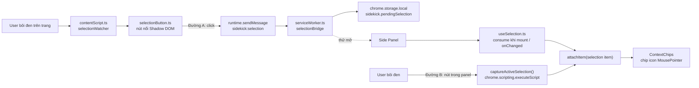

**Cơ chế "open-with-fallback" (panel đang đóng):**

`chrome.sidePanel.open()` chỉ chạy được trong **user gesture**. Message từ content script sang service worker có thể **không** giữ được gesture → ta **thử** mở panel, nếu Chrome từ chối (`try/catch`) thì **im lặng**: đoạn chọn đã nằm trong `chrome.storage.local` → panel mở sau tự nhận (TTL 5 phút).

| Bước | Nơi thực hiện |
|---|---|
| 1. Ghi `sidekick.pendingSelection` vào storage | `serviceWorker.ts` → `selectionBridge.handleSelectionMessage()` |
| 2. Thử `chrome.sidePanel.open({ windowId })` (bọc `try/catch`) | `selectionBridge.tryOpenSidePanel()` |
| 3. Panel mount → `consumePendingSelection()` | `sidepanel/hooks/useSelection.ts` |
| 4. Panel đang mở → `chrome.storage.onChanged` → consume | `useSelection.ts` |

**Các file liên quan:**

| File | Vai trò |
|---|---|
| `packages/shared/src/constants.ts` | `LIMITS.MAX_SELECTION_CHARS` (10 000) · `LIMITS.MIN_SELECTION_CHARS` (10) · `SELECTION_PENDING_TTL_MS` (300 000) |
| `apps/extension/src/content/selection.ts` | **Thuần**: `readSelectionFromDocument()` · `normalizeSelectionText()` · `isMeaningfulSelection()` · `selectionAnchorRect()` |
| `apps/extension/src/content/selectionWatcher.ts` | Nghe `mouseup`/`keyup` (debounce 120 ms) → hiện/ẩn nút nổi; `selectionchange`/`scroll` → ẩn nút |
| `apps/extension/src/content/selectionButton.ts` | Nút nổi trong `attachShadow({ mode: 'open' })` — `position: fixed`, `z-index: 2147483647` |
| `apps/extension/src/content/selectionStyles.ts` | Sinh CSS cho shadow root từ `design/tokens.json` (có biến thể `prefers-color-scheme: dark`) — **không** hardcode màu |
| `apps/extension/src/lib/selectionProtocol.ts` | `SELECTION_ACTION` · `PendingSelection` · `isSelectionMessage()` (type guard, không kéo `zod` vào content script) · `selectionItemId()` (hash FNV-1a) |
| `apps/extension/src/lib/selectionBridge.ts` | Cầu nối content script → SW → panel (lưu storage + thử mở panel) |
| `apps/extension/src/lib/storage.ts` | `writePendingSelection()` · `readPendingSelection()` · `consumePendingSelection()` · `clearPendingSelection()` |
| `apps/extension/src/lib/contextAttach.ts` | `attachSelection()` → `ContextItem` · `captureActiveSelection()` → `chrome.scripting.executeScript` (đường B) |
| `apps/extension/src/sidepanel/hooks/useSelection.ts` | Hook consume pending selection (mount + `storage.onChanged`) |
| `apps/extension/src/sidepanel/components/context/ContextChips.tsx` | Nút "Dính đoạn đã chọn" (`MousePointer2`) |

**Ràng buộc MV3 liên quan:**

- Content script build **IIFE 1 file** (`vite.content.config.ts`) → `selectionProtocol.ts` **không** import `zod`, chỉ dùng type guard thuần. `dist/content.js` ≈ 13.9 kB (không có `import`).
- Không kéo `lucide-react` vào content script (bundle phình) → icon SVG viết tay.
- Service worker **không** giữ state lâu dài → đoạn chờ nằm trong `chrome.storage.local`.
- `dist/content.js` **không** chứa `import` → Chrome load được (kiểm tra sau mỗi lần build).

**Quy tắc hành vi:**

| Quy tắc | Lý do |
|---|---|
| Chỉ hiện nút nổi khi selection ≥ `MIN_SELECTION_CHARS` (10) | Tránh nút nổi khi user chỉ click chuột / kéo 1–2 ký tự |
| Ẩn nút khi `selectionchange` rỗng hoặc trang scroll | Vùng chọn đã đổi → toạ độ neo không còn đúng |
| Đoạn chờ quá TTL (5 phút) → bỏ | User đã chuyển sang task khác → tránh đính kèm nhầm |
| Id item = hash nội dung (`selection-<hash>`) | Bôi đen lại cùng đoạn → **thay** item cũ, không nhân bản |
| Chỉ đính kèm khi user **chủ động** bấm nút | FR-CONTEXT-13 — không tự ý gửi nội dung trang |

### 7.3.5 Hash context · snapshot log · cache theo URL (T-M1-06)

> Nguồn sự thật cho hợp đồng: [`REQUIREMENTS.md`](REQUIREMENTS.md) §4.2 (FR-CONTEXT-01, FR-CONTEXT-12).

Ba mảnh độc lập, cùng phục vụ **tái lập lượt chat** (reproducibility) và **tránh trích xuất lại**:

#### (a) Hash context — `packages/shared/src/contextHash.ts`

Hàm hash **thuần**, không phụ thuộc runtime (`node:crypto` không dùng) → dùng được cho extension, server, content script.

| Hàm | Mô tả |
|---|---|
| `hashString(text): string` | FNV-1a 32-bit → hex 8 ký tự. **Không phải** hàm bảo mật — chỉ để so sánh/đối chiếu |
| `hashContextItems(items): string` | Hash deterministic của danh sách context item |
| `contextHashKey(url): string` | Khoá cache theo URL đã chuẩn hoá |

**Tính deterministic của `hashContextItems()`** — 2 quy tắc:

1. Sắp xếp item theo `CONTEXT_TIER_ORDER` (`selection` > `attachment` > `currentTab`) rồi theo `id` → thứ tự gửi không làm đổi hash.
2. Chỉ hash các trường **ảnh hưởng nội dung**: `id | kind | tier | url | title | sourceKind | text` (nối bằng `\u0000`). `truncated` / `droppedChars` / `tokens` là thuộc tính ngân sách → **không** tính.

Danh sách rỗng → `''` (server ghi `null`).

#### (b) Server: `context_hash` + `context_snapshot`

**Nguồn sự thật duy nhất:** `resolveContextItems(request, options)` trong `apps/server/src/services/chatService.ts` chạy `applyContextBudget()` **một lần** → trả về `ContextBudgetResult`. Cả hai nơi dùng:

| Nơi dùng | Mục đích |
|---|---|
| `buildProviderMessages()` | Dựng prompt gửi provider (nhận `options.contextBudget` đã tính sẵn) |
| `persistRequestLog()` | Tính `context_hash` + `context_snapshot` |

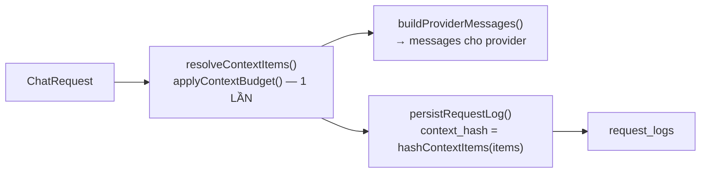

| Cột | Ghi khi nào | Nội dung |
|---|---|---|
| `context_hash` | **Luôn** (khi có context) | Hash 8 ký tự của context **đã cắt ngân sách**. Không có context → `null` |
| `context_snapshot` | **Chỉ khi `LOG_CONTEXT_SNAPSHOT=true`** (mặc định TẮT) | jsonb `[{ id, kind, tier, url, title, sourceKind, text, excerpt, truncated }]` |

> **Vì sao hash phải là của context chứ không phải của prompt?** Trước T-M1-06, `context_hash` = hash của **toàn bộ prompt** (system + lịch sử + context) → đổi câu hỏi là đổi hash, không dùng được để đối chiếu "cùng context". Nay hash chỉ phụ thuộc context → đổi câu hỏi → hash **không đổi**; đổi nội dung context → hash **đổi**.

> **Vì sao snapshot mặc định TẮT?** Snapshot chứa **nội dung trang** (dữ liệu nhạy cảm). Cờ riêng `LOG_CONTEXT_SNAPSHOT` — **không** gộp với `logFullContent` (setting FR-SETTINGS-04) để không vô tình bật lưu nội dung. Khớp retention policy §5.2.

| Setting | Mặc định | Nơi khai báo |
|---|---|---|
| `LOG_REQUESTS` | `false` | `apps/server/src/config/env.ts` |
| `LOG_CONTEXT_SNAPSHOT` | `false` | `apps/server/src/config/env.ts` → `ChatServiceDeps.logContextSnapshot` |

#### (c) Extension: cache context theo URL — `apps/extension/src/lib/contextCache.ts`

Lưu trong `chrome.storage.local`, key `sidekick.contextCache` (object `Record<cacheKey, entry>`).

```ts
interface ContextCacheEntry {
  key: string          // contextHashKey(url) — bỏ fragment/query, lowercase host
  url: string
  title: string
  text: string
  excerpt: string | undefined
  sourceKind: PageKind | undefined
  contentHash: string  // hashString(text) — phát hiện nội dung đã đổi
  capturedAt: number   // epoch ms
}
```

| Hằng số | Giá trị | Ý nghĩa |
|---|---|---|
| `CONTEXT_CACHE_TTL_MS` | 30 phút | Hết hạn → entry bị xoá |
| `CONTEXT_CACHE_MAX_ENTRIES` | 20 | Vượt → prune, giữ entry **mới nhất** |

**Luồng trong `attachTab()`** (`apps/extension/src/lib/contextAttach.ts`):

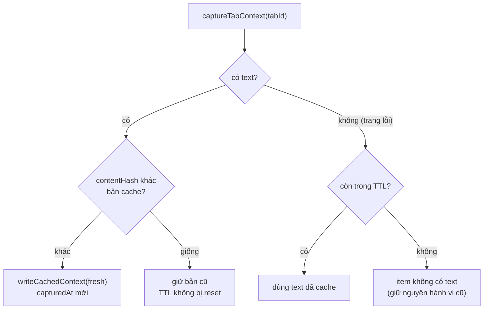

| Quy tắc | Lý do |
|---|---|
| Nội dung không đổi → **không** ghi lại cache | Không reset TTL → trang cũ vẫn hết hạn đúng hạn |
| Nội dung đổi → ghi đè, `capturedAt` mới | Trang đã cập nhật → cache phải mới |
| Trang lỗi → fallback về bản cache | PDF scan / extractor rỗng / mất mạng vẫn chat được |
| Lỗi storage → **không throw** | Cache là tối ưu, không được làm hỏng chat |

> **Ràng buộc MV3:** cache nằm ở `chrome.storage.local` (không phải biến trong service worker — SW bị kill sau ~30 s). Content script **không** import `contextHash.ts` (giữ bundle nhỏ) — dùng subpath `@sidekick/shared/constants` như hiện tại.

#### (d) File liên quan

| File | Vai trò |
|---|---|
| `packages/shared/src/contextHash.ts` | `hashString()` · `hashContextItems()` · `contextHashKey()` |
| `packages/shared/src/constants.ts` | `CONTEXT_CACHE_TTL_MS` · `CONTEXT_CACHE_MAX_ENTRIES` |
| `apps/server/src/services/chatService.ts` | `resolveContextItems()` · `buildProviderMessages()` · `persistRequestLog()` · `buildContextSnapshot()` |
| `apps/server/src/config/env.ts` | `LOG_CONTEXT_SNAPSHOT` |
| `apps/extension/src/lib/contextCache.ts` | `readCachedContext()` · `writeCachedContext()` · `clearContextCache()` · `toCacheEntry()` · `hasContentChanged()` |
| `apps/extension/src/lib/contextAttach.ts` | Nối cache vào `attachTab()` (ghi + fallback) |
| `apps/extension/src/lib/storage.ts` | `CONTEXT_CACHE_STORAGE_KEY` |

### 7.4 Ảnh đính kèm & vision input (T-M1-24)

> Nguồn sự thật cho hợp đồng: [`REQUIREMENTS.md`](REQUIREMENTS.md) §4.3 (FR-VISION-01) · shape: §4.2.2.

**Ba đường vào ảnh — cùng quy về `File` → validate → base64:**

| Đường | Sự kiện | Ghi chú |
|---|---|---|
| Paste | `onPaste` trên `<textarea>` | Chỉ nhận item `kind === 'file'` có MIME `image/*`; text thường bị `preventDefault` → không ảnh |
| Drag-drop | `onDragOver` + `onDrop` trên wrapper composer | `preventDefault()` ở **cả hai** — nếu thiếu, Chrome điều hướng panel rời trang |
| File picker | `<input type="file" accept="image/png,image/jpeg,image/webp,image/gif" multiple>` ẩn + nút 📎 | `accept` lọc ở tầng OS/browser |

**Các file liên quan:**

| File | Vai trò |
|---|---|
| `packages/shared/src/schemas/vision.ts` | `imageAttachmentSchema` · `imageAttachmentListSchema` (kiểm số ảnh + tổng byte) · `IMAGE_MIME_TYPES` (re-export từ `constants.ts`) · `MAX_IMAGE_BASE64_CHARS` |
| `packages/shared/src/constants.ts` | Hằng `VISION` (giới hạn 5 MB / 4 ảnh / 12 MB / 258 token) + `VISION_MIME_TYPES` (tuple nguồn sự thật) + `VISION.ALLOWED_MIME_TYPES` |
| `apps/extension/src/lib/imageUpload.ts` | **Thuần**: `validateImageFile()` · `readImageFile()` (FileReader → base64 thuần) · `measureImage()` (đo pixel: `createImageBitmap` → fallback `Image` → `undefined`, **không throw**) · `stripDataUrlPrefix()` · `extractImagesFromDataTransfer()` + wrapper `extractImagesFromClipboard()` / `extractImagesFromDrop()` · `createAttachmentId()` · `formatBytes()` |
| `apps/extension/src/sidepanel/hooks/useImageAttachments.ts` | Hook quản lý `pendingImages` (thêm/xoá/giới hạn/báo lỗi tiếng Việt) |
| `apps/extension/src/sidepanel/components/composer/AttachmentTray.tsx` | Thumbnail + nút ✕ + thông báo lỗi (token màu, không hardcode) |
| `apps/extension/src/sidepanel/store/chatStore.ts` | `pendingImages` + `addPendingImages` / `removePendingImage` / `clearPendingImages` |
| `apps/server/src/services/attachmentService.ts` | `persistAttachments()` · `loadRecentAttachments()` · `getAttachment()` · `decodeBase64Image()` |
| `apps/server/src/routes/attachments.ts` | `GET /api/attachments/:id` → binary (`Content-Type` = mime) |

**Quy tắc hành vi:**

| Quy tắc | Lý do |
|---|---|
| Ảnh **không** phụ thuộc toggle `contextEnabled` | Ảnh là đầu vào trực tiếp của câu hỏi, không phải context thứ cấp (FR-CONTEXT-13) |
| Ảnh **không** bị `applyContextBudget()` cắt | Hàm cắt theo **số ký tự**; ảnh không có ký tự → phải cắt riêng bằng `TOKEN_ESTIMATE_PER_IMAGE` |
| Client gửi base64, server tự lưu `bytea` | Lượt sau chỉ gửi text → server tải ảnh từ DB → không upload lại base64 |
| `id` do client sinh (uuid) → `ON CONFLICT DO NOTHING` | Retry cùng request không tạo dòng trùng |
| Danh sách mime **khoá** trong test (`VISION.ALLOWED_MIME_TYPES` phải đúng 4 giá trị) | Mutation "thêm mime mới vào allowlist" phải bị test bắt — không để lọt định dạng không an toàn |
| `measureImage()` **không throw** | Đo pixel là thông tin phụ (preview) → hỏng đo không được làm hỏng việc đính kèm ảnh |
| Server **không tin** `bytes` của client | Lưu `byteSize` = kích thước **thực** sau khi giải mã base64; ảnh vượt giới hạn → bỏ qua |
| Provider không hỗ trợ vision → **fallback**, không lỗi ngay | Model mặc định Groq không đọc ảnh → tự chuyển sang OpenRouter/Gemini |
| Hết provider hỗ trợ → `PROVIDER_VISION_UNSUPPORTED` | Lỗi rõ ràng tiếng Việt thay vì crash |
| `express.json({ limit: '16mb' })` | Payload base64 của 12 MB ảnh vượt mặc định 2 MB |

**Ràng buộc MV3 liên quan:**

- **Không cần permission mới** — paste / drag-drop / file picker không yêu cầu quyền Chrome.
- Ảnh **không** đi qua service worker (base64 payload nặng) → gửi trực tiếp Side Panel → BFF.
- `dist/content.js` **không** bị ảnh hưởng (ảnh chỉ ở side panel).

### 7.5 Build: content script phải là classic script

Chrome **không** load được content script dạng ES module. Nếu bundle chứa `import ... from "./assets/x.js"`, Chrome báo *"It isn't a module"* và content script **không chạy**.

| Entry | Định dạng | Config |
|---|---|---|
| Side panel (`sidepanel.html`) | ESM (`<script type="module">`) | `apps/extension/vite.config.ts` |
| Service worker | ESM (`"type": "module"` trong manifest) | `apps/extension/vite.config.ts` |
| **Content script** | **IIFE, 1 file, không `import`** | `apps/extension/vite.content.config.ts` |

Lệnh build: `vite build && vite build --config vite.content.config.ts` (đã gộp trong `pnpm build`).

Để content script không kéo theo cả bundle `zod` của `@sidekick/shared`, package expose thêm subpath `@sidekick/shared/constants` — extractor chỉ import hằng số từ đó. Cùng nguyên tắc đó, `lib/selectionProtocol.ts` (T-M1-02) dùng **type guard thuần** thay vì `zod` → content script không kéo schema vào bundle.

Kích thước `dist/content.js`:

| Mốc | Kích thước | Ghi chú |
|---|---|---|
| M0 (chỉ metadata) | ≈ 4.7 kB | — |
| T-M1-01 (extractor) | 4.81 kB | Readability-lite + tokens |
| T-M1-02 (selection) | 13.9 kB | + watcher · + nút nổi Shadow DOM · + CSS shadow root sinh từ `tokens.json` |
| ⚠️ T-M1-17 (i18n) | **151 kB** | **Hồi quy** — `lib/i18n.ts` → `lib/settings.ts` → `@sidekick/shared` (barrel) → **Zod** |
| ⚠️ T-M1-20 (a11y) | **~46 kB** | **Hồi quy** — `lib/i18n.ts` → `i18n/index.ts` → dictionary **đầy đủ** (~34 kB) |
| **Sau khi tách surface (T-M1-20)** | **17.27 kB** | + dictionary rút gọn 4 khoa · + `storageKeys.ts` không Zod |

Vẫn là **IIFE 1 file, không `import`** → Chrome load được (kiểm tra sau mỗi lần build).

#### 7.5.1 Ranh giới bundle: "ngoài panel" vs "trong panel"

Content script chạy ở **mọi** trang web user mở → bundle phình ảnh hưởng trực tiếp tới tốc độ load trang. Vì vậy có **2 tầng dictionary**:

| Tầng | Module | Dictionary | Dùng ở đâu |
|---|---|---|---|
| **Trong panel** | `i18n/index.ts` → `i18n/vi.ts` + `i18n/en.ts` | **đầy đủ** (~34 kB) | side panel (React) |
| **Ngoài panel** | `i18n/outsidePanel.ts` → `i18n/outsidePanel.vi.ts` + `outsidePanel.en.ts` | **rút gọn — 4 khoa** | content script · service worker (context menu) |

| Module | Vai trò | Phụ thuộc |
|---|---|---|
| `i18n/format.ts` | `formatMessage()` + `resolveLanguage()` — **không** import dictionary | thuần |
| `i18n/surface.ts` | Union kiểu `OutsidePanelKey` (nguồn: `outsidePanel.vi.ts`) | thuần |
| `i18n/outsidePanel.vi.ts` | **Nguồn sự thật** của 4 khoa ngoài panel | thuần |
| `i18n/outsidePanel.en.ts` | Bản EN (kiểu ràng buộc key) | thuần |
| `lib/storageKeys.ts` | Khoá storage + `readStoredUiLanguage()` — đọc **thuộc tính** trực tiếp, **không** validate bằng Zod | thuần |
| `lib/i18nSurface.ts` | `getSurfaceTranslator()` — điểm vào cho content script + SW | thuần |

> **Quy tắc:** khoá "ngoài panel" phải có **ở cả 3 nơi**: `outsidePanel.vi.ts` (nguồn sự thật) · `outsidePanel.en.ts` (kiểu ràng buộc) · `surface.ts` (danh sách khoá). Thiếu một → `pnpm typecheck` hoặc unit test bắt.

#### 7.5.2 Guard hồi quy bundle (`tests/contentBundleGuard.test.ts`)

Hai lần hồi quy ở trên **không** làm hỏng chức năng → test chức năng vẫn xanh → chỉ guard mới bắt được. Guard gồm 2 tầng:

1. **Source-level (đồ thị phụ thuộc)** — duyệt **đệ quy** toàn bộ module mà content script kéo theo (entry = `src/content/contentScript.ts`), rồi phán quyết:
   - không import value `@sidekick/shared` (barrel → Zod); chỉ subpath `@sidekick/shared/constants` được phép;
   - không kéo theo dictionary **đầy đủ** (`lib/i18n.ts` · `i18n/index.ts` · `i18n/vi.ts` · `i18n/en.ts`);
   - không kéo theo `react` hoặc `zod`.
   - > `import type { X } from 'y'` và `import { type X } from 'y'` bị **xoá khi build** → **không** báo động giả.
2. **Bundle-level** — nếu `dist/content.js` đã build: kích thước **≤ 40 kB** + không chứa marker của Zod (`invalid_type`).

> **Vì sao là đồ thị phụ thuộc, không phải grep từng file?** Bản đầu tiên của guard chỉ grep **trực tiếp** trong `src/content/*.ts` → **lọt lưới**: đổi `contentScript.ts` sang import `../lib/i18n.js` vẫn xanh, dù `lib/i18n.js` kéo theo dictionary đầy đủ. Guard phải **duyệt đệ quy** rồi mới phán quyết.

> **Quy ước import nội bộ:** dùng đuôi `.js` dù file nguồn là `.ts` (`from '../lib/i18nSurface.js'`) → resolver của guard phải bỏ đuôi `.js` trước khi tìm file nguồn.

### 7.6 Hợp đồng onboarding (FR-UX-02, T-M1-25)

#### 7.6.1 Cờ trạng thái (client-side)

| Khoá `chrome.storage.local` | Kiểu | Ý nghĩa |
|---|---|---|
| `sidekick.onboarding.completed` | `boolean` | Onboarding đã chạy xong (kể cả khi user bấm "Bỏ qua") |
| `sidekick.preferredProvider` | `ProviderId` | Provider user chọn ở bước 2 → gửi kèm `ChatRequest.provider` |

Nguồn sự thật: `apps/extension/src/lib/onboarding.ts` (`readOnboardingState` / `completeOnboarding` / `resetOnboarding` / `readPreferredProvider` / `writePreferredProvider`) — file **thuần**, không phụ thuộc React/Zustand → test được trực tiếp.

#### 7.6.2 Luồng render

```
App.tsx  ──useOnboarding()──▶  sidekick.onboarding.completed
   │
   ├─ false → <Onboarding />          (3 bước, xem REQUIREMENTS.md §4.9.1)
   └─ true  → <ChatWorkspace />       (nội dung chat, tách từ App.tsx nguyên trạng)
```

`useOnboarding` (`apps/extension/src/sidepanel/hooks/useOnboarding.ts`) đọc cờ qua `chrome.storage.local` và **lắng nghe** `chrome.storage.onChanged` → khi cờ đổi (bấm "Bỏ qua" hoặc "Hoàn tất") panel chuyển màn hình **không cần reload**.

#### 7.6.3 Component

| File | Trách nhiệm |
|---|---|
| `components/onboarding/Onboarding.tsx` | Orchestrator: progress bar (`ONBOARDING_STEPS` = `['permissions','provider','try']`), điều hướng "Tiếp tục" / "Quay lại", nút "Bỏ qua" |
| `components/onboarding/StepPermissions.tsx` | Liệt kê quyền + lý do; nút "Mở cài đặt trình duyệt" (`chrome.tabs.create` bọc try/catch — Chrome chặn URL `chrome://` → fallback hiện extension id để copy) |
| `components/onboarding/StepProvider.tsx` | Radio list provider từ `GET /api/providers`; ô nhập key (chỉ khi provider `requiresKey` và chưa có key) → `POST /providers/keys` → `POST /providers/keys/:id/test` |
| `components/onboarding/StepTry.tsx` | Ô nhập + nút "Thử" → `streamChat()` (SSE thật) → hiện câu trả lời stream |

> Bước 2 dùng **radio native** (`<input type="radio">` + `<label>`) → a11y tốt, không cần thêm component UI mới.

#### 7.6.4 Mở lại onboarding

`PanelHeader` có nút "Hướng dẫn" (`CircleHelp`) → gọi `resetOnboarding()` → cờ bị xoá → `useOnboarding` phát `onChanged` → panel hiện lại onboarding. Đây là entry tạm thời cho tới khi Settings (T-M1-12) có mục "Chạy lại hướng dẫn".

#### 7.6.4.1 Provider ưu tiên được dùng cho các lượt chat sau

`useChat` đọc `sidekick.preferredProvider` (`readPreferredProvider()`) và gửi kèm `provider` trong `ChatRequest` → server **đặt provider đó đầu** chuỗi fallback (§4.4.2).

```ts
// apps/extension/src/sidepanel/hooks/useChat.ts
const preferredProvider = await readPreferredProvider()
// ...
streamChat(
  {
    messages: requestTurns,
    ...(context === undefined ? {} : { context }),
    ...(preferredProvider === undefined ? {} : { provider: preferredProvider }),
  },
  // ...
)
```

Không có provider ưu tiên → **không** gửi field `provider` → server dùng fallback chain mặc định.

#### 7.6.5 Ràng buộc bảo mật

- API key nhập ở bước 2 gửi lên BFF qua HTTPS → BFF mã hoá **AES-256-GCM** (`MASTER_KEY`) → lưu `provider_keys`. Client **không bao giờ** nhận lại key gốc, chỉ `masked` (`****` + 4 ký tự cuối).
- BFF thiếu `MASTER_KEY` → `MASTER_KEY_NOT_CONFIGURED` (500) — thông báo rõ ràng cho user, không crash.
- Bước 3 gọi `POST /api/chat` qua **cùng** đường SSE như chat thường → không có đường tắt riêng cho onboarding.

### 7.8 Pipeline render Markdown (FR-CHAT-02/03/04 — T-M1-07)

#### 7.8.1 Stack đã chốt

| Thành phần | Phiên bản | Vai trò |
|---|---|---|
| `react-markdown` | `^10.1.0` | Render Markdown → React |
| `remark-gfm` | `^4.0.1` | Bảng GFM · strikethrough · task list · autolink |
| `rehype-highlight` | `^7.0.2` | Syntax highlight (kéo `lowlight@^3.3.0` → `highlight.js@~11.11`) |
| `rehype-sanitize` | `^6.0.0` | Allowlist thẻ/attribute/protocol (XSS) |
| `sonner` | `^2.0.8` | Toast phản hồi copy (đã có sẵn trong deps, nay dùng) |

> **Vì sao KHÔNG dùng `shiki`:** `shiki` cần WebAssembly → MV3 CSP (`script-src 'self'`) không cho `'wasm-unsafe-eval'`; tokenize **async** → code block nhấp nháy unhighlighted khi streaming → vi phạm NFR-PERF-02.

#### 7.8.2 Thứ tự plugin (quan trọng)

```
remark-parse → remark-gfm → remark-rehype → rehype-highlight → rehype-sanitize → render
```

- `rehype-highlight` **trước** `rehype-sanitize` → highlight sinh `span.hljs-*` rồi mới được allowlist giữ lại.
- `rehype-sanitize` **nhận schema trực tiếp** (không phải `{ schema }`) — `rehype-sanitize` v6 đã đổi API.

#### 7.8.3 Schema sanitize custom

`apps/extension/src/sidepanel/components/chat/markdownSchema.ts` — clone `defaultSchema` của `hast-util-sanitize`:

| Thay đổi | Giá trị | Lý do |
|---|---|---|
| `attributes.code` | `[['className', /^language-./, 'hljs']]` | Giữ class `language-*` + `hljs` để highlight hoạt động |
| `attributes.span` | `[['className', /^hljs-/]]` | Giữ token màu `hljs-keyword`, `hljs-string`, … |
| `protocols.href` | `['http', 'https', 'mailto']` | Bỏ `irc` / `xmpp` của `defaultSchema` |

> `defaultSchema` là **module singleton** → **không mutate**; phải spread ra object mới.

Ngoài ra `react-markdown` được set `skipHtml` → **raw HTML trong markdown bị loại bỏ hoàn toàn** (không thể thực thi script trong nội dung LLM).

#### 7.8.4 Chiến lược hiệu năng khi streaming (NFR-PERF-02)

| Kỹ thuật | Tác dụng |
|---|---|
| `useDeferredValue(content)` | Parse markdown chạy **sau** frame hiện tại → input + nhận token không bị block |
| Highlight **defer** khi streaming | `isStreaming === true` → chỉ `rehype-sanitize` (code block dạng plain mono). Stream xong → `rehype-highlight` chạy **1 lần duy nhất**. Highlight mỗi token là O(n²) |
| Plugin list là **module-level constant** | `react-markdown` không tạo processor mới ở mỗi render |

#### 7.8.5 Component & override

| File | Trách nhiệm |
|---|---|
| `chat/MessageContent.tsx` | Orchestrator: `useDeferredValue` · chọn plugin list theo `isStreaming` · map `components` override |
| `chat/CodeBlock.tsx` | Header (nhãn ngôn ngữ + nút copy) · `toast.success('Đã sao chép')` · icon `Copy` → `Check` 1500 ms · copy **source code thô** |
| `chat/MarkdownTable.tsx` | Bọc `<table>` trong `<div class="overflow-x-auto">` → bảng rộng scroll ngang, không vỡ layout ở panel 320 px |
| `chat/markdownSchema.ts` | Schema + `LANGUAGE_ALIASES` + `SUPPORTED_LANGUAGES` + helper đọc `node` hast (`languageFromNode` / `extractCodeText`) |

Override `components` của `react-markdown`:

| Tag | Override | Hành vi |
|---|---|---|
| `pre` | `CodeBlock` | Lấy `language` + source code từ **node hast** (không phụ thuộc children React) |
| `code` | inline chip | Nền `--surface-sunken`, font `--font-mono`; code trong `pre` giữ nguyên markup highlight |
| `a` | `AnchorOverride` | `target="_blank"` + `rel="noopener noreferrer"` |
| `table` | `MarkdownTable` | Scroll ngang |

> `CodeBlockContext` giải quyết việc `code` component không biết mình nằm trong `pre` hay là inline code.

#### 7.8.6 Ngôn ngữ hỗ trợ

`lowlight.common` = **37 grammar** (≥ 15 yêu cầu của FR-CHAT-03). Alias bổ sung qua option `aliases` của `rehype-highlight`:

| Ngôn ngữ | Alias |
|---|---|
| `javascript` | `js`, `jsx`, `mjs`, `cjs` |
| `typescript` | `ts`, `tsx`, `mts`, `cts` |
| `python` | `py`, `ipython` |
| `bash` | `sh`, `zsh` |
| `yaml` | `yml` |
| `xml` | `html`, `xhtml`, `svg`, `vue` |
| `csharp` | `cs`, `c#` |
| `cpp` | `c++`, `cc`, `hpp`, `hxx` |
| `go` | `golang` |
| `rust` | `rs` |
| `kotlin` | `kt`, `kts` |
| `plaintext` | `txt`, `text`, `dockerfile`, `http` |

Ngôn ngữ **không** đăng ký → `rehype-highlight` ghi cảnh báo non-fatal (`file.message`) → **không crash**, code block hiển thị dạng plain.

#### 7.8.7 Mapping màu highlight → design token

`apps/extension/src/sidepanel/index.css` — class `hljs-*` map sang token có sẵn trong `design/tokens.css` (không hardcode hex):

| Class | Token |
|---|---|
| `hljs-keyword`, `hljs-selector-tag`, `hljs-literal`, `hljs-type`, `hljs-name` | `--code-token-keyword` |
| `hljs-string`, `hljs-regexp`, `hljs-attribute` | `--code-token-string` |
| `hljs-number`, `hljs-variable`, `hljs-tag .hljs-attr` | `--code-token-number` |
| `hljs-comment`, `hljs-quote`, `hljs-meta` | `--code-token-comment` |
| `hljs-title`, `hljs-built_in`, `hljs-selector-id/class` | `--code-token-function` |
| `hljs-punctuation`, `hljs-operator`, `hljs-subst`, `hljs-params` | `--code-token-punctuation` |

Token đổi theo theme `.dark` → highlight tự đổi màu, không cần code.

#### 7.8.8 Phạm vi render

- **Chỉ message assistant** render Markdown. Message **user** giữ text thuần (`whitespace-pre-wrap`) → giảm rủi ro XSS từ nội dung người dùng + nhanh hơn.
- Nút copy **cả message** (copy raw markdown) vẫn giữ nguyên ở `MessageBubble`.
- Permission mới: `clipboardWrite` (dùng thật cho copy code — rule "chỉ xin quyền khi thực sự dùng").

#### 7.8.9 Kích thước bundle

| Mốc | `dist/sidepanel.js` | `dist/content.js` |
|---|---|---|
| Trước T-M1-07 | ≈ 340 kB | 13.87 kB |
| **Sau T-M1-07** | **712.80 kB** (gzip 218 kB) | **13.87 kB** (không đổi) |

`rehype-highlight` chỉ vào bundle side panel → content script (build IIFE riêng) **không bị ảnh hưởng**.

### 7.9 Citation: marker `[N]` → SSE → chip (FR-CONTEXT-10 — T-M1-08)

#### 7.9.1 Quyết định thiết kế

| Quyết định | Lý do |
|---|---|
| **LLM tự sinh marker `[N]`** trong câu trả lời | Biết được claim nào trích nguồn nào → phục vụ metric `citation_precision` / `citation_recall` trong eval |
| **Server đánh số nguồn** trong `buildContextPrompt()` → parse marker → phát SSE `citation` | `chatCitationEventSchema` + bảng `citations` **đã có sẵn từ M0** → không cần migration mới |
| Chip **inline** thay `[N]` trong câu trả lời + 1 dòng tóm tắt nguồn dưới message | Parity Edge Copilot / Chrome Gemini |
| **Remark plugin (mdast)** thay vì xử lý string thô | Không đụng code block / inline code (node type khác `text`) → không phá T-M1-07 |
| `span` + attribute `dataCitationIndex` (không dùng tag riêng) | `span` đã có trong `defaultSchema.tagNames`; `hast-util-sanitize` match **chính xác** tên property → không cần `data*` (allow-all) |
| `@radix-ui/react-popover` + copy `shadcn/ui/popover` vào repo | Popover qua Portal → không bị clip khi thread scroll; đóng bằng Escape/blur do Radix xử lý |
| Ghi vào bảng `citations` | Lưu lịch sử + eval được; bảng đã có trong migration `0000_adorable_sister_grimm.sql` |
| Regex marker đặt ở `packages/shared` | Server (parse) và extension (plugin) dùng chung 1 nguồn → không lệch pattern |
| Citation metadata **chỉ** lấy từ SSE event (không suy ra client-side) | Server là nguồn chân sự; client không cần replicate thứ tự tier → tránh coupling dễ vỡ |

#### 7.9.2 Luồng dữ liệu

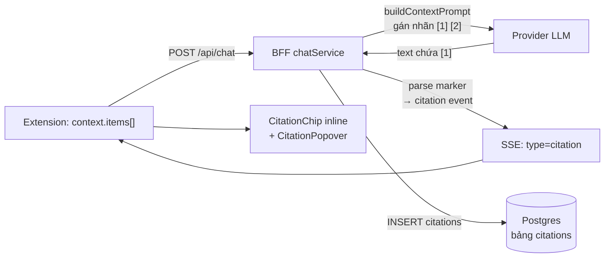

#### 7.9.3 Contract shared — `packages/shared/src/citation.ts`

| Export | Giá trị / hành vi |
|---|---|
| `CITATION_MARKER_PATTERN` | `/\[(\d{1,2})\]/g` — chỉ bắt số 1–2 chữ số (tránh bắt `[2024]` hay `[abc]`) |
| `CITATION_INSTRUCTION` | Chỉ dẫn system prompt: ghi kèm `[1]` / `[1][2]` ngay sau câu, chỉ dùng số đã cung cấp |
| `parseCitationMarkers(text)` | Trả về danh sách số nguôn **distinct + tăng dần** |

`parseCitationMarkers` dùng `text.matchAll(...)` → **không mutate `lastIndex`** của hằng regex → hàm thuần, gọi lại nhiều lần cho cùng kết quả.

#### 7.9.4 Server — đánh số nguồn + chi dẫn model

`buildContextPrompt()` gán nhãn theo thứ tự ưu tiên tier:

```
--- Nguồn [1] [Đã bôi đen] ---
Tiêu đề: ...
URL: ...
```

- `numberedContextItems(items)` (export) là **nguồn thứ tự duy nhất**: `sortItemsByTier()` → đánh số `1..N` (1-based).
- Cùng thứ tự này được dùng cho **prompt** lẫn **citation event** → `[1]` trong prompt luôn khớp với `citation.index` gửi cho client.
- `buildProviderMessages()`: khi `budget.items.length > 0` → system prompt = base + `CITATION_INSTRUCTION`. **Không có context → system prompt giữ nguyên** (không regression).

#### 7.9.5 Server — parse marker + phát SSE + ghi DB

`apps/server/src/services/citationService.ts`:

| Hàm | Trách nhiệm |
|---|---|
| `extractCitations(text, sources)` | Thuần. Marker `[N]` → nguồn thứ `N` (1-based). Marker vượt số nguồn → **bỏ qua**. Marker trùng → 1 lần. |
| `buildSnippet(source)` | `excerpt` ?? `text` (cắt còn ≤ 320 ký tự + `…`) |
| `persistCitations(db, messageId, items)` | `INSERT` vào bảng `citations` (`message_id`, `idx`, `url`, `title`, `snippet`, `tab_id`). Lỗi ghi DB **không throw** → không làm hỏng luồng chat |

Thứ tự event SSE: `meta` → `token*` → **`citation*`** → `usage` → `done`.

#### 7.9.6 Extension — remark plugin + sanitize allowlist

`apps/extension/src/sidepanel/components/chat/citationPlugin.ts` — plugin remark **thuần** (tự đệ quy, không thêm `unist-util-visit`):

- Duyệt cây mdast; node `type === 'text'` → tách theo `CITATION_MARKER_PATTERN` → thay bằng node có `data: { hName: 'span', hProperties: { dataCitationIndex: N } }`.
- Node `code` / `inlineCode` **không** bị đụng → code block giữ nguyên.
- Export `transformCitationMarkers(tree)` để test thuần không cần React.

`markdownSchema.ts` — thêm `dataCitationIndex` vào allowlist của `span`:

```ts
span: [['className', /^hljs-/], 'dataCitationIndex']
```

- **Không** dùng `data*` (allow-all) → bề mặt tấn công nhỏ nhất.
- `hast-util-to-jsx-runtime` đổi property thành prop React `data-citation-index`; giá trị gốc vẫn nằm ở `node.properties.dataCitationIndex` → `MessageContent` đọc từ đó.

#### 7.9.7 Extension — component

| Component | Vai trò |
|---|---|
| `CitationChip` | Chip số `[N]` inline. Có metadata → bọc `CitationPopover`; chưa có (đang stream) → `<span>` không popover |
| `CitationPopover` | Popover Radix: tiêu đề · domain · snippet · nút "Mở trang gốc" (`chrome.tabs.create`) |
| `CitationList` | Dòng tóm tắt nguồn dưới bubble assistant (song song với chip inline) |
| `MessageContent` | Override `span`: có `dataCitationIndex` → `CitationChip`; không có → pass-through (giữ `span.hljs-*` của T-M1-07) |
| `MessageBubble` | Truyền `citations` xuống `MessageContent` + render `CitationList` |

Danh sách nguồn được truyền qua React context (`CitationContext`) → không phải tạo lại `components` map mỗi render.

#### 7.9.8 Token màu

Chip dùng token có sẵn trong `design/tokens.css`: `--citation-bg` · `--citation-border` · `--citation-link` · `--citation-hover` (không hardcode màu). Class `.citation-chip` trong `apps/extension/src/sidepanel/index.css`.

### 7.10 Chat CRUD — quản lý nhiều cuộc trò chuyện (FR-CHAT-08/09/11 — T-M1-09)

> Nguồn sự thật cho hợp đồng: [`REQUIREMENTS.md`](REQUIREMENTS.md) §4.1 (FR-CHAT-08, FR-CHAT-09, FR-CHAT-11).

#### 7.10.1 Quyết định thiết kế

| Quyết định | Lý do |
|---|---|
| **Ghim ở cấp conversation** (`conversations.pinned`) | Cột `pinned` **đã có sẵn** từ migration `0000_adorable_sister_grimm.sql` → không cần migration mới. Ghim tin nhắn để task sau |
| **Drawer = Radix Dialog trượt từ trái** | Đúng DP-2 "chat-centric" (thread chiếm ≥ 90% không gian) — không thu hẹp panel. Radix Dialog qua Portal → không bị `overflow` của thread cắt |
| **Không migration mới** | `conversations` đã có `title` · `pinned` · `archived` · `updated_at` · `meta` |
| **Tiêu đề tự động** từ câu hỏi đầu tiên | Danh sách không nhom hết "Cuộc trò chuyện mới". Chỉ set khi **tạo mới** (`onConflictDoNothing`) → tên user đặt tay không bị ghi đè |
| **`GET /:id/messages`** thay cho `GET /:id` | Hydrate thread chỉ cần **1 request** (conversation + messages + citations) |
| **Phân trang keyset** (cursor), không OFFSET | Danh sách thay đổi liên tục (mỗi lượt chat bump `updated_at`) → OFFSET dễ lặp/sót dòng |
| **Optimistic update + rollback** trong store | CRUD phản ánh trong UI **ngay** (AC) nhưng không giữ trạng thái sai khi API lỗi |

#### 7.10.2 Luồng dữ liệu

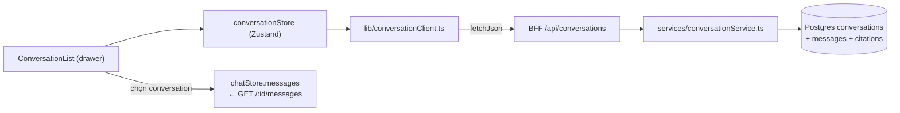

#### 7.10.3 Endpoint (đã implement)

| Method | Path | Ghi chú |
|---|---|---|
| `GET` | `/api/conversations?q=&archived=&limit=&cursor=` | Sort `pinned desc, updated_at desc, id desc` · trả `{ items, nextCursor }` |
| `POST` | `/api/conversations` | Body `{ title? }` → `201` + `ConversationSummary` |
| `GET` | `/api/conversations/:id/messages` | `{ conversation, messages[] }` — messages kèm `citations[]` + `provider`/`model`/`tokensIn`/`tokensOut` |
| `PATCH` | `/api/conversations/:id` | Body `{ title?, pinned?, archived? }` — chỉ cập nhật trường được gửi, **bump `updated_at`** |
| `DELETE` | `/api/conversations/:id` | `204` — cascade xoá `messages` · `citations` · `message_attachments` (FK `onDelete: cascade`) |

- Id phải là **UUID** → `VALIDATION_ERROR` (400) trước khi query DB.
- `AppError` (`NOT_FOUND` · `VALIDATION_ERROR` · `INTERNAL_ERROR`) map qua `errorHandler` sẵn có ở `apps/server/src/middleware/error.ts`.

#### 7.10.4 Phân trang keyset

Cursor = `base64url("pinned|updatedAt|id")` của **dòng cuối** trang trước:

```
encodeCursor({ pinned, updatedAt, id })  →  "MXwyMDI2LTAxLTAx...|fQ"
decodeCursor(cursor)                      →  { pinned, updatedAt, id } | undefined
```

- `decodeCursor` trả `undefined` khi cursor hỏng → coi như không có cursor (không throw 500).
- `nextCursor` chỉ có khi **còn** trang sau → client gọi `loadMore()` khi scroll tới cuối.
- `limit` mặc định `30`, tối đa `100` (validate bằng `conversationListQuerySchema`).

#### 7.10.5 Server — `chatService` gắn với danh sách

| Hàm | Vai trò |
|---|---|
| `buildAutoTitle(content)` | 60 ký tự đầu câu hỏi đầu tiên + `…` nếu bị cắt → tiêu đề conversation mới |
| `persistUserMessage()` | `INSERT conversations ... ON CONFLICT DO NOTHING` với tiêu đề tự động |
| `persistAssistantMessage()` | Lưu `meta` = `{ provider, model, tokensIn, tokensOut }` → khôi phục lịch sử **không mất** chip DP-6 |
| `touchConversation()` | `UPDATE conversations SET updated_at = now()` sau mỗi lượt chat → conversation vừa dùng **luôn lên đầu** danh sách |

#### 7.10.6 Extension — store + drawer

| Thành phần | Vai trò |
|---|---|
| `conversationStore` (Zustand) | `items` · `isLoading` · `error` · `query` · `archivedView` · `nextCursor` · `activeConversationId` · `activeTitle` · `refresh()` · `loadMore()` · `create()` · `rename()` · `togglePin()` · `toggleArchive()` · `remove()` |
| `ConversationList` | Nội dung drawer: "Chat mới" · search (debounce 250 ms) · tab "Đang dùng" / "Đã lưu trữ" · nhóm "Đã ghim" / "Gần đây" · mỗi dòng có nút ghim / lưu trữ / đổi tên / xoá |
| `ConfirmDialog` | Confirm trước khi xoá (FR-CHAT-08) — nút nguy hiểm dùng variant `danger` |
| `chatStore.hydrateConversation()` | Nạp lại lịch sử + citations vào thread khi chọn conversation |

**Optimistic + rollback:** `rename` / `togglePin` / `toggleArchive` / `remove` cập nhật state **trước**, gọi API sau; nếu API lỗi → khôi phục state cũ + đặt `error` (UI hiện `role="alert"`).

#### 7.10.7 Token & motion

- Drawer dùng token có sẵn: `--surface-overlay` (nền panel) · `--border-default` (viền phải) · `--shadow-3` (đổ bóng) · `--text-primary` / `--text-secondary` / `--text-tertiary`.
- Animation `sidekick-drawer-in` (translateX + opacity) & `sidekick-fade-in` (overlay) trong `apps/extension/src/sidepanel/index.css`, **tôn trọng `prefers-reduced-motion`** (`animation: none`).

---

### 7.11 Turn / variant / branch — regenerate, edit-resend, stop-continue (FR-CHAT-05/06/07/12/13 + FR-UX-05 — T-M1-10)

> Nguồn sự thật cho hợp đồng: [`REQUIREMENTS.md`](REQUIREMENTS.md) §4.1 (FR-CHAT-05, FR-CHAT-06, FR-CHAT-07, FR-CHAT-12, FR-CHAT-13) + §4.4 (FR-UX-05).

#### 7.11.1 Quyết định thiết kế

| Quyết định | Lý do |
|---|---|
| **Lưu trạng thái turn/variant/path phía server** (`messages.meta` jsonb + `conversations.meta.path`) | Panel reload là mất state → biến thể & nhánh phải sống lâu hơn 1 session. `jsonb` **đã có sẵn** từ migration `0000` → **không cần migration mới** |
| **Turn** = 1 lượt hỏi–đáp (user message + các biến thể assistant) | Khớp trực giác người dùng: "tôi hỏi gì" ↔ "câu trả lời nào" |
| **`path`** = danh sách `turnId` theo thứ tự = đường đi active | Nhánh cũ vẫn nằm trong DB nhưng không hiện trên đường đi chính |
| **Biến thể assistant** dùng `variantIndex` (0-based) + cờ `active` | Chuyển qua lại biến thể là đổi cờ, không cần bảng riêng |
| **`operation`** trong `ChatRequest` thay vì endpoint riêng | Mọi thao tac đều là "1 lượt chat" → dùng chung 1 luồng SSE, 1 code path, 1 fallback chain |
| **`continue` UPDATE message cũ** (không tạo message mới) | Nội dung dở + phần mới là **một** câu trả lời → tách làm 2 message sẽ vỡ lịch sử |
| **`CONTINUE_INSTRUCTION`** gộp vào user turn cuối (không tạo user turn mới nếu đã có) | Gemini từ chối 2 user turn liên tiếp |

#### 7.11.2 Mô hình dữ liệu (không cần migration)

`messages.meta` (jsonb):

| Khoá | Kiểu | Ý nghĩa |
|---|---|---|
| `turnId` | `string` | Nhóm 1 lượt hỏi–đáp. User message + các assistant variant cùng `turnId` |
| `variantIndex` | `number` | Biến thể assistant (0-based) trong turn. User message = `0` |
| `active` | `boolean` | Message nằm trên đường đi hiện tại. Thiếu → coi như `true` (tương thích dữ liệu cũ) |
| `parentTurnId` | `string?` | Turn cha — dùng cho branch của edit-resend |
| `aborted` | `boolean?` | Assistant bị stop giữa chừng → hiện nút "Tiếp tục" |

`conversations.meta.path` (jsonb): mảng `turnId` theo thứ tự = đường đi active. Turn không nằm trong `path` = nhánh cũ.

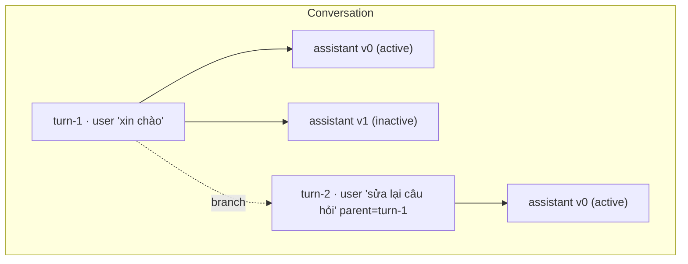

#### 7.11.3 Contract shared

| Thành phần | Nội dung |
|---|---|
| `chatOperationSchema` | `z.enum(['send', 'regenerate', 'continue', 'branch'])` — `optional()` để client cũ không gửi field này vẫn hợp lệ |
| `chatRequestSchema` | += `operation?` · `assistantMessageId?` (uuid) · `parentTurnId?` |
| `chatMetaEventSchema` | += `turnId?: string` → client đồng bộ path sau khi server xác nhận turn |
| `conversationMessageSchema` | += `turnId?` · `variantIndex?` · `active?` · `parentTurnId?` · `aborted?` |
| `conversationTurnSchema` | `{ turnId, userMessageId?, userContent, parentTurnId?, onPath, variants[] }` |
| `conversationMessagesResponseSchema` | += `path: string[]` · `turns: ConversationTurn[]` (default `[]` → tương thích dữ liệu cũ) |
| `activateVariantSchema` | `{ variantIndex: number }` |
| `API_ROUTES.conversationTurnActivate` | `/api/conversations/:id/turns/:turnId/activate` |
| `CONTINUE_INSTRUCTION` | `"Tiếp tục câu trả lời trước đó từ đúng chỗ nó bị ngắt. Chỉ viết phần tiếp theo, không lặp lại phần đã có."` |

#### 7.11.4 Server — `services/turnService.ts`

| Hàm | Vai trò |
|---|---|
| `normalizeMessages(raw[])` | Gắn `turnId` / `variantIndex` / `active` cho mọi message. Message **cũ** (không có `meta.turnId`) → user bắt đầu turn gốc, assistant gắn vào turn trước |
| `derivePath(messages[])` | Suy ra đường đi từ thứ tự message — fallback cho conversation tạo trước T-M1-10 |
| `readConversationPath()` / `rewritePath()` | Đọc/ghi `conversations.meta.path` |
| `loadNormalizedMessages()` / `loadMessage()` | Query DB → message đã chuẩn hoá |
| `nextVariantIndex()` / `activeVariantIndex()` | Chỉ số biến thể kế tiếp / đang active (chỉ đếm **assistant**, user message không phải biến thể) |
| `buildTurns(messages[], path[])` | Gom message → `ConversationTurn[]` (kèm `onPath`) |
| `patchMessageMeta()` / `patchMessagesMeta()` | Ghi `meta` (merge, không ghi đè key khác) — dùng cho `active` / `aborted` |
| `updateMessageContent()` | Ghi đè `content` + `meta` — dùng cho `continue` |

#### 7.11.5 Server — `chatService.createChatStream()` theo `operation`

| Operation | Hành vi |
|---|---|
| `send` (mặc định) | Tạo `turnId` mới → insert user message (`meta.turnId` / `variantIndex=0` / `active=true`) → `path.push(turnId)` → assistant message `variantIndex=0, active=true` |
| `regenerate` | **Không** insert user message. Resolve `turnId` từ `assistantMessageId` → assistant message mới `variantIndex = max+1`, `active=true`; các biến thể cũ chuyển `active=false` |
| `continue` | Resolve assistant message → `meta.turnId`. Provider messages = history + `CONTINUE_INSTRUCTION`. Xong → **UPDATE** message: `content = partial + text`, `meta.aborted = false` |
| `branch` | Tạo `turnId` mới với `meta.parentTurnId` → insert user message → `path = path.slice(0, indexOf(parentTurnId)) + [newTurnId]` → các turn bị cắt chuyển `active=false` → assistant message thuộc turn mới |

Mọi operation đều **yield `meta` kèm `turnId`** → client đồng bộ path sau mỗi lượt.

#### 7.11.6 Extension — thư viện thuần (`lib/chatTurns.ts`)

| Hàm | Vai trò |
|---|---|
| `groupTurns(messages[])` | Gom message → `TurnGroup[]` (user message + variants + active variant) |
| `activePathMessages(messages[], path[])` | Lọc ra message thuộc đường đi active (user + biến thể active của mỗi turn) |
| `offPathTurns(messages[], path[])` | Các turn đã bị cắt khỏi path → hiển thị ở mục "Phiên bản cũ" (chỉ đọc) |
| `applyVariantSwitch(messages[], turnId, variantIndex)` | Đổi cờ `active` trong nhóm biến thể |
| `variantLabel(variants[], activeVariant)` | Nhãn "2/3" (undefined khi chỉ 1 biến thể) |
| `branchPath(path[], parentTurnId)` | Cắt đường đi tại turn cha |
| `buildHistory(messages[], path[])` | Lịch sử gửi lên BFF — chỉ user + biến thể active, bỏ nội dung rỗng |

#### 7.11.7 Extension — store + hook

| Thành phần | Vai trò |
|---|---|
| `chatStore.path` | Đường đi active hiện tại |
| `chatStore.draft` | Bản nháp chưa gửi |
| `chatStore.hydratePath()` / `setPath()` | Nạp / thay đường đi (`setPath` đánh dấu `active=false` cho turn bị cắt) |
| `chatStore.activateVariant()` | Đổi biến thể active (local, responsive) |
| `chatStore.setAborted()` | Đánh dấu message bị stop giữa chừng |
| `useChat.regenerate(id)` | `operation: 'regenerate'` + `assistantMessageId`; biến thể cũ chuyển `active=false` |
| `useChat.editAndResend(id, content)` | `operation: 'branch'` + `parentTurnId`; cắt path local **trước** khi gọi API |
| `useChat.continueAnswer(id)` | `operation: 'continue'` + `assistantMessageId`; token append vào message đang có |
| `useChat.stop()` | `abortRef.abort()` → `catch` `AbortError` → giữ nội dung dở + `aborted: true` |

#### 7.11.8 Draft (FR-CHAT-13)

- Khoá `chrome.storage.local`: `sidekick.draft.<conversationId>` — mỗi conversation một khoá riêng.
- Ghi **debounce 300 ms** · TTL **30 ngày** (`DRAFT_TTL_MS`) → draft quá hạn bị xoá khi đọc.
- Scope `'new'` dùng khi panel mới (chưa có conversation) → bản nháp không mất khi user mới mở panel.
- `sidekick.activeDraftScope` lưu conversation đang mở → reload panel vẫn khoá đúng bản nháp.
- Xoá sau khi gửi thành công.

#### 7.11.9 Auto-scroll (FR-UX-05)

- `ChatWorkspace` theo dõi `scrollHeight - scrollTop - clientHeight` → `≤ 80 px` coi như đang ở đáy (`SCROLL_BOTTOM_THRESHOLD`).
- Chỉ auto-scroll khi đang ở đáy → user đang đọc phần trên **không bị** kéo xuống.
- Lệch → hiện nút tròn "Cuộn xuống" (`ScrollToBottomButton`), bấm → cuộn về đáy.

---

### 7.12 Prompt gợi ý theo trang + Tóm tắt 1-click (FR-UX-03 / FR-UX-04 — T-M1-11)

> Nguồn sự thật cho hợp đồng: [`REQUIREMENTS.md`](REQUIREMENTS.md) §4.9.2.

#### 7.12.1 Quyết định thiết kế

| Quyết định | Lý do |
|---|---|
| Bộ luật phân loại trang đặt ở `packages/shared/src/pageProfile.ts` | Dùng được cho cả extension (UI), server (eval harness) và `apps/eval` → 1 nguồn sự thật, không lệch. `pageKind.ts` phục vụ **routing trích xuất** (`html`/`pdf`/`youtube`) — phân loại **UX** là khái niệm khác → file riêng, không trộn |
| Phân loại theo **host → path → title**, ưu tiên host | Host định nghĩa rõ, ổn định; URL bài viết thay đổi theo bài. Path/title là fallback cho site không có trong danh sách |
| Click gợi ý → **gửi thẳng** (không điền composer trước) | Parity Edge/Gemini (bấm suggestion = chạy luôn). Gợi ý viết dạng prompt độc lập, hoàn chỉnh |
| Trước khi gửi gợi ý page-specific → **tự attach tab hiện tại** | Không có context thì "Tóm tắt trang này" sẽ bịa nội dung → vi phạm FR-CONTEXT-13. Bấm nút = hành động chủ động của user |
| Gợi ý dùng placeholder `{title}` điền tên trang | Gợi ý "cá nhân hóa" theo trang đang mở (A4: "dựa trên title + URL") |
| Refresh: xoay vòng danh sách trong **cùng profile**, tự reset khi profile đổi | "refresh theo loại trang" (FR-UX-03) = 2 chiều: đổi trang → đổi bộ gợi ý; bấm nút ↻ → xoay bộ hiện tại |
| Xoay vòng **deterministic** (offset tăng 1), không random | Test ổn định, không flaky |
| Nút "Tóm tắt trang này" đặt trong `PromptGallery` (empty state) | Đúng chỗ Edge hiển thị "Create a Summary"; không làm rối hàng chip context (DP-2: chat-centric) |
| Prompt tóm tắt đặt ở `packages/shared/src/constants.ts` (`SUMMARY_PROMPT`) | Trùng wording với dataset eval `summarize` ([`EVAL_PLAN.md`](EVAL_PLAN.md) §3) → đo được, không lệch |

#### 7.12.2 Contract shared — `packages/shared/src/pageProfile.ts`

```ts
export const PAGE_PROFILES = ['docs','article','forum','video','pdf','shopping','general'] as const
export type PageProfile = (typeof PAGE_PROFILES)[number]

export function classifyPage(url: string, title?: string): PageProfile

export interface PromptSuggestion {
  id: string     // định danh gợi ý — duy nhất trong 1 bộ
  label: string  // nhãn ngắn hiển thị trên chip
  prompt: string // prompt đầy đủ sẽ gửi (đã điền {title})
}

export function suggestionsForPage(profile: PageProfile, pageTitle: string): PromptSuggestion[]
export function generalSuggestions(): PromptSuggestion[]   // FR-UX-04 — không có context
export function rotateSuggestions(suggestions: readonly PromptSuggestion[], offset: number): PromptSuggestion[]
```

Luật phân loại (thứ tự, match đầu thắng):

| Profile | Nhận diện |
|---|---|
| `pdf` | URL kết thúc `.pdf` (tái dùng `isPdfUrl`) |
| `video` | YouTube (tái dùng `extractYouTubeVideoId`) + vimeo / tiktok / twitch / dailymotion / odysee |
| `forum` | stackoverflow / stackexchange / reddit / quora / news.ycombinator + path `/forum/`, `/community/`, `/questions/`, `/discussion/` |
| `docs` | developer.mozilla.org, host `docs.*` / `developer.*`, readthedocs, github.com/blob + path `/docs/`, `/documentation/`, `/api/`, `/reference/`, `/guide/`, `/manual/` |
| `article` | arxiv / medium / substack / wikipedia + path `/blog/`, `/post/`, `/article/`, `/news/` |
| `shopping` | amazon / shopify + path `/product/`, `/shop/`, `/cart/` |
| `general` | fallback (kể cả `chrome://`, `file://` → không có gợi ý theo trang) |

Mỗi profile có **4** gợi ý (≥ 3 theo AC) dùng placeholder `{title}`; tên trang rõng → dùng "trang này".

#### 7.12.3 Extension

| File | Vai trò |
|---|---|
| `src/lib/activePage.ts` | `readActivePage(): Promise<{ url, title } \| undefined>` — `chrome.tabs.query({ active: true, currentWindow: true })`, **không bao giờ throw** (lỗi → `undefined`) |
| `src/sidepanel/hooks/useActivePage.ts` | Hook theo dõi trang active; lắng nghe `chrome.tabs.onActivated` + `chrome.tabs.onUpdated` (chỉ khi `changeInfo.url` đổi) → đổi tab → gallery đổi bộ gợi ý |
| `src/sidepanel/components/chat/PromptGallery.tsx` | Grid chip gợi ý + nút refresh (`RefreshCw`, `aria-label` tiếng Việt) + nút "Tóm tắt trang này" + dòng minh bạch "Sẽ tự đính kèm trang này khi bạn chọn gợi ý" |
| `src/sidepanel/components/chat/SummarizeButton.tsx` | Nút chính "Tóm tắt trang này" — variant `default`, icon lucide, `aria-label`, `disabled` khi đang gửi |
| `src/sidepanel/ChatWorkspace.tsx` | Thay khối empty state tĩnh bằng `<PromptGallery />`; thêm handler `runSuggestion` / `handleSummarize` |

**Luồng gửi (điểm mấu chốt)**:

```
runSuggestion(prompt):
  1. nếu trang đọc được → await attachCurrentTab()
     (bỏ qua nếu attach lỗi → vẫn gửi, `ContextNotice` hiện sẵn có)
  2. await send(prompt)

handleSummarize():
  1. await runSuggestion(SUMMARY_PROMPT)
```

`useChat.attachCurrentTab()` trả về `item | undefined` và tự bật `contextEnabled` trong store (`chatStore.attachItem`) → sau `await` thì `useChatStore.getState()` đã có item → `buildRequestContext()` gom được context. Không cần sửa `useChat`.

**Điều kiện chọn bộ gợi ý:**

- Có tab hiện tại đọc được (`detectPageKind(url) !== 'unknown'`) → `suggestionsForPage(profile, title)`.
- Không có tab đọc được (`chrome://`, không có tab) → `generalSuggestions()` (FR-UX-04) + **không** hiện nút tóm tắt.

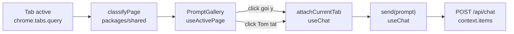

#### 7.12.4 Hiệu năng

- Đọc tab active là **1 lần** `chrome.tabs.query` (≤ 5 ms) → cache trong state của `useActivePage`, chỉ gọi lại khi có sự kiện đổi tab / đổi URL.
- `classifyPage` là hàm thuần (không I/O) → < 0.1 ms.
- `suggestionsForPage` sinh mảng 4 phần tử → không đáng kể.
- **Không** fetch nội dung trang khi mở gallery → panel cold-start không bị chậm (NFR-PERF-03).

#### 7.12.5 Kiểm thử

| Tầng | File | Phủ |
|---|---|---|
| Unit (shared) | `packages/shared/tests/pageProfile.test.ts` | classify từng profile · mỗi profile ≥ 3 gợi ý · `{title}` được điền · không còn placeholder · `rotateSuggestions` deterministic |
| Unit (extension) | `apps/extension/tests/activePage.test.ts` | `readActivePage` undefined khi `chrome.tabs.query` lỗi (không throw) |
| Unit (extension) | `apps/extension/tests/promptGallery.test.tsx` | render ≥ 3 chip · bấm chip → `onSelect(prompt)` · bấm refresh → `onRefresh` · bấm "Tóm tắt" → `onSummarize` · disabled khi `isSending` |
| E2E | `apps/extension/e2e/promptGallery.spec.ts` | (1) profile docs theo tab · (2) click gợi ý → `context.items[0]` có trang · (3) nút tóm tắt → `SUMMARY_PROMPT` + context · (4) `chrome://` → gợi ý chung · (5) đổi tab → gallery đổi profile |

### 7.13 Toggle panel · context menu · phím tắt (FR-UX-01 — T-M1-03)

> Nguồn sự thật cho hợp đồng: [`REQUIREMENTS.md`](REQUIREMENTS.md) §4.9.3.

#### 7.13.1 Quyết định thiết kế

| Quyết định | Lý do |
|---|---|
| Toolbar toggle dùng **native** `chrome.sidePanel.setPanelBehavior({ openPanelOnActionClick: true })` | Chrome tự quản lý mở/đóng → không cần tự track state cho thao tác click icon. API có từ **Chrome 114** (không phải 141) → khớp `minimum_chrome_version: 114` |
| Vẫn giữ `action.onClicked` như **fallback** | Chrome cũ / `setPanelBehavior` lỗi → mở panel bằng `open()`. Guard bằng `getPanelBehavior()` để **không** mở 2 lần (khi behavior đã bật, Chrome **không** dispatch `action.onClicked`) |
| Phím tắt = **custom command** `sidekick-toggle-panel` + tự xử lý toggle | `_execute_action` bị `openPanelOnActionClick` nuốt → không kiểm soát được toggle. Tự xử lý → 1 nguồn sự thật, test được |
| Track trạng thái panel bằng `chrome.storage.session` + event `sidePanel.onOpened`/`onClosed` | `onOpened` (Chrome 141) / `onClosed` (142) → biết panel đang mở hay không để quyết định open vs close. `storage.session` sống suốt phiên browser → **không** mất khi SW bị kill (~30s) |
| Đóng panel: `chrome.sidePanel.close({ windowId })` (Chrome 141+) + **feature detection** | Chrome < 141 không đóng được → phím tắt chỉ mở. Dùng `typeof chrome.sidePanel.close === 'function'`, không đụng `chrome.runtime.getManifest` hack |
| Context menu: **2 mục** — `sidekick-open` (`contexts: ['page']`) + `sidekick-ask-selection` (`contexts: ['selection']`) | AC ghi "context menu 'Ask Sidekick'". Mục selection tái dùng **đường B** của T-M1-02: `info.selectionText` → `PendingSelection` → `writePendingSelection()` → panel tự nhận (`useSelection`) → chip `tier: 'selection'` |
| Menu tạo lại an toàn: `chrome.contextMenus.removeAll()` **trước** `create()` | Sửa lỗi duplicate id khi update extension; `removeAll` có Promise từ Chrome 123 → dùng `await` bọc `try/catch` |
| `setPanelBehavior` gọi ở **top-level** của service worker | MV3 SW bị kill ~30s → top-level chạy lại → behavior luôn được bật lại (idempotent, upsert) |
| Tách logic ra file riêng (`background/panelController.ts`, `background/contextMenus.ts`, `background/commands.ts`) | Service worker chỉ nên là **wiring**; logic test được trong jsdom với mock `chrome.*` |
| **Không** thêm UI mới cho task này | Đổi phím tắt là T-M1-18 (`settings/ShortcutsSettings.tsx`) — task này chỉ chốt phím mặc định + contract để T-M1-18 mở rộng |

#### 7.13.2 Contract — `apps/extension/src/background/panelController.ts`

```ts
export const PANEL_OPEN_STATE_KEY = 'sidekick.panelOpen'

export type PanelToggleResult = 'opened' | 'closed' | 'noop'

export async function applyOpenOnActionClick(): Promise<boolean>
export async function isOpenOnActionClick(): Promise<boolean>
export async function readPanelOpenState(): Promise<boolean>
export async function writePanelOpenState(open: boolean): Promise<void>
export async function openSidePanel(windowId?: number): Promise<boolean>
export async function closeSidePanel(windowId?: number): Promise<boolean>
export async function toggleSidePanel(windowId?: number): Promise<PanelToggleResult>
```

- Mọi hàm bọc `try/catch` → **không bao giờ throw** (SW không được crash).
- `openSidePanel(windowId?)`: nếu không có `windowId` → fallback `chrome.windows.getCurrent()`.
- `toggleSidePanel`: đọc state → đang mở → `close()` → `'closed'`; ngược lại → `open()` → `'opened'`; thao tác thất bại → `'noop'`.

#### 7.13.3 Contract — `apps/extension/src/background/contextMenus.ts`

```ts
export const CONTEXT_MENU_OPEN_ID = 'sidekick-open'
export const CONTEXT_MENU_ASK_SELECTION_ID = 'sidekick-ask-selection'

export async function registerContextMenus(): Promise<void>
export async function handleContextMenuClick(
  info: chrome.contextMenus.OnClickData,
  tab?: chrome.tabs.Tab,
): Promise<void>
```

- `registerContextMenus()`: `removeAll()` → `create()` × 2 (mỗi `create` bọc `try/catch` riêng → menu đã tồn tại không làm hỏng menu còn lại).
- `handleContextMenuClick()`:
  - `sidekick-open` → `openSidePanel(tab?.windowId)`.
  - `sidekick-ask-selection` → `normalizeSelectionText(info.selectionText)` + `isMeaningfulSelection()` → dựng `PendingSelection` (`selectionItemId()` + `info.pageUrl` + `tab.title` + `tab.id`) → `writePendingSelection()` → `openSidePanel(tab?.windowId)`. Text rỗng/quá ngắn → **không** ghi, **không** mở panel.

#### 7.13.4 Contract — `apps/extension/src/background/commands.ts`

```ts
export const COMMAND_TOGGLE_PANEL = 'sidekick-toggle-panel'

export async function handleCommand(
  command: string,
  tab?: chrome.tabs.Tab,
): Promise<void>
```

- Command lạ → bỏ qua (không side-effect).

#### 7.13.5 Manifest

```json
"commands": {
  "sidekick-toggle-panel": {
    "suggested_key": { "default": "Ctrl+Shift+K", "mac": "Command+Shift+K" },
    "description": "Mo / dong Sidekick AI"
  }
}
```

- **Không** thêm permission mới (`commands` không cần permission; `contextMenus` đã có từ trước).
- `Ctrl+Shift+K` **không** trùng shortcut mặc định của Chrome (đã verify: Chrome dùng `Ctrl+Shift+A` cho tab search, `Ctrl+Shift+J` cho DevTools).

#### 7.13.6 Luồng

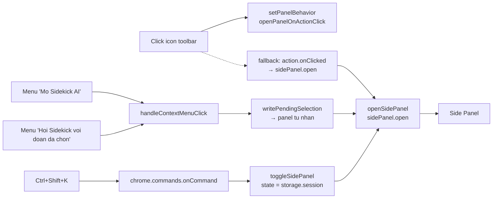

#### 7.13.7 Hiệu năng

- Mọi thao tác đều là **1 lần gọi API** của Chrome (`sidePanel.open` / `close` / `setPanelBehavior` / `getPanelBehavior`) → không I/O nặng, không chặn SW.
- Đọc/ghi trạng thái panel = 1 lần `chrome.storage.session.get/set` (in-memory) → < 1 ms.
- `registerContextMenus()` chỉ chạy ở `onInstalled` / `onStartup` → không chạy lại mỗi lần SW restart.

#### 7.13.8 Kiểm thử

| Tầng | File | Phủ |
|---|---|---|
| Unit (extension) | `apps/extension/tests/panelController.test.ts` | `setPanelBehavior` / `getPanelBehavior` · `openSidePanel` có/fallback windowId · `closeSidePanel` feature detection (Chrome < 141) · `toggleSidePanel` mở/đóng/noop · lỗi Chrome → không throw |
| Unit (extension) | `apps/extension/tests/contextMenus.test.ts` | `removeAll` trước `create` · 2 mục đúng id/title/contexts · `sidekick-open` → `sidePanel.open` · `sidekick-ask-selection` → ghi `PendingSelection` đúng text/url/title/tabId + mở panel · selection rỗng → không ghi, không mở |
| Unit (extension) | `apps/extension/tests/commands.test.ts` | command toggle → `toggleSidePanel(windowId)` · command lạ → bỏ qua |
| E2E | `apps/extension/e2e/serviceWorker.spec.ts` | (1) `getPanelBehavior()` → `openPanelOnActionClick: true` · (2) `commands.getAll()` → `Ctrl+Shift+K` + SW đã đăng ký listener · (3) menu `sidekick-open` đã tồn tại (`create` lại → "duplicate id") · (4) mở/đóng panel → `sidekick.panelOpen` trong `chrome.storage.session` cập nhật đúng |

> **Hạn chế E2E đã biết:** Playwright **không** kích hoạt được accelerator của browser (extension command) trong headless — đã verify cả `page.keyboard.press` lẫn `Input.dispatchKeyEvent` qua CDP đều không tới `chrome.commands`. Vì vậy phần "bấm phím tắt" được cover bằng unit test; E2E assert **đăng ký** shortcut + **vòng đời** trạng thái panel.

---

### 7.14 Settings — theme · cỡ chữ · chiều rộng · quản lý dữ liệu · endpoint BFF (FR-SETTINGS-01..07 + FR-UX-06 + NFR-SEC-07 — T-M1-12)

> Nguồn sự thật cho hợp đồng: [`REQUIREMENTS.md`](REQUIREMENTS.md) §4.8.1.

#### 7.14.1 Quyết định thiết kế

| Quyết định | Lý do |
|---|---|
| Settings ở **drawer** (Radix `Dialog` trượt từ **phải**), không phải màn hình thay thế chat | Giữ được ngữ cảnh chat (DP-2: thread ≥ 90%); user chỉnh setting rồi đóng vẫn thấy đúng thread. Pattern đã có sẵn: `ConversationList` trong `Dialog` (§7.10) |
| **Không** dùng Zustand store cho settings | Settings đọc/ghi `chrome.storage.local` → cần đồng bộ giữa panel + service worker. Dùng hook `useSettings()` + `chrome.storage.onChanged` (pattern đã có: `useOnboarding`) → 1 nguồn sự thật, không stale |
| Theme áp bằng class `.dark` trên `<html>` + `data-theme` | `design/tokens.css` đã có sẵn block `.dark` → **không** hardcode màu mới, chỉ bật/tắt. `system` → `matchMedia('(prefers-color-scheme: dark)')` + listener `change` |
| Cỡ chữ scale qua biến `--font-scale` | Token đã có (`tokens.css`) và `index.css` đã dùng `calc(var(--font-size-md) * var(--font-scale))` → chỉ cần set `--font-scale` (0.9 / 1 / 1.1 / 1.2) → **không** sửa component nào |
| Mật độ qua biến `--density-scale` nhân vào token `--space-*` | Tương tự `--font-scale`: 1 biến → mọi padding/gap co giãn → không sửa component nào |
| Chiều rộng panel: set `--panel-max-width` trên `<html>` | Chrome side panel chiều rộng do user kéo; extension **chỉ** set `min-width`/`max-width` được → dùng `max-width` + `width: 100%` → co giãn trong khoảng user cho phép. Giới hạn ghi rõ trong UI |
| Xoá lịch sử chat: **thêm** `DELETE /api/conversations` (xoá tất cả) | Đã có `DELETE /api/conversations/:id` (§7.10). Xoá "tất cả" bằng cách loop client sẽ chậm + dễ sót → 1 endpoint server, cascade xoá messages/citations |
| Xoá dữ liệu local: xoá theo **prefix** `sidekick.` trong `chrome.storage.local` | Dùng 1 lệnh `chrome.storage.local.get(null)` + filter prefix → xoá hết cache context + draft + pending selection + settings. **Giữ** `sidekick.onboarding.*` + `sidekick.preferredProvider` (không mất trạng thái onboarding) — nêu rõ trong UI |
| Telemetry/history: **cờ OFF mặc định**, chưa nối hành vi | FR-SETTINGS-04 AC chỉ yêu cầu "mặc định OFF". Nối telemetry thật là việc M2 (T-M2-19). Task này chỉ lưu cờ + hiển thị "chưa dùng" → tránh nói dối user |
| Ngôn ngữ VI/EN: **UI Settings chỉ hiển thị lựa chọn**, chưa dịch toàn bộ | FR-SETTINGS-06 đầy đủ là T-M1-17 (i18n). T-M1-12 chỉ lưu lựa chọn + persist → ghi rõ TODO(T-M1-17) |
| Endpoint BFF: validate bằng `fetch` tới `<url>/api/health` trước khi lưu | AC FR-SETTINGS-05: "Validate endpoint khi lưu". `getBffUrl()` đã bỏ trailing slash; `setBffUrl()` chưa validate → bổ sung validate ở tầng UI, không đụng `apiClient` (giữ hành vi hiện tại) |
| Không thêm dependency UI mới | Chỉ có `button`/`input`/`dialog` trong `components/ui/`. Radio/switch viết tay bằng `<input type="radio">` + Tailwind (pattern đã dùng ở `StepProvider`) |

#### 7.14.2 Shape — `SidekickSettings`

Nguồn sự thật: [`packages/shared/src/schemas/settings.ts`](../packages/shared/src/schemas/settings.ts) (Zod).

```ts
export const themeModeSchema = z.enum(['light', 'dark', 'system'])
export const densitySchema = z.enum(['compact', 'cozy', 'comfortable'])
export const panelWidthSchema = z.enum(['narrow', 'default', 'wide'])
export const uiLanguageSchema = z.enum(['vi', 'en'])
export const fontScaleSchema = z.union([z.literal(0.9), z.literal(1), z.literal(1.1), z.literal(1.2)])

export const settingsSchema = z.object({
  theme: themeModeSchema,
  fontScale: fontScaleSchema,
  density: densitySchema,
  panelWidth: panelWidthSchema,
  telemetryEnabled: z.boolean(),   // default false
  historyEnabled: z.boolean(),     // default false
  uiLanguage: uiLanguageSchema,
  bffUrl: z.string().min(1).max(500),
})
```

- `fontScale` dùng **enum** (không phải `number`) → tránh giá trị lạ (vd 1.37) từ storage không map được về token hợp lệ.
- Lưu ở `chrome.storage.local` key **`sidekick.settings`** (object phẳng, không nested) → đọc/ghi O(1), không cần migration.

#### 7.14.3 Contract — `apps/extension/src/lib/settings.ts`

```ts
export const SETTINGS_STORAGE_KEY = 'sidekick.settings'
export const SIDEKICK_STORAGE_PREFIX = 'sidekick.'
export const PRESERVED_STORAGE_KEYS = ['sidekick.onboarding.completed', 'sidekick.preferredProvider']
export const DEFAULT_SETTINGS: Settings

export async function readSettings(): Promise<Settings>
export async function writeSettings(patch: Partial<Settings>): Promise<void>
export async function resetSettings(): Promise<void>
export function resolveTheme(mode: ThemeMode, prefersDark: boolean): 'light' | 'dark'
export function fontScaleFor(scale: number): string
export function densityScaleFor(density: DensityMode): string
export function panelMaxWidthFor(width: PanelWidth): string
export async function exportSettings(): Promise<string>
export async function importSettings(json: string): Promise<Settings>
export async function deleteLocalSidekickData(): Promise<string[]>
```

- Mọi hàm bọc `try/catch` → **không bao giờ throw** (trừ `importSettings` → ném lỗi rõ ràng cho UI hiển thị).
- `readSettings`: giá trị sai schema → fallback **từng field** (một field hỏng không làm mất các field hợp lệ).
- `writeSettings`: **merge** với giá trị hiện tại, rồi validate qua `settingsSchema` → field không hợp lệ bị bỏ qua.
- `deleteLocalSidekickData`: xoá mọi khoa `sidekick.*` **trừ** `PRESERVED_STORAGE_KEYS`.

#### 7.14.4 Contract — `apps/extension/src/lib/theme.ts`

```ts
export function prefersDarkScheme(): boolean
export function applyTheme(mode: ThemeMode, prefersDark: boolean): void
export function applyFontScale(scale: number): void
export function applyDensity(density: DensityMode): void
export function applyPanelWidth(width: PanelWidth): void
export function watchSystemTheme(onChange: (prefersDark: boolean) => void): () => void
```

| Hàm | Tác động lên `<html>` |
|---|---|
| `applyTheme` | `classList.toggle('dark', resolved === 'dark')` + `setAttribute('data-theme', resolved)` |
| `applyFontScale` | `style.setProperty('--font-scale', fontScaleFor(scale))` |
| `applyDensity` | `style.setProperty('--density-scale', densityScaleFor(density))` |
| `applyPanelWidth` | `style.setProperty('--panel-max-width', panelMaxWidthFor(width))` |

- Bảng `--panel-max-width`: `narrow` 400px · `default` 640px · `wide` 960px.
- `design/tokens.css`: `--space-1..8` = `calc(<px> * var(--density-scale))` → mật độ áp cho **mọi** padding/gap.
- `index.css`: `#root { max-width: var(--panel-max-width); min-width: var(--panel-min-width); margin-inline: auto; }`.

#### 7.14.5 Hook — `apps/extension/src/sidepanel/hooks/useSettings.ts`

```ts
export interface UseSettingsResult {
  settings: Settings
  isLoading: boolean
  update: (patch: Partial<Settings>) => Promise<void>
}
```

- Đọc `readSettings()` lúc mount → `settings` + `isLoading`.
- Lắng nghe `chrome.storage.onChanged` (area `local`, key `sidekick.settings`) → đồng bị khi đổi ở nơi khác.
- `update(patch)` → set state ngay (**optimistic**) → `writeSettings(patch)` → storage.
- **Effect** áp theme / font-scale / density / panel-width lên `<html>` mỗi khi `settings` đổi → áp dụng **ngay, không reload** (AC FR-SETTINGS-01/02).
- `watchSystemTheme` chỉ khi `theme === 'system'` → OS đổi nền → apply lại.

#### 7.14.6 Component

| File | Nội dung |
|---|---|
| `components/settings/SettingsDrawer.tsx` | Orchestrator: Radix `Dialog` trượt từ phải + 6 section · `data-testid="settings-drawer"` |
| `components/settings/ThemeSettings.tsx` | FR-SETTINGS-01 — radio `Sáng` / `Tối` / `Theo hệ điều hành` |
| `components/settings/AppearanceSettings.tsx` | FR-SETTINGS-02 — cỡ chữ (4 mức) · mật độ (3 mức) · chiều rộng (3 mức) |
| `components/settings/PrivacySettings.tsx` | FR-SETTINGS-04 — toggle telemetry (OFF) · toggle history (OFF) |
| `components/settings/DataSettings.tsx` | FR-SETTINGS-03/07 — xoá lịch sử chat (server) · xoá dữ liệu local · export settings (JSON) · import settings (file) |
| `components/settings/EndpointSettings.tsx` | FR-SETTINGS-05 — input URL BFF + nút "Kiểm tra & lưu" (gọi `/api/health`) |
| `components/settings/LanguageSettings.tsx` | FR-SETTINGS-06 — radio VI / EN (lưu lựa chọn; dịch UI → T-M1-17) |
| `components/settings/SettingsControls.tsx` | Sub-component dùng chung: `RadioGroup` · `ToggleRow` · `SettingsSection` |

- Mỗi section dùng **radio/checkbox native** + `<label>` (a11y tốt, không cần component mới).
- Xoá dữ liệu → dùng `ConfirmDialog` có sẵn (§7.10) với `destructive` + `isBusy`.
- Entry point: nút gear trong `PanelHeader.tsx` (`data-testid="settings-button"`) → `ChatWorkspace.tsx` giữ state `isSettingsOpen`.

#### 7.14.7 Endpoint — `DELETE /api/conversations`

```ts
// apps/server/src/services/conversationService.ts
export async function deleteAllConversations(db: Database): Promise<number>
```

- Xoá **explicit** citations → messages → conversations (Postgres có `ON DELETE CASCADE` → vẫn an toàn; explicit để unit test với fake DB phản ánh đúng hiệu ứng).
- Response: `200` + `{ deleted: number }`.
- **Không** có migration DB mới (chỉ thêm endpoint DELETE).

#### 7.14.8 Luồng

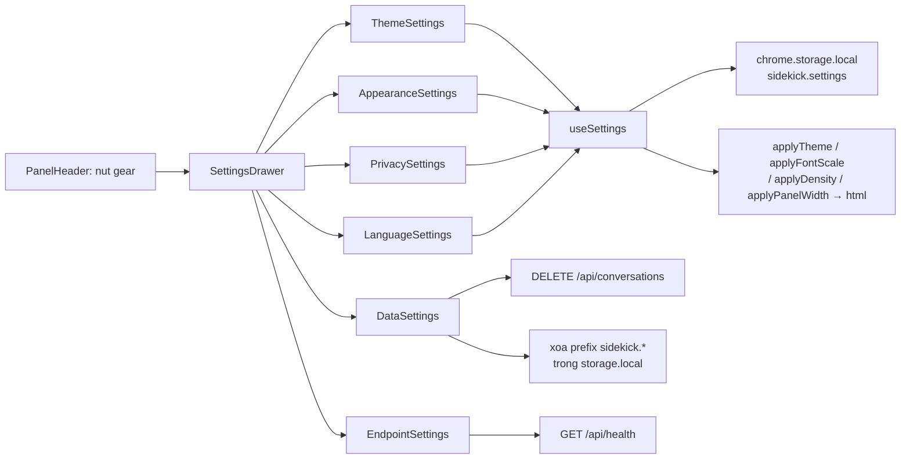

#### 7.14.9 Hiệu năng

- Đọc settings = 1 lần `chrome.storage.local.get` (< 1 ms) lúc mount panel → không ảnh hưởng cold start.
- Mỗi lần đổi setting = 1 lần `set` + 4 lần `setProperty` trên `<html>` → không re-render component nào khác (biến CSS áp bằng style, không qua React).
- Xoá lịch sử = 1 request `DELETE` (không loop N conversation).
- Xoá dữ liệu local = 1 lần `get(null)` + 1 lần `remove(keys)` → O(số khoá).

#### 7.14.10 Kiểm thử

| Tầng | File | Phủ |
|---|---|---|
| Unit (shared) | `packages/shared/tests/settings.test.ts` | `settingsSchema` validate/reject · `fontScaleSchema` chỉ nhận 4 mức |
| Unit (extension) | `apps/extension/tests/settings.test.ts` | `readSettings` default / lỗi / fallback từng field · `writeSettings` merge · `resetSettings` · `resolveTheme` 3 case · `fontScaleFor` clamp · `panelMaxWidthFor` map · `densityScaleFor` · `exportSettings` / `importSettings` (reject JSON sai) |
| Unit (extension) | `apps/extension/tests/theme.test.ts` | `applyTheme` toggle `.dark` light/dark/system · `applyFontScale` set `--font-scale` · `applyDensity` · `applyPanelWidth` · `watchSystemTheme` callback + hủy |
| Unit (extension) | `apps/extension/tests/settingsData.test.ts` | `deleteLocalSidekickData` xoá đúng prefix `sidekick.` · **giữ** `sidekick.onboarding.completed` + `sidekick.preferredProvider` · `deleteAllConversations` gọi `DELETE /api/conversations` |
| Unit (extension) | `apps/extension/tests/settingsDrawer.test.tsx` | render drawer + 6 section · đổi theme → `documentElement.classList` đổi · đổi cỡ chữ → `--font-scale` đổi · toggle → `writeSettings` được gọi · xoá lịch sử → confirm dialog → gọi DELETE |
| Unit (server) | `apps/server/tests/conversationsRoute.test.ts` | `DELETE /api/conversations` → 200 + `{ deleted }` + xoá hết rows |
| E2E | `apps/extension/e2e/settings.spec.ts` | (1) bấm gear → drawer mở · (2) chọn "Tối" → `<html>` có `.dark` → reload → vẫn `.dark` · (3) đổi cỡ chữ → `--font-scale` đổi → reload → giữ · (4) xoá lịch sử (stub `DELETE /api/conversations`) → confirm → request đúng |

> **Ghi chú E2E:** BFF được stub bằng `page.route` → test chạy độc lập, không cần Postgres thật.

### 7.15 States · retry · connection status (FR-CHAT-14 · FR-UX-08 · NFR-REL-02 · NFR-REL-04 — T-M1-19)

> Nguồn sự thật cho hợp đồng: [`REQUIREMENTS.md`](REQUIREMENTS.md) §5.3 (NFR-REL) + §4.1 (FR-CHAT-14).

#### 7.15.1 Bốn trạng thái của side panel

Side panel **không bao giờ** hiển thị màn hình trắng/chết. Mọi trạng thái đều có **một điểm vào chung** trong `apps/extension/src/sidepanel/components/states/`:

| Trạng thái | Component | Khi nào | Hành động |
|---|---|---|---|
| **Loading** | `LoadingState.tsx` | Đang tải lịch sử hội thoại (`GET /api/conversations/:id/messages`) | Skeleton rows (`animate-pulse`) — **không** flash empty state |
| **Empty** | `EmptyState.tsx` | Chưa có message nào | Wrapper của `PromptGallery` (T-M1-11) — ≥ 3 gợi ý theo trang |
| **Error** | `ErrorState.tsx` | Lỗi trong 1 luot chat | 1 hành động đúng theo nhóm lỗi (xem §7.15.3) |
| **Offline** | `offline-banner` trong `ChatWorkspace.tsx` | BFF không phản hồi | Banner dưới header + nút "Thử lại" |

#### 7.15.2 Taxonomy lỗi (shared)

Nguồn sự thật: [`packages/shared/src/chatErrors.ts`](../packages/shared/src/chatErrors.ts) — **thuần**, dùng chung server + extension + eval.

```ts
export type ChatErrorKind = 'network' | 'rate-limit' | 'auth' | 'provider' | 'server' | 'unknown'

export function classifyChatError(code: string): ChatErrorKind
export function isRetryableKind(kind: ChatErrorKind): boolean      // false cho 'auth'
export function shouldAutoRetry(kind: ChatErrorKind): boolean      // true cho network/server/unknown
export function defaultRetryAfterSeconds(kind: ChatErrorKind): number | undefined  // 60 cho 'rate-limit'
export const AUTO_RETRY_BACKOFF_MS = 800
```

| Error code | Kind | `retryable` (user) | Auto-retry | Hành động trong UI |
|---|---|---|---|---|
| `INVALID_API_KEY` · `PROVIDER_KEY_INVALID` · `MISSING_API_KEY` · `UNAUTHORIZED` · `FORBIDDEN` | `auth` | ❌ | ❌ | **Kiểm tra API key** → mở drawer Settings |
| `PROVIDER_RATE_LIMITED` · `RATE_LIMITED` · `PROVIDER_QUOTA_EXCEEDED` | `rate-limit` | ✅ (sau hạn) | ❌ | **Thử lại sau Ns** (đếm ngược, nút bị disable) |
| `SERVICE_UNAVAILABLE` · `PROVIDER_UNAVAILABLE` · `TIMEOUT` | `network` | ✅ | ✅ | **Thử lại** |
| `INTERNAL_ERROR` · `DB_ERROR` | `server` | ✅ | ✅ | **Thử lại** |
| `PROVIDER_ERROR` · `MODEL_NOT_FOUND` | `provider` | ✅ | ❌ | **Thử lại** (model sai → retry cũng lỗi) |
| (không nhận ra) | `unknown` | ✅ | ✅ | **Thử lại** |

#### 7.15.3 Luồng lỗi

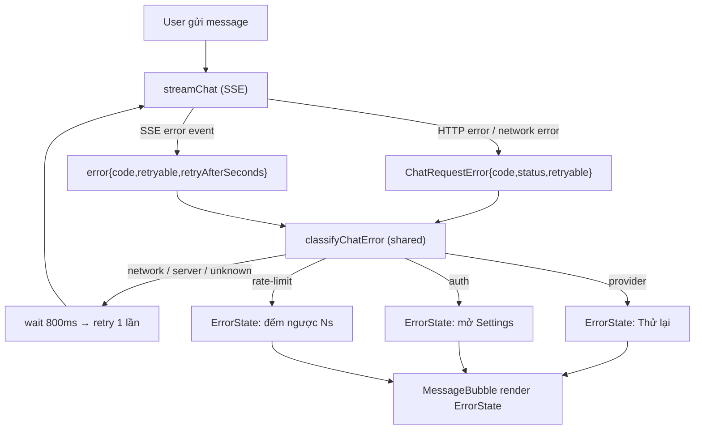

#### 7.15.4 Server — báo lỗi thật

| Nơi | Thay đổi |
|---|---|
| `packages/shared/src/events.ts` | `chatErrorEventSchema` += `retryAfterSeconds?: number` (int ≥ 0) |
| `packages/shared/src/schemas/provider.ts` | `providerChunkSchema` += `errorRetryable?: boolean` + `retryAfterSeconds?: number` |
| `apps/server/src/providers/types.ts` | `errorChunk(code, message, { retryable, retryAfterSeconds })` |
| `apps/server/src/providers/sse.ts` | `parseRetryAfterSeconds(response)` (đọc header `Retry-After`, ghim ≤ 600 s) · `isRetryableStatus(status)` (401/403 → false) · `shouldTryFallbackModel(status)` (429 **vẫn** fallback sang model khác) |
| `apps/server/src/providers/{openaiCompatible,gemini}.ts` | HTTP 429 → gắn `retryAfterSeconds` từ header · HTTP 401/403 → `errorRetryable: false` |
| `apps/server/src/services/chatService.ts` | `retryable = chunk.errorRetryable ?? isRetryableKind(classifyChatError(code))` — **không** hardcode `true`; forward `retryAfterSeconds` |

> **Phân biệt 2 khái niệm `retryable`:** `shouldTryFallbackModel` (server thử **model** khác — 429 vẫn thử) ≠ `isRetryableStatus` (user có nên **retry** — 401/403 thì không).

#### 7.15.5 Extension — plumbing

| Nơi | Thay đổi |
|---|---|
| `apps/extension/src/lib/sseClient.ts` | `export class ChatRequestError extends Error { code; status; retryable }` — thay `new Error("CODE: msg")`; lỗi network → `ChatRequestError('SERVICE_UNAVAILABLE', …)` |
| `apps/extension/src/sidepanel/store/chatStore.ts` | `ChatMessage` += `serverId?` (uuid từ SSE `meta.messageId`) · `errorCode?` · `errorRetryable?` · `errorRetryAfterSeconds?` · action `setMessageError(id, patch)` |
| `apps/extension/src/sidepanel/hooks/useChat.ts` | Lưu `code`/`retryable`/`retryAfterSeconds` khi nhận SSE `error` · retry **1 lần** backoff 800 ms · `retryMessage(messageId)` (gọi `regenerate` với `serverId`) |

> **`serverId` là bắt buộc:** client sinh id local (`assistant-<timestamp>`) nhưng server yêu cầu `assistantMessageId` là **uuid** (`chatRequestSchema`) → `regenerate` / `continue` / `retryMessage` phải dùng `serverId` (từ SSE `meta.messageId`), nếu không server trả 400.

#### 7.15.6 Trạng thái kết nối

Nguồn: [`apps/extension/src/lib/connectionStatus.ts`](../apps/extension/src/lib/connectionStatus.ts) (thuần) + [`apps/extension/src/sidepanel/hooks/useConnectionStatus.ts`](../apps/extension/src/sidepanel/hooks/useConnectionStatus.ts).

- Probe `GET <bffUrl>/api/health` (timeout 3 s) → `connected` (HTTP 200 + `status: 'ok'`) · `degraded` (`status: 'degraded'`) · `offline` (HTTP lỗi / fetch reject / timeout).
- **Backoff probe**: 5 s → 15 s → 30 s (giữ nguyên 30 s). Probe thành công → reset về 5 s.
- `navigator.onLine` listener → báo `offline` **tức thời** (không chờ probe kế tiếp); `online` → probe lại ngay.
- `ConnectionBadge` trong `PanelHeader` (icon + chữ, **không** chỉ dựa vào màu) + banner offline dưới header.

#### 7.15.7 Kiểm thử

| Tầng | File | Phủ |
|---|---|---|
| Unit (shared) | `packages/shared/tests/chatErrors.test.ts` | `classifyChatError` 6 nhóm · `isRetryableKind` · `shouldAutoRetry` · `defaultRetryAfterSeconds` · `AUTO_RETRY_BACKOFF_MS` |
| Unit (shared) | `packages/shared/tests/events.test.ts` | `error` event có `retryAfterSeconds` · reject giá trị âm |
| Unit (server) | `apps/server/tests/chatErrorEvent.test.ts` | 401 → `retryable: false` · 429 → `retryAfterSeconds` · provider 429 đọc header `Retry-After` · 401 → `errorRetryable: false` |
| Unit (extension) | `apps/extension/tests/chatErrorState.test.tsx` | action đúng theo kind · đếm ngược 429 · dismiss · `role="alert"` · `data-error-kind` |
| Unit (extension) | `apps/extension/tests/connectionStatus.test.ts` | `backoffFor` 5s→15s→30s · `probeConnection` ok/degraded/lỗi/reject |
| Unit (extension) | `apps/extension/tests/chatRetry.test.ts` | retry **đúng 1 lần** · 401 **không** retry · sau retry vẫn có card lỗi · SSE `error` lưu `errorCode` + `retryAfterSeconds` · `retryMessage` gọi `regenerate` |
| E2E | `apps/extension/e2e/states.spec.ts` | (1) BFF offline → badge + banner · (2) BFF online → badge "Đã kết nối" · (3) SSE 429 → card lỗi + đếm ngược · (4) mở conversation → skeleton loading |

**Mutation spot-check (8 mutation, đều bị bắt):**

| Mutation | Kết quả |
|---|---|
| `chatErrors.ts`: `shouldAutoRetry` bỏ điều kiện loại trừ `auth` | ✅ Bị bắt — *"auth / rate-limit / provider khong tu dong retry"* fail |
| `useChat.ts`: bỏ guard số lần retry (thêm 1 lần gọi nữa) | ✅ Bị bắt — *"retry DUNG 1 lan"* fail (3 thay vì 2) |
| `ErrorState.tsx`: đếm ngược không giảm | ✅ Bị bắt — *"het dem nguoc thi nut Thu lai duoc bat"* fail |
| `sse.ts`: bỏ mapping header `Retry-After` | ✅ Bị bắt — *"429 doc header Retry-After"* fail |
| `ChatWorkspace.tsx`: bỏ render banner offline | ✅ Bị bắt — E2E *"BFF offline → badge Offline + banner"* fail |
| `connectionStatus.ts`: bỏ backoff (luôn 5 s) | ✅ Bị bắt — 3 test backoff fail |
| `chatService.ts`: hardcode `retryable: true` | ✅ Bị bắt — *"401 → retryable=false"* fail |
| `ChatWorkspace.tsx`: bỏ render `LoadingState` | ✅ Bị bắt — E2E *"skeleton loading thay empty state"* fail |

---

### 7.16 Request logging đầy đủ vào `request_logs` (NFR-MAINT-04 · FR-CONTEXT-12 · FR-PROVIDER-05/06 — T-M1-14)

> Nguồn sự thật cho hợp đồng: [`REQUIREMENTS.md`](REQUIREMENTS.md) §5.2 (NFR-MAINT) + §4.1 (FR-PROVIDER-05/06, FR-CONTEXT-12).

#### 7.16.1 Vấn đề đã giải quyết

| Khoảng trống trước T-M1-14 | Sau T-M1-14 |
|---|---|
| `LOG_REQUESTS` mặc định `false` → **0 dòng log** | Mặc định `true` (chỉ metadata — an toàn) |
| `cost_usd` **luôn = 0**; SSE `usage` hardcode `costUsd: 0` | `calculateCostUsd()` từ bảng giá token; SSE `usage` mang chi phí thật |
| `tool_calls` **luôn = null** | Cột đã wire + shape-test; `null` khi không có tool call (tool thật → M2) |
| Lượt **thất bại** không được ghi (`MISSING_API_KEY` return sớm) | **Mọi** lượt đều có 1 dòng (thành công **và** thất bại) |
| Request-id sinh trong service, không tới client / log HTTP / provider | `X-Request-Id` xuyên suốt client → BFF → provider |
| Log HTTP dạng text (`GET /api/health 200 12ms`) | **JSON** 1 dòng/request |
| `GET /logs` · `GET /usage` có trong §4.1 nhưng **chưa implement** | Đã implement + validate Zod + **chỉ metadata** |
| Retention 90 ngày **không được enforce** | `pruneRequestLogs()` chạy lúc khởi động + mỗi 24 h |

> **Không có migration DB mới** — mọi cột (`cost_usd`, `tool_calls`, `context_hash`, `context_snapshot`, …) đã có sẵn từ M0.

#### 7.16.2 Luồng request-id

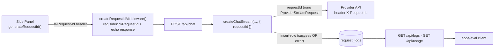

| Bước | Nơi | Hành vi |
|---|---|---|
| Sinh id | `apps/extension/src/lib/sseClient.ts` → `generateRequestId()` | `crypto.randomUUID()`; gửi header `X-Request-Id` |
| Chấp nhận id | `apps/server/src/middleware/requestId.ts` | Id hợp lệ (≤ 200 ký tự, charset `A-Za-z0-9._:/-`) → dùng; **không** hợp lệ → `randomUUID()` (chống log injection) |
| Gắn id | `req.sidekickRequestId` (augment Express tại `apps/server/src/types/express.d.ts`) | Không dùng `any` |
| Echo | Response header `X-Request-Id` (mọi route) + SSE `meta.requestId` | Client hiển thị 6 ký tự đầu ở meta line |
| Truyền provider | `ProviderStreamRequest.requestId` → header `X-Request-Id` | `openaiCompatible.ts` (Groq/OpenRouter/Ollama) + `gemini.ts`. **Best-effort** — provider có thể bỏ qua |

#### 7.16.3 Format log JSON

`apps/server/src/middleware/requestLogger.ts` — **1 dòng JSON / request**:

```json
{"ts":"2026-11-07T14:59:04.887Z","level":"info","event":"http_request","requestId":"req-live-test-003","method":"POST","path":"/api/chat","status":200,"durationMs":462}
```

> **Không bao giờ** log body / API key / nội dung người dùng. Chỉ method · path · status · duration · request-id.

#### 7.16.4 Mô hình chi phí

Nguồn: [`packages/shared/src/pricing.ts`](../packages/shared/src/pricing.ts) — `PROVIDER_PRICING` (USD / 1M token) + `calculateCostUsd({ provider, model, tokensIn, tokensOut })` → làm tròn **6** chữ số (khớp `numeric(12, 6)`).

- Model có giá riêng → dùng giá riêng; model lạ → giá mặc định của provider; provider không có trong bảng → `0`.
- `mock` / `ollama` (local) → `0` (không có chi phí thực).
- Bảng giá là **snapshot** → khi chốt `EVAL_REPORT.md` phải ghi lại giá đã dùng (xem [`EVAL_PLAN.md`](EVAL_PLAN.md) §5.3).

#### 7.16.5 API đọc log (chỉ metadata)

| Method | Path | Query | Response |
|---|---|---|---|
| GET | `/api/logs` | `limit` (≤ 200, mặc định 50) · `offset` · `provider` · `conversationId` (uuid) · `from` / `to` (ISO 8601) | `{ items: RequestLogSummary[], total }` |
| GET | `/api/usage` | `from` / `to` (ISO 8601) | `{ totalTokens, totalCostUsd, byDay[] }` |

`RequestLogSummary` (`packages/shared/src/schemas/logs.ts`) — **không** có `promptText` / `responseText` / `contextSnapshot`. Chỉ: `id` · `requestId` · `conversationId` · `provider` · `model` · `keySource` · `contextHash` · `tokensIn` · `tokensOut` · `costUsd` · `ttftMs` · `latencyMs` · `toolCallCount` · `error` · `createdAt`.

> **Cả hai endpoint đều validate Zod ở biên** → `400 VALIDATION_ERROR` khi query sai.

#### 7.16.6 Biến môi trường

| Biến | Mặc định | Ý nghĩa |
|---|---|---|
| `LOG_REQUESTS` | `true` | Ghi 1 dòng `request_logs` cho mỗi lượt chat (chỉ metadata) |
| `LOG_FULL_CONTENT` | `false` | Lưu **thêm** `prompt_text` + `response_text` (chứa nội dung người dùng — mặc định **TẮT**) |
| `LOG_RETENTION_DAYS` | `90` | Số ngày giữ `request_logs`; `0` = giữ vô hạn |
| `LOG_CONTEXT_SNAPSHOT` | `false` | Lưu `context_snapshot` (T-M1-06) |

#### 7.16.7 Kiểm thử

| Tầng | File | Phạm vi |
|---|---|---|
| Unit (shared) | `packages/shared/tests/pricing.test.ts` | model biết · model lạ → giá mặc định · `mock`/`ollama` → 0 · làm tròn 6 chữ số · token 0 / âm |
| Unit (server) | `apps/server/tests/requestLogService.test.ts` | shape insert (cost / `tool_calls` null vs array) · dòng lỗi · prune cutoff · filter + phân trang logs · tổng hợp usage |
| Unit (server) | `apps/server/tests/requestLogger.test.ts` | shape JSON 1 dòng · id echo từ header · id sinh khi thiếu · **không** rò body/secret |
| Unit (server) | `apps/server/tests/logsRoute.test.ts` | validate query · payload **chỉ metadata** (không `promptText`/`responseText`) |
| Unit (extension) | `apps/extension/tests/sseClient.test.ts` | `X-Request-Id` được gửi · id của server thắng |
| Unit (extension) | `apps/extension/tests/useChat.test.ts` | `requestId` lưu trên message assistant · truyền xuống `streamChat` |
| E2E | `apps/extension/e2e/requestLog.spec.ts` | gửi prompt → `GET /api/logs?limit=1` trả dòng có `requestId` khớp · `ttftMs` > 0 · `latencyMs` > 0 · `costUsd` ≥ 0 · `GET /api/usage` tổng hợp đúng |

**Mutation spot-check (6 mutation, đều bị bắt):**

| Mutation | Kết quả |
|---|---|
| `pricing.ts`: `calculateCostUsd` trả `0` | ✗ Bị bắt — *"tinh dung theo bang gia rieng cua model"* fail |
| `requestLogService.ts`: dùng hash của **prompt** thay `context_hash` | ✗ Bị bắt — *"context rong → context_hash = null"* + test context hash fail |
| `chatService.ts`: bỏ nhánh ghi log ở đường lỗi | ✗ Bị bắt — *"error code duoc ghi vao cot `error`*" fail |
| `routes/logs.ts`: trả `promptText` trong summary | ✗ Bị bắt — *"CHI metadata"* fail (route + summary) |
| `pruneRequestLogs`: sai mốc cutoff (bỏ `retentionDays`) | ✗ Bị bắt — *"xoa dong cu hon thoi han giu"* + *"retentionDays = 0"* fail |
| `requestId.ts`: bỏ nhánh đọc `X-Request-Id` (luôn sinh id mới) | ✗ Bị bắt — *"dung id tu header"* fail |

---

### 7.17 i18n VI/EN (FR-SETTINGS-06 — T-M1-17)

> Nguồn sự thật cho hành vi: [`REQUIREMENTS.md`](REQUIREMENTS.md) §4.8.1 (FR-SETTINGS-06).

#### 7.17.1 Vấn đề đã giải quyết

| Khoảng trống trước T-M1-17 | Sau T-M1-17 |
|---|---|
| Section "Ngôn ngữ" **chỉ lưu lựa chọn**, UI vẫn tiếng Việt | Toàn bộ UI panel dịch theo `settings.uiLanguage` |
| Cảnh báo "Giao diện hiện vẫn dùng tiếng Việt…" trong Settings | Đã **xoá** (không còn đúng) |
| Chuỗi rải rác trong component (`.tsx`), không kiểm soát được | **1 dictionary có kiểu** → thiếu key = **lỗi typecheck** |
| Không đổi được nhãn context menu / nút nổi content script | Cả 2 đọc từ dictionary → đổi theo ngôn ngữ |

#### 7.17.2 Kiến trúc module i18n

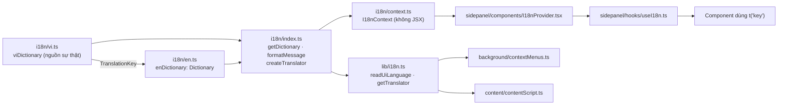

| File | Vai trò | Ghi chú |
|---|---|---|
| `apps/extension/src/i18n/vi.ts` | **Nguồn sự thật** của danh sách key | `viDictionary` là `const` object → `TranslationKey = keyof typeof viDictionary` |
| `apps/extension/src/i18n/en.ts` | Dictionary tiếng Anh | Kiểu `Dictionary = Record<TranslationKey, string>` → **thừa/thiếu key = lỗi typecheck** |
| `apps/extension/src/i18n/index.ts` | Hàm thuần | `getDictionary` · `resolveLanguage` · `formatMessage` · `createTranslator` |
| `apps/extension/src/i18n/context.ts` | React context | **Không JSX** → content script + service worker không import React |
| `apps/extension/src/lib/i18n.ts` | Lớp không React | `readUiLanguage()` (đọc storage) · `translatorFor()` · `getTranslator()` |
| `apps/extension/src/sidepanel/hooks/useI18n.ts` | Hook cho component | Trả `{ t, language }` |
| `apps/extension/src/sidepanel/components/I18nProvider.tsx` | Provider | Bọc ở `App.tsx` |

#### 7.17.3 Quy tắc bắt buộc

1. **Không thêm thư viện i18n** (không `i18next`, không `intl-messageformat`) → bundle nhỏ + không dependency mới. Chỉ dùng placeholder `{name}` do `formatMessage()` thay.
2. **Key mới → phải thêm vào cả `vi.ts` và `en.ts`.** Thiếu 1 trong 2 → `pnpm typecheck` fail.
3. **Dịch `en.ts` không được chứa dấu tiếng Việt** — trừ tên ngôn ngữ (`settings.language.vi` = "Tiếng Việt"). Có test tự động bắt.
4. **Placeholder phải giống nhau** ở 2 dictionary — có test tự động bắt.
5. **Comment tiếng Việt, identifier tiếng Anh.**

#### 7.17.4 Luồng đổi ngôn ngữ

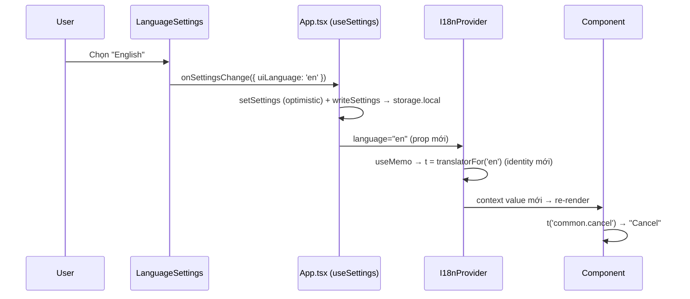

- Đổi ngôn ngữ áp dụng **ngay**, **không cần reload** (AC FR-SETTINGS-06).
- Persist qua `chrome.storage.local` key `sidekick.settings` → reload panel vẫn giữ ngôn ngữ.
- `useSettings()` được **nâng lên `App.tsx`** → `settings` + `onSettingsChange` truyền xuống `ChatWorkspace` → `SettingsDrawer`. Lý do: `I18nProvider` phải bọc **cả** onboarding lẫn chat để đổi ngôn ngữ đồng bộ; drawer nằm trong chat nên không thể tự đọc settings (vòng lặp state).
- `SettingsDrawer` **fallback** về `useSettings()` khi không truyền props → test render độc lập vẫn chạy được.

#### 7.17.5 Ngoài side panel

| Nơi | Cơ chế | Ghi chú |
|---|---|---|
| `background/contextMenus.ts` | `await getTranslator()` trước khi `chrome.contextMenus.create()` | `registerContextMenus()` đã idempotent (`removeAll()` → `create()`) |
| `background/serviceWorker.ts` | `chrome.storage.onChanged` → khi `sidekick.settings` đổi → gọi lại `registerContextMenus()` | Nhãn menu đổi theo ngôn ngữ, **không cần reload trình duyệt** |
| `content/contentScript.ts` | `localizeSelectionButton()` đọc storage → cập nhật text/aria-label của nút nổi trong Shadow DOM | Nút nổi nằm trong trang web host → không render được React |

> **Content script không được import React** → `i18n/context.ts` tách riêng khỏi `i18n/index.ts` để giữ content script là IIFE nhỏ. Kiểm chứng: `dist/content.js` **không** chứa React.

#### 7.17.6 Phạm vi dịch

| Đã dịch | Không dịch (giữ nguyên) | Lý do |
|---|---|---|
| Toàn bộ side panel (header · composer · thread · drawer cuộc trò chuyện · drawer cài đặt · onboarding · toast · banner lỗi) | Gợi ý trang trong `packages/shared/src/pageProfile.ts` | Prompt đánh giá phải **nhất quán** giữa các lần chạy eval |
| Context menu của extension (2 mục) | `SUMMARY_PROMPT` | Cùng lý do — prompt đánh giá |
| Nhãn nút nổi content script | Thông điệp lỗi **từ server** trả về | Thuộc phía BFF, không thuộc extension |

#### 7.17.7 Kiểm thử

| Tầng | File | Phạm vi |
|---|---|---|
| Unit | `apps/extension/tests/i18n.test.tsx` | key-set parity VI/EN · không dấu tiếng Việt trong `en.ts` · placeholder giống nhau · `formatMessage` (thay / giữ nguyên / nhiều placeholder) · `resolveLanguage` · `getDictionary` fallback · `readUiLanguage` (storage rong → `vi`) · `useI18n` mặc định `vi` |
| Unit (cũ) | `apps/extension/tests/settingsDrawer.test.tsx` · `onboardingUi.test.tsx` | Assert literal tiếng Việt vẫn pass (dictionary `vi` là mặc định) |
| E2E | `apps/extension/e2e/i18n.spec.ts` | Mặc định VI → chọn English → UI đổi **ngay** → reload vẫn EN → chọn lại VI → đổi ngay |

---

### 7.18 Phím tắt cấu hình được (FR-UX-01 — T-M1-18)

> Nguồn sự thật cho hành vi: [`REQUIREMENTS.md`](REQUIREMENTS.md) §4.9.3 (FR-UX-01).

#### 7.18.1 Ràng buộc MV3 / Chrome — `chrome.commands` **không** cho đổi shortcut

| API | Chrome | Firefox | Ghi chú |
|---|---|---|---|
| `chrome.commands.getAll()` | ✅ | ✅ | Đọc shortcut đang gán |
| `chrome.commands.onCommand` | ✅ | ✅ | Nhận sự kiện kích hoạt |
| `chrome.commands.update()` | ❌ **không tồn tại** | ✅ | Kiểm chứng: runtime probe trên Chrome 156 → `chrome.commands` chỉ có `onCommand` + `getAll` |
| `chrome.commands.reset()` | ❌ **không tồn tại** | ✅ | Như trên |

**Hệ quả:** Chrome chỉ cho người dùng đổi shortcut tại `chrome://extensions/shortcuts` → extension **không thể** tự gán lại `suggested_key` lúc chạy.

#### 7.18.2 Kiến trúc 2 lớp phím tắt

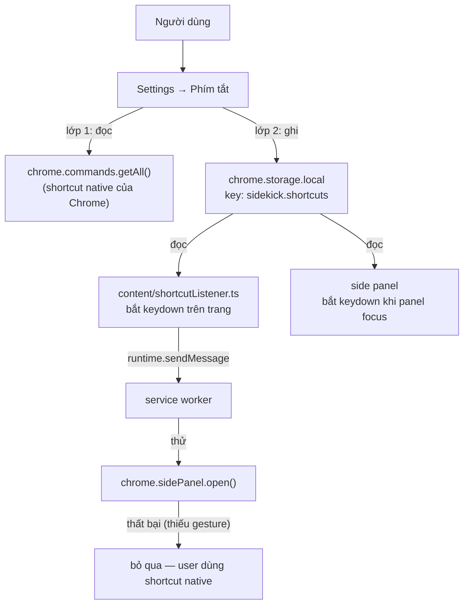

| Lớp | Nguồn lưu | Ai đổi được | Phạm vi | Mục đích |
|---|---|---|---|---|
| **Lớp 1 — native** | Chrome tự quản lý | User tại `chrome://extensions/shortcuts` | Toàn trình duyệt (kể cả khi panel đang đóng) | Mở/toggle panel từ bất kỳ trang nào |
| **Lớp 2 — nhanh** | `chrome.storage.local` (`sidekick.shortcuts`) | Người dùng ngay trong Settings | Side panel đang focus | Mở/toggle nhanh, không cần rời panel |

> **Vì sao cần lớp 2?** Chrome không cho extension tự đổi shortcut native, nhưng người dùng vẫn muốn **một tổ hợp riêng cho Sidekick** mà đổi được ngay trong sản phẩm. Lớp 2 lưu tổ hợp đó và tự bắt phím.

#### 7.18.3 Module map

| File | Vai trò | Thuần? |
|---|---|---|
| `apps/extension/src/lib/shortcuts.ts` | `normalizeShortcut` · `isReservedShortcut` · `parseShortcut` · `shortcutFromKeyboardEvent` · `matchesShortcut` · `RESERVED_CHROME_SHORTCUTS` · `DEFAULT_SHORTCUTS` · `SHORTCUT_COMMANDS` | ✅ thuần (test được trong jsdom) |
| `apps/extension/src/lib/shortcutStorage.ts` | `readShortcuts` · `writeShortcut` · `clearShortcut` · `resolveShortcut` | ✅ chỉ `chrome.storage.local` |
| `apps/extension/src/lib/shortcutProtocol.ts` | `SHORTCUT_TOGGLE_ACTION` + type guard (không import Zod → content script IIFE nhỏ) | ✅ thuần |
| `apps/extension/src/lib/shortcutBridge.ts` | Nhận message từ content script → thử `sidePanel.open()` | ⚠️ dùng `chrome.*` |
| `apps/extension/src/content/shortcutListener.ts` | Bắt `keydown` trên trang → so khớp shortcut → `runtime.sendMessage` | ⚠️ dùng `chrome.*` |
| `apps/extension/src/sidepanel/components/settings/ShortcutsSettings.tsx` | UI section trong drawer Settings | ⚠️ React |

#### 7.18.4 Deny-list shortcut của trình duyệt

Chrome **không** cho extension truy xuất danh sách shortcut mặc định của trình duyệt → phải **deny-list thủ công** (`RESERVED_CHROME_SHORTCUTS`):

`Ctrl+T` · `Ctrl+N` · `Ctrl+W` · `Ctrl+Shift+N` · `Ctrl+Shift+T` · `Ctrl+Shift+W` · `Ctrl+Shift+Q` · `F5` · `Ctrl+Shift+Delete` · `Ctrl+L` · `Ctrl+D` · `Ctrl+P` · `Ctrl+S` · `Ctrl+O` · `Alt+F4` · `F11` · `F12` · `Ctrl+Tab` · `Ctrl+Shift+Tab` · `Ctrl+1`…`Ctrl+9`

> Chrome cũng **tự ưu tiên** shortcut hệ thống (quản lý cửa sổ) → các tổ hợp đó không thể ghi đè dù đã cho phép.

#### 7.18.5 Quy tắc bắt buộc

1. **Không thêm field vào `settingsSchema`** → shortcut nằm ở khoá storage riêng (`sidekick.shortcuts`) vì nó **không** phải "hiển thị" mà là "hành vi".
2. **Shortcut phải chuẩn hoá** qua `normalizeShortcut()` trước khi lưu → so sánh được, không phụ thuộc thứ tự modifier user gõ.
3. **Tổ hợp trong deny-list → từ chối** với thông báo rõ ràng (`settings.shortcuts.reserved`), không crash.
4. **`chrome.commands.getAll()` fail âm thầm** → luôn kiểm tra `chrome.runtime.lastError` sau khi gọi.
5. **Nút "Về mặc định"** xoá shortcut tu do khỏi storage → quay về `DEFAULT_SHORTCUTS`.
6. **Không** dùng `chrome.commands.update()` / `chrome.commands.reset()` → không tồn tại trong Chrome.

#### 7.18.6 Kiểm thử

| Tầng | File | Phạm vi |
|---|---|---|
| Unit | `apps/extension/tests/shortcuts.test.ts` | `normalizeShortcut` (thứ tự modifier · alias · viết hoà · input sai) · `isReservedShortcut` · `parseShortcut` · `shortcutFromKeyboardEvent` · `matchesShortcut` · `formatShortcutLabel` |
| Unit | `apps/extension/tests/shortcutStorage.test.ts` | đọc/ghi/xoá shortcut · xoá khoá khi rỗng · `resolveShortcut` (ưu tiên tu do → fallback mặc định) |
| Unit | `apps/extension/tests/shortcutsSettings.test.tsx` | đọc shortcut native · lưu shortcut nhanh · từ chối tổ hợp reserved · reset · disable nút reset khi đang mặc định |
| E2E | `apps/extension/e2e/shortcuts.spec.ts` | section hiển thị · phản chiếu `getAll()` · đổi → lưu storage → persist qua reload · reset → về mặc định |

> **E2E không assert key-press:** Playwright headless **không** kích hoạt được accelerator của trình duyệt (đã ghi trong §7.13) → assert **đăng ký + phản chiếu + persist**.

---

### 7.19 Responsive 320–640px + a11y pass (FR-UX-06/07/09/10, NFR-A11Y-01..05 — T-M1-20)

> Nguồn sự thật cho hành vi: [`REQUIREMENTS.md`](REQUIREMENTS.md) §4.9.5.

#### 7.19.1 Ràng buộc layout của side panel

Side panel là **1 cột** do người dùng kéo → không có breakpoint ngang như web app. Vì vậy "responsive" ở đây = **không tràn ngang** + **giữ được chức năng** ở mọi bề rộng.

| Vấn đề | Trước | Sau |
|---|---|---|
| `#root` có `min-width` cứng | `320px` → tràn ngang khi panel < 320px | `min(var(--panel-min-width), 100%)` → **không bao giờ** rộng hơn viewport |
| Drawer Settings | `w-[min(360px,92vw)] max-w-[min(360px,92vw)]` | `w-[min(360px,92vw)] max-w-full` |
| Drawer conversation / confirm dialog | `w-[min(320px,85vw)]` / `w-[min(320px,90vw)]` | + `max-w-full` |
| Chip / nguồn trích dẫn | `max-w-[180px]` cứng | `max-w-[min(180px,100%)]` → co theo container |
| Flex child (bubble, textarea) | thiếu `min-w-0` → phình ngang | `min-w-0` + `truncate` + `overflow-x-hidden` ở thread |

#### 7.19.2 Focus ring — 1 pattern duy nhất

Mọi interactive element dùng **đúng 1** pattern (không dùng `outline: none` trần):

```
focus-visible:outline-2 focus-visible:outline-offset-2 focus-visible:outline-[var(--border-focus)]
```

| Trước | Sau |
|---|---|
| `focus-visible:outline-none focus-visible:ring-[var(--focus-ring)]` (12 chỗ) | pattern chuẩn ở trên |

> Vì sao đổi? `--focus-ring` là **box-shadow** (`0 0 0 2px surface, 0 0 0 4px border-focus`) → cần `outline: none` để tránh 2 vòng focus chồng nhau. Pattern `outline-*` dùng **1 token** (`--border-focus`) → đồng bộ với `Button` / `Input` / `Textarea` (đã đúng từ M0).

Ngoài ra: `index.css` có rule global `:focus-visible { outline: 2px solid var(--border-focus) }` → phủ cho mọi phần tử **kể cả** phần tử không có class Tailwind.

#### 7.19.3 Live region — đặt đúng chỗ để không spam

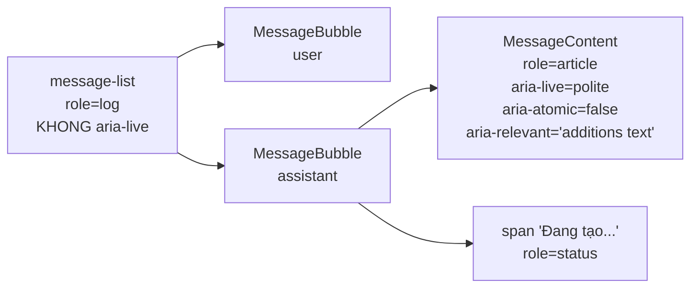

| Vị trí | `aria-live` | Lý do |
|---|---|---|
| `message-list` (thread) | ❌ **không** | Chứa cả lịch sử cũ → screen reader đọc lại toàn bộ khi bất kỳ thay đổi nào |
| `MessageContent` (assistant đang stream) | ✅ `polite` | Chỉ phần **vừa** stream → đọc đúng nội dung mới |
| span "Đang tạo câu trả lời..." | `role="status"` | Trạng thái, không phải nội dung luồng |
| `LoadingState` | `role="status"` + `aria-live="polite"` | (đã có từ T-M1-19) |

> `aria-atomic="false"` → chỉ đọc phần **thêm mới**, không đọc lại toàn bộ bubble.

#### 7.19.4 Skip-link

- `App.tsx` render `<SkipLink />` **trong** `I18nProvider` (dùng `t('a11y.skipToComposer')`).
- Anchor `#sidekick-composer-input` → `id` đặt trên `<Textarea>` trong `Composer`.
- Class: `sr-only focus:not-sr-only focus:absolute …` → ẩn cho tới khi nhận focus (WCAG 2.4.1 Bypass Blocks).

#### 7.19.5 Tab nhóm conversation — roving tabindex

| Phần tử | Thuộc tính |
|---|---|
| Tab "Đang hoạt động" | `role="tab"` · `id="conversation-tab-active"` · `aria-controls="conversation-panel"` · `aria-selected` · `tabIndex={active ? 0 : -1}` |
| Tab "Đã lưu trữ" | `role="tab"` · `id="conversation-tab-archived"` · `aria-controls="conversation-panel"` · `aria-selected` · `tabIndex={active ? 0 : -1}` |
| Panel danh sách | `role="tabpanel"` · `id="conversation-panel"` · `aria-labelledby={tab đang active}` |

> **Roving tabindex** (chỉ 1 tab trong tablist được focus) là pattern chuẩn của WAI-ARIA cho tablist.

#### 7.19.6 Tap target ≥ 24px (WCAG 2.2 §2.5.8)

Icon-button trước đây dùng `p-[2px]` + icon `h-3`/`h-3.5` → kích thước thực ~18–20px (dưới ngưỡng 24px).

| File | Trước | Sau |
|---|---|---|
| `ContextChips.tsx` (nút xoá chip) | `p-[2px]` + `h-3 w-3` | `h-6 w-6` + `flex items-center justify-center` |
| `ContextNotice.tsx` (nút dismiss) | `p-[2px]` + `h-3.5 w-3.5` | `h-6 w-6` |
| `PromptGallery.tsx` (nút refresh) | `p-[2px]` + `h-3.5 w-3.5` | `h-6 w-6` |
| `AttachmentTray.tsx` (nút xoá ảnh) | `p-[2px]` + `h-3 w-3` | `h-6 w-6` |
| `ContextChips.tsx` (chip toggle / thêm tab) | `py-[2px]` | + `min-h-[24px]` |
| `dialog.tsx` (nút đóng) | `p-1` + `h-4 w-4` | `h-6 w-6` |

#### 7.19.7 i18n — dọn chuỗi literal còn sót từ T-M1-17

| Chuỗi | Nơi | Key mới |
|---|---|---|
| "Enter để gửi · Shift+Enter để xuống dòng · @ để đính kèm tab" | `Composer.tsx` | `composer.hint` |
| "Phien ban cu ({count})" | `ChatWorkspace.tsx` | `chat.oldVersions` |
| (nhãn thread) | `ChatWorkspace.tsx` (`role="log"`) | `chat.threadLabel` |
| `aria-label="Đóng"` | `components/ui/dialog.tsx` | `common.close` |

> `useI18n` được **chuyển** từ `src/sidepanel/hooks/useI18n.ts` → `src/i18n/useI18n.ts` (file cũ re-export) → `components/ui/dialog.tsx` (component dùng chung) dùng được mà **không** import nguược từ `sidepanel/`.

#### 7.19.8 Kiểm thử

| Tầng | File | Phạm vi |
|---|---|---|
| Unit | `apps/extension/tests/a11y.test.tsx` | icon-button có `aria-label` · live region khi/không streaming · `role="status"` · `composer.hint` đã dịch · **source-level**: không còn `focus-visible:outline-none` / `focus-visible:ring-[var(--focus-ring)]` · icon-only button ≥ 24px |
| E2E | `apps/extension/e2e/responsive.spec.ts` | `scrollWidth <= clientWidth` ở 320 / 480 / 640px · drawer Settings + drawer conversation ở 320px · composer nằm trong khung nhìn |

> **Mutation spot-check:** đổi `focus-visible:outline-2 …` của `ContextNotice` về `focus-visible:outline-none` → **1 test fail** (đã kiểm chứng).

---

### 7.20 Export cuộc trò chuyện (FR-CHAT-10 — T-M1-13)

> Nguồn sự thật cho hành vi: [`REQUIREMENTS.md`](REQUIREMENTS.md) §4.1 (FR-CHAT-10).

#### 7.20.1 Ranh giới module

```mermaid
flowchart LR
  UI["ExportMenu.tsx<br/>(Radix Popover)"] --> B["lib/export.ts<br/>THUẦN — sinh nội dung"]
  UI --> D["lib/downloadFile.ts<br/>Blob + <a download>"]
  B --> MD["buildMarkdownExport()"]
  B --> JS["buildJsonExport()"]
  B --> FN["buildExportFileName()"]
```

| File | Trách nhiệm | Phụ thuộc |
|---|---|---|
| `apps/extension/src/lib/export.ts` | **Thuần** — sinh nội dung `.md` / `.json` + tên file | Không DOM · không Zod · không Chrome API |
| `apps/extension/src/lib/downloadFile.ts` | Tạo file + trigger download | `Blob` · `URL.createObjectURL` · `<a download>` |
| `apps/extension/src/sidepanel/components/chat/ExportMenu.tsx` | UI (Radix Popover) + toast | `useI18n` · `sonner` |

> Vì sao tách `downloadTextFile`? `lib/export.ts` phải test được trong vitest mà **không** cần DOM → nếu gộp `Blob`/`document` vào sẽ phải mock. Ngoài ra `downloadTextFile` được **tái sử dụng** cho export settings (`DataSettings.tsx`) → chỉ 1 bản.

#### 7.20.2 Hợp đồng dữ liệu đầu vào

```ts
interface ExportConversation {
  id?: string
  title: string
  messages: readonly ExportMessage[]
  exportedAt?: Date
}

interface ExportMessage {
  role: 'user' | 'assistant' | 'system'
  content: string
  createdAt: number          // epoch ms
  provider?: string
  model?: string
  tokensIn?: number
  tokensOut?: number
  requestId?: string
  citations?: readonly { index: number; url: string; title: string; snippet?: string }[]
}
```

**Nguồn dữ liệu:** `ChatWorkspace.tsx` map từ `visibleMessages` (= `activePathMessages(messages, path)`) → chỉ xuất **đường đi active**, đúng nội dung user đang nhìn thấy trên màn hình.

#### 7.20.3 Định dạng file Markdown

```markdown
# {tiêu đề conversation}

- Xuất lúc: {ISO 8601}
- Conversation ID: {uuid}
- Số tin nhắn: {n}

## Người dùng

*{ISO 8601 message*

> gemini · gemini-2.0-flash · 120/45 tokens · req abcdef

{nội dung}

## Trợ lý

...

**Nguồn:**

- [1] [Tiêu đề nguồn](https://url)
```

| Khối | Nguồn | Mục đích |
|---|---|---|
| Metadata đầu file | `exportedAt` · `conversation.id` · số message | Xác định **lúc nào** + **cái gì** được xuất |
| Metadata từng lượt assistant | `provider` · `model` · `tokensIn/tokensOut` · `requestId.slice(0,6)` | Đối chiếu với dòng `request_logs` (T-M1-14) — cùng 6 ký tự như chip trong bubble |
| `**Nguồn:**` | `citations[]` | Giữ liên kết nguồn theo marker `[N]` như trong nội dung |

> Role heading (`## Người dùng` / `## Trợ lý` / `## Hệ thống`) là **chuỗi cố định** — không dịch theo `i18n` vì file export phải ổn định giữa các lần xuất (và để máy đọc được). UI (nút, toast) **có** dịch VI/EN.

#### 7.20.4 Định dạng file JSON

```json
{
  "version": 1,
  "exportedAt": "2026-11-09T01:30:00.000Z",
  "conversation": { "id": "…", "title": "…" },
  "messages": [
    {
      "role": "user",
      "content": "…",
      "createdAt": "2026-11-09T01:29:00.000Z",
      "provider": "gemini",
      "model": "gemini-2.0-flash",
      "tokensIn": 120,
      "tokensOut": 45,
      "requestId": "abcdef123456",
      "citations": [{ "index": 1, "url": "…", "title": "…", "snippet": "…" }]
    }
  ]
}
```

- `version` (`EXPORT_FORMAT_VERSION = 1`) → tăng khi đổi shape → máy đọc được biết format nào.
- Field không có giá trị → **bỏ hẳn** khỏi object (không để `undefined`) → JSON gọn, không có `null` rác.
- Kiểu trả về là `ExportJsonPayload` (interface cụ thể) — **không** dùng `Record<string, unknown>` → test không phải ép kiểu.

#### 7.20.5 Tên file

`buildExportFileName(title, ext, at)` → `sidekick-<title>-<yyyyMMdd-HHmm>.<ext>`

- Loại ký tự cấm Windows: `< > : " / \ | ? *` → thay bằng khoảng trắng.
- Gộp khoảng trắng liên tiếp · cắt còn ≤ 60 ký tự · fallback `conversation` khi tiêu đề rỗng.
- Timestamp theo **giờ địa phương** (dễ đọc với user) — `yyyyMMdd-HHmm`.

#### 7.20.6 Hành vi UI

| Hành động | Kết quả | Toast |
|---|---|---|
| **Sao chép Markdown** | `navigator.clipboard.writeText(markdown)` | `toast.exportCopied` / `toast.exportFailed` |
| **Xuất .md** | download `sidekick-<title>-<stamp>.md` (`text/markdown`) | `toast.exportDone` / `toast.exportFailed` |
| **Xuất .json** | download `sidekick-<title>-<stamp>.json` (`application/json`) | `toast.exportDone` / `toast.exportFailed` |

- Nút export **chỉ hiện khi thread có nội dung** (`messages.length > 0`) → không mở menu rỗng.
- Menu là Radix `Popover` (đã có sẵn `components/ui/popover.tsx`) → render qua Portal → **không** bị `overflow` của thread cắt (FR-CONTEXT-10).
- `PanelHeader` nhận prop `exportMenu?: ReactNode` (không phải callback) → header chỉ lo vị trí, không cần biết chi tiết hành động.
- i18n keys: `chat.export` · `chat.exportCopy` · `chat.exportMarkdown` · `chat.exportJson` · `chat.exportDefaultTitle` · `toast.exportCopied` · `toast.exportDone` · `toast.exportFailed`.

#### 7.20.7 Kiểm thử

| Tầng | File | Phạm vi |
|---|---|---|
| Unit | `apps/extension/tests/export.test.ts` | metadata đầu file · metadata từng lượt · nguồn `[N]` · message rỗng bị bỏ qua · conversation rỗng vẫn sinh file · giữ nguyên ký tự đặc biệt · shape JSON + không có field `undefined` · tên file (ký tự cấm Windows · fallback · cắt độ dài) |
| E2E | `apps/extension/e2e/export.spec.ts` | thread rỗng → không có nút · có tin nhắn → menu 3 mục · download `.md` chứa nội dung assistant · download `.json` parse được + `version`/`messages[]` |

> **Mutation spot-check:** đổi `buildExportFileName` bỏ bước loại ký tự cấm Windows → **1 test fail** (đã kiểm chứng).

---

### 7.21 Parity — panel giữ nguyên khi chuyển tab (COMPARISON_MATRIX §E)

> Nguồn sự thật cho hành vi: [`COMPARISON_MATRIX.md`](COMPARISON_MATRIX.md) §E.

#### 7.21.1 Vì sao hành vi này **không cần code riêng**

Side panel thuộc **cửa sổ** (window), không thuộc **tab** → Chrome giữ panel mở khi user chuyển tab trong cùng cửa sổ. Đây là hành vi native của Chrome, giống Edge Copilot Sidebar và Chrome Gemini.

Thêm vào đó, side panel là **một document React** — không bị reload khi đổi tab → toàn bộ state trong bộ nhớ của panel (Zustand store `chatStore` · `conversationStore`) sống suốt:

| State | Nơi lưu | Mất khi đổi tab? |
|---|---|---|
| Thread (message + biến thể + đường đi active) | `useChatStore` (RAM của panel) | ❌ không |
| Draft (bản nháp đang gõ) | `useChatStore` + `chrome.storage.local` (`sidekick.draft.<id>`) | ❌ không |
| Context chips / ngân sách context | `useChatStore` | ❌ không |
| Danh sách conversation | `useConversationStore` | ❌ không |

#### 7.21.2 Phản ứng với sự kiện đổi tab

`useActivePage` (`apps/extension/src/sidepanel/hooks/useActivePage.ts`) đăng ký 2 listener:

| Listener | Điều kiện | Tác dụng |
|---|---|---|
| `chrome.tabs.onActivated` | luôn | đọc lại tab active → cập nhật `page` |
| `chrome.tabs.onUpdated` | **chỉ khi `changeInfo.url` khác `undefined`** | đọc lại khi trang điều hướng (trang reload không đổi URL → không đọc lại) |

`page` chỉ dùng cho **gợi ý theo trang** (`PromptGallery` — FR-UX-03) + placeholder. Nó **không** đụng vào `chatStore` → đổi tab **không** reset thread.

#### 7.21.3 Kiểm thử

`apps/extension/e2e/panelPersistence.spec.ts` — mock `chrome.tabs` (copy helper `mockTab` của `e2e/promptGallery.spec.ts`) + stub SSE `/api/chat`:

| Test | Chứng minh |
|---|---|
| `đổi tab → gallery đổi gợi ý theo trang mới` | `data-profile` của gallery đổi `docs` → `forum` |
| `đổi tab khi đã có thread → thread giữ nguyên, panel vẫn đọc tab mới` | thread giữ nguyên nội dung user + assistant · `chrome.tabs.query` được gọi lại (đếm bằng `__tabsQueryCount()`) → chứng minh panel **thật sự phản ứng**, không phải "đơ" vì state đứng yên · không quay về empty state |
| `đổi tab lần 2 → thread vẫn giữ nguyên` | đổi tab nhiều lần → thread không mất |

> **Giới hạn của E2E:** Playwright không điều khiển được side panel native của Chrome → test mô phỏng sự kiện `tabs.onActivated`. Phần "Chrome giữ panel mở khi đổi tab" là **hành vi native** (không có API nào để tắt) → không cần test code.

### 7.22 Model picker động + fallback chain runtime (FR-PROVIDER-03/04 — T-M2-02)

> Nguồn sự thật cho hành vi: [`REQUIREMENTS.md`](REQUIREMENTS.md) §4.6.

#### 7.22.1 Vì sao cần "model động"

Provider thay đổi danh mục model liên tục (Gemini, Groq, OpenRouter). Danh sách hardcode trong code sẽ nhanh lỗi thời → user không chọn được model mới. Vì vậy:

- **Server** gọi API `/models` của provider **thật** (có auth header) → trả danh sách model hiện hành.
- Nếu provider lỗi / không hỗ trợ → server trả danh sách **tĩnh** (preferred models) với `source: 'fallback'` → UI vẫn dùng được, chỉ hiện cảnh báo nhỏ.

#### 7.22.2 Endpoint — `GET /api/providers/:id/models`

| Thuộc tính | Giá trị |
|---|---|
| Route | `GET /api/providers/:id/models` (`apps/server/src/routes/providers.ts`) |
| Handler | `listProviderModels(deps, providerId)` (`apps/server/src/services/providerService.ts`) |
| Response | `ProviderModelsResponse` (`packages/shared/src/schemas/provider.ts`) |
| Auth | Header provider (`Authorization` hoặc `x-goog-api-key`) — **key nằm ở BFF, không bao giờ gửi xuống extension** |

```ts
// packages/shared/src/schemas/provider.ts
providerModelSourceSchema = z.enum(['live', 'fallback'])
providerModelsResponseSchema = z.object({
  providerId: providerIdSchema,
  models: z.array(z.string()),
  source: providerModelSourceSchema,
})
```

**Contract adapter** (`apps/server/src/providers/types.ts`):

```ts
export interface ProviderModelDiscovery {
  models: string[]
  /** `live` = gọi API thật · `fallback` = dùng danh sách tĩnh. */
  source: 'live' | 'fallback'
}

export interface ProviderAdapter {
  // ...
  /** Danh sách model động — adapter không implement thì server tự fallback. */
  discoverModels?(apiKey?: string): Promise<ProviderModelDiscovery>
}
```

- `openaiCompatible.ts` (`groq`, `openrouter`): `GET {baseUrl}/models` + header `Authorization: Bearer <key>`.
- `gemini.ts`: `GET {baseUrl}/models` + header `x-goog-api-key: <key>`.
- Adapter **không** implement `discoverModels` → `listProviderModels` trả `{ models: preferredModels, source: 'fallback' }`.

#### 7.22.3 Fallback chain runtime (FR-PROVIDER-04)

Khi provider chính lỗi **tạm thời** (429 / 5xx / network) **trước khi** token đầu tiên được phát ra → server thử provider tiếp theo trong chain.

**Điều kiện fallback (cả 3 phải đúng):**

1. Lỗi có `retryable: true` (dùng `isRetryableKind(classifyChatError(code))` — T-M1-19).
2. `streamedToken === false` — **chưa** phát token nào ra client. Nếu đã stream dở thì fallback sẽ sinh nội dung trùng lặp → không được.
3. Còn candidate tiếp theo trong chain.

**Chuỗi ứng viên** (`apps/server/src/services/chatService.ts`):

- Provider được chỉ định trong request (`request.provider`) → đứng đầu.
- Nếu không → `registry.getFallbackChain()` (mặc định: provider mặc định → các provider còn lại).
- Provider **không có key** → **bỏ qua** (không phải lỗi → không tốn lượt thử).
- Request có ảnh → provider/model không hỗ trợ vision → **bỏ qua** (FR-VISION-01).

**SSE event mới — `provider_switch`** (`packages/shared/src/events.ts`):

```ts
chatProviderSwitchEventSchema = z.object({
  type: z.literal('provider_switch'),
  from: providerIdSchema,   // provider bị lỗi
  to: providerIdSchema,     // provider dự phòng đang dùng
  reason: z.string(),       // error code của provider trước (vd: 'RATE_LIMITED')
  model: z.string(),        // model của provider mới
})
```

> Event phát **trước** `token` đầu tiên của provider mới → client biết chính xác model nào đang trả lời.

**Khi chuyển provider, server tính lại:**

- `contextBudget` — context window mỗi provider khác nhau → cắt lại context.
- `messagesForProvider` — dựng lại prompt theo provider mới (format tool/message khác nhau).

**Ghi log** — cột mới `request_logs.fallback_from` (`text`, nullable):

- Lưu `providerId` của provider **đã lỗi** → truy vết "lượt chat này đã fallback".
- Migration: `apps/server/drizzle/0002_certain_vector.sql`.

#### 7.22.4 Extension — `ModelPicker`

| Thành phần | Vị trí | Vai trò |
|---|---|---|
| Component | `apps/extension/src/sidepanel/components/ModelPicker.tsx` | Radix `Popover` trong header panel |
| Storage | `apps/extension/src/lib/modelSelection.ts` | `chrome.storage.local` key `sidekick.modelSelection` |
| Client | `apps/extension/src/lib/providerClient.ts` → `listProviderModels()` | `GET /api/providers/:id/models`, validate bằng Zod |
| Gửi lên | `apps/extension/src/sidepanel/hooks/useChat.ts` | `provider` + `model` trong body `POST /api/chat` |

**Hành vi:**

- Danh sách provider: `GET /api/providers` → chỉ hiện provider `available: true`.
- Đổi provider → **xoá model đã chọn** (model của provider khác không dùng được).
- Đổi model → lọc theo từ khoá khi provider có **> 12 model** (`MODEL_SEARCH_THRESHOLD`).
- Nút "Về mặc định" → xoá lựa chọn → BFF tự dùng provider/model mặc định.
- Lựa chọn được lưu `chrome.storage.local` → **persist qua reload panel**, và dùng cho **mọi** lượt chat sau.
- `source === 'fallback'` → hiện dòng cảnh báo nhỏ (danh sách model không phải live).
- Response lệch shape → `providerModelsResponseSchema.safeParse` **không** crash UI → hiện danh sách rỗng + thông báo lỗi.

**Nút trigger** hiện provider/model **đang thật sự chạy** (từ SSE `meta`), không phải lựa chọn đã lưu → user luôn thấy đúng thứ đang trả lời.

#### 7.22.5 Phản ứng với `provider_switch` ở extension

`useChat.ts` (case `'provider_switch'`):

1. `setActive({ provider: event.to, model: event.model })` → chip provider trong header đổi ngay.
2. `updateMessage(assistantId, { provider: event.to, model: event.model })` → bubble ghi nhận provider thật sự đã trả lời.
3. Toast thông báo: "Đã chuyển sang provider X (lý do)" — i18n key `providerSwitch.toast`.

> `keySource` **không** đổi theo event (provider mới có key riêng → server sẽ cập nhật ở lượt sau) → giữ nguyên `keySource` hiện tại.

#### 7.22.6 Kiểm thử

| Tầng | File | Phủ |
|---|---|---|
| Server unit | `apps/server/tests/providerModelsRoute.test.ts` | 4 test — route trả model thật, `source` đúng, provider lạ → 400, model rỗng |
| Server unit | `apps/server/tests/fallbackChain.test.ts` | 6 test — fallback khi lỗi retryable, **không** fallback khi đã stream token, **không** fallback khi 401, lỗi sau khi hết chain, ghi `fallback_from` |
| Extension unit | `apps/extension/tests/modelSelection.test.ts` | đọc/ghi/xoá storage, dữ liệu hỏng → fallback về mặc định |
| Extension unit | `apps/extension/tests/providerModelsClient.test.ts` | validate Zod, response sai shape → không throw |
| Extension unit | `apps/extension/tests/modelPicker.test.tsx` | render, đổi provider xoá model, tìm kiếm, lưu lựa chọn |
| Extension unit | `apps/extension/tests/useChatM2.test.ts` | xử lý `provider_switch` + `usage` |
| E2E | `apps/extension/e2e/modelPicker.spec.ts` | mở picker, chọn model, hiện usage badge, mở section chi phí |

### 7.23 Token & chi phí (FR-PROVIDER-05 — T-M2-03)

> Nguồn sự thật cho hành vi: [`REQUIREMENTS.md`](REQUIREMENTS.md) §4.6.

#### 7.23.1 Nguồn dữ liệu

Chi phí **không** tính ở extension → server đã tính sẵn (`PROVIDER_PRICING` — §7.16.4) và gửi kèm trong SSE event `usage`:

```
usage → { tokensIn, tokensOut, costUsd }
```

Extension chỉ **lưu & hiển thị** → không lệch với giá thật.

#### 7.23.2 `UsageBadge` — badge dưới bubble assistant

| Thuộc tính | Giá trị |
|---|---|
| Component | `apps/extension/src/sidepanel/components/chat/UsageBadge.tsx` |
| Vị trí | Dòng meta của bubble assistant (cạnh `request_id`) |
| Store | `chatStore` → `ChatMessage.costUsd` (mới) |
| Format | `apps/extension/src/lib/costFormat.ts` → `formatCostUsd()` |

**Hiển thị:**

| Trường hợp | Kết quả |
|---|---|
| Có token, `costUsd` = 0 (mock / Ollama local) | chỉ token vào/ra — **không** hiện `$0.0000` |
| Có token, `costUsd` > 0 | token vào/ra + `~ $0.0123` |
| Chưa có `usage` event | badge **không** hiện (không render rỗng) |

`formatCostUsd()` dùng **4 chữ số thập phân** cho chi phí nhỏ (`0.0004`) → giá trị < 0.0001 bị làm tròn về 0 vẫn phải hiện đọc được.

#### 7.23.3 `UsageSettings` — section "Chi phí & sử dụng"

| Thuộc tính | Giá trị |
|---|---|
| Component | `apps/extension/src/sidepanel/components/settings/UsageSettings.tsx` |
| Vị trí | `SettingsDrawer` → section "Chi phí & sử dụng" |
| API | `GET /api/usage?range=…` → `apps/extension/src/lib/usageClient.ts` → `fetchUsage()` |
| Parse | `usageResponseSchema.safeParse` → response lệch shape **không** crash drawer |

**Nội dung:**

- Tổng token vào/ra + tổng chi phí USD cho khoảng đã chọn.
- Bảng phân rã **theo ngày** (`byDay[]` → `date` · `requests` · `tokensIn` · `tokensOut` · `costUsd`).
- Nút "Tải lại" → gọi lại API.

**Khoảng thời gian:** `today` · `7d` · `30d` · `all` (mặc định `7d`).

#### 7.23.4 Kiểm thử

| Tầng | File | Phủ |
|---|---|---|
| Extension unit | `apps/extension/tests/costFormat.test.ts` | `formatCostUsd` — 0 · 0.0004 · 0.0123 · số lớn |
| Extension unit | `apps/extension/tests/usageBadge.test.tsx` | ẩn khi chưa có token · chỉ token khi cost = 0 · có cost khi > 0 |
| Extension unit | `apps/extension/tests/usageSettings.test.tsx` | render tổng · bảng theo ngày · response sai shape → không crash |

---

### 7.24 Budget cap (FR-PROVIDER-06 — T-M2-03b)

> Nguồn sự thật cho hành vi: [`REQUIREMENTS.md`](REQUIREMENTS.md) §4.6 (FR-PROVIDER-06).

#### 7.24.1 Quyết định thiết kế: enforce **phía server**

Cấu hình hạn mức **không** nằm trong `chrome.storage.local` mà nằm trong **Postgres** (bảng `budget_settings`, singleton). Lý do:

| Nếu enforce ở client | Hậu quả |
|---|---|
| Extension tự so sánh | Client có thể bỏ qua → không phải "hạn mức" thật |
| Config lưu local | Mỗi máy 1 hạn mức → user đổi máy là mất |
| Server là nguồn chặn | Chi phí thật do server tính (§7.16.4) → chặn đúng số tiền đã dùng |

#### 7.24.2 Mô hình dữ liệu

Bảng `budget_settings` (migration `0003_good_mimic.sql`) — **1 dòng** (`id = 'default'`):

| Cột | Kiểu | Mặc định | Ý nghĩa |
|---|---|---|---|
| `id` | `text` pk | `'default'` | Id singleton — upsert idempotent |
| `enabled` | `boolean` | `false` | Bật/tắt budget cap (mặc định **TẮT**) |
| `limit_usd` | `numeric(12,6)` | `0` | Hạn mức USD cho kỳ (`0` = không giới hạn) |
| `warn_threshold_percent` | `integer` | `80` | Ngưỡng cảnh báo (%) |
| `period` | `text` | `'monthly'` | Kỳ tính: `daily` \| `monthly` |
| `hard_block` | `boolean` | `true` | Khi vượt hạn mức → **chặn** lượt chat mới |
| `created_at` / `updated_at` | `timestamptz` | `now()` | |

#### 7.24.3 Kỳ tính — giờ **địa phương** của máy chạy BFF

`packages/shared/src/budget.ts` → `resolveBudgetPeriod(period, now)`:

| Kỳ | Mốc bắt đầu | Mốc kết thúc |
|---|---|---|
| `daily` | 00:00 hôm nay | 00:00 ngày mai |
| `monthly` | 00:00 ngày 1 tháng này | 00:00 ngày 1 tháng sau |

BFF chạy **local cùng máy** với trình duyệt → `new Date()` của Node dùng đúng múi giờ của user → "hôm nay" khớp với cảm nhận của user. Postgres lưu timestamp theo UTC → khi query `created_at >= periodStart` thì `periodStart` đã là Date tuyệt đối (UTC nội bộ) → đúng.

#### 7.24.4 Trạng thái budget

`evaluateBudgetState({ enabled, limitUsd, spentUsd, warnThresholdPercent })` → `state` + `percentUsed`:

| Điều kiện | `state` | Hành vi |
|---|---|---|
| `enabled === false` hoặc `limitUsd <= 0` | `disabled` | Không canh báo, không chặn |
| `spent < limit × warn%` | `ok` | Bình thường |
| `warn% ≤ spent/limit < 100%` | `warning` | Cảnh báo (`--warning`) |
| `spent >= limit` | `exceeded` | Vượt hạn mức (`--danger`) |

#### 7.24.5 Luồng enforce trong `chatService`

```
POST /api/chat
  └─ buildBudgetStatus(db, now)            ← TRƯỚC prepareTurn
       ├─ yield { type:'budget', state, spentUsd, limitUsd, percentUsed, period }
       └─ state === 'exceeded' && hardBlock:
            ├─ persistRequestLog(costUsd = 0, error = BUDGET_EXCEEDED)
            ├─ yield { type:'error', code:'BUDGET_EXCEEDED', retryable:false }
            ├─ yield { type:'done', finishReason:'error' }
            └─ return   ← KHÔNG gọi provider → chi phí = 0
  └─ (nếu không bị chặn) stream provider bình thường
  └─ sau khi biết costUsd của lượt:
       yield { type:'budget', state, spentUsd: spentTrước + costUsd, ... }
```

**Điểm quan trọng:** kiểm tra budget **trước** `prepareTurn` → không tạo turn, không ghi user message, không gọi provider. Lượt bị chặn vẫn ghi **1 dòng `request_logs`** (cost 0, `error = 'BUDGET_EXCEEDED'`) → đúng AC "mỗi lượt chat (kể cả thất bại) có 1 dòng log" (§7.16).

#### 7.24.6 API

| Method | Path | Body | Response |
|---|---|---|---|
| `GET` | `/api/budget` | — | `BudgetStatus` |
| `PUT` | `/api/budget` | `BudgetSettingsPatch` (partial) | `BudgetStatus` (sau khi upsert) |

`BudgetStatus` (`packages/shared/src/schemas/budget.ts`):

```ts
{
  settings: { enabled, limitUsd, period, warnThresholdPercent, hardBlock }
  spentUsd: number
  limitUsd: number
  remainingUsd: number
  percentUsed: number
  state: 'disabled' | 'ok' | 'warning' | 'exceeded'
  period: 'daily' | 'monthly'
  periodStart: string   // ISO 8601
  periodEnd: string     // ISO 8601
}
```

Validate ở biên bằng `budgetSettingsPatchSchema` → lỗi → `400 VALIDATION_ERROR`.

#### 7.24.7 SSE event `budget`

```ts
{ type: 'budget', state, spentUsd, limitUsd, percentUsed, period }
```

Được emit **2 lần** mỗi lượt: (1) trước lượt (trạng thái hiện tại) · (2) sau lượt (đã cộng `costUsd`) → banner cập nhật **ngay** khi vừa vượt ngưỡng.

#### 7.24.8 Taxonomy lỗi

`packages/shared/src/chatErrors.ts`:

| Mục | Giá trị |
|---|---|
| `ChatErrorKind` mới | `'budget'` |
| `ERROR_CODES.BUDGET_EXCEEDED` | `'BUDGET_EXCEEDED'` |
| `ERROR_STATUS_MAP` | `402` |
| `isRetryableKind('budget')` | `false` (retry vô ích) |
| `shouldAutoRetry('budget')` | `false` (tránh vòng lặp retry) |

#### 7.24.9 Extension

| Thành phần | File | Vai trò |
|---|---|---|
| Client | `apps/extension/src/lib/budgetClient.ts` | `fetchBudgetStatus()` · `updateBudgetSettings(patch)` — parse bằng `budgetStatusSchema` |
| Store | `apps/extension/src/sidepanel/store/budgetStore.ts` | Zustand `useBudgetStore` → `status` (**khác** `chatStore.budget` = context budget) |
| Hook | `apps/extension/src/sidepanel/hooks/useBudgetStatus.ts` | `GET /api/budget` khi mở panel → ghi vào store |
| Section | `apps/extension/src/sidepanel/components/settings/BudgetSettings.tsx` | Bật · hạn mức USD · kỳ (radio) · ngưỡng cảnh báo % · toggle chặn · thanh tiến trình + nút "Lưu hạn mức" |
| Banner | `apps/extension/src/sidepanel/components/BudgetBanner.tsx` | Dưới header: `warning` → `--warning` · `exceeded` → `--danger` · có nút "Mở cài đặt" |
| Error | `apps/extension/src/sidepanel/components/states/ErrorState.tsx` | `kind === 'budget'` → ẩn "Thử lại", hiện "Mở cài đặt hạn mức" |
| SSE | `apps/extension/src/sidepanel/hooks/useChat.ts` | `case 'budget'` → `budgetStore.setStatus` |

#### 7.24.10 Kiểm thử

| Tầng | File | Phủ |
|---|---|---|
| Shared unit | `packages/shared/tests/budget.test.ts` | `resolveBudgetPeriod` (daily/monthly, tháng 12) · `evaluateBudgetState` (4 trạng thái) · schema reject sai |
| Server unit | `apps/server/tests/budgetService.test.ts` | đọc/ghi settings · `sumSpendSince` · `buildBudgetStatus` · `isBudgetBlocked` |
| Server unit | `apps/server/tests/budgetRoute.test.ts` | `GET` 200 · `PUT` hợp lệ 200 · `PUT` sai → 400 `VALIDATION_ERROR` |
| Server unit | `apps/server/tests/chatBudget.test.ts` | vượt hạn mức + `hardBlock` → **không gọi provider** + event `budget` + `error` + `done` error · `hardBlock` tắt → vẫn chat |
| Extension unit | `apps/extension/tests/budgetSettings.test.tsx` | render section · lưu → gọi `PUT` · API lỗi → không crash |
| Extension unit | `apps/extension/tests/budgetBanner.test.tsx` | warning → `--warning` · exceeded → `--danger` · không có budget → không render |
| E2E | `apps/extension/e2e/budget.spec.ts` | stub `/api/budget` → mở Settings → bật + đặt hạn mức → reload vẫn giữ · banner `exceeded` |

---

### 7.25 Skills — menu `/`, CRUD, seed built-in (FR-SKILL-01/02/03 — T-M2-04)

> Nguồn sự thật cho hành vi: [`REQUIREMENTS.md`](REQUIREMENTS.md) §4.7 (FR-SKILL-01/02/03/04).

**Skill** = prompt mẫu dùng lại được. User gọi bằng `/ten-skill` trong composer → server nối `prompt_template` vào system prompt → model trả lời theo kỹ năng đó.

#### 7.25.1 Quyết định thiết kế: server **resolve** skill

| Câu hỏi | Chốt | Lý do |
|---|---|---|
| Skill áp dụng ở đâu? | **Server resolve** — client gửi `skillId` trong `POST /api/chat` | server là nguồn sự thật; client không cần biết nội dung template; 1 template dùng được cho mọi provider |
| Skill lưu ở đâu? | Postgres (bảng `skills`) cho skill của **user** + registry **trong code** cho built-in | skill user phải sống lâu; built-in không cần migration seed |
| Menu `/` | Popover ngay trên textarea (giống `MentionPopover`), lọc theo **prefix** | đúng AC FR-SKILL-01: lọc prefix · Enter chọn · Tab autocomplete |
| Quản lý skill | Drawer trượt từ **trái** (Radix `Dialog`, y hệt `ConversationList`) | khớp pattern có sẵn, không thêm UI pattern mới |
| `model` của skill | Cột `model text` nullable → khi chat, giá trị này **ghi đè** model của request | FR-SKILL-02 "optional model" |

#### 7.25.2 Mô hình dữ liệu

Bảng `skills` (migration `0004_worthless_earthquake.sql`):

| Cột | Kiểu | Mặc định | Ý nghĩa |
|---|---|---|---|
| `id` | `uuid` pk | `gen_random_uuid()` | Id skill (client gửi `skillId`) |
| `name` | `text` **unique** | — | Slug để gọi bằng `/` (vd `tom-tat`) |
| `description` | `text` | `''` | Mô tả ngắn (hiển thị trong menu `/` + drawer) |
| `prompt_template` | `text` | — | Prompt mẫu (có thể chứa placeholder `{input}`) |
| `scope` | `text` | `'user'` | `user` (user tự tạo) \| `builtin` (có sẵn) |
| `enabled` | `boolean` | `true` | Skill có bật hay không |
| `tags` | `text[]` | `'{}'` | Tag để lọc (FR-SKILL-07 — T-M2-06) |
| `model` | `text` nullable | `null` | Model mặc định của skill (**ghi đè** model của request) |
| `tab_condition` | `jsonb` nullable | `null` | **Điều kiện tab** của skill (FR-SKILL-06 — T-M2-21) — `{ useCurrentTab, useSelectedTabs }` |
| `created_at` / `updated_at` | `timestamptz` | `now()` | — |

Index: `skills_name_idx` (unique trên `name`) · `skills_scope_enabled_idx` (`scope`, `enabled`).

**Built-in seed** (`apps/server/src/skills/builtin.ts`) — **9 skill** (T-M2-21 mở rộng từ 3), **uuid cố định** (để client gửi `skillId` hợp lệ, không cần migration seed):

| `name` | `id` (suffix) | `description` | `tags` | Điều kiện tab |
|---|---|---|---|---|
| `tom-tat` | `…0001` | Tóm tắt nội dung thành 5 ý chính + 2 con số nổi bật | `summary` | — |
| `giai-thich-don-gian` | `…0002` | Giải thích như cho người mới, ví dụ đời thường | `explain` | — |
| `dich` | `…0003` | Dịch sang tiếng Việt, giữ nguyên thuật ngữ kỹ thuật | `translate` | — |
| `so-sanh` | `…0004` | So sánh 2+ đối tượng theo bảng tiêu chí | `analysis`, `compare` | `useCurrentTab` |
| `trich-xuat-du-lieu` | `…0005` | Rút bảng / danh sách dữ liệu có cấu trúc từ trang | `extract`, `data` | `useCurrentTab` |
| `viet-email` | `…0006` | Soạn email trình bày + chủ đề ngắn gọn | `email`, `writing` | — |
| `sinh-quiz` | `…0007` | Sinh câu đối kèm đáp án từ nội dung đã đọc | `quiz`, `learning` | `useCurrentTab` |
| `kiem-tra-hieu` | `…0008` | Kiểm tra hiểu bằng câu hỏi mở, không đưa đáp án sẵn | `learning`, `quiz` | — |
| `so-sanh-nhieu-tab` | `…0009` | So sánh nội dung giữa nhiều tab đã chọn | `analysis`, `compare` | `useSelectedTabs` |

> Đầy đủ uuid: `a1000000-0000-4000-8000-0000000000NN` (NN = 01..09). Registry nằm trong **code** → **không** cần migration seed; mỗi skill có **≥ 1 tag** (dùng cho chip lọc ở FR-SKILL-07) + `promptTemplate` chứa placeholder `{input}`.

#### 7.25.3 Luồng ghép prompt (server)

```
POST /api/chat { messages: [...], skillId?: uuid }
  └─ resolveSkillForChat(db, skillId)
       ├─ tìm trong registry built-in trước → sau đó trong DB
       └─ trả { promptTemplate, model? } | undefined
  └─ nếu có skill:
       ├─ systemPrompt = DEFAULT_SYSTEM_PROMPT + "\n\n" + buildSkillInstruction(skill.promptTemplate)
       ├─ user turn cuối cùng = applySkillTemplate(skill.promptTemplate, stripSkillToken(question, skill.name))
       └─ model = skill.model ?? request.model
  └─ nếu KHÔNG có skill (hoặc skill đã bị xoá) → hành vi cũ, không đổi gì
```

> **Phạm vi áp dụng:** `applySkillTemplate` chỉ ghi đè **user turn cuối cùng** (câu hỏi đang trả lời) → các turn `continue` / `regenerate` (history kết thúc bằng assistant) **không** bị ghi đè nhầm.

**Placeholder `{input}` — 2 lớp xử lý (tránh lặp nội dung):**

| Hàm | Tác dụng | Nơi dùng |
|---|---|---|
| `buildSkillInstruction(template)` | **loại bỏ** `{input}` → chi dán cho model | nối vào system prompt |
| `applySkillTemplate(template, input)` | thay `{input}` bằng câu hỏi thật của user | nội dung **user turn** |

→ Câu hỏi của user chỉ xuất hiện **1 lần** (user turn), không lặp ở system instruction.
→ Câu hỏi rỗng → dùng `SKILL_DEFAULT_INPUT = "Hãy áp dụng skill này."` (để qua `chatTurnSchema.content.min(1)`).

**Token `/ten-skill` bị loại khỏi câu hỏi:**
- Client strip **trước** khi gửi (`useSkillCommand.strip`).
- Server strip **lần 2** (`stripSkillToken`) — chỉ khu vực đúng `name` của skill vừa resolve → không vô tình xoá `/api` hay URL trong câu hỏi.

#### 7.25.4 API

| Method | Path | Body | Response | Lỗi |
|---|---|---|---|---|
| `GET` | `/api/skills` | query `scope?` · `q?` (tên/mô tả) · `tags?` (mode `any`) | `{ items: Skill[] }` — **gộp** built-in + user, sắp xếp `scope` rồi `name` | `VALIDATION_ERROR` |
| `POST` | `/api/skills` | `{ name, description?, promptTemplate, tags?, model?, tabCondition? }` | `201` + `Skill` | `VALIDATION_ERROR`, `CONFLICT` (tên trùng) |
| `PATCH` | `/api/skills/:id` | `{ name?, description?, promptTemplate?, enabled?, tags?, model?, tabCondition? }` | `Skill` | `VALIDATION_ERROR`, `NOT_FOUND`, `FORBIDDEN` (sửa built-in) |
| `DELETE` | `/api/skills/:id` | — | `204` | `NOT_FOUND`, `FORBIDDEN` (xoá built-in) |

Validate ở biên bằng Zod (`createSkillSchema` / `updateSkillSchema` trong `packages/shared/src/schemas/skill.ts`).
Tên được **chuẩn hoá thành slug** (`normalizeSkillName`) ở tầng schema → "Tóm tắt" → `tom-tat`.
`updateSkillSchema` dùng `.refine` → phải có **≥ 1 field**, nếu không → `400 VALIDATION_ERROR`.

**Skill shape** (`packages/shared/src/schemas/skill.ts`):

```ts
{
  id: string            // uuid
  name: string          // slug
  description: string
  promptTemplate: string
  scope: 'user' | 'builtin'
  enabled: boolean
  tags: string[]
  model?: string        // optional
  tabCondition?: { useCurrentTab: boolean; useSelectedTabs: boolean }  // FR-SKILL-06
  createdAt: string
  updatedAt: string
}
```

#### 7.25.5 Hàm thuần trong `packages/shared`

| Hàm | File | Tác dụng |
|---|---|---|
| `normalizeSkillName(raw)` | `src/skill.ts` | slug: lowercase · bỏ dấu (NFD + strip combining marks) · `đ` → `d` · `[^a-z0-9]+` → `-` · ghep `-` · cắt đầu/cuối |
| `matchesSkillPrefix(name, query)` | `src/skill.ts` | khớp **prefix**; query rỗng → khớp hết |
| `filterSkills(skills, query)` | `src/skill.ts` | lọc danh sách, giữ thứ tự |
| `applySkillTemplate(template, input)` | `src/skill.ts` | thay `{input}` cho user turn |
| `buildSkillInstruction(template)` | `src/skill.ts` | loại `{input}` cho system prompt |
| `stripSkillToken(text, name)` | `src/skill.ts` | bỏ token `/name` khỏi câu hỏi |
| `hasTabCondition(condition)` | `src/skill.ts` | skill có điều kiện tab hay không (FR-SKILL-06) |
| `DEFAULT_SKILL_TAB_CONDITION` | `src/skill.ts` | `{ useCurrentTab: false, useSelectedTabs: false }` |

> `đ`/`Đ` **không** tách được bằng NFD (U+0110 không phải base char + dấu) → cần `.replace(/đ/g, 'd')` riêng. Đã có test (`packages/shared/tests/skill.test.ts`).

#### 7.25.6 Extension

| Thành phần | File | Vai trò |
|---|---|---|
| Client | `apps/extension/src/lib/skillClient.ts` | `listSkills` · `createSkill` · `updateSkill` · `deleteSkill` — parse bằng `skillListResponseSchema` / `skillSchema` |
| Store | `apps/extension/src/sidepanel/store/skillStore.ts` | Zustand `useSkillStore` → `items` · `isLoading` · `error` · `refresh` · `create` · `update` (optimistic + rollback) · `remove` · `duplicate` (`${name}-copy`) |
| Hook | `apps/extension/src/sidepanel/hooks/useSkillCommand.ts` | `findSkillToken(value, cursor)` → `{ query, start, end }` · `sync` / `close` / `apply` / `strip` |
| Menu `/` | `apps/extension/src/sidepanel/components/skills/SkillMenu.tsx` | popover `role="listbox"` — lọc prefix · badge scope · dòng active |
| Drawer | `apps/extension/src/sidepanel/components/skills/SkillManager.tsx` | drawer trượt trái — 2 nhóm **Có sẵn** / **Của tôi** · dùng nhanh · sửa · nhân bản · xoá (có `ConfirmDialog`) |
| Form | `apps/extension/src/sidepanel/components/skills/SkillFormDialog.tsx` | tạo/sửa — tên (preview slug) · mô tả · prompt (`{input}`) · model · tags — validate bằng schema shared |
| Header | `apps/extension/src/sidepanel/components/PanelHeader.tsx` | nút icon `Sparkles` → `onOpenSkills` (`data-testid="skills-button"`) |
| Action | `apps/extension/src/sidepanel/components/chat/MessageActions.tsx` | user message → "Lưu thành kỹ năng" (`BookmarkPlus`) → prefill form (FR-SKILL-02) |
| Wiring | `apps/extension/src/sidepanel/ChatWorkspace.tsx` | `selectedSkillId` · strip token khi gửi · `skillPopover` + `onSkillKeyDown` cho `Composer` |

**Phát hiện token `/` — chỉ ở word boundary:**

`findSkillToken` dùng regex `/\/([^\s/]*)$/` + kiểm tra ký tự **trước** token:
- Đầu chuỗi hoặc sau khoảng trắng → **bắt** (token hợp lệ).
- Sau ký tự chữ/số/`:` (vd `https://example.com/docs`, `a@b`) → **KHÔNG bắt** → menu không mở nhầm khi user paste URL.

**Tương tác với `@` (mention):** chỉ **1 popover** mở tại một thời điểm — `ChatWorkspace` đóng popover kia mỗi khi `onCursorChange` phát hiện token mới.

**Keyboard (`SkillMenu` + `Composer`):**

| Phím | Hành vi |
|---|---|
| `ArrowDown` / `ArrowUp` | đổi dòng active (vòng tròn) |
| `Enter` | chọn skill → chen `/ten-skill ` vào textarea |
| `Tab` | autocomplete → chen **tên đầy đủ** (không chọn skill) |
| `Escape` | đóng popover (không tự mở lại cho token đang gép) |

`Composer` nhận `onSkillKeyDown?: (e) => boolean` → trả `true` nghĩa là menu `/` đã xử lý → Composer **không** xử lý Enter/Tab.

#### 7.25.7 Kiểm thử

| Tầng | File | Phủ |
|---|---|---|
| Shared unit | `packages/shared/tests/skill.test.ts` | `normalizeSkillName` (có dấu · `đ` · ký tự lạ) · `matchesSkillPrefix` / `filterSkills` · schema create/update hợp lệ + không hợp lệ |
| Server unit | `apps/server/tests/skillService.test.ts` | list gộp built-in + user · create trùng tên → `CONFLICT` · update/xoá không tồn tại → `NOT_FOUND` · xoá built-in → `FORBIDDEN` |
| Server route | `apps/server/tests/skillsRoute.test.ts` | GET/POST/PATCH/DELETE · validate 400 |
| Server chat | `apps/server/tests/chatSkill.test.ts` | resolve skill → system prompt có template + model override · không có skill → hành vi cũ |
| Extension unit | `apps/extension/tests/skillClient.test.ts` | parse response đúng shape · response sai shape → throw |
| Extension unit | `apps/extension/tests/skillStore.test.ts` | create/update optimistic + rollback · remove · duplicate |
| Extension unit | `apps/extension/tests/useSkillCommand.test.ts` | nhận diện token `/` ở word boundary · **không** bắt trong URL · `apply` trả cursor đúng · `strip` |
| Extension unit | `apps/extension/tests/skillMenu.test.tsx` | lọc theo prefix · dòng active · chọn skill · badge scope |
| Extension unit | `apps/extension/tests/skillManager.test.tsx` | 2 nhóm · dùng/sửa/nhân bản/xoá (confirm) · built-in không cho xoá |
| E2E | `apps/extension/e2e/skills.spec.ts` | stub `/api/skills` → gõ `/` → menu hiện → chọn → token vào composer + `skillId` gửi BFF · Escape đóng · drawer từ header |

#### 7.25.8 Import/export skill JSON (FR-SKILL-05 — T-M2-05)

> Nguồn sự thật cho hành vi: [`REQUIREMENTS.md`](REQUIREMENTS.md) §4.5 (FR-SKILL-05).

**Định dạng file** (`version: 1`):

```json
{
  "version": 1,
  "exportedAt": "2026-11-10T08:30:00.000Z",
  "skills": [ { "id": "...", "name": "viet-email", "description": "...", "...": "..." } ]
}
```

| Quyết định | Chốt | Lý do |
|---|---|---|
| Export chỉ skill `scope === 'user'` | ✅ | Skill built-in nằm trong **registry trong code** (`apps/server/src/skills/builtin.ts`) → export ra rồi import lại vô nghĩa + đụng tên built-in |
| Import bỏ qua `id` / `scope` / `createdAt` / `updatedAt` | ✅ | File có thể chuyển máy → `id` của máy A không tồn tại ở máy B → server tự sinh `id` mới + gán `scope: 'user'` → **không** ghi đè skill khác |
| Tên trùng khi import | **Bỏ qua** + toast tổng kết | Không hỏi lại user; skill cũ được giữ nguyên |
| `version` khi import | **không** bắt buộc | User tự viết file JSON vẫn import được |
| Giới hạn | `skills` tối đa `SKILL_MAX_IMPORT_ITEMS = 100` | Chặn file quá lớn |

**Module thuần** (`packages/shared/src/skillIO.ts` — không Zod, không DOM):

| Hàm | Tác dụng |
|---|---|
| `buildSkillExport(skills, at?)` | lọc `scope === 'user'` → payload export |
| `toImportableSkills(payload)` | chuẩn hoá slug · bỏ id/scope/timestamp · loại tên rõng/trùng trong file · cắt tag rỗng |
| `buildSkillFileName(at?)` | `sidekick-skills-<yyyyMMdd-HHmm>.json` |

**Schema Zod** (`packages/shared/src/schemas/skillIO.ts`): `skillExportPayloadSchema` (`version` literal `1`) · `skillImportPayloadSchema` (`skills` 1..100).

**Extension** (`apps/extension/src/lib/skillIO.ts`):
- `exportSkillsFile(skills)` → dùng `downloadTextFile` (`Blob` + `<a download>` — **không** cần permission `chrome.downloads`).
- `importSkillsFile(file)` → `file.text()` + `JSON.parse` + `skillImportPayloadSchema.safeParse` → lỗi có **đường dẫn field** rõ ràng.

**UI** (trong drawer `SkillManager`, dưới nút "Tạo kỹ năng"):
- 2 nút: **Xuất JSON** (`Download`) · **Nhập JSON** (`Upload`) + `<input type="file" accept="application/json,.json" hidden>`.
- Nút "Xuất JSON" **disabled** khi user chưa có skill nào của mình.
- Import → gọi `POST /api/skills` cho từng skill (tái dùng endpoint có sẵn, **không** thêm endpoint mới) → server trả `CONFLICT` nếu trùng tên → client bỏ qua.

**Không cần endpoint mới** — export dùng `GET /api/skills?scope=user`, import dùng `POST /api/skills`.

| Tầng | File | Phủ |
|---|---|---|
| Shared unit | `packages/shared/tests/skillIO.test.ts` | export chỉ lấy scope user · round-trip không mất dữ liệu · bỏ id/scope · slug hoá · trùng tên trong file · schema reject (version sai · skills rỗng · > 100) |
| Extension unit | `apps/extension/tests/skillIO.test.ts` | export tạo file JSON đúng tên + MIME · không export built-in · import file hợp lệ / JSON hỏng / sai shape |
| Extension unit | `apps/extension/tests/skillManager.test.tsx` | nút Xuất/Nhập · nút xuất disabled khi chưa có skill user · import skill trùng → bỏ qua · import skill mới → gọi API tạo |

#### 7.25.9 Skill library browser (FR-SKILL-07 — T-M2-06)

> Nguồn sự thật cho hành vi: [`REQUIREMENTS.md`](REQUIREMENTS.md) §4.5 (FR-SKILL-07).

**Vị trí:** **tab thứ 2** trong drawer `SkillManager` (`role="tablist"` + 2 nút **Quản lý** / **Thư viện**) → **không** thêm UI pattern mới, **không** thêm thư viện UI.

**Server — lọc theo tag:**
- `skillListQuerySchema` (shared) thêm `tags` — nhận **2 dạng**: `?tags=a&tags=b` hoặc `?tags=a,b` → `z.preprocess` chuẩn hoá về **mảng chuỗi**.
- `listSkills` lọc **cả** built-in (registry trong code) **và** skill của user.
- Chế độ khớp: **`any`** (có **ít nhất 1** tag trong danh sách) — đơn giản, hợp lý với "lọc theo tag".
- So khớp tag **không phân biệt hoa thường**.

**Server — tìm kiếm (`q`):** khớp ở **tên** **hoặc** **mô tả** → gõ "email" ra được skill `viet-email` (mô tả "Soạn email").

**Extension — `SkillLibrary` component:**
| Thành phần | Hành vi |
|---|---|
| Ô tìm kiếm | `type="search"` + icon `Search` → query `q` (debounce **không** dùng — request rất nhẹ) |
| Chip tag | suy ra từ **toàn bộ** skill (gọi `listSkills()` không lọc) → user luôn thấy hết tag của thư viện kể cả khi đang lọc · bấm để **toggle** → query `tags` |
| Card skill | tên + mô tả + badge phạ vi (`Có sẵn` / `Của tôi`) + badge từng tag + icon `Play` |
| Click card | → `onUse(skill)` → chen `/ten-skill` vào composer + **đóng drawer** + **focus composer** (tái dùng pattern `skillCommand.apply` của `ChatWorkspace`) |
| Trạng thái | `skill-library-loading` (icon `Loader2`) · `skill-library-empty` · `skill-library-emptyFiltered` (đang lọc mà không ra) · `skill-library-error` (`role="alert"`) |

> **Lọc chạy phía server** → không tải toàn bộ skill về client để lọc.

**API:** `GET /api/skills?q=...&tags=a,b` → `{ items: Skill[] }`.

**Không** thêm endpoint mới · **không** thêm permission · **không** đổi hành vi menu `/`.

| Tầng | File | Phủ |
|---|---|---|
| Server route | `apps/server/tests/skillsRoute.test.ts` | `?tags=` lọc đúng · nhiều tag (mode `any`) · lọc cả built-in · `q` khớp cả mô tả |
| Extension unit | `apps/extension/tests/skillLibrary.test.tsx` | nap danh sách · chip tag suy ra · bấm chip → gọi API với `tags` · gõ → gọi API với `q` · click card → `onUse` · rỗng · lỗi · badge phạm vi |
| Extension unit | `apps/extension/tests/skillManager.test.tsx` | mặc định tab "Quản lý" · bấm tab "Thư viện" → hiện `SkillLibrary` |

#### 7.25.10 Thư viện built-in mở rộng + skill gắn điều kiện tab (FR-SKILL-04/06 — T-M2-21)

> Nguồn sự thật cho hành vi: [`REQUIREMENTS.md`](REQUIREMENTS.md) §4.5 (FR-SKILL-04/06).

**7.25.10.1 Thư viện built-in ≥ 8 skill (FR-SKILL-04)**

- Registry `apps/server/src/skills/builtin.ts` mở rộng từ **3** lên **9 skill** (xem bảng ở §7.25.2).
- **Uuid cố định** `a1000000-0000-4000-8000-0000000000NN` (NN = 01..09) → client gọi được bằng id ổn định.
- **Không** cần migration seed (registry nằm trong code) → **không** thêm migration.
- Mỗi skill: `description` ngắn · `tags` (≥ 1) · `promptTemplate` chứa placeholder `{input}`.
- Một số skill khai báo **điều kiện tab** (xem 7.25.10.2).

**7.25.10.2 Điều kiện tab của skill (FR-SKILL-06)**

| Quyết định | Chốt | Lý do |
|---|---|---|
| Nơi lưu | Cột `skills.tab_condition` (**jsonb**) — migration `0005_skill_tab_condition.sql` | Cùng bảng `skills` → không cần bảng mới; jsonb vì điều kiện có thể mở rộng |
| Hình dạng | `{ useCurrentTab: boolean, useSelectedTabs: boolean }` | 2 điều kiện tương ứng B6 của Chrome Gemini ("chạy trên tab hiện tại + tab được chọn") |
| Contract | `SkillTabCondition` (interface, `packages/shared/src/skill.ts`) + `skillTabConditionSchema` (Zod, `packages/shared/src/schemas/skill.ts`) | Kiểu dùng chung cho server + extension; `hasTabCondition()` là hàm thuần kiểm tra |
| Built-in cũng khai báo được | `BuiltinSkill.tabCondition?` (registry trong code) | Skill `so-sanh` / `trich-xuat-du-lieu` / `sinh-quiz` → `useCurrentTab`; `so-sanh-nhieu-tab` → `useSelectedTabs` |

**Hành vi khi user chọn skill có điều kiện** (`ChatWorkspace.applySkillTabCondition`):

```
user chọn skill (menu `/` hoặc thư viện)
  └─ skill.tabCondition
       ├─ useCurrentTab  → attachCurrentTab()   (tự đính kèm trang hiện tại)
       ├─ useSelectedTabs→ mở popover SkillTabPicker → user chọn tab → attachTab(tabId)
       └─ không có       → KHÔNG đính kèm gì (hành vi cũ)
```

> **Nguyên tắc FR-CONTEXT-13:** context **chỉ** được gửi khi user **chủ động** đính kèm. Ở đây "chủ động" = user **chọn một skill có điều kiện** → tương đương Chrome Gemini (B6). Skill **không** có điều kiện → **không** tự đính kèm.

**UI:**
- `SkillFormDialog` — 2 checkbox trong `<fieldset>`: "Chạy trên tab hiện tại" (`data-testid="skill-form-use-current-tab"`) · "Chạy trên tab được chọn" (`data-testid="skill-form-use-selected-tabs"`).
  - Tạo mới: không tick → **không** gửi `tabCondition`.
  - Sửa: bỏ cả 2 tick → gửi `{ useCurrentTab: false, useSelectedTabs: false }` → xoá được điều kiện cũ.
- `SkillConditionBadge` — badge nhỏ (icon `Globe` = tab hiện tại · `Layers` = tab được chọn) cạnh skill trong **menu `/`** và **thư viện** → `data-testid="skill-condition-badge"`.
- `SkillTabPicker` — popover chọn tab (render trong `Composer` qua prop `skillTabPopover`) → `data-testid="skill-tab-picker"` · `data-testid="skill-tab-option"`.

**API:** không có endpoint mới · dùng `POST /api/skills` + `PATCH /api/skills/:id` với field `tabCondition` đã có trong schema.

| Tầng | File | Phủ |
|---|---|---|
| Shared unit | `packages/shared/tests/skill.test.ts` | `hasTabCondition` (4 case) · `skillTabConditionSchema` (default · reject) · `createSkillSchema`/`updateSkillSchema` nhận `tabCondition` · `skillListQuerySchema.tags` (mảng · chuỗi phân tách) |
| Server unit | `apps/server/tests/skillService.test.ts` | built-in ≥ 8 · tên/id không trùng · mỗi skill ≥ 1 tag · có `{input}` · lọc theo tag (built-in + user · mode `any` · rỗng) · `tabCondition` round-trip (create · update · undefined) |
| Extension unit | `apps/extension/tests/skillTabCondition.test.tsx` | 2 checkbox trong form · tick → truyền `tabCondition` khi lưu · không tick → `undefined` · sửa skill có điều kiện → checkbox đã tick · badge · `SkillTabPicker` |
| Extension E2E | `apps/extension/e2e/skills.spec.ts` | badge điều kiện hiện trong menu `/` |

---

### 7.26 Tool registry + agent loop + tool call UI (FR-TOOLS-01/02/04/06 — T-M2-07/09)

> Nguồn sự thật cho hành vi: [`REQUIREMENTS.md`](REQUIREMENTS.md) §4.8 (FR-TOOLS-01/02/04/06).

**Tool** = hàm có tên + mô tả + JSON Schema tham số, model được gọi trong lúc chat (function calling). Server thực thi tool → kết quả quay lại model → model trả lời cuối.

#### 7.26.1 Phạm vi lot T-M2-07/09

| Hạng mục | Trong lot | Ngoài lot (task sau) |
|---|---|---|
| Provider hỗ trợ tool | `groq` · `openrouter` · `ollama` (OpenAI-compatible) + `mock` | **`gemini`** — shape function-calling riêng (`functionDeclarations` + `functionCall`/`functionResponse` parts) |
| Tool built-in | `calculator` (read-only) | `web_search` (T-M2-20) · tool từ **MCP server** (T-M2-08) |
| Approval gate | Hạ tầng + UI (badge "Cần duyệt" + nút Duyệt/Từ chối) | Tool **ghi dữ liệu thật** (T-M2-18 agentic) |
| RAG / vector | Không | T-M2-10/11 — **⏸ hoãn 2026-11-11 (quyết định user)**, xem ADR-10 |

> **Giới hạn cần ghi rõ:** `calculator` là tool **chỉ đọc** → không có tool nguy hiểm thật trong lot này. Approval gate là **hạ tầng sẵn sàng**, chưa phải hành vi end-to-end có tool ghi dữ liệu.

#### 7.26.2 Contract (`packages/shared`)

**`packages/shared/src/schemas/tool.ts`** (mới):

| Schema | Nội dung |
|---|---|
| `toolDefinitionSchema` | `{ name, description, parameters }` — `parameters` là JSON Schema `type: 'object'` |
| `toolResultSchema` | `{ ok: boolean, output: string, error?: string }` |
| `toolRequiresApprovalSchema` | `z.boolean()` |
| `toolCallRecordSchema` | `{ id, name, args, output?, status, approvalRequired, approvedByUser, durationMs? }` |
| `toolListResponseSchema` | `{ items: [{ name, description, requiresApproval }] }` |
| `toolApprovalResponseSchema` | `{ id, approvedByUser }` |

**Mở rộng `packages/shared/src/schemas/provider.ts`**:

- `providerStreamRequestSchema.messages[].role` mở rộng `'system' \| 'user' \| 'assistant' \| 'tool'`.
- `providerStreamRequestSchema.messages[]` thêm `toolCallId?` (turn `tool`) + `toolCalls?` (turn `assistant`).
- `providerStreamRequestSchema.tools?: ToolDefinition[]` — server chỉ gán khi provider hỗ trợ tool.
- `providerChunkSchema.kind` mở rộng thêm `'tool_call'` + field `toolCallId?` / `name?` / `args?`.

**Mở rộng `packages/shared/src/events.ts`**:

- `chatToolCallEventSchema` thêm `approvalRequired: z.boolean()` (bắt buộc).
- Thêm `chatToolApprovalEventSchema` = `{ type: 'tool_approval', id, name, args, reason }`.
- `CHAT_EVENT_TYPES` 10 → **11** event.

**`packages/shared/src/constants.ts`**:

```typescript
export const TOOL_LIMITS = {
  MAX_TOOL_ROUNDS: 5,          // So vong toi da cua agent loop (FR-TOOLS-02)
  MAX_TOOL_OUTPUT_CHARS: 8_000, // Do dai toi da cua output tool
  MAX_TOOLS_PER_REQUEST: 20,    // So tool toi da gui cho provider
} as const
```

`API_ROUTES.tools = '/api/tools'`.

#### 7.26.3 Server — tool registry (`apps/server/src/tools/`)

| File | Nội dung |
|---|---|
| `types.ts` | `Tool` (name · description · parameters · requiresApproval · approvalReason? · execute) + `ToolContext` (requestId · signal?) |
| `registry.ts` | `ToolRegistry` — `register` · `get` · `list` · `listEnabled` · `requiresApproval` · `approvalReason` · `toDefinitions`. `createDefaultToolRegistry()` đăng ký sẵn `calculator` |
| `executor.ts` | `executeTool(registry, name, args, ctx)` → `ToolExecutionOutcome`. **Lỗi tool không làm hỏng lượt chat** → trả `ok: false` |
| `builtin/calculator.ts` | Tool `calculator` — **không dùng `eval`** → tokenizer → shunting-yard → RPN → interpreter |

**Calculator — grammar hỗ trợ:**

| Nhóm | Hỗ trợ |
|---|---|
| Toán tử | `+` `-` `*` `/` `%` `^` (lũy thừa **phải bên phải**) |
| Ngoặc | `( )` |
| Hằng số | `pi` `e` |
| Hàm | `sqrt` `abs` `round` `floor` `ceil` `min` `max` `pow` |
| Phủ âm | `-3`, `-(1+2)` — ưu tiên **giữa** `*` và `^` → `-2^2 = -4` (quy ước toán học) |

Giới hạn: biểu thức ≤ **200 ký tự** · chia 0 → lỗi `TOOL_DIVISION_BY_ZERO` · kết quả vượt `1e15` → lỗi `TOOL_OVERFLOW` · làm tròn **10 chữ số thập phân**, bỏ số 0 thừa.

> Registry là **in-memory** → **không migration**. Bảng `tool_calls` **đã có sẵn từ M0** → cũng **không migration**.

#### 7.26.4 Agent loop (`apps/server/src/services/chatService.ts`)

```
for (round = 0; round < TOOL_LIMITS.MAX_TOOL_ROUNDS; round++) {
  stream provider -> token | usage | tool_call | done | error
    neu co tool_call:
      - emit SSE `tool_call`  { id, name, args, approvalRequired }
      - neu can duyet: emit SSE `tool_approval` { id, name, args, reason }
                     va KHONG chay tool
      - chay tool (executeTool) -> emit SSE `tool_result` { id, ok, output, durationMs }
      - them turn `assistant`(toolCalls) + turn `tool`(toolCallId, output) vao messages
      - tiep tuc vong sau (round++)
    neu done: break
}
```

**Quy tắc quan trọng:**

| Quy tắc | Chi tiết |
|---|---|
| Token đã stream phải được giữ | Text vòng trước **cộng dồn** vào `text` chung → không mất |
| Vượt `MAX_TOOL_ROUNDS` | Dừng vòng lặp · trả câu trả lời hiện có + 1 dòng cảnh báo (stream cho client) · **không crash** |
| Lỗi tool | `ok: false` → model nhận kết quả → tự quyết định bước tiếp |
| Provider fallback | `supportsTools` theo từng provider → provider không hỗ trợ → **không** gửi `tools` → chat bình thường |

**`ProviderAdapter.supportsTools`** (mới, optional, mặc định `false`):

| Provider | `supportsTools` |
|---|---|
| `openAiCompatible` (`groq` · `openrouter` · `ollama`) | `true` |
| `mock` | `true` (phục vụ test offline) |
| `gemini` | `false` (lot sau) |

#### 7.26.5 Provider adapters

**`apps/server/src/providers/openaiCompatible.ts`**

- **Gửi tools**: body có `tools: [{ type: 'function', function: { name, description, parameters } }]` + `tool_choice: 'auto'` — chỉ khi `request.tools` khác rỗng.
- **Nhận tool call**: `delta.tool_calls[]` có `index` · `id` · `function.name` · `function.arguments` (**chuỗi JSON partial**).
  - Gom theo `index` trong 1 request → `JSON.parse` khi stream kết thúc → phát chunk `{ kind: 'tool_call', toolCallId, name, args }`.
  - `finish_reason: 'tool_calls'` → chunk `done` với `finishReason: 'tool'`.
  - Arguments không phải JSON hợp lệ → `args = {}` (không crash).
- **Gửi kết quả tool**: turn `tool` → `tool_call_id`; turn `assistant` có `toolCalls` → `tool_calls[]`.

**`apps/server/src/providers/mock.ts`**

- `MockProviderOptions.toolCall?: { name, args }` → mock trả tool call khi request có `tools` **và** messages **chưa** có turn `tool`.
- Lần gọi provider thứ 2 (messages có turn `tool`) → trả text cuối cùng (`toolFinalResponse`).
- Đây là kênh **offline** duy nhất để E2E test tool loop **không cần API key**.

#### 7.26.6 Ghi DB + log (FR-TOOLS-06)

| Nơi | Nội dung |
|---|---|
| Bảng `tool_calls` | 1 dòng / tool call: `message_id` · `name` · `args` (jsonb) · `output` · `status` (`ok`/`error`) · `approval_required` · `approved_by_user` · `started_at` · `finished_at` |
| `request_logs.tool_calls` (jsonb) | Danh sách tool call của lượt → **nguồn dữ liệu cho eval** (FR-TOOLS-06) |
| Service | `apps/server/src/services/toolCallService.ts` — `persistToolCalls` · `loadToolCalls` · `setToolCallApproval` |

Ghi DB **không** làm hỏng lượt chat — lỗi insert bị nuốt (tool call chỉ là thông tin phụ).

#### 7.26.7 API (`apps/server/src/routes/tools.ts`)

| Method | Path | Ý nghĩa |
|---|---|---|
| `GET` | `/api/tools` | Danh sách tool server đang có (name · description · requiresApproval) |
| `POST` | `/api/tools/:callId/approve` | Duyệt tool call → set `approved_by_user = true` |
| `POST` | `/api/tools/:callId/deny` | Từ chối tool call → set `approved_by_user = false` |

Tool call không tồn tại → `404 NOT_FOUND`.

#### 7.26.8 Approval gate (FR-TOOLS-04 — T-M2-09)

**Vấn đề:** SSE là **một chiều** (server → client) → server không thể chờ user duyệt trong cùng stream.

**Thiết kế chọn (lot T-M2-07/09):** approval gate ở **tầng client**.

```
model goi tool can duyet
  └─ server emit `tool_call` { approvalRequired: true }
  └─ server KHONG chay tool
  └─ server emit `tool_approval` { id, name, args, reason }
  └─ server emit `tool_result` { ok: false, output: "can nguoi dung duyet" }
       → model nhan ket qua → luot chat tiep tuc binh thuong
  └─ user bam "Duyệt" trong UI → POST /api/tools/:callId/approve → ghi approved_by_user
```

> Đây là **hạ tầng** — chưa có tool nguy hiểm thật trong lot này (`calculator` là read-only). Task T-M2-18 (agentic) sẽ dùng chính đường đi này.

#### 7.26.9 Extension — tool call UI (T-M2-09)

**`apps/extension/src/sidepanel/components/tools/ToolCallBlock.tsx`**

| Phần | Nội dung |
|---|---|
| Header | `<button type="button">` · `aria-expanded` + `aria-label` (`tool.call.expand` / `tool.call.collapse`) · icon `Wrench` · tên tool · badge trạng thái · `data-testid="tool-call-toggle"` |
| Body | `<pre>` args (JSON pretty) + `<pre>` output + thời gian thực thi · `data-testid="tool-call-args"` / `tool-call-output` |
| Approval | Badge "Cần bạn duyệt" + nút **Duyệt** / **Từ chối** → `approveToolCall` / `denyToolCall` → toast |
| Mặc định | **Thu gọn** → args/output không render |

**State (`apps/extension/src/sidepanel/store/chatStore.ts`)**

```typescript
export interface ChatToolCall {
  id: string
  name: string
  args: unknown
  output?: string
  ok?: boolean
  durationMs?: number
  approvalRequired?: boolean
  approvedByUser?: boolean
  deniedByUser?: boolean
  status?: ToolCallStatus   // 'pending' | 'running' | 'ok' | 'error' | 'denied'
}
```

- `ChatMessage.toolCalls?: ChatToolCall[]`
- Action `addToolCall(messageId, toolCall)` (trùng `id` → ghi đè) + `updateToolCall(messageId, toolCallId, patch)`.

**SSE (`apps/extension/src/sidepanel/hooks/useChat.ts`)**

| Event | Hành vi |
|---|---|
| `tool_call` | `addToolCall(assistantId, { id, name, args, approvalRequired, status: approvalRequired ? 'pending' : 'running' })` |
| `tool_result` | `updateToolCall(assistantId, event.id, { ok, output, durationMs, status: ok ? 'ok' : 'error' })` |
| `tool_approval` | `addToolCall(assistantId, { id, name, args, approvalRequired: true, status: 'pending' })` |

**Client (`apps/extension/src/lib/toolClient.ts`)** — `listTools()` · `approveToolCall(id)` · `denyToolCall(id)` → dùng `fetchJson` của `lib/apiClient.ts`.

**Render** — `MessageBubble` render block tool **sau** `MessageContent`, **trước** `MessageActions` · chỉ với `role === 'assistant'`.

**Lịch sử chat**

- Server: `getConversationMessages` **join** bảng `tool_calls` → `ConversationMessage.toolCalls`.
- Shared: `conversationToolCallSchema` + `conversationMessageSchema.toolCalls` (mặc định `[]`).
- Extension: `toChatMessage` map `toolCalls` → `ChatMessage.toolCalls` → block hiện lại khi mở lại conversation.

> Chi tiết UI: [`DESIGN_SYSTEM_BRIEF.md`](DESIGN_SYSTEM_BRIEF.md) §3.14

#### 7.26.10 Kiểm thử

| Tầng | File | Phủ |
|---|---|---|
| Shared unit | `packages/shared/tests/tool.test.ts` | `toolDefinitionSchema` · `toolResultSchema` · `toolCallRecordSchema` · `toolListResponseSchema` · `TOOL_LIMITS` |
| Shared unit | `packages/shared/tests/events.test.ts` | 11 event type · `tool_call` **bắt buộc** `approvalRequired` · `tool_approval` bắt buộc `reason` |
| Server unit | `apps/server/tests/calculatorTool.test.ts` | 22 case biểu thức hợp lệ · 9 case lỗi (chia 0 · quá dài · ký tự lạ · ngoặc lệch · hàm không tồn tại) · tokenizer + RPN · tool interface |
| Server unit | `apps/server/tests/toolRegistry.test.ts` | register · get · ghi đè trùng tên · `requiresApproval` · `toDefinitions` |
| Server unit | `apps/server/tests/toolExecutor.test.ts` | tool ok · tool throw → `ok: false` · tool không tồn tại · output quá dài → cắt |
| Server unit | `apps/server/tests/toolAgentLoop.test.ts` | thứ tự `tool_call` → `tool_result` → `token` · ghi `tool_calls` · vượt `MAX_TOOL_ROUNDS` → dừng + cảnh báo · approval gate (không chạy tool · emit `tool_approval`) · `resolveToolDefinitions` theo provider |
| Server unit | `apps/server/tests/openaiToolCall.test.ts` | gom partial JSON theo `index` · nhiều tool call · `finish_reason: 'tool_calls'` → `finishReason: 'tool'` · body có `tools` + `tool_choice` · `parseToolArguments` |
| Server unit | `apps/server/tests/mockToolCall.test.ts` | mock trả tool call · vòng 2 trả text · request không có `tools` → không gọi tool |
| Server unit | `apps/server/tests/toolsRoute.test.ts` | `GET /api/tools` · approve/deny · 404 |
| Extension unit | `apps/extension/tests/toolCallBlock.test.tsx` | render tên/args/output · trạng thái lỗi · badge "cần duyệt" + nút duyệt/từ chối |
| Extension unit | `apps/extension/tests/useChatTools.test.ts` | SSE `tool_call` → `addToolCall` · SSE `tool_result` → update |
| Extension unit | `apps/extension/tests/toolClient.test.ts` | gọi đúng URL + method |
| Extension E2E | `apps/extension/e2e/tools.spec.ts` | mock provider offline: thấy tool call block · mở rộng thấy args + output · tool lỗi không làm hỏng thread |

---

### 7.27 MCP client (stdio transport) + server manager (FR-TOOLS-01 — T-M2-08)

> Nguồn sự thật cho hành vi: [`REQUIREMENTS.md`](REQUIREMENTS.md) §4.8 (FR-TOOLS-01).

**MCP** (Model Context Protocol) là chuẩn mở của Anthropic: một **MCP server** là tiến trình riêng expose **tool** qua JSON-RPC 2.0. Sidekick làm **MCP client**: nối tới nhiều MCP server → tool của chúng được đăng ký vào `ToolRegistry` (§7.26.3) → model gọi được như tool built-in.

#### 7.27.1 Framing JSON-RPC 2.0 (`apps/server/src/tools/mcp/protocol.ts`)

MCP stdio dùng **newline-delimited JSON** (mỗi message = 1 dòng JSON + `\n`) — **không** có header `Content-Length` (khác LSP).

| Hàm | Ý nghĩa |
|---|---|
| `JSON_RPC_VERSION` | `'2.0'` |
| `MCP_PROTOCOL_VERSION` | `'2024-11-05'` — phiên bản client khai báo trong `initialize` |
| `createRequest(id, method, params?)` | Tạo request có `id` |
| `createResult(id, result)` / `createError(id, code, message, data?)` | Tạo response |
| `encodeMessage(msg)` | `JSON.stringify` + `\n` |
| `parseMessages(buffer)` | Tách buffer thành mảng response — **bỏ qua** dòng không phải JSON (MCP server hay in log rác ra stdout) |

Module **thuần** — không import Zod, không biết gì về MCP semantics → test nhanh + tái sử dụng được cho HTTP/SSE transport (task sau).

#### 7.27.2 MCP client stdio (`apps/server/src/tools/mcp/client.ts`)

| Hàm / thuộc tính | Ý nghĩa |
|---|---|
| `McpClient` | Spawn 1 tiến trình MCP server → giao tiếp JSON-RPC qua stdin/stdout |
| `connect()` | Spawn → `initialize` (protocolVersion + clientInfo) → `notifications/initialized` |
| `listTools()` | `tools/list` → `McpToolInfo[]` (tên · mô tả · JSON Schema đã chuẩn hoá về `object`) |
| `callTool(name, args)` | `tools/call` → `{ ok, output }` — lỗi tool trả `ok: false`, **không** ném exception |
| `disconnect()` | Kill process + hủy mọi request đang chờ — **idempotent** |
| `McpClientError` | `kind`: `spawn` · `timeout` · `protocol` · `remote` · `closed` — message luôn **tiếng Việt** để hiển thị cho user |

**Quy tắc:**

| Quy tắc | Chi tiết |
|---|---|
| Timeout | Mỗi request có timeout `MCP_LIMITS.REQUEST_TIMEOUT_MS` (**10 s**) → không treo agent loop |
| `stderr` tách riêng | Chỉ `stdout` dùng cho framing; `stderr` giữ 500 ký tự cuối để báo lỗi rõ ràng |
| `shell: true` | Chỉ khi `command` kết thúc `.cmd`/`.bat` (script Windows) → tránh shell injection từ `args` |
| `env` | `process.env` + biến riêng của user → MCP server nhận được `API_KEY` … |

#### 7.27.3 MCP manager (`apps/server/src/tools/mcp/manager.ts`)

`McpManager` là cầu nối giữa **DB** → **tiến trình** → **ToolRegistry**.

| Hàm | Ý nghĩa |
|---|---|
| `refresh(configs, { force? })` | Đọc cấu hình → connect server mới → disconnect server đã xoá → đồng bộ tool |
| `listServers()` / `listTools()` | Trạng thái runtime / danh sách tool đã namespace |
| `reconnect(id)` | Đóng + mở lại 1 server (nút "Kết nối lại") |
| `disconnectAll()` | Đóng mọi server (khi BFF tắt) |

**Namespace tool:** `mcp__<server>__<tool>` — ví dụ `mcp__sample__echo`.

- Khớp chuẩn tên function của OpenAI (`[a-zA-Z0-9_-]{1,64}`) → provider nhận nguyên trạng.
- Tránh đụng tên tool built-in (`calculator`).
- Tên server ràng buộc `^[a-z0-9_-]+$` → namespace luôn hợp lệ.

**Quy tắc:**

| Quy tắc | Chi tiết |
|---|---|
| **1 server lỗi không chặn server khác** | Server lỗi → `status: 'error'` + `lastError`; tool của các server còn lại vẫn dùng được |
| **Không spawn lại mỗi lượt chat** | Server đã connect + cấu hình không đổi → bỏ qua (chỉ đọc lại DB) |
| **Cấu hình đổi → connect lại** | So `command` · `args` · `env` · `autoApprove` |
| **Tool MCP mặc định cần duyệt** | `requiresApproval = !autoApprove` → `ToolRegistry.requiresApproval()` → agent loop dừng tool chờ user duyệt (FR-TOOLS-04) |
| **Tool cũ bị gỡ** | `registry.unregisterByPrefix('mcp__<server>__')` khi server bị xoá / đổi danh sách tool → không để model gọi tool đã chết |
| **Lỗi tool không làm hỏng lượt chat** | `execute` trả `ToolResult { ok: false, output }` |
| **Output bị cắt** | Tối đa `MCP_LIMITS.MAX_OUTPUT_CHARS` (**8 000** ký tự) |

#### 7.27.4 DB — bảng `mcp_servers`

Migration: `apps/server/drizzle/0006_mcp_servers.sql`.

| Cột | Kiểu | Ghi chú |
|---|---|---|
| `id` | `uuid` | PK |
| `name` | `text` | **Unique** — dùng để namespace tool |
| `transport` | `text` | `'stdio'` (lot này chỉ stdio) |
| `command` | `text` | Lệnh spawn (vd `npx` · `node` · `uvx`) |
| `args` | `text[]` | Tham số truyền cho lệnh |
| `env` | `jsonb` | Biến môi trường thêm cho tiến trình |
| `enabled` | `boolean` | Tắt → không connect, tool bị ẩn khỏi registry |
| `auto_approve` | `boolean` | `true` → tool của server này **không** cần duyệt (mặc định `false`) |
| `last_connected_at` | `timestamptz` | Mốc kết nói thành công gần nhất |
| `last_error` | `text` | Lỗi kết nối gần nhất (tiếng Việt) |

> Tiến trình MCP **không** lưu trong DB → `McpManager` spawn theo vòng đời BFF.

#### 7.27.5 API (`apps/server/src/routes/mcp.ts`)

| Method | Path | Ý nghĩa |
|---|---|---|
| `GET` | `/api/mcp/servers` | Danh sách MCP server + trạng thái runtime (`status` · `toolCount` · `lastError`) |
| `POST` | `/api/mcp/servers` | Thêm MCP server (server **connect thử ngay**) |
| `PATCH` | `/api/mcp/servers/:id` | Sửa cấu hình (`command` · `args` · `env` · `enabled` · `autoApprove`) |
| `DELETE` | `/api/mcp/servers/:id` | Xoá + disconnect + gỡ tool |
| `POST` | `/api/mcp/servers/:id/reconnect` | Kết nối lại 1 server |
| `GET` | `/api/mcp/tools` | Danh sách tool MCP đang expose cho model |

- Tên trùng → `409 CONFLICT` · vượt `MCP_LIMITS.MAX_SERVERS` (**8**) → `400 BAD_REQUEST` · body sai → `400 VALIDATION_ERROR` · không tồn tại → `404 NOT_FOUND`.

#### 7.27.6 Nối vào agent loop

Trong `chatService.ts`, **trước** khi `resolveToolDefinitions()`:

```
if (deps.mcpManager !== undefined) {
  configs = listMcpServerConfigs(db)     // đọc DB
  await deps.mcpManager.refresh(configs) // spawn + đồng bộ tool
}
```

- Lỗi refresh MCP → **log + bỏ qua** → lượt chat vẫn chạy bình thường.
- Gate `supportsTools` của provider **giữ nguyên** → Gemini (chưa hỗ trợ tool) không nhận `tools`.
- `McpManager` được chia sẻ giữa agent loop và API `/api/mcp/*` (cùng 1 instance trong `index.ts`).

#### 7.27.7 Kiểm thử

| Tầng | File | Phủ |
|---|---|---|
| Server unit | `apps/server/tests/mcpProtocol.test.ts` | `createRequest` · `createResult`/`createError` · `encodeMessage` · `parseMessages` (bỏ qua dòng rác · nhiều message · message sai shape) |
| Server unit | `apps/server/tests/mcpClient.test.ts` | handshake thật với `scripts/sample-mcp-server.mjs` · `tools/list` · `tools/call` ok/lỗi · lệnh không tồn tại → `McpClientError` · `disconnect` idempotent |
| Server unit | `apps/server/tests/mcpManager.test.ts` | namespace tool · đăng ký vào registry · approval gate theo `autoApprove` · server lỗi không chặn server khác · không spawn lại · gỡ tool khi server bị xoá · execute tool qua MCP |
| Server unit | `apps/server/tests/mcpRoute.test.ts` | `GET/POST/PATCH/DELETE /api/mcp/servers` · `reconnect` · `GET /api/mcp/tools` · 409 / 400 / 404 |
| Server helper | `apps/server/tests/helpers/fakeMcpDb.ts` | Fake Drizzle cho bảng `mcp_servers` (không cần Docker) |
| Server fixture | `apps/server/scripts/sample-mcp-server.mjs` | MCP server mẫu (tool `echo` + `add`) — dùng cho test **và** demo tay |

---

### 7.28 Eval harness + LLM-as-judge (T-M2-12/13/14)

> Nguồn sự thật cho hành vi: [`EVAL_PLAN.md`](EVAL_PLAN.md) §3 · §4 · §5 · §7.
> Khối eval **tự động** — tạo **nền** cho T-M2-15 (thu thập thủ công Edge/Gemini) · T-M2-16 (chấm tay 2 người) · T-M2-17 (`docs/EVAL_REPORT.md`).

#### 7.28.1 Bộ thu thập snapshot (`apps/eval/src/snapshot.ts` + `collect.ts`)

| Hàm / file | Ý nghĩa |
|---|---|
| `htmlToText(html)` | Bóc HTML → text thuần Node (bỏ `script`/`style`/`nav`/`footer`/`header`/`aside` · ưu tiên `article` → `main` → `body` · tách block thành dòng · chuẩn hoá whitespace · cắt tại `LIMITS.MAX_PAGE_TEXT_CHARS`) |
| `sha256Content(text)` | Checksum sha256 của nội dung snapshot → `content_hash` |
| `readSnapshot(path)` / `writeSnapshot(path, text)` | Đọc/ghi `apps/eval/dataset/snapshots/<slug>.txt` |
| `loadSnapshotWithHash(path)` | Đọc + **verify** hash → trả `{ content, hash }` (dùng bởi runner + test) |
| `collectAll({ force, baseUrl })` | Fetch **45 nguồn thật** (Wikipedia VI/EN · developer.chrome.com · web.dev · MDN · docs.python.org · kubernetes.io · postgresql.org · react.dev · arxiv PDF · YouTube transcript · ảnh logo) → `htmlToText` → ghi snapshot + tính hash |

**Quy tắc:**

| Quy tắc | Chi tiết |
|---|---|
| **Idempotent** | Không ghi đè snapshot đã có nếu hash khớp (trừ `--force`) → chạy lại `eval:collect` **an toàn** |
| **Accept-Language theo slug** | Nguồn tiếng Anh gửi `Accept-Language: en-US,en;q=0.9` → không bị Google tự dịch sang VI (đã gặp lỗi này khi thu thập Chrome Docs) |
| **Ảnh nhị phân** | `downloadImage` kiểm tra `Content-Type` bắt buộc là `image/*` → chặn URL trả về HTML 404 |
| **PDF / YouTube** | Trích qua **logic sẵn có của BFF** (`POST /api/extract/pdf` · `/api/extract/youtube`) → không thêm dependency mới vào `apps/eval` |
| **Attribution** | `dataset_meta.json` lưu URL nguồn + license + sha256 → **không** nhét binary vào repo |

#### 7.28.2 Dataset (`apps/eval/dataset/tasks.json`)

- **52 task / 8 nhóm** — `page_qa` 12 · `summarize` 10 · `cross_tab` 10 · `writing` 8 · `vision` 4 · `doc_extract` 2 · `video_transcript` 2 · `general_qa` 4.
- **26 VI + 26 EN** (50% VI ≥ yêu cầu 40%) — **mỗi nhóm có cả VI + EN**.
- **100%** task có `reference.must_include_facts` (≥ yêu cầu 80%).
- `general_qa` → `context_mode: 'none'` → đo đường "chat thuần LLM" (FC-12).
- `vision` → 2 task ghi rõ `notes` "provider limitation" (đường upload ✅ vs đường ảnh trong DOM ⬜).
- Sinh bằng `apps/eval/scripts/build-tasks.mjs` (script thuần Node, chạy lại được).

#### 7.28.3 SSE client cho Node (`apps/eval/src/sse.ts`)

`streamChat(baseUrl, body, opts)` → **async generator** event đã parse:

| Ý nghĩa | Chi tiết |
|---|---|
| **Không dependency mới** | Node 22 có `fetch` sẵn → tự parse `event:`/`data:` theo chunk |
| **TTFT** | Thời gian tới **token đầu tiên** (đo ở client, khác `request_logs.ttft_ms` của server) |
| **Latency** | Tới event `done` |
| **Thu thập** | `citation[]` · `usage` (token in/out + cost) · `error` (code) · `meta` (messageId) |
| **Request-id** | `X-Request-Id` sinh tại chỗ → đối chiếu được với `request_logs` |

#### 7.28.4 Runner hệ thống ta (`apps/eval/src/runners/ours.ts`)

Mỗi task × run:

1. **Dựng context từ snapshot** (FC-2 — **không** đọc trang live): `context_mode: 'none'` → không gửi context · `'pages'` → gom `page` + `pages[]` · mặc định `'page'` → chỉ `page`. Mỗi item: `{ kind:'tab', tier:'currentTab', url, title, text, sourceKind }`.
2. **Vision** → đính kèm ảnh base64 vào `messages[0].attachments[]` (T-M1-24) · `doc_extract` → `sourceKind:'pdf'` · `video_transcript` → `sourceKind:'youtube'`.
3. Gọi `POST /api/chat` với `provider`/`model` từ flag + `X-Request-Id` sinh tại chỗ.
4. **Retry tối đa 2 lần** khi lỗi mạng / 5xx (backoff 1.5 s) → lỗi → ghi `status:'error'` + error code (**không** lặp vô hạn).
5. Ghi `apps/eval/results/ours/<run_id>/<task_id>.json` — transcript đầy đủ + TTFT/latency/token/cost/citations/requestId/provider/model/contextHash.

**Flags:** `--tasks` · `--runs` (mặc định `EVAL_RUNS_PER_TASK` = 3) · `--group` · `--lang` · `--limit` · `--provider` · `--model` · `--base-url` · `--run-id` · `--delay` · `--merge` · `--dry-run`.

**Chạy lại khi provider lỗi tạm thời (`--merge`):**

| Cờ | Hành vi |
|---|---|
| `--merge` | Gộp kết quả vào thư mục run cũ: lượt **mới thành công** ghi đè lượt lỗi cùng số · lượt **đã thành công** giữ nguyên |
| `--merge` (kèm `retryFailedOnly`) | **Chỉ** gọi provider cho các lượt bị lỗi → không tốn quota cho lượt đã có kết quả tốt |
| `--delay <ms>` | Nghỉ giữa 2 lượt (mặc định 1 500 ms) → tránh vượt RPM của provider free tier |

> **Lý do cần `--merge`:** provider free tier rất hạn chế — Gemini `429 quota exceeded` · Groq `413` (context quá lớn) / `429` · OpenRouter `402` (hạn mức ngày). Chạy lại **toàn bộ** sẽ vừa tốn quota vừa có nguy cơ đè mất lượt đã thành công. Cờ `--merge` giữ nguyên lượt tốt và chỉ bù lượt hỏng.

> **Danh sách `--tasks` nhận cả phẩy lẫn khoảng trắng** — một số shell (PowerShell + pnpm) biến `"a,b"` thành `"a b"` → parser gom **mọi** token sau cờ cho tới token bắt đầu bằng `--`.

#### 7.28.5 Metrics aggregator (`apps/eval/src/metrics/aggregate.ts`)

| Nhóm metric | Hàm / field | Nguồn |
|---|---|---|
| **Chất lượng** | `computeOverallScore()` (0–100, trọng số R1–R5 = 2 · R7 = 1) · `rubricAverages` · `taskSuccessRate` (R1/R2/R3 ≥ 4) | Điểm judge (T-M2-14) |
| | `groundednessRate` · `hallucinationRate` · `citationPrecision` | `judge.citation_check` + `judge.hallucinated_claims` |
| | `citationRecall` | `min(citations thực tế, expected_citations)` / `expected_citations` |
| **Hiệu năng** | `ttftP50` / `ttftP95` · `latencyP50` / `latencyP95` · `tokensPerSecond` | Runner (client) |
| **Chi phí** | `costUsd` · `costPerTask` · `costPerCorrectTask` | `request_logs.cost_usd` (server) |
| **Cắt lọc** | `aggregateAll()` → `overall` + `byGroup` + `byLang` | — |

- **Percentile dùng nearest-rank** → giá trị luôn có thật trong dataset (đọc + đối chiếu được).
- **Lượt không có điểm judge** → **không** tính vào `overallScore` (**không** coi là 0 — tránh "phân biệt do model" sai lệch).
- Xuất `apps/eval/reports/summary-<run_id>.json` + bảng Markdown (dùng để lấy số liệu cho `EVAL_REPORT.md`).

#### 7.28.6 LLM-as-judge (`apps/eval/src/judge/`)

| File | Ý nghĩa |
|---|---|
| `prompt.ts` | `JUDGE_SYSTEM_PROMPT` (đúng §4.3) + `buildJudgeUserMessage()` — ghép QUESTION / SOURCE MATERIAL / RESPONSE / KEY POINTS / MUST-INCLUDE / MUST-NOT + TASK. Giới hạn **31 000 ký tự** (BFF chặn `messages[].content` > 32 000) |
| `blind.ts` | `createBlindMap(systems, seed)` — map **deterministic** (FNV-1a + seed) giữa hệ thống thật và nhãn giả `system_A/B/C` → FC-6 (judge **không** biết tên hệ thống) |
| `run_judge.ts` | `judgeOnce()` — gọi BFF (`systemPrompt` = judge prompt · `temperature: 0`) → `extractJsonPayload()` (bóc fence ```` ```json ````) → validate `evalJudgeResultSchema` → ghi `apps/eval/results/judged/<run_id>/<task_id>__<label>__run<N>.json` |

- **Lỗi parse / schema → `status:'judge_error'`** → **không** tính điểm 0.
- `blind_map.json` lưu ở `apps/eval/results/<run_id>/blind_map.json` — **chỉ** mở **sau** khi chấm xong.
- **Flags:** `--run` · `--judge-provider` · `--judge-model` · `--limit` · `--dry-run` · `--seed`.

#### 7.28.7 CLI (`apps/eval/src/cli.ts`)

| Lệnh | Việc |
|---|---|
| `pnpm eval:collect` | Thu thập snapshot trang thật (idempotent) |
| `pnpm eval:run -- run --runs 3` | Chạy hệ thống của nhóm trên dataset |
| `pnpm eval:judge -- --run <id>` | Chấm LLM-as-judge (temperature 0 · blind) |
| `pnpm eval:report -- --run <id>` | Tổng hợp metric → JSON + Markdown |
| `pnpm eval:run logs --limit 20` | Đọc `request_logs` (T-M1-14) |
| `pnpm eval:run` (không subcommand) | Thống kê dataset |

#### 7.28.8 Kiểm thử

| Tầng | File | Phủ |
|---|---|---|
| Shared unit | `packages/shared/tests/evalSchema.test.ts` | `evalAssetSchema` · `evalContextModeSchema` · `evalJudgeResultSchema` (kèm **clamp** điểm ngoài thang 1–5) |
| Eval unit | `apps/eval/tests/snapshot.test.ts` | `htmlToText` (bỏ tag rác · ưu tiên `article` · cắt độ dài) · hash ổn định · đọc/ghi snapshot |
| Eval unit | `apps/eval/tests/datasetQuality.test.ts` | Dataset **thật**: ≥ 44 task · ≥ 80% `must_include_facts` · ≥ 40% VI · đủ 8 nhóm · mỗi nhóm có VI+EN · snapshot tồn tại + hash khớp |
| Eval unit | `apps/eval/tests/sse.test.ts` | Parse SSE từ chunk thô · thiếu field bắt buộc → bỏ qua |
| Eval unit | `apps/eval/tests/aggregate.test.ts` | `percentile` (nearest-rank) · `computeOverallScore` (trọng số theo nhóm) · `isCorrectTask` · `aggregateRuns` (success rate · cost/task) |
| Eval unit | `apps/eval/tests/judge.test.ts` | `extractJsonPayload` (bóc fence · JSON thừa) · `buildJudgeUserMessage` (giới hạn 32 000) |
| Eval unit | `apps/eval/tests/blind.test.ts` | Blind map **deterministic** (cùng seed → cùng map) · quan hệ 1-1 · nhãn `system_A/B/C` |
| Eval unit | `apps/eval/tests/cliFlags.test.ts` | `readFlag` · `readNumberFlag` · `readBoolFlag` · `readListFlag` (phân tách theo phẩy **và** khoảng trắng) |
| Eval unit | `apps/eval/tests/mergeRuns.test.ts` | `--merge` giữ lượt đã thành công · lượt mới thành công ghi đè lượt lỗi |
| Server unit | `apps/server/tests/geminiThinkingConfig.test.ts` | `thinkingConfig` **nested** trong `generationConfig` (không flatten) · model `*-lite` → không gửi field |
| Server unit | `apps/server/tests/fallbackChain.test.ts` | Provider dự phóng dùng **model mặc định của chính nó** (không dùng model của provider trước) |

#### 7.28.9 Bug phát hiện khi chạy eval thật (T-M2-12 → 14)

Năm lỗi dưới đây **không** lộ ra ở unit test (mock provider không gọi network, mock asset không tồn tại) → chỉ phát hiện khi chạy eval **thật** với provider thật. Lỗi 1 + 2 làm **mất ~60% lượt judge**; lỗi 4 + 5 làm **sai số điểm** (không phải mất lượt).

##### 7.28.9.1 `thinkingConfig` bị flatten sai trong payload Gemini

| Mặt | Chi tiết |
|---|---|
| **Triệu chứng** | Gemini trả `400 INVALID_ARGUMENT`: `Unknown name "thinkingBudget" at 'generation_config': Cannot find field.` — **mọi** model Gemini, kể cả model có thinking |
| **Nguyên nhân** | `thinkingConfigFor()` trả **nội dung** của `thinkingConfig` (`{ thinkingBudget: 0 }`) → server **spread thẳng** vào `generationConfig` → thành `{ generationConfig: { thinkingBudget: 0 } }` thay vì `{ generationConfig: { thinkingConfig: { thinkingBudget: 0 } } }` |
| **Sửa** | `apps/server/src/providers/gemini.ts` → `...(Object.keys(thinking).length > 0 ? { thinkingConfig: thinking } : {})` (**nested**) · model `*-lite` → `thinkingConfigFor()` trả `{}` → **không** gửi field nào |
| **Test** | `apps/server/tests/geminiThinkingConfig.test.ts` — khẳng định `generationConfig` có `thinkingConfig` (con) chứ **không** có `thinkingBudget` (trực tiếp) |

##### 7.28.9.2 Provider dự phóng dùng nhầm model của provider trước

| Mặt | Chi tiết |
|---|---|
| **Triệu chứng** | Gemini trả `400`: `GenerateContentRequest.model: unexpected model name format` — khi chain fallback sang Gemini với model `openai/gpt-oss-120b` (model của Groq) |
| **Nguyên nhân** | `chatService.ts` gọi `provider.resolveModel(requestedModel)` cho **mọi** provider trong chain → model của provider trước bị truyền sang provider sau (model đó **không tồn tại** ở provider sau) |
| **Sửa** | Chỉ provider **user chọn** (`request.provider`) mới nhận `requestedModel` · provider dự phóng dùng **model mặc định của chính nó** (`resolveModel(undefined)`) |
| **Test** | `apps/server/tests/fallbackChain.test.ts` — provider dự phóng phải nhận model mặc định của nó, **không** phải model của provider trước |

##### 7.28.9.3 Điểm judge ngoài thang 1–5 → clamp thay vì `judge_error`

| Mặt | Chi tiết |
|---|---|
| **Triệu chứng** | Judge trả `R5: 0` (cho "không áp dụng") → `evalJudgeResultSchema` **reject** → cả lượt thành `judge_error` → mất 1 điểm dữ liệu |
| **Sửa** | `packages/shared/src/schemas/eval.ts` → `z.preprocess(normalizeJudgeScores, …)` — điểm **có mặt** ngoài `[1, 5]` được **clamp** (`0 → 1`, `6 → 5`) · điểm **thiếu** vẫn bị reject (R6/R8 không do judge → bắt buộc đủ 6 tiêu chí) |
| **Test** | `packages/shared/tests/evalSchema.test.ts` — clamp trên/dưới · giá trị không phải số → `1` · thiếu tiêu chí → reject |

##### 7.28.9.4 Ảnh của task `vision` không được đính kèm (lỗi harness)

| Mặt | Chi tiết |
|---|---|
| **Triệu chứng** | Model trả lời *"tôi không thể xem được hình ảnh"* → điểm nhóm `vision` chỉ **14.4/100** (mức sàn, gần như 0 giá trị) |
| **Nguyên nhân** | `apps/eval/src/runners/ours.ts` → `buildTaskAttachments()` resolve đường dẫn asset theo `resolve(APP_ROOT, '..', '..', asset.path)` → trỏ ra **ngoài monorepo** (`D:\apps\eval\…`) → file không tồn tại → đính kèm rỗng |
| **Sửa** | Resolve asset theo **repo root** (`resolve(REPO_ROOT, asset.path)`, `REPO_ROOT` = 4 cấp lên từ `src/runners`) → điểm nhóm `vision` **77.6/100** |
| **Test** | `apps/eval/tests/visionAttachments.test.ts` — asset của task `vision` phải đọc được từ repo root (không rỗng) |

##### 7.28.9.5 Judge chấm "hallucination" cho task không có tài liệu

| Mặt | Chi tiết |
|---|---|
| **Triệu chứng** | Nhóm `general_qa` bị chấm **100% hallucination** → điểm nhóm chỉ **52.3/100** (đúng thực tế: 4 câu hỏi đều trả lời đúng) |
| **Nguyên nhân** | Task `general_qa` có `context_mode: 'none'` → **không** có tài liệu nguồn → judge vẫn đối chiếu "grounded" với **placeholder rỗng** → mọi claim đều thành hallucination |
| **Sửa** | 2 lớp: (1) `apps/eval/src/judge/prompt.ts` → `buildJudgeUserMessage()` ghi rõ *"không có tài liệu nguồn → đánh giá theo kiến thức của mô hình, **không** chấm hallucination"*; (2) `apps/eval/src/metrics/aggregate.ts` → task `context_mode: 'none'` bị **loại khỏi** công thức `groundedness`/`hallucination`/`citation precision` → báo `n/a` thay vì `0%` → điểm nhóm `general_qa` **98.5/100** |
| **Test** | `apps/eval/tests/aggregate.test.ts` — task `context_mode: 'none'` không được tính vào hallucination |

> **Bài học (đưa vào quy trình):** chạy eval **thật** là bắt buộc — 5 lỗi trên **không** lộ ra ở unit test (mock provider không gọi network, mock asset không tồn tại). Cờ `--force` (T-M2-13) cho phép chạy lại **toàn bộ** lượt khi chính harness bị lỗi — khác `--merge` (chỉ chạy lại lượt **lỗi**).

---

### 7.29 Upload tài liệu đính kèm — FR-CONTEXT-14 (T-M2-23)

> Nguồn sự thật cho hành vi: [`REQUIREMENTS.md`](REQUIREMENTS.md) §4.4 FR-CONTEXT-14.

#### 7.29.1 Vì sao tách khỏi đường ảnh (FR-VISION-01)

| Đường | Đơn vị | Đường đi | Lưu DB |
|---|---|---|---|
| **Ảnh** (T-M1-24) | `messages[].attachments[]` | base64 → BFF → **multimodal** (model đọc ảnh) | ✅ `message_attachments` |
| **Tài liệu** (T-M2-23) | `context.items[]` | file → BFF parse → **text** → system prompt | ❌ **no-persist** |

Tài liệu **không** đi qua `message_attachments` → nó là **context item dạng text** → tự động thừa hưởng: ngân sách context (`applyContextBudget` · `tier: 'attachment'`), prompt assembly (`buildContextPrompt`), citation (`citationService`), `context_hash` + `context_snapshot`.

#### 7.29.2 Contract (`packages/shared/src/schemas/document.ts`)

| Export | Ý nghĩa |
|---|---|
| `DOCUMENT_KINDS` | `['pdf', 'docx', 'text']` — loại tài liệu server biết parse |
| `documentExtractRequestSchema` | `{ fileName (1–255), mimeType (≤120), data (base64, ≥1) }` |
| `documentExtractResponseSchema` | `{ kind, text, title?, excerpt?, truncated, error?, errorMessage? }` |
| `DOCUMENT_ERROR_CODES` | 4 code: `DOCUMENT_UNSUPPORTED_TYPE` · `DOCUMENT_TOO_LARGE` · `DOCUMENT_NOT_READABLE` · `DOCUMENT_EMPTY` |
| `DOCUMENT` (constants) | `MAX_BYTES: 8_000_000` · `MAX_PER_MESSAGE: 5` · `ALLOWED_EXTENSIONS` (`.pdf .docx .txt .md .csv`) · `ALLOWED_MIME_TYPES` · `MAX_BASE64_CHARS: 12_000_000` |
| `API_ROUTES.extractDocument` | `/api/extract/document` |

`contextItemSchema` (shared) thêm 2 field **optional**: `fileName` · `mimeType`. **Không** đụng `sourceKind` (enum `PAGE_KINDS` là loại *trang*, không phải loại *file*).

#### 7.29.3 Endpoint `POST /api/extract/document`

| Mặt | Chi tiết |
|---|---|
| **Request** | `{ fileName, mimeType, data }` — `data` là **base64 thuần** (không có prefix `data:...;base64,`) |
| **Response** | **luôn HTTP 200** cho lỗi nghiệp vụ — `error` + `errorMessage` trong body. Chỉ **400** khi body sai schema · **413** khi file > 8 MB |
| **Body limit** | `express.json({ limit: '16mb' })` (đã có sẵn ở `app.ts`) — 8 MB file → base64 ≈ 10.7 MB → **không** đổi |
| **Lỗi 413 từ body parser** | `PayloadTooLargeError` → middleware `error.ts` map sang `PAYLOAD_TOO_LARGE` (413) thay vì 500 |
| **Kiểm tra kích thước** | Trên **byte thực** sau khi decode base64 (4 byte → 3 byte), không phải độ dài chuỗi |

#### 7.29.4 Parser (`apps/server/src/lib/documentExtractor.ts`)

`detectDocumentKind(fileName, bytes)` — **sniff magic byte trước**, đuôi file chỉ là gợi ý:

| Điều kiện | Kind |
|---|---|
| Magic byte `%PDF` **hoặc** đuôi `.pdf` | `pdf` |
| Magic byte `PK\x03\x04` (ZIP) **hoặc** đuôi `.docx` | `docx` (ZIP không phải `.docx` → `undefined`) |
| Đuôi `.txt` / `.md` / `.csv` | `text` |
| Khác | `undefined` → `DOCUMENT_UNSUPPORTED_TYPE` |

> **Không** tin MIME type: nhiều OS trả `application/octet-stream` cho `.md`/`.csv`.

`extractDocumentText(bytes, opts)`:

| Kind | Cách parse | Ghi chú |
|---|---|---|
| `pdf` | `extractPdfText()` (`pdfjs-dist`, tái dùng T-M1-21) | PDF scan → `CONTEXT_PDF_NOT_READABLE` → map sang `DOCUMENT_NOT_READABLE` · **buffer phải là `Uint8Array` thuần** — xem §7.29.4.1 |
| `docx` | `mammoth.extractRawText({ buffer })` (`mammoth@^1.13.0`) | `.doc` binary **không** hỗ trợ; `mammoth` không chạy macro (chỉ đọc XML) |
| `text` | `TextDecoder('utf-8', { fatal: false })` | Bỏ BOM `\uFEFF`; byte NUL → coi là **binary** → `DOCUMENT_NOT_READABLE` |

Chuẩn hoá: `normalizeText()` (bỏ BOM · `CRLF → LF` · gom khoang trang thua · gom ≥3 newline → 2) · cắt `LIMITS.MAX_EXTRACT_TEXT_CHARS` (40 000) → `truncated: true` · `excerpt` = `LIMITS.MAX_EXCERPT_CHARS` (500) ký tự đầu · text rỗng sau trim → `DOCUMENT_EMPTY`.

##### 7.29.4.1 Ràng buộc `Uint8Array` của `pdfjs-dist` (bug T-M2-23)

`pdfjs-dist` (node build) **từ chối** `Buffer`:

```js
// node_modules/pdfjs-dist/legacy/build/pdf.mjs — getDataProp()
if (isNodeJS && typeof Buffer !== "undefined" && val instanceof Buffer) {
  throw new Error("Please provide binary data as `Uint8Array`, rather than `Buffer`.")
}
```

- Route upload tài liệu giai ma base64 bằng `Buffer.from(data, 'base64')` → **`Buffer`**.
- `Buffer` là subclass của `Uint8Array`, nhưng `Buffer.prototype.slice()` **vẫn trả về `Buffer`** → `bytes.slice()` **không** phải cách chuyển đổi an toàn.
- Đường PDF theo **URL** (T-M1-21) không gặp lỗi này vì `readBuffer()` trả `Uint8Array` thuần → **chỉ** đường upload file từ side panel bị lộ.

**Fix** (`apps/server/src/lib/pdfExtractor.ts`): chuẩn hoá **mọi** input về `Uint8Array` thuần trước khi gọi `pdfjs.getDocument()`:

```ts
function toPlainUint8Array(bytes: Uint8Array): Uint8Array {
  return new Uint8Array(bytes) // copy mới, có ArrayBuffer riêng → không mutate input
}
```

> **Bài học:** test unit chỉ truyền `Uint8Array` thuần nên **không** bắt được lỗi này → bắt buộc có **test ở tầng HTTP** (`extractRoute.test.ts`) đi đúng đường thật: base64 → `Buffer` → server. Đã thêm 2 test regression (unit `pdfExtractor` + integration `extractRoute` cho cả PDF và DOCX).

#### 7.29.5 Extension

| File | Vai trò |
|---|---|
| `apps/extension/src/lib/documentUpload.ts` | `validateDocumentFile()` (đuôi + kích thước + rỗng) · `readFileAsBase64()` (`FileReader` → cắt prefix `data:`) · `requestDocumentExtract()` (**không bao giờ throw** — mọi lỗi → `{ error, errorMessage }`) |
| `apps/extension/src/sidepanel/hooks/useDocumentAttachments.ts` | `addFiles(files)` → validate → base64 → BFF → `attachItem({ id: 'doc-<uuid>', kind: 'file', tier: 'attachment', title, text, excerpt, fileName, mimeType })` · lỗi → `setContextError` (hiện `ContextNotice`) · giới hạn `DOCUMENT.MAX_PER_MESSAGE` |
| `apps/extension/src/sidepanel/components/Composer.tsx` | 1 file picker phục vụ **cả** ảnh lẫn tài liệu (`accept="image/png,image/jpeg,image/webp,image/gif,.pdf,.docx,.txt,.md,.csv"`) · prop `onImagesSelected` → **`onFilesSelected`** · `isReadingImages` → `isReadingFiles` · drag-drop/paste lọc theo `file.type.startsWith('image/')` **hoặc** `isDocumentFile(file)` |
| `apps/extension/src/sidepanel/ChatWorkspace.tsx` | `handleFilesSelected(files)` → tách `images` → `imageAttachments.addFiles` · `documents` → `documentAttachments.addFiles` |
| `apps/extension/src/sidepanel/components/composer/AttachmentTray.tsx` | Thêm danh sách tài liệu (icon `FileText` + nút xoá) dưới hàng thumbnail ảnh |

#### 7.29.6 Citation với tài liệu

`ContextItem.kind === 'file'` → `describeContextSource()` trả `'[File đính kèm]'` (đã có sẵn từ T-M1-23) → prompt render `--- Nguồn [N] [File đính kèm] ---`. `citationService.extractCitations()` map `source.url ?? ''` → `''` → `CitationPopover` hiện **tiêu đề + đoạn trích** nhưng nút **"Mở trang gốc"** tự disable (`disabled={citation.url.length === 0}`).

#### 7.29.7 Quyết định & giới hạn (ghi rõ, không overclaim)

- **No-persist** (quyết định user 2026-11-12): tài liệu chỉ sống trong **phiên panel** → đóng panel là mất. **Không** migration, **không** bảng DB. Lịch sử chat vẫn lưu **câu trả lời**; nội dung tài liệu chỉ vào `context_snapshot` khi bật `LOG_CONTEXT_SNAPSHOT` (mặc định TẮT).
- **Chỉ "core"**: `pdf` · `docx` · `txt`/`md`/`csv`. `.xlsx` / `.pptx` / `.doc` (binary) → `DOCUMENT_UNSUPPORTED_TYPE`.
- **PDF scan** (không có text layer) → `DOCUMENT_NOT_READABLE` + gợi ý tải ảnh lên (OCR thuộc T-M2-22).
- **Bảo mật**: file chỉ đi extension → BFF localhost (`127.0.0.1:8787`), **không** upload ra ngoài. `mammoth` không tự chạy macro (chỉ đọc XML của OOXML).

#### 7.29.8 Kiểm thử

| Tầng | File | Phủ |
|---|---|---|
| Shared unit | `packages/shared/tests/documentSchema.test.ts` | Request/response schema · reject thiếu `fileName` · reject `kind`/`error` lạ |
| Server unit | `apps/server/tests/documentExtractor.test.ts` | PDF mini (text layer) · DOCX mini (zip tạo tay) · TXT có BOM · byte NUL → `DOCUMENT_NOT_READABLE` · rỗng → `DOCUMENT_EMPTY` · cắt ở `maxChars` → `truncated` |
| Server unit | `apps/server/tests/pdfExtractor.test.ts` | **Regression `Buffer`**: chấp nhận Node `Buffer` (đường upload tài liệu) · không mutate buffer gốc |
| Server integration | `apps/server/tests/extractRoute.test.ts` | 400 body sai · 200 + text · 200 + `error` sai định dạng/rỗng · 413 file > 8 MB · **Regression `Buffer`**: 200 + text cho **PDF** và **DOCX** qua đúng đường thật (base64 → `Buffer` → server) |
| Extension unit | `apps/extension/tests/documentUpload.test.ts` | Validate đuôi + kích thước · đọc base64 bỏ prefix · `requestDocumentExtract` trả lỗi thay vì throw |
| Extension unit | `apps/extension/tests/useDocumentAttachments.test.ts` | Thành công → `attachItem` `kind:'file'` · lỗi → `setContextError` · vượt `MAX_PER_MESSAGE` |
| Extension unit | `apps/extension/tests/AttachmentTray.test.tsx` | Danh sách tài liệu · nút xoá · Composer nhận `onFilesSelected` · drop/paste tài liệu |
| E2E | `apps/extension/e2e/vision.spec.ts` | Fixture "file không hỗ trợ" đổi `.txt` → `.exe` (TXT nay **đã** hỗ trợ) |

---

## 8. Hiệu năng

| Chỉ số | Mục tiêu | Cách đạt |
|---|---|---|
| TTFT (time to first token) | ≤ 3s p95 | Prewarm provider connection; prompt ngắn gồm; context truncate thông minh |
| BFF overhead | ≤ 30ms | Keep-alive HTTP agent, connection pool Postgres (max 10) |
| Content extraction (HTML) | ≤ 800ms | Chạy trong content script, dùng Readability-lite (T-M1-01 ✅). Cache theo URL+hash trong `chrome.storage.local` — **chưa implement** (ưu tiên tối đa 1 lần/trang) |
| Content extraction (PDF) | ≤ 3s | Fetch bytes + parse ở BFF (T-M1-21 ✅). Giới hạn 20 MB; cache kết quả theo URL+hash — **cache chưa implement** |
| Content extraction (YouTube) | ≤ 2s | Fetch `timedtext` ở BFF (T-M1-22 ✅). Cache theo video id + language — **cache chưa implement** |
| Panel mở | ≤ 300ms | Không fetch nặng khi mount; lazy-load settings. **T-M1-11 ✅:** đọc tab active = 1 lần `chrome.tabs.query` (≤ 5 ms), `classifyPage` thuần (< 0.1 ms) → không ảnh hưởng cold start. **T-M1-03 ✅:** mọi thao tác mở/toggle panel = 1 lần gọi API Chrome + 1 lần `storage.session.get` (< 1 ms). **T-M1-12 ✅:** đọc settings = 1 lần `chrome.storage.local.get` (< 1 ms); đổi setting = 1 lần `set` + 4 lần `setProperty` trên `<html>` (không re-render component khác) |
| Scroll khi streaming | ≥ 50fps | Batch token bằng `requestAnimationFrame`, không render mỗi token · **T-M1-07 ✅:** `useDeferredValue` + defer highlight khi streaming (§7.8.4) |
| Upload ảnh | ≤ 1s / ảnh | `FileReader` đọc base64 ở main thread (5 MB) · giới hạn 4 ảnh / 12 MB tổng · **TODO(T-M2-22)**: chuyển sang `OffscreenCanvas`/`createImageBitmap` + `Web Worker` nếu cần |
| Token ảnh | ≤ 258 token / ảnh | Ước lượng theo quy ước OpenAI (ảnh 512 px) — trừ khỏi `historyBudget` trước khi cắt lịch sử |

---

## 9. Rủi ro kỹ thuật

| Rủi ro | Xác suất | Ảnh hưởng | Giảm thiểu |
|---|---|---|---|
| SW bị kill giữa luồng | Cao | Cao | ADR-2: stream không đi qua SW |
| `activeTab` không được cấp | Cao | Cao | Dùng `tabs` + `scripting` + `<all_urls>` |
| Provider đổi API/format | Trung bình | Trung bình | Adapter layer + contract test + feature flag provider |
| Postgres chưa sẵn sàng khi BFF start | Trung bình | Trung bình | Health check + retry + `/health` báo `db: down` |
| `pgvector` chưa có extension | Thấp | Cao | `CREATE EXTENSION IF NOT EXISTS vector;` trong migration đầu |
| Rate limit provider | Cao | Trung bình | Exponential backoff + hàng đợi + hiển thị quota |
| Quota free tier cạn khi demo | Cao | Cao | Fallback provider + Ollama local + key dự phòng |
| Fetch URL từ BFF bị lạm dụng thành SSRF | Trung bình | Cao | Chỉ fetch URL do user đang xem · chặn mạng nội bộ (`127.0.0.0/8`, `10.0.0.0/8`, `169.254.0.0/16`) · giới hạn kích thước response · timeout (T-M1-21/22) |
| YouTube không có caption / geo-block | Cao | Thấp | Trả lỗi rõ ràng `CONTEXT_TRANSCRIPT_UNAVAILABLE`, không crash chat (T-M1-22) |

---

## 10. Liên kết

- [`REQUIREMENTS.md`](REQUIREMENTS.md) — nguồn yêu cầu (FR/NFR)
- [`DESIGN_SYSTEM_BRIEF.md`](DESIGN_SYSTEM_BRIEF.md) — token & component
- [`IMPLEMENTATION_PLAN.md`](IMPLEMENTATION_PLAN.md) — task-level theo milestone
- [`EVAL_PLAN.md`](EVAL_PLAN.md) — kế hoạch đo lường
- [`HANDOFF.md`](HANDOFF.md) — quy trình bắt đầu chat mới
