# System Design — Sidekick AI

**Version:** v1.0 · **Ngày:** 2026-11-03 · **Trạng thái:** Baseline
**Yêu cầu:** [`REQUIREMENTS.md`](REQUIREMENTS.md) · **Đối chiếu tính năng:** [`COMPARISON_MATRIX.md`](COMPARISON_MATRIX.md) · **UI:** [`DESIGN_SYSTEM_BRIEF.md`](DESIGN_SYSTEM_BRIEF.md)

> Tài liệu này trả lời "**code viết như thế nào**". Nó không lặp lại requirement — mỗi requirement đã có ở `REQUIREMENTS.md`.

---

## 1. Kiến trúc tổng thể

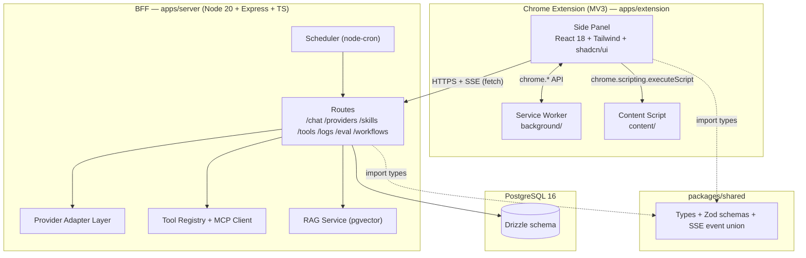

### 1.1 Ranh giới trách nhiệm

| Tầng | Trách nhiệm | KHÔNG được làm |
|---|---|---|
| **Side Panel** | Render, thu thập input, điều khiển trạng thái UI, gọi BFF, đọc `chrome.storage.local` | Không giữ API key dạng rõ khi đang ở chế độ K2; không tự gọi provider API (trừ K3 fallback) |
| **Service Worker** | Điều phối tab, mở/đóng panel, context menu, shortcut, lưu draft | **Không** proxy streaming; **không** giữ state phiên |
| **Content Script** | Trích xuất nội dung trang, đọc selection, gửi về panel | Không tự gọi BFF (tránh leak token); không ghi log |
| **BFF** | Chọn provider, quản lý key, build prompt, gọi provider, stream lại, log, RAG, scheduler | Không chứa logic UI; không tự quyết định UX |
| **packages/shared** | Type, Zod schema, event union, constants, error codes | Không chứa logic runtime |

---

## 2. Quyết định kiến trúc (ADR)

> Mỗi ADR: **Bối cảnh → Quyết định → Lý do → Hệ quả.**

### ADR-1 — Dùng Side Panel API, không dùng popup
- **Bối cảnh:** popup đóng khi mất focus → không chat được nhiều lượt; Edge Copilot & Gemini đều là panel cố định.
- **Quyết định:** `chrome.sidePanel` (Chrome ≥ 114), mở qua toolbar action.
- **Lý do:** Parity + trải nghiệm multi-turn đúng như hệ thống đối chiếu.
- **Hệ quả:** 1 panel/window; cần `sidePanel` permission; không có `default_popup`.

### ADR-2 — Streaming trực tiếp Side Panel → BFF, không đi qua Service Worker
- **Bối cảnh:** MV3 service worker bị terminate sau ~30s idle; một luồng chat có thể kéo dài vài phút.
- **Quyết định:** Side Panel tự mở `fetch` tới BFF với `Accept: text/event-stream`, đọc stream bằng `ReadableStream` reader.
- **Lý do:** SW không đảm bảo sống suốt stream → phải nối lại hoặc mất dữ liệu.
- **Hệ quả:** Stream không sống sót nếu đóng panel → cần persist message vào DB **ngay khi nhận `done`**, và báo user "đã lưu".

### ADR-3 — SSE thay vì WebSocket
- **Bối cảnh:** Luồng dữ liệu là 1 chiều server → client (token, citation, tool result). Không cần server gọi ngược client giữa chừng.
- **Quyết định:** `text/event-stream` qua HTTP thường.
- **Lý do:** Đơn giản hơn, đi qua proxy dễ, tự reconnect được, không cần lib WS.
- **Hệ quả:** Không có push server→client ngoài luồng chat (notification workflow dùng `chrome.notifications` từ SW, không qua SSE).

### ADR-4 — Drizzle ORM + PostgreSQL 16
- **Bối cảnh:** Cần lưu conversation, log có cấu trúc (cho eval), vector search (RAG).
- **Quyết định:** Drizzle + `pg` driver, `pgvector` extension.
- **Lý do:** Type-safe end-to-end với `packages/shared`; migration SQL đọc được; hỗ trợ `vector` type thuần Postgres.
- **Hệ quả:** Drizzle không có admin UI → dùng `drizzle-kit studio` khi dev.

### ADR-5 — Monorepo pnpm workspace
- **Bối cảnh:** Extension, BFF, eval harness, shared types phải dùng chung type.
- **Quyết định:** `pnpm-workspace.yaml` với `apps/*` + `packages/*`.
- **Lý do:** Một nguồn type; CI cache dễng; deploy tách bạch.
- **Hệ quả:** Cần `build:packages/shared` trước khi build extension. Fallback `npm` nếu pnpm chưa cài.

### ADR-6 — Tailwind CSS + shadcn/ui (copy code vào repo)
- **Bối cảnh:** Cần UI nhanh, nhất quán, accessible, và có thể tự sửa.
- **Quyết định:** Tailwind + shadcn/ui components **copy vào** `apps/extension/src/components/ui/`.
- **Lý do:** Sở hữu 100% code, không phụ thuộc npm runtime, có thể chỉnh sửa sâu; Radix primitives xử lý focus/keyboard/aria đúng chuẩn.
- **Hệ quả:** Phải tự cập nhật component khi shadcn ra bản mới (chấp nhận được).

### ADR-7 — Zustand cho client state
- **Bối cảnh:** State: conversation list, context tabs, settings, streaming buffer.
- **Quyết định:** Zustand (không Redux Toolkit).
- **Lý do:** Nhẹ, selector granular → không re-render toàn bộ thread khi streaming.
- **Hệ quả:** Không có devtools middleware mặc định → thêm `zustand/devtools` ở dev build.

### ADR-8 — Chia dữ liệu: `chrome.storage.local` vs Postgres
- **Bối cảnh:** Extension có thể chạy khi BFF down.
- **Quyết định:** Settings, draft, cache context, conversation id list → `chrome.storage.local`. Nội dung conversation đầy đủ, log, skill, eval → Postgres.
- **Lý do:** Cho phép offline-first; Postgres là nguồn sự thật khi có BFF.
- **Hệ quả:** Cần cơ chế "pending sync" cho conversation tạo ở chế độ K3 → queue trong `chrome.storage.local`, flush khi BFF lên.

### ADR-9 — Ba nguồn API key: K1 / K2 / K3
- **Bối cảnh:** Nhóm cần demo nhanh (không ai nhập key), nhưng người dùng thật cần BYOK an toàn, và demo có thể chạy khi Docker chưa bật.
- **Quyết định:**

| Nguồn | Nơi lưu | Bắt buộc BFF? | Dùng khi |
|---|---|---|---|
| **K1 — Team key** | `.env` của BFF (`TEAM_API_KEY`) | Có | Demo/dev, mặc định M0–M1 |
| **K2 — BYOK qua BFF** | Postgres, mã hoá AES-256-GCM | Có | User thật, M2+ |
| **K3 — BYOK direct** | `chrome.storage.local` (đã mã hoá bằng WebCrypto, key sinh từ passphrase) | **Không** | BFF down / offline |

- **Lý do:** Ba nguồn độc lập về mặt vòng đời; K3 cho fallback khi BFF sập.
- **Hệ quả:** Code phải có `ProviderResolutionService` duy nhất chọn nguồn, trả về `{ key, source, model }` — không nơi nào khác đụng tới key.

### ADR-10 — RAG dùng pgvector, không dùng sqlite-vec
- **Bối cảnh:** Cần search trong lịch sử chat / tài liệu đã lưu.
- **Quyết định:** Extension `vector` + index `ivfflat` (hoặc `hnsw`), embed 384 chiều (`all-MiniLM-L6-v2` chạy local qua Ollama hoặc ONNX).
- **Lý do:** Cùng DB, cùng backup, cùng retention policy; không thêm hệ thống file.
- **Hệ quả:** Embedding model phải cố định theo `embedding_model` trong bảng `rag_documents`; đổi model → re-embed toàn bộ.

### ADR-11 — Eval harness chạy trong `apps/eval`, dùng chung type với BFF
- **Bối cảnh:** Harness phải gọi đúng endpoint chat như extension thật.
- **Quyết định:** `apps/eval` là CLI Node dùng `packages/shared` + gọi HTTP vào BFF (không import code UI).
- **Lý do:** Tái lập được, chạy được 1 lệnh, tách biệt UI.
- **Hệ quả:** BFF phải expose API ổn định — mọi thay đổi breaking phải bump version.

### ADR-12 — Không đưa API key vào extension bundle
- **Bối cảnh:** Extension là file .zip có thể bị mở.
- **Quyết định:** K1 và K2 **chỉ** tồn tại ở BFF. Extension không bao giờ nhận key dạng rõ trừ chế độ K3 (user tự nhập, mã hoá local, và đây là lựa chọn của chính user).
- **Lý do:** An toàn mặc định.
- **Hệ quả:** BFF là single point of failure → ADR-9 K3 là đường lùi.

---

## 3. Cấu trúc thư mục chi tiết

> **Trạng thái M1 (2026-11-04, sau T-M1-23):** cây bên dưới là cấu trúc **đích**. M0 đã implement các phần in đậm; T-M1-01 bổ sung `content/extractor.ts` + `lib/pageContext.ts`; T-M1-23 bổ sung `lib/contextAttach.ts` + `lib/storage.ts` + `components/context/{ContextChips,ContextBudget}.tsx`. Các thư mục còn lại (`chat/`, `skills/`, `tools/`, `settings/`, `workflow/`, `selection.ts`) sẽ được tạo ở M1–M4.
>
> Thực tế M0 + T-M1-01 + T-M1-23 đã có:
> ```text
> apps/extension/
> ├─ public/{manifest.json, icons/{16,32,48,128}.png}
> ├─ sidepanel.html                 # entry HTML (build ra dist/sidepanel.html)
> ├─ src/
> │  ├─ sidepanel/{App.tsx, main.tsx, index.css,
> │  │            components/{PanelHeader,MessageBubble,Composer}.tsx,
> │  │            components/context/{ContextNotice,ContextChips,ContextBudget}.tsx,
> │  │            hooks/useChat.ts, store/chatStore.ts}
> │  ├─ components/ui/{button,input,textarea}.tsx   # shadcn/ui
> │  ├─ background/serviceWorker.ts
> │  ├─ content/{contentScript.ts, extractor.ts}   # extractor = Readability-lite
> │  ├─ lib/{apiClient,sseClient,pageContext,contextAttach,storage,utils}.ts
> │  └─ types/globals.d.ts
> ├─ e2e/{fixtures.ts,sidepanel.spec.ts,extractor.spec.ts,extract.spec.ts,context.spec.ts}
> ├─ tests/{apiClient,chatStore,sseClient,useChat,extractor,pageContext,contextAttach,sharedAlias}.test.ts
> ├─ vite.config.ts                  # side panel + service worker (ESM)
> ├─ vite.content.config.ts          # content script (IIFE, 1 file — §7.5)
> ├─ vitest.config.ts                # alias @sidekick/shared → packages/shared/src (§7.1.1)
> ├─ playwright.config.ts
> ```
> `packages/shared/src/` hiện có: `constants.ts` · `contextBudget.ts` · `errors.ts` · `events.ts` · `pageKind.ts` · `schemas/{chat,extract,provider}.ts` · `types/entities.ts`.
> `apps/server/src/` hiện có: `routes/{health,chat,extract}.ts` · `services/chatService.ts` · `providers/*` · `middleware/*` · `config/env.ts` · `db/*` · `lib/{crypto,safeFetch,pdfExtractor,youtubeExtractor}.ts`.

```text
uddn_extension_chat/
├─ apps/
│  ├─ extension/
│  │  ├─ public/
│  │  │  ├─ manifest.json
│  │  │  └─ icons/{16,32,48,128}.png
│  │  ├─ src/
│  │  │  ├─ sidepanel/
│  │  │  │  ├─ App.tsx
│  │  │  │  ├─ components/
│  │  │  │  │  ├─ ui/            # shadcn/ui đã copy (button, dialog, popover...)
│  │  │  │  │  ├─ chat/          # MessageList, UserMessage, AssistantMessage, Composer...
│  │  │  │  │  ├─ context/       # ContextChips, MentionPopover, CitationChip
│  │  │  │  │  ├─ skills/        # SkillMenu, SkillSettings
│  │  │  │  │  ├─ tools/         # ToolCallBlock, McpSettings
│  │  │  │  │  ├─ settings/      # SettingsPanel + sections
│  │  │  │  │  └─ workflow/      # M4
│  │  │  │  ├─ hooks/            # useChat, useSse, useContextTabs, useShortcuts
│  │  │  │  ├─ state/            # Zustand stores
│  │  │  │  └─ styles/           # tokens.css import
│  │  │  ├─ background/
│  │  │  │  ├─ index.ts          # entry service worker
│  │  │  │  ├─ sidepanel.ts      # mở/đóng panel
│  │  │  │  └─ contextMenu.ts
│  │  │  ├─ content/
│  │  │  │  ├─ index.ts
│  │  │  │  ├─ extractor.ts      # Readability-lite
│  │  │  │  └─ selection.ts
│  │  │  ├─ lib/
│  │  │  │  ├─ apiClient.ts
│  │  │  │  ├─ sseClient.ts
│  │  │  │  ├─ storage.ts
│  │  │  │  └─ crypto.ts
│  │  │  └─ shared/              # constants dùng nội bộ extension
│  │  ├─ vite.config.ts
│  │  └─ tailwind.config.ts
│  ├─ server/
│  │  ├─ src/
│  │  │  ├─ index.ts              # bootstrap
│  │  │  ├─ app.ts                # express app
│  │  │  ├─ routes/
│  │  │  ├─ providers/            # adapter + registry
│  │  │  ├─ tools/                # registry, mcp client, executors
│  │  │  ├─ rag/
│  │  │  ├─ scheduler/
│  │  │  ├─ db/
│  │  │  │  ├─ schema.ts
│  │  │  │  └─ client.ts
│  │  │  ├─ middleware/           # auth, error, origin, ratelimit
│  │  │  └─ lib/                  # logger, crypto, config
│  │  ├─ drizzle.config.ts
│  │  └─ Dockerfile
│  └─ eval/
│     ├─ dataset/
│     │  ├─ tasks.json
│     │  └─ snapshots/
│     ├─ runners/                 # ours.ts, aggregate.ts
│     ├─ judge/                   # prompt.ts, run_judge.ts
│     ├─ metrics/
│     ├─ results/
│     │  ├─ raw/                  # git-ignore
│     │  └─ manual/
│     └─ reports/
├─ packages/shared/
│  └─ src/
│     ├─ index.ts
│     ├─ types/                   # conversation, message, provider, skill...
│     ├─ schemas/                 # Zod
│     ├─ events.ts                # SSE event union
│     ├─ errors.ts                # error codes
│     ├─ contextBudget.ts         # estimateTokens · applyContextBudget · trimHistory
│     └─ constants.ts
├─ design/
│  ├─ tokens.json
│  ├─ tokens.css
│  ├─ components.md
│  ├─ patterns.md
│  └─ a11y-audit.md
├─ docs/
├─ docker-compose.yml
├─ package.json                   # root scripts (pnpm -r)
├─ pnpm-workspace.yaml
├─ AGENTS.md
├─ .cursorrules
├─ .cursor/rules/
└─ .gitignore
```

### 3.1 Dependency graph

```text
packages/shared  ←  apps/extension
                 ←  apps/server
                 ←  apps/eval
```

`packages/shared` **không** được import ngược lại từ apps. Không có import chéo giữa `apps/extension` ↔ `apps/server`.

### 3.2 Scripts gốc (root `package.json`)

| Script | Lệnh | Ý nghĩa |
|---|---|---|
| `pnpm dev` | `pnpm -r --parallel dev` | Chạy song song extension (vite HMR) + server (tsx watch) |
| `pnpm dev:ext` | `pnpm --filter @sidekick/extension dev` | Chỉ extension |
| `pnpm dev:server` | `pnpm --filter @sidekick/server dev` | Chỉ BFF |
| `pnpm build` | `pnpm -r build` | Build tất cả (shared → extension → server) |
| `pnpm build:ext` | `pnpm --filter @sidekick/extension build` | Build extension ra `dist/` |
| `pnpm db:migrate` | `pnpm --filter @sidekick/server db:migrate` | Chạy migration Drizzle |
| `pnpm db:studio` | `pnpm --filter @sidekick/server db:studio` | Mở Drizzle Studio |
| `pnpm test` | `pnpm -r test` | Unit + integration |
| `pnpm test:e2e` | `pnpm --filter @sidekick/eval test:e2e` | Playwright E2E |
| `pnpm eval:run` | `pnpm --filter @sidekick/eval run` | Chạy eval harness |
| `pnpm lint` / `pnpm typecheck` | `eslint .` / `tsc --noEmit` | |

---

## 4. Hợp đồng API (Extension ↔ BFF)

**Base URL mặc định:** `http://localhost:8787/api` (cấu hình được trong Settings, lưu `chrome.storage.local`).

**Headers bắt buộc:**
```
Content-Type: application/json
X-Sidekick-Client: extension      // để BFF áp origin allowlist
X-Request-Id: <uuid v4>            // idempotency + tracing
```

**Error format thống nhất** (mọi endpoint):
```json
{
  "error": {
    "code": "PROVIDER_QUOTA_EXCEEDED",
    "message": "Đã vượt quota của provider.",
    "retryable": true,
    "details": { "provider": "gemini", "retryAfterMs": 30000 }
  }
}
```

### 4.1 Bảng endpoint

| Method | Path | Request | Response | Error codes |
|---|---|---|---|---|
| GET | `/health` | — | `{ status, version, db, uptime }` | — |
| GET | `/providers` | — | `{ items: ProviderInfo[] }` (id, name, models, keySource `K2\|K1\|none`, requiresKey, available, note?) | — |
| GET | `/providers/keys` | — | `{ items: ProviderKeyRecord[] }` (chỉ metadata + masked, **không** trả key gốc) | — |
| POST | `/providers/keys` | `{ providerId, apiKey, label? }` | `201` + `ProviderKeyRecord` (id, providerId, label, masked, createdAt) | `VALIDATION_ERROR`, `MASTER_KEY_NOT_CONFIGURED` |
| DELETE | `/providers/keys/:id` | — | `204` | `NOT_FOUND` |
| POST | `/providers/keys/:id/test` | — | `{ ok, latencyMs, error? }` | `NOT_FOUND`, `MASTER_KEY_NOT_CONFIGURED`, `INVALID_API_KEY` |
| POST | `/chat` | `ChatRequest` | **SSE stream** | `VALIDATION_ERROR`, `NO_KEY_AVAILABLE`, `RATE_LIMITED`, `PROVIDER_VISION_UNSUPPORTED` |
| GET | `/attachments/:id` | — | **binary** (`Content-Type` = mime của ảnh) | `NOT_FOUND` |
| POST | `/extract/pdf` | `{ url }` | `{ text, title?, excerpt?, truncated, error? }` | `VALIDATION_ERROR`, `CONTEXT_PDF_NOT_READABLE`, `CONTEXT_PDF_UNREACHABLE` |
| POST | `/extract/youtube` | `{ url }` | `{ text, title?, excerpt?, truncated, error? }` | `VALIDATION_ERROR`, `CONTEXT_TRANSCRIPT_UNAVAILABLE` |
| GET | `/conversations` | `?q=&archived=&limit=&cursor=` ✅ | `{ items, nextCursor }` | `VALIDATION_ERROR` |
| POST | `/conversations` | `{ title? }` ✅ | `201` + `ConversationSummary` | `VALIDATION_ERROR` |
| GET | `/conversations/:id/messages` | — ✅ | `{ conversation, messages, path, turns }` (kèm `citations[]` đã lưu + `turnId`/`variantIndex`/`active`/`aborted`; `path` = đường đi active, `turns` = turn + biến thể) | `VALIDATION_ERROR`, `NOT_FOUND` |
| POST | `/conversations/:id/turns/:turnId/activate` | `{ variantIndex }` ✅ | `{ path, turns }` | `VALIDATION_ERROR`, `NOT_FOUND` |
| PATCH | `/conversations/:id` | `{ title?, pinned?, archived? }` ✅ | `ConversationSummary` | `VALIDATION_ERROR`, `NOT_FOUND` |
| DELETE | `/conversations/:id` | — ✅ | `204` | `VALIDATION_ERROR`, `NOT_FOUND` |
| DELETE | `/conversations` | — ✅ | `200` + `{ deleted: number }` (xoá toàn bộ lịch sử chat — FR-SETTINGS-03 + NFR-SEC-07, T-M1-12) | — |
| GET | `/skills` | `?scope=builtin\|user` | `Skill[]` | — |
| POST | `/skills` | `{ name, prompt, description? }` | `Skill` | `VALIDATION_ERROR` |
| PATCH | `/skills/:id` | `{ name?, prompt?, enabled? }` | `Skill` | `NOT_FOUND` |
| DELETE | `/skills/:id` | — | `204` | `NOT_FOUND` |
| GET | `/tools` | — | `ToolInfo[]` (builtin + MCP servers + trạng thái kết nối) | — |
| POST | `/tools/mcp/servers` | `{ name, command, args?, env? }` | `McpServer` | `VALIDATION_ERROR` |
| DELETE | `/tools/mcp/servers/:id` | — | `204` | `NOT_FOUND` |
| POST | `/tools/invoke` | `{ toolName, args }` | `{ output, ok }` | `TOOL_ERROR`, `APPROVAL_REQUIRED` |
| GET | `/logs` | `?from=&to=&provider=&limit=` | `{ items, total }` | — |
| GET | `/usage` | `?from=&to=` | `{ totalTokens, totalCostUsd, byDay[] }` | — |
| POST | `/rag/search` | `{ query, topK? }` | `{ documents: [{ id, title, snippet, score }] }` | — |
| GET | `/rag/documents` | `?q=&limit=` | `RagDocument[]` | — |
| DELETE | `/rag/documents/:id` | — | `204` | `NOT_FOUND` |
| POST | `/eval/run` | `{ datasetVersion, taskIds?, systems? }` | `{ runId }` | `VALIDATION_ERROR` |
| GET | `/eval/runs` | — | `EvalRun[]` | — |
| GET | `/eval/runs/:id/results` | — | `EvalResult[]` | `NOT_FOUND` |
| POST | `/workflows` | `WorkflowInput` | `Workflow` | `VALIDATION_ERROR` |
| GET | `/workflows` | — | `Workflow[]` | — |
| PATCH | `/workflows/:id` | `Partial<WorkflowInput>` | `Workflow` | `NOT_FOUND` |
| DELETE | `/workflows/:id` | — | `204` | `NOT_FOUND` |
| POST | `/workflows/:id/run` | `{ dryRun?: boolean }` | `{ runId, status }` | `WORKFLOW_ERROR` |
| GET | `/workflow-runs` | `?workflowId=&limit=` | `WorkflowRun[]` | — |
| GET | `/workflow-runs/:id` | — | `WorkflowRun` (kèm step runs) | `NOT_FOUND` |

> Endpoint `/workflows*` chỉ tồn tại khi M4 được implement — extension phải **feature-detect** qua `GET /health` → `capabilities: { workflows: boolean }`.
>
> Endpoint `/extract/pdf` và `/extract/youtube` đã **implement** (T-M1-21, T-M1-22). Body request là `{ kind, url }` với `kind ∈ { 'pdf', 'youtube' }` (validate bằng `extractRequestSchema`). **Lỗi nghiệp vụ trả HTTP 200** kèm `{ error, errorMessage }` trong body — client không phân biệt theo status, chỉ 400 khi body sai schema. Chi tiết luồng & ràng buộc bảo mật ở §7.3.1.
>
> Endpoint `/conversations*` đã **implement** (T-M1-09). `GET /conversations/:id/messages` thay cho `GET /conversations/:id` (trả **kèm** messages + citations trong 1 response để hydrate thread chỉ cần 1 request). Chi tiết ở §7.10.

### 4.2 Shape của `ChatRequest`

> **Shape đang chạy thật (M0 + T-M1-01 + T-M1-23 + T-M1-24)** — nguồn sự thật là `packages/shared/src/schemas/chat.ts`:
>
> ```ts
> interface ChatRequest {
>   messages: Array<{
>     role: 'user' | 'assistant' | 'system'
>     content: string
>     attachments?: ImageAttachment[]   // FR-VISION-01 — xem §4.2.2
>   }>
>   conversationId?: string
>   provider?: 'mock' | 'groq' | 'openrouter' | 'gemini' | 'ollama'
>   model?: string
>   systemPrompt?: string
>   context?: ContextBundle   // xem §4.2.1
>   temperature?: number
>   maxOutputTokens?: number
>   stream?: boolean
> }
> ```
>
> Giới hạn: `MAX_PAGE_TEXT_CHARS = 40_000` (nội dung trang) · `MAX_EXCERPT_CHARS = 500` · `MAX_CONTEXT_CHARS = 100_000` · `MAX_CONTEXT_ITEMS = 20`.

#### 4.2.1 Hợp đồng `context` — bundle item + tier ưu tiên (T-M1-23)

> **Mô hình mới: chỉ những gì user chủ động đính kèm.** Trước T-M1-23, `context` là 1 object phẳng đại diện cho tab active và **luôn** được gửi ở mọi lượt chat.

```ts
/** Một nguồn context do user đính kèm. */
interface ContextItem {
  id: string                    // định danh để gỡ / cập nhật trong UI
  kind: 'selection' | 'tab' | 'file'
  tier: 'selection' | 'attachment' | 'currentTab'  // ưu tiên khi cắt bớt
  url?: string
  title: string
  text?: string                 // nội dung đã trích (có thể bị cắt)
  excerpt?: string              // trích đoạn ngắn để preview trên chip
  sourceKind?: 'html' | 'pdf' | 'youtube'
  tabId?: number
}

/** Bundle gửi lên BFF. */
interface ContextBundle {
  items: ContextItem[]          // tối đa 20 item
}
```

**Quy tắc:**

1. **Không tự đính kèm** — tab active **không** tự vào context. Chỉ vào khi user bấm "Thêm trang này" / `@` (T-M1-05) / bôi đen (T-M1-02) / upload file (T-M1-24).
2. **Không đính kèm gì → không gửi `context`** — request chỉ có `messages` → chat hoạt động như LLM thuần (FR-CONTEXT-13). Lịch sử hội thoại **vẫn** được gửi để duy trì ngữ cảnh cuộc trò chuyện.
3. **Ưu tiên khi cắt** — `selection` > `attachment` > `currentTab`; lịch sử chat cắt sau cùng (bằng `trimHistory`).
4. **Toggle** — chip ở composer bật/tắt việc gửi context, mặc định **TẮT**; trạng thái lưu ở `chrome.storage.local` key `sidekick.contextEnabled`.
5. **Backward compatible** — `chatRequestSchema.context` dùng `z.preprocess(normalizeContext, …)` nên vẫn nhận shape cũ phẳng `{ url, title, text, … }` → bọc thành `items[0]` (tier `currentTab`) + item `selection` nếu có `selectedText`. Eval harness / client cũ không vỡ.

**Ngân sách context 2 tầng (FR-CONTEXT-07):**

| Tầng | Nơi chạy | Vai trò |
|---|---|---|
| 1 — client | `apps/extension` (`buildRequestContext`) | Tính **ước lượng** để hiển thị meter "Đã dùng X/Y token" và tiết kiệm băng thông |
| 2 — server | `apps/server` (`buildProviderMessages`) | **Cắt lại lần nữa** trước khi gọi provider → server là nguồn chân lý (client có thể gửi bản siêu lớn) |

Cả 2 tầng dùng **cùng một hàm** `applyContextBudget()` trong `packages/shared/src/contextBudget.ts` → số liệu meter không lệch với cái thực sự gửi đi.

> **Shape đích (M2+)** — multi-tab, skills, tools, settings:
>
> ```ts
> interface ChatRequest {
>   conversationId?: string;          // không có → tạo mới
>   message: string;
>   contextTabs: Array<{
>     tabId: number;
>     url: string;
>     title: string;
>     content?: string;               // đã trích xuất ở client
>     excerpt?: string;               // selection context
>     favicon?: string;
>   }>;
>   providerId: string;
>   model: string;
>   keySource: 'K1' | 'K2' | 'K3';    // client chỉ đề xuất; BFF quyết định thực tế
>   settings: {
>     temperature?: number;
>     maxTokens?: number;
>     enableWebSearch?: boolean;
>     enableRag?: boolean;
>     language?: 'vi' | 'en';
>   };
>   tools?: string[];                 // danh sách tool được phép dùng
>   skills?: string[];                // skill được user chọn
> }
> ```

#### 4.2.2 Hợp đồng `attachments` — ảnh đính kèm (FR-VISION-01, T-M1-24)

> **Ảnh KHÔNG phải `ContextItem`.** Ảnh là **đầu vào trực tiếp** của câu hỏi, không phải context thứ cấp. Vì vậy nó **không** phụ thuộc toggle `contextEnabled` và **không** bị `applyContextBudget()` cắt theo số ký tự.

```ts
/** Một ảnh đính kèm trong một turn hội thoại. */
interface ImageAttachment {
  id: string                    // uuid do client sinh → upsert idempotent, render ngay trong UI
  mimeType: 'image/png' | 'image/jpeg' | 'image/webp' | 'image/gif'
  data: string                  // base64 THUẦN (không prefix `data:<mime>;base64,`)
  bytes: number                 // kích thước byte ảnh gốc
  width?: number
  height?: number
  fileName?: string
}
```

**Giới hạn (`VISION` trong `packages/shared/src/constants.ts`):**

| Hằng | Giá trị | Ý nghĩa |
|---|---|---|
| `MAX_IMAGE_BYTES` | 5 000 000 | 5 MB / ảnh |
| `MAX_IMAGES_PER_MESSAGE` | 4 | 4 ảnh / lượt |
| `MAX_TOTAL_IMAGE_BYTES` | 12 000 000 | 12 MB tổng / lượt |
| `TOKEN_ESTIMATE_PER_IMAGE` | 258 | ước lượng token để cắt ngân sách context |

**Luồng server (`apps/server`):**

```
POST /api/chat { messages[].attachments[] }
  → validate ở biên (Zod: imageAttachmentListSchema)
  → persistAttachments() giải mã base64 → bảng message_attachments (bytea)
  → loadRecentAttachments() lấy ảnh gần nhất của conversation
  → mergeImages() hợp nhất ảnh lượt này + ảnh lượt trước (dedup theo base64)
  → buildProviderMessages() gắn ảnh vào USER TURN CUỐI CÙNG
  → provider adapter map sang payload đúng chuẩn (xem §4.4)
```

**Multi-turn:** lượt 2 chỉ gửi text → server tự tải ảnh của lượt 1 từ DB → model vẫn "thấy" ảnh. Extension **không** phải upload lại base64.

**Token budget:** `buildProviderMessages` trừ `images.length * TOKEN_ESTIMATE_PER_IMAGE` khỏi `historyBudget` trước khi `trimHistory` → ảnh không làm tràn context window.

### 4.3 Giao thức SSE
**Event union (dùng chung, `packages/shared/src/events.ts`):**

```ts
type ChatEvent =
  | { type: 'meta'; messageId: string; conversationId: string; provider: string; model: string; keySource: string; requestId: string }
  | { type: 'token'; delta: string; index: number }
  | { type: 'citation'; index: number; url: string; title: string; snippet: string; tabId?: number }
  | { type: 'tool_call'; id: string; name: string; args: unknown }
  | { type: 'tool_result'; id: string; ok: boolean; output: string; durationMs: number }
  | { type: 'usage'; tokensIn: number; tokensOut: number; costUsd: number }
  | { type: 'error'; code: string; message: string; retryable: boolean; retryAfterSeconds?: number }
  | { type: 'done'; finishReason: 'stop' | 'length' | 'tool' | 'aborted' | 'error'; messageId: string };
```

**Format wire:**
```
event: token
data: {"type":"token","delta":"Xin","index":0}

event: done
data: {"type":"done","finishReason":"stop","messageId":"..."}
```

**Quy tắc:**
1. Luôn gửi `meta` đầu tiên (client cần `conversationId` để lưu).
2. `token` mang `delta` (phần text tăng thêm), **không** gửi toàn bộ message → giảm băng thông.
3. `done` là event cuối cùng, **bắt buộc** — client dùng nó để finalize (persist, tính cost).
4. Khi lỗi: gửi `event: error` rồi `event: done` với `finishReason:'error'`.
5. Client **phải** xử lý `done` cả khi stream bị cắt đột ngột (network drop) → coi như `finishReason:'aborted'`, hiện nút "Tiếp tục"/"Tạo lại".
6. Reconnect: client không tự reconnect giữa luồng (mất context). Thay vào đó bấm "Tạo lại" (regenerate) — đơn giản và tránh trùng nội dung.
7. Server gửi heartbeat comment `: ping` mỗi 15s để giữ kết nối qua proxy.
8. `citation` (FR-CONTEXT-10 — T-M1-08) phát **sau** toàn bộ `token*`, **trước** `usage`/`done` — server chỉ biết marker `[N]` sau khi stream kết thúc. Chi tiết: [§7.9](#79-citation-marker-n--sse--chip-fr-context-10--t-m1-08).
9. `error` mang **thông tin lỗi thật** (T-M1-19): `code` (error code chuẩn) · `retryable` (**suy ra từ `code`**, không hardcode `true`) · `retryAfterSeconds` (từ header `Retry-After` của provider khi HTTP 429). Chi tiết: [§7.15](#715-states--retry--connection-status-fr-chat-14--fr-ux-08--nfr-rel-02--nfr-rel-04--t-m1-19).

### 4.4 Chiến lược provider & fallback

```
resolveKey(providerId, keySource)
  → K2: tìm key active trong DB, decrypt bằng MASTER_KEY
  → K1: đọc TEAM_API_KEY từ env
  → K3: không có ở server → trả lỗi NO_KEY_AVAILABLE, client tự gọi provider trực tiếp
```

Fallback chain: provider chính → provider dự phòng (cấu hình trong settings) → trả lỗi kèm gợi ý cấu hình.

#### 4.4.2 Provider ưu tiên (preferred-first) — T-M1-25

Khi client gửi `ChatRequest.provider` (provider user chọn ở onboarding), `chatService` **đặt provider đó ở đầu** chuỗi thay vì **thay thế** toàn bộ chain:

```ts
const chain = request.provider
  ? [...new Set([request.provider, ...registry.getFallbackChain()])]
  : registry.getFallbackChain()
```

→ Provider ưu tiên được dùng trước, nhưng nếu provider đó lỗi (thiếu key, 5xx, timeout) thì vẫn **fallback** được như cũ (FR-PROVIDER-04). Không có `request.provider` → hành vi không đổi.

#### 4.4.3 Provider không cần API key — Ollama (T-M1-25)

`OpenAiCompatibleProvider` nhận thêm option `requiresKey?: boolean` (mặc định `true`). Ollama — provider local, không cần key — được đăng ký với `requiresKey: false` → `chatService` **bỏ qua** bước resolve key, và `buildHeaders` trả `{}` (không gửi header `Authorization`).

| Provider | `requiresKey` | `keySource` khi không có key |
|---|---|---|
| `mock` | `false` | `none` |
| `ollama` | `false` | `none` |
| `groq` / `openrouter` / `gemini` | `true` | `K2` (DB) → `K1` (env) → `none` |

**Probe Ollama**: `detectOllama(baseUrl, timeoutMs = 1500)` gọi `GET /api/tags` (endpoint native, trả `{ models: [{ name }] }`) → `{ available, models, error }`. Timeout ngắn để onboarding không bị treo khi user chưa bật Ollama. Kết quả dùng cho `ProviderInfo.available` + `ProviderInfo.note` (tiếng Việt) hiển thị ở bước 2 của onboarding.

> Env: `OLLAMA_BASE_URL` (mặc định `http://127.0.0.1:11434/v1`) · `OLLAMA_MODEL` (mặc định `llama3.2`).

#### 4.4.1 Hỗ trợ vision của provider (FR-VISION-01, T-M1-24)

Mỗi `ProviderAdapter` phải cài `supportsVision(model: string): boolean`. Khi request có ảnh, `createChatStream` **bỏ qua** provider/model không hỗ trợ vision và chuyển sang provider tiếp theo trong chain. Nếu hết chain → trả lỗi `PROVIDER_VISION_UNSUPPORTED` (không crash, không mất tiến trình).

| Provider | `supportsVision()` | Payload ảnh |
|---|---|---|
| `gemini` | **luôn `true`** | `parts: [{ text }, { inline_data: { mime_type, data } }]` |
| `openrouter` | theo tiền tố model (`google/gemini`, `openai/gpt-4o`, `anthropic/claude-3`, `anthropic/claude-4`, `meta-llama/llama-3.2`, `qwen/qwen2-vl`, `google/gemma`) | `content: [{ type:'text' }, { type:'image_url', image_url: { url: 'data:<mime>;base64,<data>' } }]` |
| `groq` | theo tiền tố model (`meta-llama/llama-4-scout`, `meta-llama/llama-4-maverick`, `meta-llama/llama-3.2-11b-vision`, `meta-llama/llama-3.2-90b-vision`) | như OpenAI-compatible |
| `mock` | `true` (để test end-to-end) | echo số ảnh trong text: `[mock] Nhan duoc 1 anh (image/png)` |
| `ollama` | theo tiền tố model (`llama3.2-vision`, `llava`, `bakllava`, `qwen2-vl`, `qwen2.5-vl`, `minicpm-v`, `moondream`, `gemma3`) | như OpenAI-compatible |

> **Lưu ý:** model mặc định của Groq (`openai/gpt-oss-120b`) **không** hỗ trợ ảnh → khi user đính kèm ảnh, server tự fallback sang `openrouter` hoặc `gemini`. Người dùng không cần chỉnh tay.

---

## 5. Data model (Drizzle / PostgreSQL 16)

> Bản rút gọn ở [`REQUIREMENTS.md`](REQUIREMENTS.md) §7.2. Ở đây là bản đầy đủ kèm index & retention.

### 5.1 Bảng chính

| Bảng | Cột chính | Index |
|---|---|---|
| `conversations` | id uuid pk, title text, created_at, updated_at, pinned bool, archived bool, meta jsonb | `(archived, updated_at desc)`, `(pinned, updated_at desc)` |
| `messages` | id uuid pk, conversation_id fk, role text, content text, meta jsonb, created_at | `(conversation_id, created_at)` |
| `message_attachments` | id uuid pk (client sinh), message_id fk, conversation_id fk, mime_type text, byte_size int, ord int, width int, height int, file_name text, **data bytea**, created_at | `(message_id)`, `(conversation_id, created_at desc)`, unique `(message_id, ord)` |
| `citations` | id uuid pk, message_id fk, idx int, url text, title text, snippet text, tab_id int, score real | `(message_id)` |
| `tool_calls` | id uuid pk, message_id fk, name text, args jsonb, output text, status text, approval_required bool, approved_by_user bool, started_at, finished_at | `(message_id)` |
| `skills` | id uuid pk, name text unique, description text, prompt_template text, scope text, enabled bool, tags text[], created_at, updated_at | `(scope, enabled)` |
| `tool_registry` | id uuid pk, name text unique, kind text (builtin\|mcp), server_id uuid nullable, schema jsonb, enabled bool | `(kind)` |
| `mcp_servers` | id uuid pk, name text unique, transport text (stdio\|http), command text, args jsonb, env jsonb, enabled bool, last_connected_at | — |
| `rag_documents` | id uuid pk, source_type text (message\|file\|url), ref_id text, title text, content text, embedding vector(384), embedding_model text, metadata jsonb, created_at | HNSW/IVFFlat trên `embedding` |
| `workflows` | id uuid pk, name text, description text, steps jsonb, schedule text nullable, enabled bool, created_at, updated_at | `(enabled)` |
| `workflow_runs` | id uuid pk, workflow_id fk, status text, started_at, finished_at, error text, output text | `(workflow_id, started_at desc)` |
| `workflow_step_runs` | id uuid pk, workflow_run_id fk, step_index int, status text, input jsonb, output text, tokens int, cost_usd numeric, error text | `(workflow_run_id, step_index)` |
| `request_logs` | id uuid pk, request_id text unique, conversation_id, provider, model, key_source, prompt_text, context_hash, context_snapshot jsonb, response_text, tokens_in, tokens_out, cost_usd numeric, ttft_ms, latency_ms, tool_calls jsonb, error text, created_at | `(created_at desc)`, `(provider, created_at desc)` |
| `provider_keys` | id uuid pk, provider_id text, label text, ciphertext text, iv text, auth_tag text, hint text (4 ký tự cuối), is_active bool, created_at, last_used_at | `(provider_id, is_active)` |
| `eval_datasets` | id uuid pk, version text unique, task_count int, source text, tasks jsonb, checksum text, created_at | — |
| `eval_runs` | id uuid pk, dataset_id fk, dataset_version, judge_model, started_at, finished_at, notes | `(dataset_version)` |
| `eval_results` | id uuid pk, run_id fk, task_id, system, rubric jsonb, overall numeric, judge_raw text, created_at | `(run_id, task_id)` |
| `eval_judgments` | id uuid pk, result_id fk, criterion, score int, reasoning, judge_model, judge_prompt_hash, created_at | `(result_id)` |

### 5.2 Retention policy

| Bảng | Mặc định | Tuỳ chọn |
|---|---|---|
| `messages`, `citations`, `tool_calls` | Giữ vô hạn (lịch sử chat của user) | Xoá theo conversation |
| `request_logs` | 90 ngày | 30 / 365 / vô hạn |
| `context_snapshot` | **Tắt mặc định** (chỉ lưu `context_hash`) | Bật để debug — qua setting `LOG_CONTEXT_SNAPSHOT` (T-M1-06) |
| `rag_documents` | Giữ cùng với nguồn | Xoá thủ công |
| `eval_runs` / `eval_results` | Vô hạn (bằng chứng đồ án) | — |
| `provider_keys` | Giữ đến khi user xoá | — |

> **`request_logs` là dữ liệu nhạy cảm.** Mặc định **không** lưu `prompt_text`/`response_text` đầy đủ mà chỉ lưu hash + metadata. Bật lưu đầy đủ là một setting riêng, có cảnh báo rõ trong UI (FR-SETTINGS-04).

### 5.3 Migration

- `drizzle-kit generate` → file SQL trong `apps/server/drizzle/` → `drizzle-kit migrate` khi khởi động container.
- Migration chạy tự động trong entrypoint của Docker image (trước khi start server).

---

## 6. Bảo mật

### 6.1 Mã hoá API key

- Thuật toán: **AES-256-GCM**.
- `MASTER_KEY`: biến môi trường 32 bytes (base64). Không commit. `.env.example` chỉ có placeholder.
- Mỗi key lưu: `ciphertext` + `iv` (12 bytes random) + `auth_tag`.
- `hint`: 4 ký tự cuối để user nhận ra key nào là key nào, **không** đủ để dùng.
- Khi `MASTER_KEY` đổi → key cũ không decrypt được → `POST /providers/keys/:id/test` trả `INVALID_API_KEY` kèm hướng dẫn nhập lại key.
- BFF **chưa có** `MASTER_KEY` → `POST /providers/keys` trả `MASTER_KEY_NOT_CONFIGURED` (500) — không lưu được key thay vì lưu plaintext rỗng.

### 6.2 Origin allowlist (BFF)

BFF chỉ nhận request từ extension. Kiểm tra header `Origin` / `X-Sidekick-Client`:
- Allow: `chrome-extension://<extension-id>` (id thật nằm trong `.env` → `ALLOWED_ORIGINS`), `http://localhost:*` cho dev.
- CORS: `origin` cụ thể (không dùng `*`), `credentials: false`.
- BFF **không** lộ ra internet: bind `127.0.0.1` mặc định trong docker-compose.

### 6.3 MV3 extension security

- `manifest.json`:
  - `permissions`: `["sidePanel", "scripting", "storage", "tabs", "contextMenus", "notifications"]`
  - `host_permissions`: `["<all_urls>"]` — **bắt buộc** vì `activeTab` không được cấp khi user tương tác trong side panel.
  - `content_security_policy.extension_pages`: `"script-src 'self'; object-src 'self'"` — không cho `unsafe-eval`, không remote script.
- Không `eval`, không remote code, không `innerHTML` với dữ liệu người dùng.
- Markdown render: `react-markdown` + `remark-gfm` + `rehype-highlight` + `rehype-sanitize` (allowlist thẩm — xem §7.8).
- Link trong nội dung: `rel="noopener noreferrer"` + `target="_blank"`.
- Secret KHÔNG đặt trong `manifest.json`; không đưa vào bundle Vite (dùng biến môi trường build-time chỉ cho endpoint mặc định).

### 6.4 Rủi ro đã biết & giảm thiểu

| Rủi ro | Mức | Giảm thiểu |
|---|---|---|
| `<all_urls>` bị coi là over-permission | Trung bình | Ghi rõ lý do trong mô tả store listing; thêm toggle "tắt context theo domain" |
| Key nằm trong DB của BFF local | Thấp | AES-256-GCM + `MASTER_KEY` ngoài DB; `.env` git-ignore |
| BFF lộ ra mạng LAN | Trung bình | Bind `127.0.0.1`; origin allowlist |
| Prompt injection từ nội dung trang | Trung bình | Tách system prompt, đánh dấu context là "dữ liệu không phải lệnh"; không tự động gọi tool khi chưa duyệt |
| Agentic action ghi dữ liệu | Cao | Approval gate + diff preview (FR-TOOLS-04); **cắt được** theo `REQUIREMENTS.md` §9.3 |

---

## 7. Chiến lược test

| Tầng | Công cụ | Phạm vi | Ngưỡng |
|---|---|---|---|
| **Unit** | Vitest | Context builder, provider adapter, skill engine, RAG retriever, key resolver, cost calculator | Coverage ≥ 70% cho `packages/shared` và `apps/server/src/{providers,tools,rag}` |
| **Integration** | Vitest + supertest | Từng route BFF: request → response, validation, error mapping, SSE format | Mọi endpoint trong §4.1 có ≥ 1 test; SSE có test đầy đủ 8 event type |
| **Contract** | Vitest | Response shape khớp `packages/shared` schemas (validate bằng Zod ở test) | 100% endpoint có schema |
| **E2E** | Playwright + Chrome for Testing | Load unpacked extension → mở side panel → gửi prompt → nhận stream → kiểm tra citations | ≥ 6 kịch bản lõi (happy path, offline, BFF down, stop, edit-resend, context toggle) |
| **Manual** | Checklist | `docs/REQUIREMENTS.md` §E của COMPARISON_MATRIX + checklist M1 | Trước mỗi milestone demo |
| **Eval** | `apps/eval` | Chất lượng so với Edge/Gemini | Theo `EVAL_PLAN.md` |

### 7.1 Mock provider trong test

Một `MockProvider` implement cùng interface `ProviderAdapter`, trả stream token giả với delay → dùng cho unit/integration/E2E **không cần network, không cần key**. Bắt buộc để CI chạy được và để demo offline.

### 7.1.1 Nguyên tắc: test phải chạy trên SOURCE, không phải bản build

> Bắt buộc — nếu vi phạm, test có thể **xanh trong khi code sai**.

`packages/shared` là package dùng chung cho extension · server · eval. Theo mặc định, Node/Vite resolve `@sidekick/shared` qua `package.json` `exports` → **`packages/shared/dist/`** (bản build `tsc`).

Hệ quả nếu để nguyên:

| Vấn đề | Mô tả |
|---|---|
| **Test chạy code cũ** | Sửa `packages/shared/src/**` mà quên `pnpm build` → test extension/server vẫn xanh dù source đã hỏng → *"test pass nhưng code sai"* |
| **Fresh clone fail** | `packages/shared/dist` bị `.gitignore` → `pnpm install && pnpm test` **fail** với `Cannot find module "@sidekick/shared"` |
| **CI rò rỉ** | `pnpm test` ở root không build shared trước → trạng thái phụ thuộc thứ tự chạy trước đó |

**Giải pháp (đã implement):**

1. **Alias trong vitest config** — `apps/extension/vitest.config.ts`, `apps/server/vitest.config.ts`, `apps/eval/vitest.config.ts` trỏ `@sidekick/shared` → `packages/shared/src/index.ts` (và subpath `@sidekick/shared/constants` → `packages/shared/src/constants.ts`).
   - Subpath phải khai báo **trước** alias chung, nếu không sẽ bị che.
   - Kết quả: test luôn chạy trên source hiện tại, **không cần build**.
2. **`pre` hooks ở root** (`package.json`) — `pretest` · `pretest:coverage` · `pretest:e2e` · `pretypecheck` · `prebuild` · `predev` đều build `packages/shared` trước, vì `tsc --noEmit` và `vite build` vẫn cần `dist/*.d.ts` để resolve type.
3. **`dev:shared`** — `tsc -p tsconfig.build.json --watch` chạy song song với `dev:ext` + `dev:server` (thêm vào `pnpm dev`) → sửa `packages/shared/src` được hot-reload.

**Guard chống regression:** `apps/extension/tests/sharedAlias.test.ts` + `apps/server/tests/sharedAlias.test.ts` assert alias tồn tại, trỏ đúng `packages/shared/src`, và `@sidekick/shared` resolve về **cùng instance module** với import source trực tiếp (nếu alias bị xoá → 2 instance khác nhau → test fail).

> **Bằng chứng:** trước khi có alias, inject `throw` vào `packages/shared/src/contextBudget.ts` → test extension **vẫn PASS 16/16** (chạy `dist`). Sau khi có alias → test **FAIL** đúng chỗ, báo `packages/shared/src/contextBudget.ts:26`.

> **Lưu ý:** alias chỉ áp dụng cho **test**. `vite build` (đóng gói extension) và `tsx` (chạy server) vẫn resolve qua `dist` — đó là hành vi đúng, vì production cần JS đã compile.

### 7.2 Trạng thái test M0 (2026-11-04)

| Tầng | Trạng thái | Vị trí |
|---|---|---|
| Unit | ✅ 120 test — shared 22 · server 55 · extension 43 | `packages/shared/tests/` · `apps/server/tests/` · `apps/extension/tests/` |
| Integration | ✅ BFF `/api/health` + `POST /api/chat` (SSE format, validation, error mapping) | `apps/server/tests/` |
| Contract | ✅ Zod schema ở biên route + `isChatEvent` cho SSE client | `packages/shared/src/schemas/` · `apps/extension/src/lib/sseClient.ts` |
| E2E | ✅ 3 kịch bản — render panel · gõ prompt nhận token thật + provider chip + design token · **content script trích nội dung trang thật** | `apps/extension/e2e/{sidepanel,extractor}.spec.ts` |
| Verify provider | ✅ script check 3 provider stream thật (Groq / OpenRouter / Gemini Direct) | `scripts/verify-providers.mjs` |

> **T-M1-01 bổ sung:** `apps/extension/tests/extractor.test.ts` (8 fixture HTML) · `apps/extension/tests/pageContext.test.ts` (5) · `apps/extension/tests/useChat.test.ts` (+3 test context) · `packages/shared/tests/chatSchema.test.ts` (7) · `apps/server/tests/contextPrompt.test.ts` (6) · `apps/extension/e2e/extractor.spec.ts` (1 kịch bản thật).

Các kịch bản E2E còn lại (offline, BFF down, stop, edit-resend, context toggle) thuộc M1.

### 7.2.1 Trạng thái test hiện tại (2026-11-07)

| Tầng | Số test | Vị trí |
|---|---|---|
| Unit | **983** — shared 177 · server 312 · extension 494 | `packages/shared/tests/` · `apps/server/tests/` · `apps/extension/tests/` |
| E2E | **52** | `apps/extension/e2e/` |

> **T-M1-07 bổ sung:** `apps/extension/tests/messageContent.test.tsx` (25) · `tests/messageContentDefer.test.tsx` (2) · `tests/markdownSchema.test.ts` (17) · `e2e/markdown.spec.ts` (4 kịch bản).
>
> **T-M1-08 bổ sung:** `packages/shared/tests/citation.test.ts` (12) · `apps/server/tests/citationService.test.ts` (12) · `apps/server/tests/citationStream.test.ts` (5) · `apps/server/tests/contextPrompt.test.ts` (+7) · `apps/extension/tests/citationPlugin.test.ts` (11) · `tests/citationChip.test.tsx` (9) · `tests/messageContentCitation.test.tsx` (9) · `tests/chatStore.test.ts` (+4) · `tests/useChat.test.ts` (+2) · `e2e/citation.spec.ts` (4 kịch bản).
>
> **T-M1-09 bổ sung:** `packages/shared/tests/conversationSchema.test.ts` · `apps/server/tests/conversationService.test.ts` (28) · `apps/server/tests/conversationsRoute.test.ts` (13) · `apps/server/tests/helpers/fakeConversationDb.ts` (fake Drizzle DB — **không cần Docker**) · `apps/extension/tests/conversationStore.test.ts` (15) · `apps/extension/tests/conversationClient.test.ts` · `apps/extension/tests/conversationList.test.tsx` · `e2e/conversation.spec.ts` (7 kịch bản).
>
> **T-M1-10 bổ sung:** `packages/shared/tests/chatOperation.test.ts` · `apps/server/tests/turnService.test.ts` · `apps/server/tests/chatOperations.test.ts` · `apps/extension/tests/chatTurns.test.ts` · `apps/extension/tests/useChatOperations.test.ts` · `apps/extension/tests/messageActions.test.tsx` · `apps/extension/tests/draftStorage.test.ts` · `e2e/chatActions.spec.ts` (5 kịch bản).

### 7.2.2 Audit chất lượng test bằng mutation testing (2026-11-04)

> Đã thực hiện 5 vòng mutation audit thủ công (scratch script, không commit) để kiểm tra test có thực sự bắt lỗi hay không.

**Phương pháp:** backup source → áp 1 mutation (đổi logic) → chạy test → nếu test **vẫn PASS** thì mutation sống sót → khôi phục source.

**Kết quả vòng 1:** ~78 mutation trên logic cốt lõi → phần lớn bị bắt (đảo thứ tự tier, bỏ `trimHistory`, bỏ `applyContextBudget`, xoá `attachedItems` khi reset, bo filter `role=system`, bỏ guard `empty prompt`, bỏ `AbortError` handling…). **Không có bằng chứng test bị "tình cho đúng".**

**Blind spot đã phát hiện (đã fix — xem bảng bên dưới):**

| # | Vị trí | Vấn đề |
|---|---|---|
| 1 | `apps/extension/tests/extractor.test.ts` | Test *"fallback ve body"* thực tế đi qua nhánh `strategyOf(div)`, **không** phải nhánh fallback `doc.body` → mutation tắt fallback vẫn pass |
| 2 | `apps/extension/tests/extractor.test.ts` | Test *"bo qua block nam trong block da lay"* dùng `<div><p>` — `div` không thuộc `BLOCK_SELECTOR` nên **không** kích hoạt nhánh dedup `if (nested) continue` |
| 3 | `apps/extension/tests/extractor.test.ts` | Test *"bo qua sidebar"* — sidebar bị loại vì chọn node `article`, **không** phải vì `NEGATIVE_PATTERN` → tắt pattern vẫn pass |
| 4 | `apps/extension/tests/extractor.test.ts` | Thiếu fixture biên: chỉ `<title>` (không `og:title`) · chỉ `<h1>` · trang link-density cao · `textContent` vs `innerText` (jsdom không mô phỏng layout) |
| 5 | `packages/shared/tests/contextBudget.test.ts` | Chỉ assert **độ dài** sau khi cắt, không assert **phần nào được giữ lại** → cắt đầu vs cắt cuối không phân biệt được (cắt cuối giữ phần đầu bài — quan trọng nhất) |
| 6 | `packages/shared/tests/chatSchema.test.ts` | Không test `role` sai (`z.enum` → `z.string()` vẫn pass) · không test `id` rỗng · không test vượt `MAX_HISTORY_MESSAGES` |
| 7 | `apps/extension/tests/` | **Không có test file cho `lib/storage.ts`** → persist toggle context qua `chrome.storage.local` chưa được kiểm chứng |
| 8 | `apps/server/tests/` | `chatService.ts` coverage **25%** · provider thật (`gemini.ts` 7%, `openaiCompatible.ts` 6.6%) chưa từng được test — E2E chỉ dùng `MockProvider` |

**Vòng 2 — đã fix toàn bộ 8 blind spot (2026-11-04, T-M1-05 + remediation):**

| # | Fix | Test mới |
|---|---|---|
| 1 | Fixture fallback **thật** (mọi block < `MIN_BLOCK_LENGTH` → mọi node điểm 0 → rơi vào nhánh `doc.body`) | `extractor.test.ts` — *"FALLBACK THAT: khi moi node diem < 20 → dung body"* |
| 2 | Dedup lồng nhau dùng `<blockquote><p>` (`blockquote` **có** trong `BLOCK_SELECTOR` → kích hoạt `if (nested) continue`) | `extractor.test.ts` — *"dedup block long: blockquote chua <p> khong bi lap noi dung"* |
| 3 | `NEGATIVE_PATTERN` **bên trong** node được chọn (`.ad-banner` / `.comment` lồng trong `<article>`) | `extractor.test.ts` — *"loai bo vung nhieu (class/id am) NGUOI TRONG candidate node"* |
| 4 | Fixture biên: chỉ `<title>` · chỉ `<h1>` · link-density cao | `extractor.test.ts` — 3 test `bien: ...` |
| 5 | Assert **phần đầu được giữ** (không chỉ độ dài) | `contextBudget.test.ts` — *"cat GIU phan dau (head slice)"*, *"cat dung so ky tu = token con lai * CHARS_PER_TOKEN"* |
| 6 | Validate `role` sai · `id` rỗng · vượt `MAX_HISTORY_MESSAGES` · `kind`/`tier` sai | `chatSchema.test.ts` — `describe('contextItemSchema')` + 4 test role/history |
| 7 | Test file cho `lib/storage.ts` | `apps/extension/tests/storage.test.ts` (10 test) — đọc/ghi, giá trị không phải boolean, storage lỗi → không throw |
| 8 | Test `chatService` (SSE event + fallback chain + context prompt) & `openaiCompatible` (parse SSE + retry/fallback model) | `apps/server/tests/chatService.test.ts` (14 test) · `apps/server/tests/openaiCompatible.test.ts` (13 test) |

**Mutation re-check vòng 2 (5 mutation, đều bị bắt):**

| Mutation | Kết quả |
|---|---|
| `contextBudget.ts`: `text.slice(0, n)` → `text.slice(len - n)` (cắt cuối) | ✅ Bị bắt — *"cat GIU phan dau"* fail |
| `useMention.ts`: bỏ guard "trước `@` phải là khoảng trắng" | ✅ Bị bắt — *"KHONG bat @ nam giua email"* fail |
| `tabList.ts`: bỏ filter `detectPageKind() === 'unknown'` | ✅ Bị bắt — *"loai bo trang dac biet"* fail |
| `openaiCompatible.ts`: bỏ `404` khỏi `retryable` | ✅ Bị bắt — 2 test fallback 404 fail |
| `chatService.ts`: bỏ nhánh thêm context vào prompt | ✅ Bị bắt — *"them context vao cuoi"* fail |

**Mức độ thực tế của từng tầng:**

| Tầng | Mức độ thực tế |
|---|---|
| Unit `packages/shared` | ✅ Thật — logic thuần, không mock |
| Unit `apps/server` | ✅ Đã test provider adapter (SSE parse + fallback) + `chatService` (orchestration + context prompt) — DB vẫn mock |
| Unit `apps/extension` | ⚠️ jsdom + mock `chrome.*` — logic store/hook thật, không có Chrome thật |
| E2E `extractor.spec.ts` | ✅ Thật — content script trong isolated world Chrome thật, `chrome.scripting.executeScript` thật |
| E2E `sidepanel.spec.ts` | ✅ Thật — extension load unpacked + BFF thật + SSE streaming thật (provider = `mock`) |
| E2E `context.spec.ts` · `extract.spec.ts` · `mention.spec.ts` | ⚠️ Chrome thật nhưng BFF **bị stub** bằng `page.route` → chỉ kiểm phía client |

**Kết luận & hệ quả:** sau vòng 2, **cả 8 blind spot đã được đóng** bằng test cụ thể, và 5 mutation re-check đều bị bắt → không có bằng chứng test bị "tình cho đúng".

**Vòng 3 — T-M1-06 (2026-11-05):** 5 mutation spot-check cho hash context / snapshot / cache — **tất cả đều bị bắt**:

| # | Mutation | Test bắt được |
|---|---|---|
| 1 | Bỏ `sort` trong `hashContextItems()` | `packages/shared/tests/contextHash.test.ts` — "thu tu item khac → CUNG hash" |
| 2 | `context_hash` lấy hash của **prompt** (hành vi cũ) | `apps/server/tests/requestLogContext.test.ts` — 3 test fail (hash context · đổi câu hỏi · không có context → null) |
| 3 | Bỏ nhánh `logContextSnapshot` (luôn `null`) | `apps/server/tests/requestLogContext.test.ts` — "bat → context_snapshot chua id/url/title/text" |
| 4 | Bỏ check `contentHash` khi ghi cache | `apps/extension/tests/contextAttach.test.ts` — "noi dung KHONG doi → giu nguyen capturedAt" |
| 5 | Bỏ `prune()` khi vượt giới hạn entry | `apps/extension/tests/contextCache.test.ts` — "vuot gioi han → giu entry moi nhat" |

> Mutation #4 ban đầu **sống sót** (test chỉ kiểm text cuối cùng → ghi đè hay không cho kết quả giống nhau) → đã bổ sung test khẳng định `capturedAt` **không** bị reset khi nội dung không đổi → mutation bị bắt.

**Vòng 4 — T-M1-07 (2026-11-06):** 6 mutation spot-check cho pipeline Markdown — **tất cả đều bị bắt**:

| # | Mutation | Test bắt được |
|---|---|---|
| 1 | Bỏ `rehype-sanitize` khỏi plugin list | `apps/extension/tests/messageContent.test.tsx` — "sanitize loại class không được phép" + "sanitize giới hạn protocol href (chặn `irc:`)" |
| 2 | Bỏ `rel="noopener noreferrer"` | `apps/extension/tests/messageContent.test.tsx` — "link mở tab mới + chặn opener" |
| 3 | Đổi allowlist `href` (`http/https/mailto` → `http/https/irc/xmpp`) | `apps/extension/tests/markdownSchema.test.ts` — "giới hạn protocol href" + `messageContent.test.tsx` — "chặn `irc:`" |
| 4 | Bỏ nhánh defer-highlight khi streaming | `apps/extension/tests/messageContent.test.tsx` — "đang stream → CHƯA có token highlight" |
| 5 | Bỏ `useDeferredValue(content)` | `apps/extension/tests/messageContentDefer.test.tsx` — "gọi `useDeferredValue` với nội dung hiện tại" (file riêng vì mock `react` áp dụng cho cả file) |
| 6 | Bỏ `overflow-x-auto` ở wrapper bảng | `apps/extension/tests/messageContent.test.tsx` — "render table có wrapper overflow-x-auto" |

**Vòng 5 — T-M1-08 (2026-11-06):** 6 mutation spot-check cho cơ chế citation — **tất cả đều bị bắt**:

| # | Mutation | Test bắt được |
|---|---|---|
| 1 | Bỏ `CITATION_INSTRUCTION` khỏi system prompt | `apps/server/tests/contextPrompt.test.ts` — 2 test fail (có/không instruction theo context) |
| 2 | Đảo thứ tự tier trong `numberedContextItems()` | `apps/server/tests/contextPrompt.test.ts` — 3 test fail (thứ tự đánh số nguồn) |
| 3 | Cho phép số `N` vượt phạm vi trong `extractCitations()` | `apps/server/tests/citationService.test.ts` — 2 test fail (bỏ số vượt phạm vi) |
| 4 | Bỏ `dataCitationIndex` khỏi allowlist `span` | `apps/extension/tests/messageContentCitation.test.tsx` — 5 test fail (chip không render · span không còn attribute) |
| 5 | Bỏ `case 'citation'` trong `useChat` | `apps/extension/tests/useChat.test.ts` — 2 unit fail + `e2e/citation.spec.ts` — 3 kịch bản fail |
| 6 | Ép **mọi** `span` thành chip (bỏ phân biệt `dataCitationIndex` / token highlight) | `apps/extension/tests/messageContentCitation.test.tsx` — 4 test fail (token `.hljs-*` bị biến thành chip) |

### 7.3 Trích xuất nội dung trang (T-M1-01)

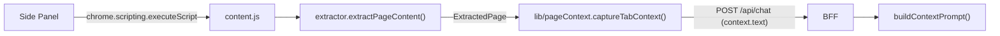

- `apps/extension/src/content/extractor.ts` — thuật toán rút gọn Readability: clone `Document` → xoá script/style/nav/footer/aside + phần tử có class/id khớp pattern âm → chấm điểm các node `article, main, [role=main], section, div` (điểm theo độ dài text block, trừ theo link density > 0.5, cộng/trừ theo class/id) → chọn node điểm cao nhất → fallback `body` → ghép text chuẩn hoá whitespace.
- Kết quả: `{ title, byline, url, text, excerpt, strategy, wordCount }` với `strategy ∈ article | main | body | empty`.
- `apps/extension/src/lib/pageContext.ts` — `captureTabContext(tabId)` + `getActiveTabId()`; **không bao giờ throw** (trang `chrome://`, không có quyền → trả context tối thiểu). Tự inject `content.js` rồi thử lại nếu content script chưa có.
- `buildContextPrompt()` ở BFF đánh dấu rõ context là "dữ liệu tham chiếu, không phải chỉ thị" (chống prompt injection — §6.4).
- **Lưu ý MV3:** content script chạy trong *isolated world* → không chia sẻ `window` với page script hay `page.evaluate` của Playwright. Muốn đọc kết quả phải đi qua `chrome.scripting.executeScript` (từ SW hoặc panel).

### 7.3.1 Nhánh trích xuất PDF & YouTube (T-M1-21, T-M1-22)

Content script **không đủ** cho PDF và YouTube:
- **PDF**: PDF viewer là plugin native của Chrome → content script không inject được → không thể đọc text bằng DOM.
- **YouTube**: transcript nằm ở `captionTracks` trong `ytInitialPlayerResponse` (không phải DOM text) → cần đọc qua player API hoặc gọi `timedtext` API.

→ Cả hai nhánh đều **fetch ở server side (BFF)** rồi chuẩn hoá về cùng shape `context.text` như nhánh HTML, để `buildContextPrompt()` không phân biệt nguồn.

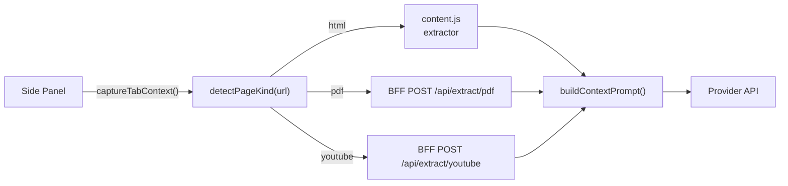

| Nhánh | Detect | BFF làm gì | Fallback khi lỗi |
|---|---|---|---|
| **PDF** | URL kết thúc `.pdf` (server xác thực bằng cách parse thử, không phụ thuộc `Content-Type`) | `fetch` bytes → parse text server-side (`pdfjs-dist`) | PDF scan (không có text layer) → lỗi `CONTEXT_PDF_NOT_READABLE` → UI hiện "không đọc được, hãy upload ảnh". PDF nội bộ / `file://` → không fetch được → lỗi `CONTEXT_PDF_UNREACHABLE` |
| **YouTube** | host `youtube.com` / `youtu.be` + video id trong URL | đọc `captionTracks` → fetch `timedtext` → ghép transcript theo timestamp | không có caption / geo-block / consent → lỗi `CONTEXT_TRANSCRIPT_UNAVAILABLE` → UI báo rõ |

**Nguyên tắc:** cả 3 nhánh đều **không được làm hỏng chat**. Lỗi trích xuất → trả context rỗng kèm `error` message → panel vẫn gửi prompt được (giống hành vi `captureTabContext()` hiện tại: không bao giờ throw).

**Bảo mật:**
- Chỉ fetch URL do user đang xem (panel gửi `url` kèm `referer`/origin) → BFF kiểm tra origin allowlist như endpoint chat (chống SSRF).
- Chặn `localhost` / mạng nội bộ (`127.0.0.0/8`, `10.0.0.0/8`, `169.254.0.0/16`) trong fetcher.
- Giới hạn kích thước: PDF ≤ 20 MB · transcript ≤ 40 000 ký tự (khớp `LIMITS.MAX_PAGE_TEXT_CHARS`).

**Contract mới (`packages/shared` — đã implement):**
- `pageKind.ts`: `detectPageKind(url)` → `'html' | 'pdf' | 'youtube' | 'unknown'` · `extractYouTubeVideoId(url)` · `isPdfUrl(url)`
- `schemas/extract.ts`: `extractRequestSchema`: `{ kind: 'pdf' | 'youtube', url: string }` · `extractResponseSchema`: `{ kind, text, title?, excerpt?, truncated, error?, errorMessage? }` · `pageKindSchema` (validate `sourceKind` từ client)
- `errors.ts`: thêm `CONTEXT_PDF_NOT_READABLE` (422) · `CONTEXT_PDF_UNREACHABLE` (502) · `CONTEXT_TRANSCRIPT_UNAVAILABLE` (422) · `CONTEXT_EXTRACT_FAILED` (500)
- `constants.ts`: `LIMITS.MAX_PDF_BYTES = 20_000_000` · `LIMITS.MAX_EXTRACT_TEXT_CHARS = 40_000` · `LIMITS.EXTRACT_FETCH_TIMEOUT_MS = 15_000` · `API_ROUTES.extractPdf` / `API_ROUTES.extractYoutube`
- `schemas/chat.ts`: `pageContextSchema` thêm `sourceKind?` · `contextError?` · `contextErrorMessage?` để UI hiện lỗi trích xuất

**Cơ chế đã implement (T-M1-21):**
- `apps/server/src/lib/safeFetch.ts` — lớp chống SSRF: chỉ `http:`/`https:` · **chặn hostname nội bộ** (`localhost`, `*.local`, `*.internal`, `*.localdomain`) · resolve DNS rồi chặn loopback (`127/8`) · private (`10/8`, `172.16/12`, `192.168/16`) · link-local (`169.254/16`) · CGNAT (`100.64/10`) · IPv6 (`::1`, `fc00::/7`, `fe80::/10`) · IPv4-mapped (`::ffff:x.x.x.x`) · tự đi theo redirect (tối đa 3 hop, kiểm tra lại từng hop) · timeout 15s · giới hạn size khi đọc stream.
- `apps/server/src/lib/pdfExtractor.ts` — `pdfjs-dist@^4.10.38` (build `legacy`, Node ≥ 20) · gom text item theo tọa độ Y (`transform[5]`) để giữ newline · truyền `standardFontDataUrl` cho PDF dùng font chuẩn non-embedded · PDF không có text layer → `CONTEXT_PDF_NOT_READABLE`.
- `apps/server/src/routes/extract.ts` — `POST /extract/pdf` · `POST /extract/youtube` · **luôn trả 200** cho lỗi nghiệp vụ.

**Cơ chế đã implement (T-M1-22):**
- `apps/server/src/lib/youtubeExtractor.ts` — `GET watch page` (lấy `INNERTUBE_API_KEY` + `VISITOR_DATA` bằng regex) → `POST youtubei/v1/player` với client `ANDROID` (`clientVersion 20.10.38`, `androidSdkVersion 34`, header `X-Youtube-Client-Name: 3`) → đọc `captions.playerCaptionsTracklistRenderer.captionTracks[]` → `fetch captionTracks[].baseUrl` với `User-Agent` Android → parse XML timedtext (`<p t d>` hoặc `<text start dur>`) thành `[mm:ss] text`.
- Chọn track: ưu tiên ngôn ngữ `vi` → `en` → ngôn ngữ còn lại; trong cùng ngôn ngữ ưu tiên track thủ công (`kind !== 'asr'`).
- **2 tầng dự phòng** (InnerTube là API không chính thức): tầng 1 InnerTube → tầng 2 `ytInitialPlayerResponse` nhúng trong HTML watch page (parse bằng bộ đếm ngoặc, không regex) → hết cả 2 → `CONTEXT_TRANSCRIPT_UNAVAILABLE`.

> **Ghi chú vận hành:** InnerTube là API **không chính thức** của YouTube → có thể đổi. Khi hỏng → `CONTEXT_TRANSCRIPT_UNAVAILABLE` → UI báo rõ, chat vẫn chạy bình thường.

### 7.3.2 Mô hình "đính kèm chủ động" & ngân sách context (T-M1-23)

> **Vấn đề đã giải quyết (T-M1-23):** trước đây `captureActiveContext()` **luôn** gửi nội dung tab active ở mọi lượt chat → (a) không có cách "chat như LLM thuần", (b) `context` chỉ biểu diễn được 1 nguồn → không cắt bớt theo thứ tự ưu tiên, (c) không có ngân sách token.

#### Mô hình attach

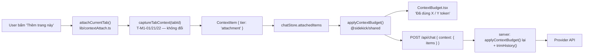

| Khái niệm | Giá trị |
|---|---|
| Nguồn context | Chỉ những gì user **chủ động** đính kèm: nút "Thêm trang này" · `@` (T-M1-05) · vùng bôi đen (T-M1-02) · file (T-M1-24) |
| Không đính kèm | Request **không** có payload `context` → chat thuần LLM (FR-CONTEXT-13) |
| Toggle | Chip ở composer bật/tắt context, mặc định **TẮT**, lưu ở `chrome.storage.local` key `sidekick.contextEnabled` |
| Tier | `selection` (cao nhất) > `attachment` > `currentTab` — quyết định thứ tự cấp phát ngân sách |
| Vị trí state | `chatStore` (side panel) — **không** đặt trong service worker (MV3 SW bị kill ~30s) |

**Các file liên quan:**

| File | Vai trò |
|---|---|
| `packages/shared/src/contextBudget.ts` | `estimateTokens()` · `applyContextBudget()` · `trimHistory()` — **nguồn sự thật duy nhất** cho ngân sách |
| `packages/shared/src/schemas/chat.ts` | `contextItemSchema` · `contextBundleSchema` · `normalizeContext()` (backward compatible) |
| `apps/extension/src/lib/contextAttach.ts` | `attachCurrentTab()` — bọc `captureTabContext()` thành `ContextItem`; không throw |
| `apps/extension/src/lib/storage.ts` | `readContextEnabled()` / `writeContextEnabled()` — persist toggle |
| `apps/extension/src/sidepanel/store/chatStore.ts` | `attachedItems` · `contextEnabled` · `budget` + actions |
| `apps/extension/src/sidepanel/hooks/useChat.ts` | `buildRequestContext()` — dựng payload `context` theo budget |
| `apps/extension/src/sidepanel/components/context/ContextChips.tsx` | Chip item + toggle + nút "Thêm trang này" |
| `apps/extension/src/sidepanel/components/context/ContextBudget.tsx` | Meter "Đã dùng X / Y token" |
| `apps/server/src/services/chatService.ts` | `buildContextPrompt()` render theo tier · `buildProviderMessages()` cắt lại + `trimHistory()` |

#### Ngân sách token theo provider

`maxTokens = contextWindow − reservedOutputTokens − CONTEXT_SAFETY_MARGIN_TOKENS`

| Provider | `CONTEXT_WINDOWS` (token) |
|---|---|
| `gemini` | 1 000 000 |
| `groq` | 128 000 |
| `openrouter` | 128 000 |
| `ollama` | 32 000 |
| `mock` | 8 000 |

- `CONTEXT_SAFETY_MARGIN_TOKENS = 2_000` — margin cho output + system prompt.
- `MAX_CONTEXT_ITEMS = 20` — số item tối đa trong 1 bundle.

**Cơ chế cắt bớt:**

1. Cấp phát theo thứ tự tier: `selection` giữ trọn → `attachment` giữ trọn nếu còn chỗ → `currentTab` chỉ dùng phần dư.
2. Item vượt chỗ → **cắt đầu** (`head slice`) + `truncated: true` + `droppedChars`.
3. Hết chỗ → `droppedItems` tăng (UI báo "N nguồn bị cắt khỏi context").
4. Phần dư ngân sách → `historyBudget` → `trimHistory()` cắt lượt chat **cũ** trước, **luôn giữ** lượt user cuối cùng.
5. `estimateTokens()` là **heuristic** (`ceil(chars / 4)`) → xấp xỉ, ghi rõ trong docs. Số token thật hiển thị từ `usage` event của provider (T-M2-03).

**Hai tầng, một hàm:** extension dùng `applyContextBudget()` để hiển thị meter + dựng payload; server gọi **cùng hàm** để cắt lại trước khi gọi provider (nguồn chân lý — client có thể gửi bản siêu lớn).

### 7.3.3 `@`-mention multi-tab (T-M1-05)

> **FR-CONTEXT-03.** Gõ `@` trong composer → popover liệt kê các tab đang mở → chọn 1 tab → tab đó được đính kèm vào context (`tier: attachment`) và tên tab được chèn vào ô nhập.

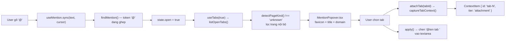

**Quy tắc phát hiện token `@`:**

| Quy tắc | Lý do |
|---|---|
| `@` phải ở đầu chuỗi hoặc sau khoảng trắng | `@` trong email (`a@b.com`) **không** bật popover |
| Token không chứa khoảng trắng | Chỉ lọc theo 1 từ khóa |
| Con trỏ phải nằm **sau** token | Token `@` đã gõ xong phía trước con trỏ |
| Sau `Escape` → token đó bị "đóng" | Trình duyệt bắn `select` event sau khi thoát ô nhập → nếu không có cơ chế này popover mở lại ngay |

**Các file liên quan:**

| File | Vai trò |
|---|---|
| `apps/extension/src/lib/tabList.ts` | `listOpenTabs()` — `chrome.tabs.query({ currentWindow: true })` + lọc trang nội bộ + `domainOf()` |
| `apps/extension/src/sidepanel/hooks/useTabs.ts` | `useTabs(enabled)` — nạp danh sách tab **lazy** (chỉ khi popover mở) |
| `apps/extension/src/sidepanel/hooks/useMention.ts` | `findMention()` (thuần, test được) + `useMention()` (state mở/đóng, `apply()` thay token) |
| `apps/extension/src/sidepanel/components/context/MentionPopover.tsx` | Popover danh sách tab: favicon · title · domain · dấu ✓ (đã đính kèm) · gạch (tab active) |
| `apps/extension/src/lib/contextAttach.ts` | `attachTab(tabId)` — bọc `captureTabContext()` thành `ContextItem`; **không** capture lại tab đã đính kèm |
| `apps/extension/src/sidepanel/hooks/useChat.ts` | `attachTab(tabId)` — cầu nối store ↔ `contextAttach` |
| `apps/extension/src/sidepanel/components/Composer.tsx` | `onCursorChange` + `onEscape` + `inputRef` — cần thiết để phát hiện token `@` |

**Ràng buộc MV3 liên quan:**

- Chỉ query tab của **cửa sổ hiện tại** (`currentWindow: true`) → không lộ tab của cửa sổ khác.
- `listOpenTabs()` **không bao giờ throw** → lỗi trả `[]` (popover rỗng, panel vẫn chat được).
- Không gọi `chrome.sidePanel.open()` ở đây — popover nằm trong panel đang mở.

### 7.3.4 Selection context — bôi đen → hỏi (T-M1-02)

> **FR-CONTEXT-04.** Bôi đen một đoạn văn bản trên trang → đoạn đó trở thành `ContextItem { kind: 'selection', tier: 'selection' }` (tier **cao nhất** trong `CONTEXT_TIER_ORDER`) → được gửi lên BFF kèm nhãn `[Đã bôi đen]`.

Có **hai đường tương tác** (user đã chốt "cả hai"):

- **Đường A (parity Edge Copilot A8):** content script bắt selection → hiện nút nổi "Hỏi Sidekick" cạnh vùng chọn → click → panel nhận đoạn text.
- **Đường B:** nút "Dính đoạn đã chọn" trong panel → đọc selection của tab active qua `chrome.scripting.executeScript`.

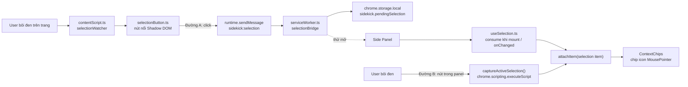

**Cơ chế "open-with-fallback" (panel đang đóng):**

`chrome.sidePanel.open()` chỉ chạy được trong **user gesture**. Message từ content script sang service worker có thể **không** giữ được gesture → ta **thử** mở panel, nếu Chrome từ chối (`try/catch`) thì **im lặng**: đoạn chọn đã nằm trong `chrome.storage.local` → panel mở sau tự nhận (TTL 5 phút).

| Bước | Nơi thực hiện |
|---|---|
| 1. Ghi `sidekick.pendingSelection` vào storage | `serviceWorker.ts` → `selectionBridge.handleSelectionMessage()` |
| 2. Thử `chrome.sidePanel.open({ windowId })` (bọc `try/catch`) | `selectionBridge.tryOpenSidePanel()` |
| 3. Panel mount → `consumePendingSelection()` | `sidepanel/hooks/useSelection.ts` |
| 4. Panel đang mở → `chrome.storage.onChanged` → consume | `useSelection.ts` |

**Các file liên quan:**

| File | Vai trò |
|---|---|
| `packages/shared/src/constants.ts` | `LIMITS.MAX_SELECTION_CHARS` (10 000) · `LIMITS.MIN_SELECTION_CHARS` (10) · `SELECTION_PENDING_TTL_MS` (300 000) |
| `apps/extension/src/content/selection.ts` | **Thuần**: `readSelectionFromDocument()` · `normalizeSelectionText()` · `isMeaningfulSelection()` · `selectionAnchorRect()` |
| `apps/extension/src/content/selectionWatcher.ts` | Nghe `mouseup`/`keyup` (debounce 120 ms) → hiện/ẩn nút nổi; `selectionchange`/`scroll` → ẩn nút |
| `apps/extension/src/content/selectionButton.ts` | Nút nổi trong `attachShadow({ mode: 'open' })` — `position: fixed`, `z-index: 2147483647` |
| `apps/extension/src/content/selectionStyles.ts` | Sinh CSS cho shadow root từ `design/tokens.json` (có biến thể `prefers-color-scheme: dark`) — **không** hardcode màu |
| `apps/extension/src/lib/selectionProtocol.ts` | `SELECTION_ACTION` · `PendingSelection` · `isSelectionMessage()` (type guard, không kéo `zod` vào content script) · `selectionItemId()` (hash FNV-1a) |
| `apps/extension/src/lib/selectionBridge.ts` | Cầu nối content script → SW → panel (lưu storage + thử mở panel) |
| `apps/extension/src/lib/storage.ts` | `writePendingSelection()` · `readPendingSelection()` · `consumePendingSelection()` · `clearPendingSelection()` |
| `apps/extension/src/lib/contextAttach.ts` | `attachSelection()` → `ContextItem` · `captureActiveSelection()` → `chrome.scripting.executeScript` (đường B) |
| `apps/extension/src/sidepanel/hooks/useSelection.ts` | Hook consume pending selection (mount + `storage.onChanged`) |
| `apps/extension/src/sidepanel/components/context/ContextChips.tsx` | Nút "Dính đoạn đã chọn" (`MousePointer2`) |

**Ràng buộc MV3 liên quan:**

- Content script build **IIFE 1 file** (`vite.content.config.ts`) → `selectionProtocol.ts` **không** import `zod`, chỉ dùng type guard thuần. `dist/content.js` ≈ 13.9 kB (không có `import`).
- Không kéo `lucide-react` vào content script (bundle phình) → icon SVG viết tay.
- Service worker **không** giữ state lâu dài → đoạn chờ nằm trong `chrome.storage.local`.
- `dist/content.js` **không** chứa `import` → Chrome load được (kiểm tra sau mỗi lần build).

**Quy tắc hành vi:**

| Quy tắc | Lý do |
|---|---|
| Chỉ hiện nút nổi khi selection ≥ `MIN_SELECTION_CHARS` (10) | Tránh nút nổi khi user chỉ click chuột / kéo 1–2 ký tự |
| Ẩn nút khi `selectionchange` rỗng hoặc trang scroll | Vùng chọn đã đổi → toạ độ neo không còn đúng |
| Đoạn chờ quá TTL (5 phút) → bỏ | User đã chuyển sang task khác → tránh đính kèm nhầm |
| Id item = hash nội dung (`selection-<hash>`) | Bôi đen lại cùng đoạn → **thay** item cũ, không nhân bản |
| Chỉ đính kèm khi user **chủ động** bấm nút | FR-CONTEXT-13 — không tự ý gửi nội dung trang |

### 7.3.5 Hash context · snapshot log · cache theo URL (T-M1-06)

> Nguồn sự thật cho hợp đồng: [`REQUIREMENTS.md`](REQUIREMENTS.md) §4.2 (FR-CONTEXT-01, FR-CONTEXT-12).

Ba mảnh độc lập, cùng phục vụ **tái lập lượt chat** (reproducibility) và **tránh trích xuất lại**:

#### (a) Hash context — `packages/shared/src/contextHash.ts`

Hàm hash **thuần**, không phụ thuộc runtime (`node:crypto` không dùng) → dùng được cho extension, server, content script.

| Hàm | Mô tả |
|---|---|
| `hashString(text): string` | FNV-1a 32-bit → hex 8 ký tự. **Không phải** hàm bảo mật — chỉ để so sánh/đối chiếu |
| `hashContextItems(items): string` | Hash deterministic của danh sách context item |
| `contextHashKey(url): string` | Khoá cache theo URL đã chuẩn hoá |

**Tính deterministic của `hashContextItems()`** — 2 quy tắc:

1. Sắp xếp item theo `CONTEXT_TIER_ORDER` (`selection` > `attachment` > `currentTab`) rồi theo `id` → thứ tự gửi không làm đổi hash.
2. Chỉ hash các trường **ảnh hưởng nội dung**: `id | kind | tier | url | title | sourceKind | text` (nối bằng `\u0000`). `truncated` / `droppedChars` / `tokens` là thuộc tính ngân sách → **không** tính.

Danh sách rỗng → `''` (server ghi `null`).

#### (b) Server: `context_hash` + `context_snapshot`

**Nguồn sự thật duy nhất:** `resolveContextItems(request, options)` trong `apps/server/src/services/chatService.ts` chạy `applyContextBudget()` **một lần** → trả về `ContextBudgetResult`. Cả hai nơi dùng:

| Nơi dùng | Mục đích |
|---|---|
| `buildProviderMessages()` | Dựng prompt gửi provider (nhận `options.contextBudget` đã tính sẵn) |
| `persistRequestLog()` | Tính `context_hash` + `context_snapshot` |

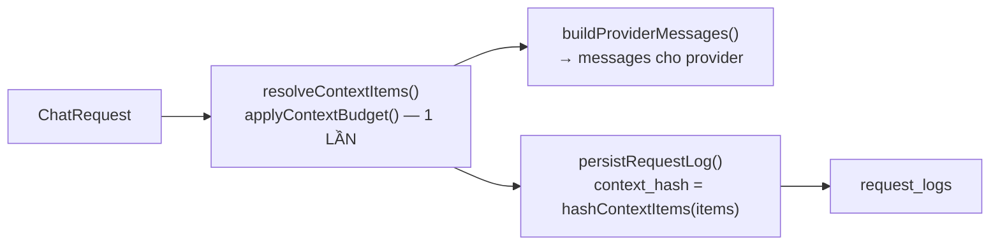

| Cột | Ghi khi nào | Nội dung |
|---|---|---|
| `context_hash` | **Luôn** (khi có context) | Hash 8 ký tự của context **đã cắt ngân sách**. Không có context → `null` |
| `context_snapshot` | **Chỉ khi `LOG_CONTEXT_SNAPSHOT=true`** (mặc định TẮT) | jsonb `[{ id, kind, tier, url, title, sourceKind, text, excerpt, truncated }]` |

> **Vì sao hash phải là của context chứ không phải của prompt?** Trước T-M1-06, `context_hash` = hash của **toàn bộ prompt** (system + lịch sử + context) → đổi câu hỏi là đổi hash, không dùng được để đối chiếu "cùng context". Nay hash chỉ phụ thuộc context → đổi câu hỏi → hash **không đổi**; đổi nội dung context → hash **đổi**.

> **Vì sao snapshot mặc định TẮT?** Snapshot chứa **nội dung trang** (dữ liệu nhạy cảm). Cờ riêng `LOG_CONTEXT_SNAPSHOT` — **không** gộp với `logFullContent` (setting FR-SETTINGS-04) để không vô tình bật lưu nội dung. Khớp retention policy §5.2.

| Setting | Mặc định | Nơi khai báo |
|---|---|---|
| `LOG_REQUESTS` | `false` | `apps/server/src/config/env.ts` |
| `LOG_CONTEXT_SNAPSHOT` | `false` | `apps/server/src/config/env.ts` → `ChatServiceDeps.logContextSnapshot` |

#### (c) Extension: cache context theo URL — `apps/extension/src/lib/contextCache.ts`

Lưu trong `chrome.storage.local`, key `sidekick.contextCache` (object `Record<cacheKey, entry>`).

```ts
interface ContextCacheEntry {
  key: string          // contextHashKey(url) — bỏ fragment/query, lowercase host
  url: string
  title: string
  text: string
  excerpt: string | undefined
  sourceKind: PageKind | undefined
  contentHash: string  // hashString(text) — phát hiện nội dung đã đổi
  capturedAt: number   // epoch ms
}
```

| Hằng số | Giá trị | Ý nghĩa |
|---|---|---|
| `CONTEXT_CACHE_TTL_MS` | 30 phút | Hết hạn → entry bị xoá |
| `CONTEXT_CACHE_MAX_ENTRIES` | 20 | Vượt → prune, giữ entry **mới nhất** |

**Luồng trong `attachTab()`** (`apps/extension/src/lib/contextAttach.ts`):

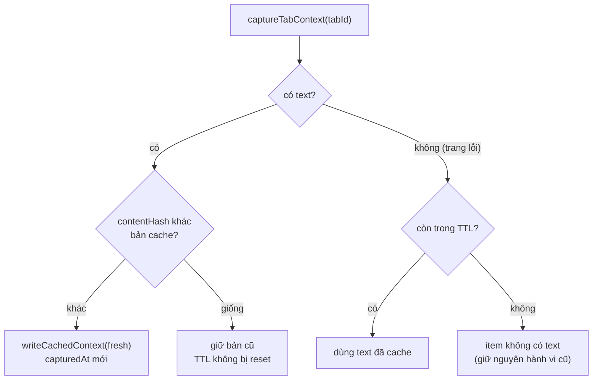

| Quy tắc | Lý do |
|---|---|
| Nội dung không đổi → **không** ghi lại cache | Không reset TTL → trang cũ vẫn hết hạn đúng hạn |
| Nội dung đổi → ghi đè, `capturedAt` mới | Trang đã cập nhật → cache phải mới |
| Trang lỗi → fallback về bản cache | PDF scan / extractor rỗng / mất mạng vẫn chat được |
| Lỗi storage → **không throw** | Cache là tối ưu, không được làm hỏng chat |

> **Ràng buộc MV3:** cache nằm ở `chrome.storage.local` (không phải biến trong service worker — SW bị kill sau ~30 s). Content script **không** import `contextHash.ts` (giữ bundle nhỏ) — dùng subpath `@sidekick/shared/constants` như hiện tại.

#### (d) File liên quan

| File | Vai trò |
|---|---|
| `packages/shared/src/contextHash.ts` | `hashString()` · `hashContextItems()` · `contextHashKey()` |
| `packages/shared/src/constants.ts` | `CONTEXT_CACHE_TTL_MS` · `CONTEXT_CACHE_MAX_ENTRIES` |
| `apps/server/src/services/chatService.ts` | `resolveContextItems()` · `buildProviderMessages()` · `persistRequestLog()` · `buildContextSnapshot()` |
| `apps/server/src/config/env.ts` | `LOG_CONTEXT_SNAPSHOT` |
| `apps/extension/src/lib/contextCache.ts` | `readCachedContext()` · `writeCachedContext()` · `clearContextCache()` · `toCacheEntry()` · `hasContentChanged()` |
| `apps/extension/src/lib/contextAttach.ts` | Nối cache vào `attachTab()` (ghi + fallback) |
| `apps/extension/src/lib/storage.ts` | `CONTEXT_CACHE_STORAGE_KEY` |

### 7.4 Ảnh đính kèm & vision input (T-M1-24)

> Nguồn sự thật cho hợp đồng: [`REQUIREMENTS.md`](REQUIREMENTS.md) §4.3 (FR-VISION-01) · shape: §4.2.2.

**Ba đường vào ảnh — cùng quy về `File` → validate → base64:**

| Đường | Sự kiện | Ghi chú |
|---|---|---|
| Paste | `onPaste` trên `<textarea>` | Chỉ nhận item `kind === 'file'` có MIME `image/*`; text thường bị `preventDefault` → không ảnh |
| Drag-drop | `onDragOver` + `onDrop` trên wrapper composer | `preventDefault()` ở **cả hai** — nếu thiếu, Chrome điều hướng panel rời trang |
| File picker | `<input type="file" accept="image/png,image/jpeg,image/webp,image/gif" multiple>` ẩn + nút 📎 | `accept` lọc ở tầng OS/browser |

**Các file liên quan:**

| File | Vai trò |
|---|---|
| `packages/shared/src/schemas/vision.ts` | `imageAttachmentSchema` · `imageAttachmentListSchema` (kiểm số ảnh + tổng byte) · `IMAGE_MIME_TYPES` (re-export từ `constants.ts`) · `MAX_IMAGE_BASE64_CHARS` |
| `packages/shared/src/constants.ts` | Hằng `VISION` (giới hạn 5 MB / 4 ảnh / 12 MB / 258 token) + `VISION_MIME_TYPES` (tuple nguồn sự thật) + `VISION.ALLOWED_MIME_TYPES` |
| `apps/extension/src/lib/imageUpload.ts` | **Thuần**: `validateImageFile()` · `readImageFile()` (FileReader → base64 thuần) · `measureImage()` (đo pixel: `createImageBitmap` → fallback `Image` → `undefined`, **không throw**) · `stripDataUrlPrefix()` · `extractImagesFromDataTransfer()` + wrapper `extractImagesFromClipboard()` / `extractImagesFromDrop()` · `createAttachmentId()` · `formatBytes()` |
| `apps/extension/src/sidepanel/hooks/useImageAttachments.ts` | Hook quản lý `pendingImages` (thêm/xoá/giới hạn/báo lỗi tiếng Việt) |
| `apps/extension/src/sidepanel/components/composer/AttachmentTray.tsx` | Thumbnail + nút ✕ + thông báo lỗi (token màu, không hardcode) |
| `apps/extension/src/sidepanel/store/chatStore.ts` | `pendingImages` + `addPendingImages` / `removePendingImage` / `clearPendingImages` |
| `apps/server/src/services/attachmentService.ts` | `persistAttachments()` · `loadRecentAttachments()` · `getAttachment()` · `decodeBase64Image()` |
| `apps/server/src/routes/attachments.ts` | `GET /api/attachments/:id` → binary (`Content-Type` = mime) |

**Quy tắc hành vi:**

| Quy tắc | Lý do |
|---|---|
| Ảnh **không** phụ thuộc toggle `contextEnabled` | Ảnh là đầu vào trực tiếp của câu hỏi, không phải context thứ cấp (FR-CONTEXT-13) |
| Ảnh **không** bị `applyContextBudget()` cắt | Hàm cắt theo **số ký tự**; ảnh không có ký tự → phải cắt riêng bằng `TOKEN_ESTIMATE_PER_IMAGE` |
| Client gửi base64, server tự lưu `bytea` | Lượt sau chỉ gửi text → server tải ảnh từ DB → không upload lại base64 |
| `id` do client sinh (uuid) → `ON CONFLICT DO NOTHING` | Retry cùng request không tạo dòng trùng |
| Danh sách mime **khoá** trong test (`VISION.ALLOWED_MIME_TYPES` phải đúng 4 giá trị) | Mutation "thêm mime mới vào allowlist" phải bị test bắt — không để lọt định dạng không an toàn |
| `measureImage()` **không throw** | Đo pixel là thông tin phụ (preview) → hỏng đo không được làm hỏng việc đính kèm ảnh |
| Server **không tin** `bytes` của client | Lưu `byteSize` = kích thước **thực** sau khi giải mã base64; ảnh vượt giới hạn → bỏ qua |
| Provider không hỗ trợ vision → **fallback**, không lỗi ngay | Model mặc định Groq không đọc ảnh → tự chuyển sang OpenRouter/Gemini |
| Hết provider hỗ trợ → `PROVIDER_VISION_UNSUPPORTED` | Lỗi rõ ràng tiếng Việt thay vì crash |
| `express.json({ limit: '16mb' })` | Payload base64 của 12 MB ảnh vượt mặc định 2 MB |

**Ràng buộc MV3 liên quan:**

- **Không cần permission mới** — paste / drag-drop / file picker không yêu cầu quyền Chrome.
- Ảnh **không** đi qua service worker (base64 payload nặng) → gửi trực tiếp Side Panel → BFF.
- `dist/content.js` **không** bị ảnh hưởng (ảnh chỉ ở side panel).

### 7.5 Build: content script phải là classic script

Chrome **không** load được content script dạng ES module. Nếu bundle chứa `import ... from "./assets/x.js"`, Chrome báo *"It isn't a module"* và content script **không chạy**.

| Entry | Định dạng | Config |
|---|---|---|
| Side panel (`sidepanel.html`) | ESM (`<script type="module">`) | `apps/extension/vite.config.ts` |
| Service worker | ESM (`"type": "module"` trong manifest) | `apps/extension/vite.config.ts` |
| **Content script** | **IIFE, 1 file, không `import`** | `apps/extension/vite.content.config.ts` |

Lệnh build: `vite build && vite build --config vite.content.config.ts` (đã gộp trong `pnpm build`).

Để content script không kéo theo cả bundle `zod` của `@sidekick/shared`, package expose thêm subpath `@sidekick/shared/constants` — extractor chỉ import hằng số từ đó. Cùng nguyên tắc đó, `lib/selectionProtocol.ts` (T-M1-02) dùng **type guard thuần** thay vì `zod` → content script không kéo schema vào bundle.

Kích thước `dist/content.js`:

| Mốc | Kích thước | Ghi chú |
|---|---|---|
| M0 (chỉ metadata) | ≈ 4.7 kB | — |
| T-M1-01 (extractor) | 4.81 kB | Readability-lite + tokens |
| **T-M1-02 (selection)** | **13.9 kB** | + watcher · + nút nổi Shadow DOM · + CSS shadow root sinh từ `tokens.json` |

Vẫn là **IIFE 1 file, không `import`** → Chrome load được (kiểm tra sau mỗi lần build).

### 7.6 Hợp đồng onboarding (FR-UX-02, T-M1-25)

#### 7.6.1 Cờ trạng thái (client-side)

| Khoá `chrome.storage.local` | Kiểu | Ý nghĩa |
|---|---|---|
| `sidekick.onboarding.completed` | `boolean` | Onboarding đã chạy xong (kể cả khi user bấm "Bỏ qua") |
| `sidekick.preferredProvider` | `ProviderId` | Provider user chọn ở bước 2 → gửi kèm `ChatRequest.provider` |

Nguồn sự thật: `apps/extension/src/lib/onboarding.ts` (`readOnboardingState` / `completeOnboarding` / `resetOnboarding` / `readPreferredProvider` / `writePreferredProvider`) — file **thuần**, không phụ thuộc React/Zustand → test được trực tiếp.

#### 7.6.2 Luồng render

```
App.tsx  ──useOnboarding()──▶  sidekick.onboarding.completed
   │
   ├─ false → <Onboarding />          (3 bước, xem REQUIREMENTS.md §4.9.1)
   └─ true  → <ChatWorkspace />       (nội dung chat, tách từ App.tsx nguyên trạng)
```

`useOnboarding` (`apps/extension/src/sidepanel/hooks/useOnboarding.ts`) đọc cờ qua `chrome.storage.local` và **lắng nghe** `chrome.storage.onChanged` → khi cờ đổi (bấm "Bỏ qua" hoặc "Hoàn tất") panel chuyển màn hình **không cần reload**.

#### 7.6.3 Component

| File | Trách nhiệm |
|---|---|
| `components/onboarding/Onboarding.tsx` | Orchestrator: progress bar (`ONBOARDING_STEPS` = `['permissions','provider','try']`), điều hướng "Tiếp tục" / "Quay lại", nút "Bỏ qua" |
| `components/onboarding/StepPermissions.tsx` | Liệt kê quyền + lý do; nút "Mở cài đặt trình duyệt" (`chrome.tabs.create` bọc try/catch — Chrome chặn URL `chrome://` → fallback hiện extension id để copy) |
| `components/onboarding/StepProvider.tsx` | Radio list provider từ `GET /api/providers`; ô nhập key (chỉ khi provider `requiresKey` và chưa có key) → `POST /providers/keys` → `POST /providers/keys/:id/test` |
| `components/onboarding/StepTry.tsx` | Ô nhập + nút "Thử" → `streamChat()` (SSE thật) → hiện câu trả lời stream |

> Bước 2 dùng **radio native** (`<input type="radio">` + `<label>`) → a11y tốt, không cần thêm component UI mới.

#### 7.6.4 Mở lại onboarding

`PanelHeader` có nút "Hướng dẫn" (`CircleHelp`) → gọi `resetOnboarding()` → cờ bị xoá → `useOnboarding` phát `onChanged` → panel hiện lại onboarding. Đây là entry tạm thời cho tới khi Settings (T-M1-12) có mục "Chạy lại hướng dẫn".

#### 7.6.4.1 Provider ưu tiên được dùng cho các lượt chat sau

`useChat` đọc `sidekick.preferredProvider` (`readPreferredProvider()`) và gửi kèm `provider` trong `ChatRequest` → server **đặt provider đó đầu** chuỗi fallback (§4.4.2).

```ts
// apps/extension/src/sidepanel/hooks/useChat.ts
const preferredProvider = await readPreferredProvider()
// ...
streamChat(
  {
    messages: requestTurns,
    ...(context === undefined ? {} : { context }),
    ...(preferredProvider === undefined ? {} : { provider: preferredProvider }),
  },
  // ...
)
```

Không có provider ưu tiên → **không** gửi field `provider` → server dùng fallback chain mặc định.

#### 7.6.5 Ràng buộc bảo mật

- API key nhập ở bước 2 gửi lên BFF qua HTTPS → BFF mã hoá **AES-256-GCM** (`MASTER_KEY`) → lưu `provider_keys`. Client **không bao giờ** nhận lại key gốc, chỉ `masked` (`****` + 4 ký tự cuối).
- BFF thiếu `MASTER_KEY` → `MASTER_KEY_NOT_CONFIGURED` (500) — thông báo rõ ràng cho user, không crash.
- Bước 3 gọi `POST /api/chat` qua **cùng** đường SSE như chat thường → không có đường tắt riêng cho onboarding.

### 7.8 Pipeline render Markdown (FR-CHAT-02/03/04 — T-M1-07)

#### 7.8.1 Stack đã chốt

| Thành phần | Phiên bản | Vai trò |
|---|---|---|
| `react-markdown` | `^10.1.0` | Render Markdown → React |
| `remark-gfm` | `^4.0.1` | Bảng GFM · strikethrough · task list · autolink |
| `rehype-highlight` | `^7.0.2` | Syntax highlight (kéo `lowlight@^3.3.0` → `highlight.js@~11.11`) |
| `rehype-sanitize` | `^6.0.0` | Allowlist thẻ/attribute/protocol (XSS) |
| `sonner` | `^2.0.8` | Toast phản hồi copy (đã có sẵn trong deps, nay dùng) |

> **Vì sao KHÔNG dùng `shiki`:** `shiki` cần WebAssembly → MV3 CSP (`script-src 'self'`) không cho `'wasm-unsafe-eval'`; tokenize **async** → code block nhấp nháy unhighlighted khi streaming → vi phạm NFR-PERF-02.

#### 7.8.2 Thứ tự plugin (quan trọng)

```
remark-parse → remark-gfm → remark-rehype → rehype-highlight → rehype-sanitize → render
```

- `rehype-highlight` **trước** `rehype-sanitize` → highlight sinh `span.hljs-*` rồi mới được allowlist giữ lại.
- `rehype-sanitize` **nhận schema trực tiếp** (không phải `{ schema }`) — `rehype-sanitize` v6 đã đổi API.

#### 7.8.3 Schema sanitize custom

`apps/extension/src/sidepanel/components/chat/markdownSchema.ts` — clone `defaultSchema` của `hast-util-sanitize`:

| Thay đổi | Giá trị | Lý do |
|---|---|---|
| `attributes.code` | `[['className', /^language-./, 'hljs']]` | Giữ class `language-*` + `hljs` để highlight hoạt động |
| `attributes.span` | `[['className', /^hljs-/]]` | Giữ token màu `hljs-keyword`, `hljs-string`, … |
| `protocols.href` | `['http', 'https', 'mailto']` | Bỏ `irc` / `xmpp` của `defaultSchema` |

> `defaultSchema` là **module singleton** → **không mutate**; phải spread ra object mới.

Ngoài ra `react-markdown` được set `skipHtml` → **raw HTML trong markdown bị loại bỏ hoàn toàn** (không thể thực thi script trong nội dung LLM).

#### 7.8.4 Chiến lược hiệu năng khi streaming (NFR-PERF-02)

| Kỹ thuật | Tác dụng |
|---|---|
| `useDeferredValue(content)` | Parse markdown chạy **sau** frame hiện tại → input + nhận token không bị block |
| Highlight **defer** khi streaming | `isStreaming === true` → chỉ `rehype-sanitize` (code block dạng plain mono). Stream xong → `rehype-highlight` chạy **1 lần duy nhất**. Highlight mỗi token là O(n²) |
| Plugin list là **module-level constant** | `react-markdown` không tạo processor mới ở mỗi render |

#### 7.8.5 Component & override

| File | Trách nhiệm |
|---|---|
| `chat/MessageContent.tsx` | Orchestrator: `useDeferredValue` · chọn plugin list theo `isStreaming` · map `components` override |
| `chat/CodeBlock.tsx` | Header (nhãn ngôn ngữ + nút copy) · `toast.success('Đã sao chép')` · icon `Copy` → `Check` 1500 ms · copy **source code thô** |
| `chat/MarkdownTable.tsx` | Bọc `<table>` trong `<div class="overflow-x-auto">` → bảng rộng scroll ngang, không vỡ layout ở panel 320 px |
| `chat/markdownSchema.ts` | Schema + `LANGUAGE_ALIASES` + `SUPPORTED_LANGUAGES` + helper đọc `node` hast (`languageFromNode` / `extractCodeText`) |

Override `components` của `react-markdown`:

| Tag | Override | Hành vi |
|---|---|---|
| `pre` | `CodeBlock` | Lấy `language` + source code từ **node hast** (không phụ thuộc children React) |
| `code` | inline chip | Nền `--surface-sunken`, font `--font-mono`; code trong `pre` giữ nguyên markup highlight |
| `a` | `AnchorOverride` | `target="_blank"` + `rel="noopener noreferrer"` |
| `table` | `MarkdownTable` | Scroll ngang |

> `CodeBlockContext` giải quyết việc `code` component không biết mình nằm trong `pre` hay là inline code.

#### 7.8.6 Ngôn ngữ hỗ trợ

`lowlight.common` = **37 grammar** (≥ 15 yêu cầu của FR-CHAT-03). Alias bổ sung qua option `aliases` của `rehype-highlight`:

| Ngôn ngữ | Alias |
|---|---|
| `javascript` | `js`, `jsx`, `mjs`, `cjs` |
| `typescript` | `ts`, `tsx`, `mts`, `cts` |
| `python` | `py`, `ipython` |
| `bash` | `sh`, `zsh` |
| `yaml` | `yml` |
| `xml` | `html`, `xhtml`, `svg`, `vue` |
| `csharp` | `cs`, `c#` |
| `cpp` | `c++`, `cc`, `hpp`, `hxx` |
| `go` | `golang` |
| `rust` | `rs` |
| `kotlin` | `kt`, `kts` |
| `plaintext` | `txt`, `text`, `dockerfile`, `http` |

Ngôn ngữ **không** đăng ký → `rehype-highlight` ghi cảnh báo non-fatal (`file.message`) → **không crash**, code block hiển thị dạng plain.

#### 7.8.7 Mapping màu highlight → design token

`apps/extension/src/sidepanel/index.css` — class `hljs-*` map sang token có sẵn trong `design/tokens.css` (không hardcode hex):

| Class | Token |
|---|---|
| `hljs-keyword`, `hljs-selector-tag`, `hljs-literal`, `hljs-type`, `hljs-name` | `--code-token-keyword` |
| `hljs-string`, `hljs-regexp`, `hljs-attribute` | `--code-token-string` |
| `hljs-number`, `hljs-variable`, `hljs-tag .hljs-attr` | `--code-token-number` |
| `hljs-comment`, `hljs-quote`, `hljs-meta` | `--code-token-comment` |
| `hljs-title`, `hljs-built_in`, `hljs-selector-id/class` | `--code-token-function` |
| `hljs-punctuation`, `hljs-operator`, `hljs-subst`, `hljs-params` | `--code-token-punctuation` |

Token đổi theo theme `.dark` → highlight tự đổi màu, không cần code.

#### 7.8.8 Phạm vi render

- **Chỉ message assistant** render Markdown. Message **user** giữ text thuần (`whitespace-pre-wrap`) → giảm rủi ro XSS từ nội dung người dùng + nhanh hơn.
- Nút copy **cả message** (copy raw markdown) vẫn giữ nguyên ở `MessageBubble`.
- Permission mới: `clipboardWrite` (dùng thật cho copy code — rule "chỉ xin quyền khi thực sự dùng").

#### 7.8.9 Kích thước bundle

| Mốc | `dist/sidepanel.js` | `dist/content.js` |
|---|---|---|
| Trước T-M1-07 | ≈ 340 kB | 13.87 kB |
| **Sau T-M1-07** | **712.80 kB** (gzip 218 kB) | **13.87 kB** (không đổi) |

`rehype-highlight` chỉ vào bundle side panel → content script (build IIFE riêng) **không bị ảnh hưởng**.

### 7.9 Citation: marker `[N]` → SSE → chip (FR-CONTEXT-10 — T-M1-08)

#### 7.9.1 Quyết định thiết kế

| Quyết định | Lý do |
|---|---|
| **LLM tự sinh marker `[N]`** trong câu trả lời | Biết được claim nào trích nguồn nào → phục vụ metric `citation_precision` / `citation_recall` trong eval |
| **Server đánh số nguồn** trong `buildContextPrompt()` → parse marker → phát SSE `citation` | `chatCitationEventSchema` + bảng `citations` **đã có sẵn từ M0** → không cần migration mới |
| Chip **inline** thay `[N]` trong câu trả lời + 1 dòng tóm tắt nguồn dưới message | Parity Edge Copilot / Chrome Gemini |
| **Remark plugin (mdast)** thay vì xử lý string thô | Không đụng code block / inline code (node type khác `text`) → không phá T-M1-07 |
| `span` + attribute `dataCitationIndex` (không dùng tag riêng) | `span` đã có trong `defaultSchema.tagNames`; `hast-util-sanitize` match **chính xác** tên property → không cần `data*` (allow-all) |
| `@radix-ui/react-popover` + copy `shadcn/ui/popover` vào repo | Popover qua Portal → không bị clip khi thread scroll; đóng bằng Escape/blur do Radix xử lý |
| Ghi vào bảng `citations` | Lưu lịch sử + eval được; bảng đã có trong migration `0000_adorable_sister_grimm.sql` |
| Regex marker đặt ở `packages/shared` | Server (parse) và extension (plugin) dùng chung 1 nguồn → không lệch pattern |
| Citation metadata **chỉ** lấy từ SSE event (không suy ra client-side) | Server là nguồn chân sự; client không cần replicate thứ tự tier → tránh coupling dễ vỡ |

#### 7.9.2 Luồng dữ liệu

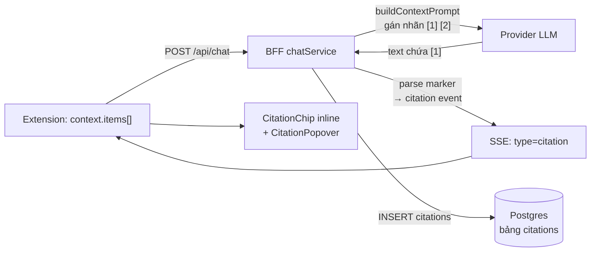

#### 7.9.3 Contract shared — `packages/shared/src/citation.ts`

| Export | Giá trị / hành vi |
|---|---|
| `CITATION_MARKER_PATTERN` | `/\[(\d{1,2})\]/g` — chỉ bắt số 1–2 chữ số (tránh bắt `[2024]` hay `[abc]`) |
| `CITATION_INSTRUCTION` | Chỉ dẫn system prompt: ghi kèm `[1]` / `[1][2]` ngay sau câu, chỉ dùng số đã cung cấp |
| `parseCitationMarkers(text)` | Trả về danh sách số nguôn **distinct + tăng dần** |

`parseCitationMarkers` dùng `text.matchAll(...)` → **không mutate `lastIndex`** của hằng regex → hàm thuần, gọi lại nhiều lần cho cùng kết quả.

#### 7.9.4 Server — đánh số nguồn + chi dẫn model

`buildContextPrompt()` gán nhãn theo thứ tự ưu tiên tier:

```
--- Nguồn [1] [Đã bôi đen] ---
Tiêu đề: ...
URL: ...
```

- `numberedContextItems(items)` (export) là **nguồn thứ tự duy nhất**: `sortItemsByTier()` → đánh số `1..N` (1-based).
- Cùng thứ tự này được dùng cho **prompt** lẫn **citation event** → `[1]` trong prompt luôn khớp với `citation.index` gửi cho client.
- `buildProviderMessages()`: khi `budget.items.length > 0` → system prompt = base + `CITATION_INSTRUCTION`. **Không có context → system prompt giữ nguyên** (không regression).

#### 7.9.5 Server — parse marker + phát SSE + ghi DB

`apps/server/src/services/citationService.ts`:

| Hàm | Trách nhiệm |
|---|---|
| `extractCitations(text, sources)` | Thuần. Marker `[N]` → nguồn thứ `N` (1-based). Marker vượt số nguồn → **bỏ qua**. Marker trùng → 1 lần. |
| `buildSnippet(source)` | `excerpt` ?? `text` (cắt còn ≤ 320 ký tự + `…`) |
| `persistCitations(db, messageId, items)` | `INSERT` vào bảng `citations` (`message_id`, `idx`, `url`, `title`, `snippet`, `tab_id`). Lỗi ghi DB **không throw** → không làm hỏng luồng chat |

Thứ tự event SSE: `meta` → `token*` → **`citation*`** → `usage` → `done`.

#### 7.9.6 Extension — remark plugin + sanitize allowlist

`apps/extension/src/sidepanel/components/chat/citationPlugin.ts` — plugin remark **thuần** (tự đệ quy, không thêm `unist-util-visit`):

- Duyệt cây mdast; node `type === 'text'` → tách theo `CITATION_MARKER_PATTERN` → thay bằng node có `data: { hName: 'span', hProperties: { dataCitationIndex: N } }`.
- Node `code` / `inlineCode` **không** bị đụng → code block giữ nguyên.
- Export `transformCitationMarkers(tree)` để test thuần không cần React.

`markdownSchema.ts` — thêm `dataCitationIndex` vào allowlist của `span`:

```ts
span: [['className', /^hljs-/], 'dataCitationIndex']
```

- **Không** dùng `data*` (allow-all) → bề mặt tấn công nhỏ nhất.
- `hast-util-to-jsx-runtime` đổi property thành prop React `data-citation-index`; giá trị gốc vẫn nằm ở `node.properties.dataCitationIndex` → `MessageContent` đọc từ đó.

#### 7.9.7 Extension — component

| Component | Vai trò |
|---|---|
| `CitationChip` | Chip số `[N]` inline. Có metadata → bọc `CitationPopover`; chưa có (đang stream) → `<span>` không popover |
| `CitationPopover` | Popover Radix: tiêu đề · domain · snippet · nút "Mở trang gốc" (`chrome.tabs.create`) |
| `CitationList` | Dòng tóm tắt nguồn dưới bubble assistant (song song với chip inline) |
| `MessageContent` | Override `span`: có `dataCitationIndex` → `CitationChip`; không có → pass-through (giữ `span.hljs-*` của T-M1-07) |
| `MessageBubble` | Truyền `citations` xuống `MessageContent` + render `CitationList` |

Danh sách nguồn được truyền qua React context (`CitationContext`) → không phải tạo lại `components` map mỗi render.

#### 7.9.8 Token màu

Chip dùng token có sẵn trong `design/tokens.css`: `--citation-bg` · `--citation-border` · `--citation-link` · `--citation-hover` (không hardcode màu). Class `.citation-chip` trong `apps/extension/src/sidepanel/index.css`.

### 7.10 Chat CRUD — quản lý nhiều cuộc trò chuyện (FR-CHAT-08/09/11 — T-M1-09)

> Nguồn sự thật cho hợp đồng: [`REQUIREMENTS.md`](REQUIREMENTS.md) §4.1 (FR-CHAT-08, FR-CHAT-09, FR-CHAT-11).

#### 7.10.1 Quyết định thiết kế

| Quyết định | Lý do |
|---|---|
| **Ghim ở cấp conversation** (`conversations.pinned`) | Cột `pinned` **đã có sẵn** từ migration `0000_adorable_sister_grimm.sql` → không cần migration mới. Ghim tin nhắn để task sau |
| **Drawer = Radix Dialog trượt từ trái** | Đúng DP-2 "chat-centric" (thread chiếm ≥ 90% không gian) — không thu hẹp panel. Radix Dialog qua Portal → không bị `overflow` của thread cắt |
| **Không migration mới** | `conversations` đã có `title` · `pinned` · `archived` · `updated_at` · `meta` |
| **Tiêu đề tự động** từ câu hỏi đầu tiên | Danh sách không nhom hết "Cuộc trò chuyện mới". Chỉ set khi **tạo mới** (`onConflictDoNothing`) → tên user đặt tay không bị ghi đè |
| **`GET /:id/messages`** thay cho `GET /:id` | Hydrate thread chỉ cần **1 request** (conversation + messages + citations) |
| **Phân trang keyset** (cursor), không OFFSET | Danh sách thay đổi liên tục (mỗi lượt chat bump `updated_at`) → OFFSET dễ lặp/sót dòng |
| **Optimistic update + rollback** trong store | CRUD phản ánh trong UI **ngay** (AC) nhưng không giữ trạng thái sai khi API lỗi |

#### 7.10.2 Luồng dữ liệu

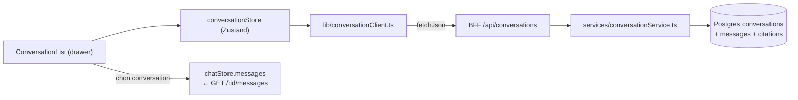

#### 7.10.3 Endpoint (đã implement)

| Method | Path | Ghi chú |
|---|---|---|
| `GET` | `/api/conversations?q=&archived=&limit=&cursor=` | Sort `pinned desc, updated_at desc, id desc` · trả `{ items, nextCursor }` |
| `POST` | `/api/conversations` | Body `{ title? }` → `201` + `ConversationSummary` |
| `GET` | `/api/conversations/:id/messages` | `{ conversation, messages[] }` — messages kèm `citations[]` + `provider`/`model`/`tokensIn`/`tokensOut` |
| `PATCH` | `/api/conversations/:id` | Body `{ title?, pinned?, archived? }` — chỉ cập nhật trường được gửi, **bump `updated_at`** |
| `DELETE` | `/api/conversations/:id` | `204` — cascade xoá `messages` · `citations` · `message_attachments` (FK `onDelete: cascade`) |

- Id phải là **UUID** → `VALIDATION_ERROR` (400) trước khi query DB.
- `AppError` (`NOT_FOUND` · `VALIDATION_ERROR` · `INTERNAL_ERROR`) map qua `errorHandler` sẵn có ở `apps/server/src/middleware/error.ts`.

#### 7.10.4 Phân trang keyset

Cursor = `base64url("pinned|updatedAt|id")` của **dòng cuối** trang trước:

```
encodeCursor({ pinned, updatedAt, id })  →  "MXwyMDI2LTAxLTAx...|fQ"
decodeCursor(cursor)                      →  { pinned, updatedAt, id } | undefined
```

- `decodeCursor` trả `undefined` khi cursor hỏng → coi như không có cursor (không throw 500).
- `nextCursor` chỉ có khi **còn** trang sau → client gọi `loadMore()` khi scroll tới cuối.
- `limit` mặc định `30`, tối đa `100` (validate bằng `conversationListQuerySchema`).

#### 7.10.5 Server — `chatService` gắn với danh sách

| Hàm | Vai trò |
|---|---|
| `buildAutoTitle(content)` | 60 ký tự đầu câu hỏi đầu tiên + `…` nếu bị cắt → tiêu đề conversation mới |
| `persistUserMessage()` | `INSERT conversations ... ON CONFLICT DO NOTHING` với tiêu đề tự động |
| `persistAssistantMessage()` | Lưu `meta` = `{ provider, model, tokensIn, tokensOut }` → khôi phục lịch sử **không mất** chip DP-6 |
| `touchConversation()` | `UPDATE conversations SET updated_at = now()` sau mỗi lượt chat → conversation vừa dùng **luôn lên đầu** danh sách |

#### 7.10.6 Extension — store + drawer

| Thành phần | Vai trò |
|---|---|
| `conversationStore` (Zustand) | `items` · `isLoading` · `error` · `query` · `archivedView` · `nextCursor` · `activeConversationId` · `activeTitle` · `refresh()` · `loadMore()` · `create()` · `rename()` · `togglePin()` · `toggleArchive()` · `remove()` |
| `ConversationList` | Nội dung drawer: "Chat mới" · search (debounce 250 ms) · tab "Đang dùng" / "Đã lưu trữ" · nhóm "Đã ghim" / "Gần đây" · mỗi dòng có nút ghim / lưu trữ / đổi tên / xoá |
| `ConfirmDialog` | Confirm trước khi xoá (FR-CHAT-08) — nút nguy hiểm dùng variant `danger` |
| `chatStore.hydrateConversation()` | Nạp lại lịch sử + citations vào thread khi chọn conversation |

**Optimistic + rollback:** `rename` / `togglePin` / `toggleArchive` / `remove` cập nhật state **trước**, gọi API sau; nếu API lỗi → khôi phục state cũ + đặt `error` (UI hiện `role="alert"`).

#### 7.10.7 Token & motion

- Drawer dùng token có sẵn: `--surface-overlay` (nền panel) · `--border-default` (viền phải) · `--shadow-3` (đổ bóng) · `--text-primary` / `--text-secondary` / `--text-tertiary`.
- Animation `sidekick-drawer-in` (translateX + opacity) & `sidekick-fade-in` (overlay) trong `apps/extension/src/sidepanel/index.css`, **tôn trọng `prefers-reduced-motion`** (`animation: none`).

---

### 7.11 Turn / variant / branch — regenerate, edit-resend, stop-continue (FR-CHAT-05/06/07/12/13 + FR-UX-05 — T-M1-10)

> Nguồn sự thật cho hợp đồng: [`REQUIREMENTS.md`](REQUIREMENTS.md) §4.1 (FR-CHAT-05, FR-CHAT-06, FR-CHAT-07, FR-CHAT-12, FR-CHAT-13) + §4.4 (FR-UX-05).

#### 7.11.1 Quyết định thiết kế

| Quyết định | Lý do |
|---|---|
| **Lưu trạng thái turn/variant/path phía server** (`messages.meta` jsonb + `conversations.meta.path`) | Panel reload là mất state → biến thể & nhánh phải sống lâu hơn 1 session. `jsonb` **đã có sẵn** từ migration `0000` → **không cần migration mới** |
| **Turn** = 1 lượt hỏi–đáp (user message + các biến thể assistant) | Khớp trực giác người dùng: "tôi hỏi gì" ↔ "câu trả lời nào" |
| **`path`** = danh sách `turnId` theo thứ tự = đường đi active | Nhánh cũ vẫn nằm trong DB nhưng không hiện trên đường đi chính |
| **Biến thể assistant** dùng `variantIndex` (0-based) + cờ `active` | Chuyển qua lại biến thể là đổi cờ, không cần bảng riêng |
| **`operation`** trong `ChatRequest` thay vì endpoint riêng | Mọi thao tac đều là "1 lượt chat" → dùng chung 1 luồng SSE, 1 code path, 1 fallback chain |
| **`continue` UPDATE message cũ** (không tạo message mới) | Nội dung dở + phần mới là **một** câu trả lời → tách làm 2 message sẽ vỡ lịch sử |
| **`CONTINUE_INSTRUCTION`** gộp vào user turn cuối (không tạo user turn mới nếu đã có) | Gemini từ chối 2 user turn liên tiếp |

#### 7.11.2 Mô hình dữ liệu (không cần migration)

`messages.meta` (jsonb):

| Khoá | Kiểu | Ý nghĩa |
|---|---|---|
| `turnId` | `string` | Nhóm 1 lượt hỏi–đáp. User message + các assistant variant cùng `turnId` |
| `variantIndex` | `number` | Biến thể assistant (0-based) trong turn. User message = `0` |
| `active` | `boolean` | Message nằm trên đường đi hiện tại. Thiếu → coi như `true` (tương thích dữ liệu cũ) |
| `parentTurnId` | `string?` | Turn cha — dùng cho branch của edit-resend |
| `aborted` | `boolean?` | Assistant bị stop giữa chừng → hiện nút "Tiếp tục" |

`conversations.meta.path` (jsonb): mảng `turnId` theo thứ tự = đường đi active. Turn không nằm trong `path` = nhánh cũ.

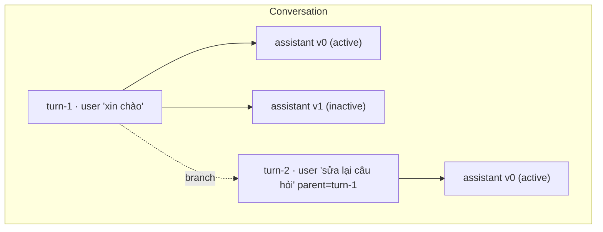

#### 7.11.3 Contract shared

| Thành phần | Nội dung |
|---|---|
| `chatOperationSchema` | `z.enum(['send', 'regenerate', 'continue', 'branch'])` — `optional()` để client cũ không gửi field này vẫn hợp lệ |
| `chatRequestSchema` | += `operation?` · `assistantMessageId?` (uuid) · `parentTurnId?` |
| `chatMetaEventSchema` | += `turnId?: string` → client đồng bộ path sau khi server xác nhận turn |
| `conversationMessageSchema` | += `turnId?` · `variantIndex?` · `active?` · `parentTurnId?` · `aborted?` |
| `conversationTurnSchema` | `{ turnId, userMessageId?, userContent, parentTurnId?, onPath, variants[] }` |
| `conversationMessagesResponseSchema` | += `path: string[]` · `turns: ConversationTurn[]` (default `[]` → tương thích dữ liệu cũ) |
| `activateVariantSchema` | `{ variantIndex: number }` |
| `API_ROUTES.conversationTurnActivate` | `/api/conversations/:id/turns/:turnId/activate` |
| `CONTINUE_INSTRUCTION` | `"Tiếp tục câu trả lời trước đó từ đúng chỗ nó bị ngắt. Chỉ viết phần tiếp theo, không lặp lại phần đã có."` |

#### 7.11.4 Server — `services/turnService.ts`

| Hàm | Vai trò |
|---|---|
| `normalizeMessages(raw[])` | Gắn `turnId` / `variantIndex` / `active` cho mọi message. Message **cũ** (không có `meta.turnId`) → user bắt đầu turn gốc, assistant gắn vào turn trước |
| `derivePath(messages[])` | Suy ra đường đi từ thứ tự message — fallback cho conversation tạo trước T-M1-10 |
| `readConversationPath()` / `rewritePath()` | Đọc/ghi `conversations.meta.path` |
| `loadNormalizedMessages()` / `loadMessage()` | Query DB → message đã chuẩn hoá |
| `nextVariantIndex()` / `activeVariantIndex()` | Chỉ số biến thể kế tiếp / đang active (chỉ đếm **assistant**, user message không phải biến thể) |
| `buildTurns(messages[], path[])` | Gom message → `ConversationTurn[]` (kèm `onPath`) |
| `patchMessageMeta()` / `patchMessagesMeta()` | Ghi `meta` (merge, không ghi đè key khác) — dùng cho `active` / `aborted` |
| `updateMessageContent()` | Ghi đè `content` + `meta` — dùng cho `continue` |

#### 7.11.5 Server — `chatService.createChatStream()` theo `operation`

| Operation | Hành vi |
|---|---|
| `send` (mặc định) | Tạo `turnId` mới → insert user message (`meta.turnId` / `variantIndex=0` / `active=true`) → `path.push(turnId)` → assistant message `variantIndex=0, active=true` |
| `regenerate` | **Không** insert user message. Resolve `turnId` từ `assistantMessageId` → assistant message mới `variantIndex = max+1`, `active=true`; các biến thể cũ chuyển `active=false` |
| `continue` | Resolve assistant message → `meta.turnId`. Provider messages = history + `CONTINUE_INSTRUCTION`. Xong → **UPDATE** message: `content = partial + text`, `meta.aborted = false` |
| `branch` | Tạo `turnId` mới với `meta.parentTurnId` → insert user message → `path = path.slice(0, indexOf(parentTurnId)) + [newTurnId]` → các turn bị cắt chuyển `active=false` → assistant message thuộc turn mới |

Mọi operation đều **yield `meta` kèm `turnId`** → client đồng bộ path sau mỗi lượt.

#### 7.11.6 Extension — thư viện thuần (`lib/chatTurns.ts`)

| Hàm | Vai trò |
|---|---|
| `groupTurns(messages[])` | Gom message → `TurnGroup[]` (user message + variants + active variant) |
| `activePathMessages(messages[], path[])` | Lọc ra message thuộc đường đi active (user + biến thể active của mỗi turn) |
| `offPathTurns(messages[], path[])` | Các turn đã bị cắt khỏi path → hiển thị ở mục "Phiên bản cũ" (chỉ đọc) |
| `applyVariantSwitch(messages[], turnId, variantIndex)` | Đổi cờ `active` trong nhóm biến thể |
| `variantLabel(variants[], activeVariant)` | Nhãn "2/3" (undefined khi chỉ 1 biến thể) |
| `branchPath(path[], parentTurnId)` | Cắt đường đi tại turn cha |
| `buildHistory(messages[], path[])` | Lịch sử gửi lên BFF — chỉ user + biến thể active, bỏ nội dung rỗng |

#### 7.11.7 Extension — store + hook

| Thành phần | Vai trò |
|---|---|
| `chatStore.path` | Đường đi active hiện tại |
| `chatStore.draft` | Bản nháp chưa gửi |
| `chatStore.hydratePath()` / `setPath()` | Nạp / thay đường đi (`setPath` đánh dấu `active=false` cho turn bị cắt) |
| `chatStore.activateVariant()` | Đổi biến thể active (local, responsive) |
| `chatStore.setAborted()` | Đánh dấu message bị stop giữa chừng |
| `useChat.regenerate(id)` | `operation: 'regenerate'` + `assistantMessageId`; biến thể cũ chuyển `active=false` |
| `useChat.editAndResend(id, content)` | `operation: 'branch'` + `parentTurnId`; cắt path local **trước** khi gọi API |
| `useChat.continueAnswer(id)` | `operation: 'continue'` + `assistantMessageId`; token append vào message đang có |
| `useChat.stop()` | `abortRef.abort()` → `catch` `AbortError` → giữ nội dung dở + `aborted: true` |

#### 7.11.8 Draft (FR-CHAT-13)

- Khoá `chrome.storage.local`: `sidekick.draft.<conversationId>` — mỗi conversation một khoá riêng.
- Ghi **debounce 300 ms** · TTL **30 ngày** (`DRAFT_TTL_MS`) → draft quá hạn bị xoá khi đọc.
- Scope `'new'` dùng khi panel mới (chưa có conversation) → bản nháp không mất khi user mới mở panel.
- `sidekick.activeDraftScope` lưu conversation đang mở → reload panel vẫn khoá đúng bản nháp.
- Xoá sau khi gửi thành công.

#### 7.11.9 Auto-scroll (FR-UX-05)

- `ChatWorkspace` theo dõi `scrollHeight - scrollTop - clientHeight` → `≤ 80 px` coi như đang ở đáy (`SCROLL_BOTTOM_THRESHOLD`).
- Chỉ auto-scroll khi đang ở đáy → user đang đọc phần trên **không bị** kéo xuống.
- Lệch → hiện nút tròn "Cuộn xuống" (`ScrollToBottomButton`), bấm → cuộn về đáy.

---

### 7.12 Prompt gợi ý theo trang + Tóm tắt 1-click (FR-UX-03 / FR-UX-04 — T-M1-11)

> Nguồn sự thật cho hợp đồng: [`REQUIREMENTS.md`](REQUIREMENTS.md) §4.9.2.

#### 7.12.1 Quyết định thiết kế

| Quyết định | Lý do |
|---|---|
| Bộ luật phân loại trang đặt ở `packages/shared/src/pageProfile.ts` | Dùng được cho cả extension (UI), server (eval harness) và `apps/eval` → 1 nguồn sự thật, không lệch. `pageKind.ts` phục vụ **routing trích xuất** (`html`/`pdf`/`youtube`) — phân loại **UX** là khái niệm khác → file riêng, không trộn |
| Phân loại theo **host → path → title**, ưu tiên host | Host định nghĩa rõ, ổn định; URL bài viết thay đổi theo bài. Path/title là fallback cho site không có trong danh sách |
| Click gợi ý → **gửi thẳng** (không điền composer trước) | Parity Edge/Gemini (bấm suggestion = chạy luôn). Gợi ý viết dạng prompt độc lập, hoàn chỉnh |
| Trước khi gửi gợi ý page-specific → **tự attach tab hiện tại** | Không có context thì "Tóm tắt trang này" sẽ bịa nội dung → vi phạm FR-CONTEXT-13. Bấm nút = hành động chủ động của user |
| Gợi ý dùng placeholder `{title}` điền tên trang | Gợi ý "cá nhân hóa" theo trang đang mở (A4: "dựa trên title + URL") |
| Refresh: xoay vòng danh sách trong **cùng profile**, tự reset khi profile đổi | "refresh theo loại trang" (FR-UX-03) = 2 chiều: đổi trang → đổi bộ gợi ý; bấm nút ↻ → xoay bộ hiện tại |
| Xoay vòng **deterministic** (offset tăng 1), không random | Test ổn định, không flaky |
| Nút "Tóm tắt trang này" đặt trong `PromptGallery` (empty state) | Đúng chỗ Edge hiển thị "Create a Summary"; không làm rối hàng chip context (DP-2: chat-centric) |
| Prompt tóm tắt đặt ở `packages/shared/src/constants.ts` (`SUMMARY_PROMPT`) | Trùng wording với dataset eval `summarize` ([`EVAL_PLAN.md`](EVAL_PLAN.md) §3) → đo được, không lệch |

#### 7.12.2 Contract shared — `packages/shared/src/pageProfile.ts`

```ts
export const PAGE_PROFILES = ['docs','article','forum','video','pdf','shopping','general'] as const
export type PageProfile = (typeof PAGE_PROFILES)[number]

export function classifyPage(url: string, title?: string): PageProfile

export interface PromptSuggestion {
  id: string     // định danh gợi ý — duy nhất trong 1 bộ
  label: string  // nhãn ngắn hiển thị trên chip
  prompt: string // prompt đầy đủ sẽ gửi (đã điền {title})
}

export function suggestionsForPage(profile: PageProfile, pageTitle: string): PromptSuggestion[]
export function generalSuggestions(): PromptSuggestion[]   // FR-UX-04 — không có context
export function rotateSuggestions(suggestions: readonly PromptSuggestion[], offset: number): PromptSuggestion[]
```

Luật phân loại (thứ tự, match đầu thắng):

| Profile | Nhận diện |
|---|---|
| `pdf` | URL kết thúc `.pdf` (tái dùng `isPdfUrl`) |
| `video` | YouTube (tái dùng `extractYouTubeVideoId`) + vimeo / tiktok / twitch / dailymotion / odysee |
| `forum` | stackoverflow / stackexchange / reddit / quora / news.ycombinator + path `/forum/`, `/community/`, `/questions/`, `/discussion/` |
| `docs` | developer.mozilla.org, host `docs.*` / `developer.*`, readthedocs, github.com/blob + path `/docs/`, `/documentation/`, `/api/`, `/reference/`, `/guide/`, `/manual/` |
| `article` | arxiv / medium / substack / wikipedia + path `/blog/`, `/post/`, `/article/`, `/news/` |
| `shopping` | amazon / shopify + path `/product/`, `/shop/`, `/cart/` |
| `general` | fallback (kể cả `chrome://`, `file://` → không có gợi ý theo trang) |

Mỗi profile có **4** gợi ý (≥ 3 theo AC) dùng placeholder `{title}`; tên trang rõng → dùng "trang này".

#### 7.12.3 Extension

| File | Vai trò |
|---|---|
| `src/lib/activePage.ts` | `readActivePage(): Promise<{ url, title } \| undefined>` — `chrome.tabs.query({ active: true, currentWindow: true })`, **không bao giờ throw** (lỗi → `undefined`) |
| `src/sidepanel/hooks/useActivePage.ts` | Hook theo dõi trang active; lắng nghe `chrome.tabs.onActivated` + `chrome.tabs.onUpdated` (chỉ khi `changeInfo.url` đổi) → đổi tab → gallery đổi bộ gợi ý |
| `src/sidepanel/components/chat/PromptGallery.tsx` | Grid chip gợi ý + nút refresh (`RefreshCw`, `aria-label` tiếng Việt) + nút "Tóm tắt trang này" + dòng minh bạch "Sẽ tự đính kèm trang này khi bạn chọn gợi ý" |
| `src/sidepanel/components/chat/SummarizeButton.tsx` | Nút chính "Tóm tắt trang này" — variant `default`, icon lucide, `aria-label`, `disabled` khi đang gửi |
| `src/sidepanel/ChatWorkspace.tsx` | Thay khối empty state tĩnh bằng `<PromptGallery />`; thêm handler `runSuggestion` / `handleSummarize` |

**Luồng gửi (điểm mấu chốt)**:

```
runSuggestion(prompt):
  1. nếu trang đọc được → await attachCurrentTab()
     (bỏ qua nếu attach lỗi → vẫn gửi, `ContextNotice` hiện sẵn có)
  2. await send(prompt)

handleSummarize():
  1. await runSuggestion(SUMMARY_PROMPT)
```

`useChat.attachCurrentTab()` trả về `item | undefined` và tự bật `contextEnabled` trong store (`chatStore.attachItem`) → sau `await` thì `useChatStore.getState()` đã có item → `buildRequestContext()` gom được context. Không cần sửa `useChat`.

**Điều kiện chọn bộ gợi ý:**

- Có tab hiện tại đọc được (`detectPageKind(url) !== 'unknown'`) → `suggestionsForPage(profile, title)`.
- Không có tab đọc được (`chrome://`, không có tab) → `generalSuggestions()` (FR-UX-04) + **không** hiện nút tóm tắt.

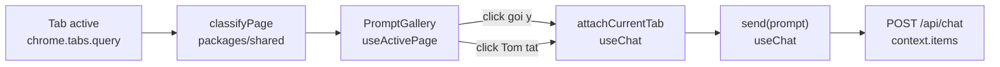

#### 7.12.4 Hiệu năng

- Đọc tab active là **1 lần** `chrome.tabs.query` (≤ 5 ms) → cache trong state của `useActivePage`, chỉ gọi lại khi có sự kiện đổi tab / đổi URL.
- `classifyPage` là hàm thuần (không I/O) → < 0.1 ms.
- `suggestionsForPage` sinh mảng 4 phần tử → không đáng kể.
- **Không** fetch nội dung trang khi mở gallery → panel cold-start không bị chậm (NFR-PERF-03).

#### 7.12.5 Kiểm thử

| Tầng | File | Phủ |
|---|---|---|
| Unit (shared) | `packages/shared/tests/pageProfile.test.ts` | classify từng profile · mỗi profile ≥ 3 gợi ý · `{title}` được điền · không còn placeholder · `rotateSuggestions` deterministic |
| Unit (extension) | `apps/extension/tests/activePage.test.ts` | `readActivePage` undefined khi `chrome.tabs.query` lỗi (không throw) |
| Unit (extension) | `apps/extension/tests/promptGallery.test.tsx` | render ≥ 3 chip · bấm chip → `onSelect(prompt)` · bấm refresh → `onRefresh` · bấm "Tóm tắt" → `onSummarize` · disabled khi `isSending` |
| E2E | `apps/extension/e2e/promptGallery.spec.ts` | (1) profile docs theo tab · (2) click gợi ý → `context.items[0]` có trang · (3) nút tóm tắt → `SUMMARY_PROMPT` + context · (4) `chrome://` → gợi ý chung · (5) đổi tab → gallery đổi profile |

### 7.13 Toggle panel · context menu · phím tắt (FR-UX-01 — T-M1-03)

> Nguồn sự thật cho hợp đồng: [`REQUIREMENTS.md`](REQUIREMENTS.md) §4.9.3.

#### 7.13.1 Quyết định thiết kế

| Quyết định | Lý do |
|---|---|
| Toolbar toggle dùng **native** `chrome.sidePanel.setPanelBehavior({ openPanelOnActionClick: true })` | Chrome tự quản lý mở/đóng → không cần tự track state cho thao tác click icon. API có từ **Chrome 114** (không phải 141) → khớp `minimum_chrome_version: 114` |
| Vẫn giữ `action.onClicked` như **fallback** | Chrome cũ / `setPanelBehavior` lỗi → mở panel bằng `open()`. Guard bằng `getPanelBehavior()` để **không** mở 2 lần (khi behavior đã bật, Chrome **không** dispatch `action.onClicked`) |
| Phím tắt = **custom command** `sidekick-toggle-panel` + tự xử lý toggle | `_execute_action` bị `openPanelOnActionClick` nuốt → không kiểm soát được toggle. Tự xử lý → 1 nguồn sự thật, test được |
| Track trạng thái panel bằng `chrome.storage.session` + event `sidePanel.onOpened`/`onClosed` | `onOpened` (Chrome 141) / `onClosed` (142) → biết panel đang mở hay không để quyết định open vs close. `storage.session` sống suốt phiên browser → **không** mất khi SW bị kill (~30s) |
| Đóng panel: `chrome.sidePanel.close({ windowId })` (Chrome 141+) + **feature detection** | Chrome < 141 không đóng được → phím tắt chỉ mở. Dùng `typeof chrome.sidePanel.close === 'function'`, không đụng `chrome.runtime.getManifest` hack |
| Context menu: **2 mục** — `sidekick-open` (`contexts: ['page']`) + `sidekick-ask-selection` (`contexts: ['selection']`) | AC ghi "context menu 'Ask Sidekick'". Mục selection tái dùng **đường B** của T-M1-02: `info.selectionText` → `PendingSelection` → `writePendingSelection()` → panel tự nhận (`useSelection`) → chip `tier: 'selection'` |
| Menu tạo lại an toàn: `chrome.contextMenus.removeAll()` **trước** `create()` | Sửa lỗi duplicate id khi update extension; `removeAll` có Promise từ Chrome 123 → dùng `await` bọc `try/catch` |
| `setPanelBehavior` gọi ở **top-level** của service worker | MV3 SW bị kill ~30s → top-level chạy lại → behavior luôn được bật lại (idempotent, upsert) |
| Tách logic ra file riêng (`background/panelController.ts`, `background/contextMenus.ts`, `background/commands.ts`) | Service worker chỉ nên là **wiring**; logic test được trong jsdom với mock `chrome.*` |
| **Không** thêm UI mới cho task này | Đổi phím tắt là T-M1-18 (`settings/ShortcutsSettings.tsx`) — task này chỉ chốt phím mặc định + contract để T-M1-18 mở rộng |

#### 7.13.2 Contract — `apps/extension/src/background/panelController.ts`

```ts
export const PANEL_OPEN_STATE_KEY = 'sidekick.panelOpen'

export type PanelToggleResult = 'opened' | 'closed' | 'noop'

export async function applyOpenOnActionClick(): Promise<boolean>
export async function isOpenOnActionClick(): Promise<boolean>
export async function readPanelOpenState(): Promise<boolean>
export async function writePanelOpenState(open: boolean): Promise<void>
export async function openSidePanel(windowId?: number): Promise<boolean>
export async function closeSidePanel(windowId?: number): Promise<boolean>
export async function toggleSidePanel(windowId?: number): Promise<PanelToggleResult>
```

- Mọi hàm bọc `try/catch` → **không bao giờ throw** (SW không được crash).
- `openSidePanel(windowId?)`: nếu không có `windowId` → fallback `chrome.windows.getCurrent()`.
- `toggleSidePanel`: đọc state → đang mở → `close()` → `'closed'`; ngược lại → `open()` → `'opened'`; thao tác thất bại → `'noop'`.

#### 7.13.3 Contract — `apps/extension/src/background/contextMenus.ts`

```ts
export const CONTEXT_MENU_OPEN_ID = 'sidekick-open'
export const CONTEXT_MENU_ASK_SELECTION_ID = 'sidekick-ask-selection'

export async function registerContextMenus(): Promise<void>
export async function handleContextMenuClick(
  info: chrome.contextMenus.OnClickData,
  tab?: chrome.tabs.Tab,
): Promise<void>
```

- `registerContextMenus()`: `removeAll()` → `create()` × 2 (mỗi `create` bọc `try/catch` riêng → menu đã tồn tại không làm hỏng menu còn lại).
- `handleContextMenuClick()`:
  - `sidekick-open` → `openSidePanel(tab?.windowId)`.
  - `sidekick-ask-selection` → `normalizeSelectionText(info.selectionText)` + `isMeaningfulSelection()` → dựng `PendingSelection` (`selectionItemId()` + `info.pageUrl` + `tab.title` + `tab.id`) → `writePendingSelection()` → `openSidePanel(tab?.windowId)`. Text rỗng/quá ngắn → **không** ghi, **không** mở panel.

#### 7.13.4 Contract — `apps/extension/src/background/commands.ts`

```ts
export const COMMAND_TOGGLE_PANEL = 'sidekick-toggle-panel'

export async function handleCommand(
  command: string,
  tab?: chrome.tabs.Tab,
): Promise<void>
```

- Command lạ → bỏ qua (không side-effect).

#### 7.13.5 Manifest

```json
"commands": {
  "sidekick-toggle-panel": {
    "suggested_key": { "default": "Ctrl+Shift+K", "mac": "Command+Shift+K" },
    "description": "Mo / dong Sidekick AI"
  }
}
```

- **Không** thêm permission mới (`commands` không cần permission; `contextMenus` đã có từ trước).
- `Ctrl+Shift+K` **không** trùng shortcut mặc định của Chrome (đã verify: Chrome dùng `Ctrl+Shift+A` cho tab search, `Ctrl+Shift+J` cho DevTools).

#### 7.13.6 Luồng

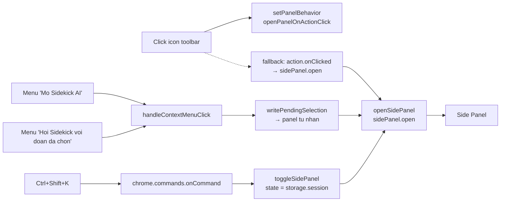

#### 7.13.7 Hiệu năng

- Mọi thao tác đều là **1 lần gọi API** của Chrome (`sidePanel.open` / `close` / `setPanelBehavior` / `getPanelBehavior`) → không I/O nặng, không chặn SW.
- Đọc/ghi trạng thái panel = 1 lần `chrome.storage.session.get/set` (in-memory) → < 1 ms.
- `registerContextMenus()` chỉ chạy ở `onInstalled` / `onStartup` → không chạy lại mỗi lần SW restart.

#### 7.13.8 Kiểm thử

| Tầng | File | Phủ |
|---|---|---|
| Unit (extension) | `apps/extension/tests/panelController.test.ts` | `setPanelBehavior` / `getPanelBehavior` · `openSidePanel` có/fallback windowId · `closeSidePanel` feature detection (Chrome < 141) · `toggleSidePanel` mở/đóng/noop · lỗi Chrome → không throw |
| Unit (extension) | `apps/extension/tests/contextMenus.test.ts` | `removeAll` trước `create` · 2 mục đúng id/title/contexts · `sidekick-open` → `sidePanel.open` · `sidekick-ask-selection` → ghi `PendingSelection` đúng text/url/title/tabId + mở panel · selection rỗng → không ghi, không mở |
| Unit (extension) | `apps/extension/tests/commands.test.ts` | command toggle → `toggleSidePanel(windowId)` · command lạ → bỏ qua |
| E2E | `apps/extension/e2e/serviceWorker.spec.ts` | (1) `getPanelBehavior()` → `openPanelOnActionClick: true` · (2) `commands.getAll()` → `Ctrl+Shift+K` + SW đã đăng ký listener · (3) menu `sidekick-open` đã tồn tại (`create` lại → "duplicate id") · (4) mở/đóng panel → `sidekick.panelOpen` trong `chrome.storage.session` cập nhật đúng |

> **Hạn chế E2E đã biết:** Playwright **không** kích hoạt được accelerator của browser (extension command) trong headless — đã verify cả `page.keyboard.press` lẫn `Input.dispatchKeyEvent` qua CDP đều không tới `chrome.commands`. Vì vậy phần "bấm phím tắt" được cover bằng unit test; E2E assert **đăng ký** shortcut + **vòng đời** trạng thái panel.

---

### 7.14 Settings — theme · cỡ chữ · chiều rộng · quản lý dữ liệu · endpoint BFF (FR-SETTINGS-01..07 + FR-UX-06 + NFR-SEC-07 — T-M1-12)

> Nguồn sự thật cho hợp đồng: [`REQUIREMENTS.md`](REQUIREMENTS.md) §4.8.1.

#### 7.14.1 Quyết định thiết kế

| Quyết định | Lý do |
|---|---|
| Settings ở **drawer** (Radix `Dialog` trượt từ **phải**), không phải màn hình thay thế chat | Giữ được ngữ cảnh chat (DP-2: thread ≥ 90%); user chỉnh setting rồi đóng vẫn thấy đúng thread. Pattern đã có sẵn: `ConversationList` trong `Dialog` (§7.10) |
| **Không** dùng Zustand store cho settings | Settings đọc/ghi `chrome.storage.local` → cần đồng bộ giữa panel + service worker. Dùng hook `useSettings()` + `chrome.storage.onChanged` (pattern đã có: `useOnboarding`) → 1 nguồn sự thật, không stale |
| Theme áp bằng class `.dark` trên `<html>` + `data-theme` | `design/tokens.css` đã có sẵn block `.dark` → **không** hardcode màu mới, chỉ bật/tắt. `system` → `matchMedia('(prefers-color-scheme: dark)')` + listener `change` |
| Cỡ chữ scale qua biến `--font-scale` | Token đã có (`tokens.css`) và `index.css` đã dùng `calc(var(--font-size-md) * var(--font-scale))` → chỉ cần set `--font-scale` (0.9 / 1 / 1.1 / 1.2) → **không** sửa component nào |
| Mật độ qua biến `--density-scale` nhân vào token `--space-*` | Tương tự `--font-scale`: 1 biến → mọi padding/gap co giãn → không sửa component nào |
| Chiều rộng panel: set `--panel-max-width` trên `<html>` | Chrome side panel chiều rộng do user kéo; extension **chỉ** set `min-width`/`max-width` được → dùng `max-width` + `width: 100%` → co giãn trong khoảng user cho phép. Giới hạn ghi rõ trong UI |
| Xoá lịch sử chat: **thêm** `DELETE /api/conversations` (xoá tất cả) | Đã có `DELETE /api/conversations/:id` (§7.10). Xoá "tất cả" bằng cách loop client sẽ chậm + dễ sót → 1 endpoint server, cascade xoá messages/citations |
| Xoá dữ liệu local: xoá theo **prefix** `sidekick.` trong `chrome.storage.local` | Dùng 1 lệnh `chrome.storage.local.get(null)` + filter prefix → xoá hết cache context + draft + pending selection + settings. **Giữ** `sidekick.onboarding.*` + `sidekick.preferredProvider` (không mất trạng thái onboarding) — nêu rõ trong UI |
| Telemetry/history: **cờ OFF mặc định**, chưa nối hành vi | FR-SETTINGS-04 AC chỉ yêu cầu "mặc định OFF". Nối telemetry thật là việc M2 (T-M2-19). Task này chỉ lưu cờ + hiển thị "chưa dùng" → tránh nói dối user |
| Ngôn ngữ VI/EN: **UI Settings chỉ hiển thị lựa chọn**, chưa dịch toàn bộ | FR-SETTINGS-06 đầy đủ là T-M1-17 (i18n). T-M1-12 chỉ lưu lựa chọn + persist → ghi rõ TODO(T-M1-17) |
| Endpoint BFF: validate bằng `fetch` tới `<url>/api/health` trước khi lưu | AC FR-SETTINGS-05: "Validate endpoint khi lưu". `getBffUrl()` đã bỏ trailing slash; `setBffUrl()` chưa validate → bổ sung validate ở tầng UI, không đụng `apiClient` (giữ hành vi hiện tại) |
| Không thêm dependency UI mới | Chỉ có `button`/`input`/`dialog` trong `components/ui/`. Radio/switch viết tay bằng `<input type="radio">` + Tailwind (pattern đã dùng ở `StepProvider`) |

#### 7.14.2 Shape — `SidekickSettings`

Nguồn sự thật: [`packages/shared/src/schemas/settings.ts`](../packages/shared/src/schemas/settings.ts) (Zod).

```ts
export const themeModeSchema = z.enum(['light', 'dark', 'system'])
export const densitySchema = z.enum(['compact', 'cozy', 'comfortable'])
export const panelWidthSchema = z.enum(['narrow', 'default', 'wide'])
export const uiLanguageSchema = z.enum(['vi', 'en'])
export const fontScaleSchema = z.union([z.literal(0.9), z.literal(1), z.literal(1.1), z.literal(1.2)])

export const settingsSchema = z.object({
  theme: themeModeSchema,
  fontScale: fontScaleSchema,
  density: densitySchema,
  panelWidth: panelWidthSchema,
  telemetryEnabled: z.boolean(),   // default false
  historyEnabled: z.boolean(),     // default false
  uiLanguage: uiLanguageSchema,
  bffUrl: z.string().min(1).max(500),
})
```

- `fontScale` dùng **enum** (không phải `number`) → tránh giá trị lạ (vd 1.37) từ storage không map được về token hợp lệ.
- Lưu ở `chrome.storage.local` key **`sidekick.settings`** (object phẳng, không nested) → đọc/ghi O(1), không cần migration.

#### 7.14.3 Contract — `apps/extension/src/lib/settings.ts`

```ts
export const SETTINGS_STORAGE_KEY = 'sidekick.settings'
export const SIDEKICK_STORAGE_PREFIX = 'sidekick.'
export const PRESERVED_STORAGE_KEYS = ['sidekick.onboarding.completed', 'sidekick.preferredProvider']
export const DEFAULT_SETTINGS: Settings

export async function readSettings(): Promise<Settings>
export async function writeSettings(patch: Partial<Settings>): Promise<void>
export async function resetSettings(): Promise<void>
export function resolveTheme(mode: ThemeMode, prefersDark: boolean): 'light' | 'dark'
export function fontScaleFor(scale: number): string
export function densityScaleFor(density: DensityMode): string
export function panelMaxWidthFor(width: PanelWidth): string
export async function exportSettings(): Promise<string>
export async function importSettings(json: string): Promise<Settings>
export async function deleteLocalSidekickData(): Promise<string[]>
```

- Mọi hàm bọc `try/catch` → **không bao giờ throw** (trừ `importSettings` → ném lỗi rõ ràng cho UI hiển thị).
- `readSettings`: giá trị sai schema → fallback **từng field** (một field hỏng không làm mất các field hợp lệ).
- `writeSettings`: **merge** với giá trị hiện tại, rồi validate qua `settingsSchema` → field không hợp lệ bị bỏ qua.
- `deleteLocalSidekickData`: xoá mọi khoa `sidekick.*` **trừ** `PRESERVED_STORAGE_KEYS`.

#### 7.14.4 Contract — `apps/extension/src/lib/theme.ts`

```ts
export function prefersDarkScheme(): boolean
export function applyTheme(mode: ThemeMode, prefersDark: boolean): void
export function applyFontScale(scale: number): void
export function applyDensity(density: DensityMode): void
export function applyPanelWidth(width: PanelWidth): void
export function watchSystemTheme(onChange: (prefersDark: boolean) => void): () => void
```

| Hàm | Tác động lên `<html>` |
|---|---|
| `applyTheme` | `classList.toggle('dark', resolved === 'dark')` + `setAttribute('data-theme', resolved)` |
| `applyFontScale` | `style.setProperty('--font-scale', fontScaleFor(scale))` |
| `applyDensity` | `style.setProperty('--density-scale', densityScaleFor(density))` |
| `applyPanelWidth` | `style.setProperty('--panel-max-width', panelMaxWidthFor(width))` |

- Bảng `--panel-max-width`: `narrow` 400px · `default` 640px · `wide` 960px.
- `design/tokens.css`: `--space-1..8` = `calc(<px> * var(--density-scale))` → mật độ áp cho **mọi** padding/gap.
- `index.css`: `#root { max-width: var(--panel-max-width); min-width: var(--panel-min-width); margin-inline: auto; }`.

#### 7.14.5 Hook — `apps/extension/src/sidepanel/hooks/useSettings.ts`

```ts
export interface UseSettingsResult {
  settings: Settings
  isLoading: boolean
  update: (patch: Partial<Settings>) => Promise<void>
}
```

- Đọc `readSettings()` lúc mount → `settings` + `isLoading`.
- Lắng nghe `chrome.storage.onChanged` (area `local`, key `sidekick.settings`) → đồng bị khi đổi ở nơi khác.
- `update(patch)` → set state ngay (**optimistic**) → `writeSettings(patch)` → storage.
- **Effect** áp theme / font-scale / density / panel-width lên `<html>` mỗi khi `settings` đổi → áp dụng **ngay, không reload** (AC FR-SETTINGS-01/02).
- `watchSystemTheme` chỉ khi `theme === 'system'` → OS đổi nền → apply lại.

#### 7.14.6 Component

| File | Nội dung |
|---|---|
| `components/settings/SettingsDrawer.tsx` | Orchestrator: Radix `Dialog` trượt từ phải + 6 section · `data-testid="settings-drawer"` |
| `components/settings/ThemeSettings.tsx` | FR-SETTINGS-01 — radio `Sáng` / `Tối` / `Theo hệ điều hành` |
| `components/settings/AppearanceSettings.tsx` | FR-SETTINGS-02 — cỡ chữ (4 mức) · mật độ (3 mức) · chiều rộng (3 mức) |
| `components/settings/PrivacySettings.tsx` | FR-SETTINGS-04 — toggle telemetry (OFF) · toggle history (OFF) |
| `components/settings/DataSettings.tsx` | FR-SETTINGS-03/07 — xoá lịch sử chat (server) · xoá dữ liệu local · export settings (JSON) · import settings (file) |
| `components/settings/EndpointSettings.tsx` | FR-SETTINGS-05 — input URL BFF + nút "Kiểm tra & lưu" (gọi `/api/health`) |
| `components/settings/LanguageSettings.tsx` | FR-SETTINGS-06 — radio VI / EN (lưu lựa chọn; dịch UI → T-M1-17) |
| `components/settings/SettingsControls.tsx` | Sub-component dùng chung: `RadioGroup` · `ToggleRow` · `SettingsSection` |

- Mỗi section dùng **radio/checkbox native** + `<label>` (a11y tốt, không cần component mới).
- Xoá dữ liệu → dùng `ConfirmDialog` có sẵn (§7.10) với `destructive` + `isBusy`.
- Entry point: nút gear trong `PanelHeader.tsx` (`data-testid="settings-button"`) → `ChatWorkspace.tsx` giữ state `isSettingsOpen`.

#### 7.14.7 Endpoint — `DELETE /api/conversations`

```ts
// apps/server/src/services/conversationService.ts
export async function deleteAllConversations(db: Database): Promise<number>
```

- Xoá **explicit** citations → messages → conversations (Postgres có `ON DELETE CASCADE` → vẫn an toàn; explicit để unit test với fake DB phản ánh đúng hiệu ứng).
- Response: `200` + `{ deleted: number }`.
- **Không** có migration DB mới (chỉ thêm endpoint DELETE).

#### 7.14.8 Luồng

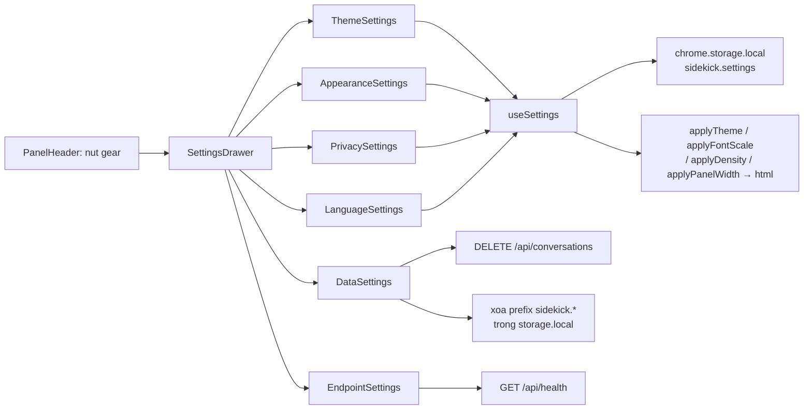

#### 7.14.9 Hiệu năng

- Đọc settings = 1 lần `chrome.storage.local.get` (< 1 ms) lúc mount panel → không ảnh hưởng cold start.
- Mỗi lần đổi setting = 1 lần `set` + 4 lần `setProperty` trên `<html>` → không re-render component nào khác (biến CSS áp bằng style, không qua React).
- Xoá lịch sử = 1 request `DELETE` (không loop N conversation).
- Xoá dữ liệu local = 1 lần `get(null)` + 1 lần `remove(keys)` → O(số khoá).

#### 7.14.10 Kiểm thử

| Tầng | File | Phủ |
|---|---|---|
| Unit (shared) | `packages/shared/tests/settings.test.ts` | `settingsSchema` validate/reject · `fontScaleSchema` chỉ nhận 4 mức |
| Unit (extension) | `apps/extension/tests/settings.test.ts` | `readSettings` default / lỗi / fallback từng field · `writeSettings` merge · `resetSettings` · `resolveTheme` 3 case · `fontScaleFor` clamp · `panelMaxWidthFor` map · `densityScaleFor` · `exportSettings` / `importSettings` (reject JSON sai) |
| Unit (extension) | `apps/extension/tests/theme.test.ts` | `applyTheme` toggle `.dark` light/dark/system · `applyFontScale` set `--font-scale` · `applyDensity` · `applyPanelWidth` · `watchSystemTheme` callback + hủy |
| Unit (extension) | `apps/extension/tests/settingsData.test.ts` | `deleteLocalSidekickData` xoá đúng prefix `sidekick.` · **giữ** `sidekick.onboarding.completed` + `sidekick.preferredProvider` · `deleteAllConversations` gọi `DELETE /api/conversations` |
| Unit (extension) | `apps/extension/tests/settingsDrawer.test.tsx` | render drawer + 6 section · đổi theme → `documentElement.classList` đổi · đổi cỡ chữ → `--font-scale` đổi · toggle → `writeSettings` được gọi · xoá lịch sử → confirm dialog → gọi DELETE |
| Unit (server) | `apps/server/tests/conversationsRoute.test.ts` | `DELETE /api/conversations` → 200 + `{ deleted }` + xoá hết rows |
| E2E | `apps/extension/e2e/settings.spec.ts` | (1) bấm gear → drawer mở · (2) chọn "Tối" → `<html>` có `.dark` → reload → vẫn `.dark` · (3) đổi cỡ chữ → `--font-scale` đổi → reload → giữ · (4) xoá lịch sử (stub `DELETE /api/conversations`) → confirm → request đúng |

> **Ghi chú E2E:** BFF được stub bằng `page.route` → test chạy độc lập, không cần Postgres thật.

### 7.15 States · retry · connection status (FR-CHAT-14 · FR-UX-08 · NFR-REL-02 · NFR-REL-04 — T-M1-19)

> Nguồn sự thật cho hợp đồng: [`REQUIREMENTS.md`](REQUIREMENTS.md) §5.3 (NFR-REL) + §4.1 (FR-CHAT-14).

#### 7.15.1 Bốn trạng thái của side panel

Side panel **không bao giờ** hiển thị màn hình trắng/chết. Mọi trạng thái đều có **một điểm vào chung** trong `apps/extension/src/sidepanel/components/states/`:

| Trạng thái | Component | Khi nào | Hành động |
|---|---|---|---|
| **Loading** | `LoadingState.tsx` | Đang tải lịch sử hội thoại (`GET /api/conversations/:id/messages`) | Skeleton rows (`animate-pulse`) — **không** flash empty state |
| **Empty** | `EmptyState.tsx` | Chưa có message nào | Wrapper của `PromptGallery` (T-M1-11) — ≥ 3 gợi ý theo trang |
| **Error** | `ErrorState.tsx` | Lỗi trong 1 luot chat | 1 hành động đúng theo nhóm lỗi (xem §7.15.3) |
| **Offline** | `offline-banner` trong `ChatWorkspace.tsx` | BFF không phản hồi | Banner dưới header + nút "Thử lại" |

#### 7.15.2 Taxonomy lỗi (shared)

Nguồn sự thật: [`packages/shared/src/chatErrors.ts`](../packages/shared/src/chatErrors.ts) — **thuần**, dùng chung server + extension + eval.

```ts
export type ChatErrorKind = 'network' | 'rate-limit' | 'auth' | 'provider' | 'server' | 'unknown'

export function classifyChatError(code: string): ChatErrorKind
export function isRetryableKind(kind: ChatErrorKind): boolean      // false cho 'auth'
export function shouldAutoRetry(kind: ChatErrorKind): boolean      // true cho network/server/unknown
export function defaultRetryAfterSeconds(kind: ChatErrorKind): number | undefined  // 60 cho 'rate-limit'
export const AUTO_RETRY_BACKOFF_MS = 800
```

| Error code | Kind | `retryable` (user) | Auto-retry | Hành động trong UI |
|---|---|---|---|---|
| `INVALID_API_KEY` · `PROVIDER_KEY_INVALID` · `MISSING_API_KEY` · `UNAUTHORIZED` · `FORBIDDEN` | `auth` | ❌ | ❌ | **Kiểm tra API key** → mở drawer Settings |
| `PROVIDER_RATE_LIMITED` · `RATE_LIMITED` · `PROVIDER_QUOTA_EXCEEDED` | `rate-limit` | ✅ (sau hạn) | ❌ | **Thử lại sau Ns** (đếm ngược, nút bị disable) |
| `SERVICE_UNAVAILABLE` · `PROVIDER_UNAVAILABLE` · `TIMEOUT` | `network` | ✅ | ✅ | **Thử lại** |
| `INTERNAL_ERROR` · `DB_ERROR` | `server` | ✅ | ✅ | **Thử lại** |
| `PROVIDER_ERROR` · `MODEL_NOT_FOUND` | `provider` | ✅ | ❌ | **Thử lại** (model sai → retry cũng lỗi) |
| (không nhận ra) | `unknown` | ✅ | ✅ | **Thử lại** |

#### 7.15.3 Luồng lỗi

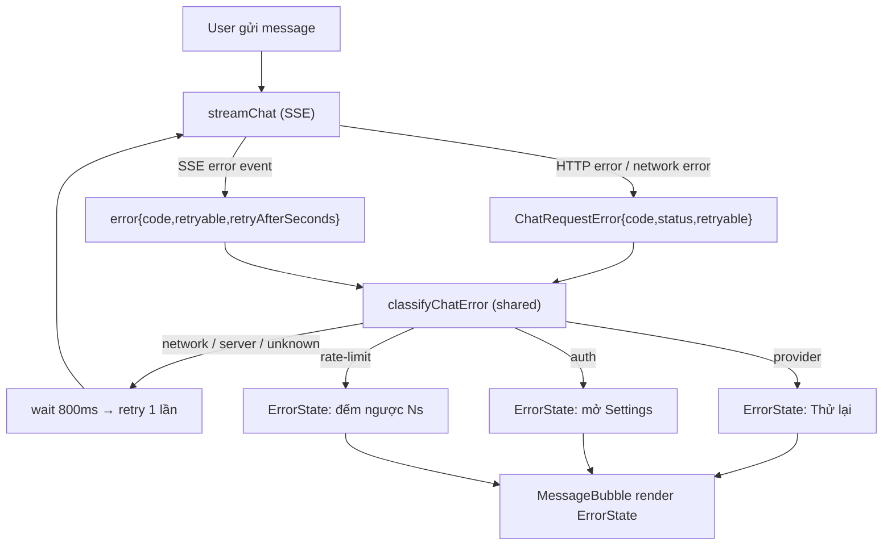

#### 7.15.4 Server — báo lỗi thật

| Nơi | Thay đổi |
|---|---|
| `packages/shared/src/events.ts` | `chatErrorEventSchema` += `retryAfterSeconds?: number` (int ≥ 0) |
| `packages/shared/src/schemas/provider.ts` | `providerChunkSchema` += `errorRetryable?: boolean` + `retryAfterSeconds?: number` |
| `apps/server/src/providers/types.ts` | `errorChunk(code, message, { retryable, retryAfterSeconds })` |
| `apps/server/src/providers/sse.ts` | `parseRetryAfterSeconds(response)` (đọc header `Retry-After`, ghim ≤ 600 s) · `isRetryableStatus(status)` (401/403 → false) · `shouldTryFallbackModel(status)` (429 **vẫn** fallback sang model khác) |
| `apps/server/src/providers/{openaiCompatible,gemini}.ts` | HTTP 429 → gắn `retryAfterSeconds` từ header · HTTP 401/403 → `errorRetryable: false` |
| `apps/server/src/services/chatService.ts` | `retryable = chunk.errorRetryable ?? isRetryableKind(classifyChatError(code))` — **không** hardcode `true`; forward `retryAfterSeconds` |

> **Phân biệt 2 khái niệm `retryable`:** `shouldTryFallbackModel` (server thử **model** khác — 429 vẫn thử) ≠ `isRetryableStatus` (user có nên **retry** — 401/403 thì không).

#### 7.15.5 Extension — plumbing

| Nơi | Thay đổi |
|---|---|
| `apps/extension/src/lib/sseClient.ts` | `export class ChatRequestError extends Error { code; status; retryable }` — thay `new Error("CODE: msg")`; lỗi network → `ChatRequestError('SERVICE_UNAVAILABLE', …)` |
| `apps/extension/src/sidepanel/store/chatStore.ts` | `ChatMessage` += `serverId?` (uuid từ SSE `meta.messageId`) · `errorCode?` · `errorRetryable?` · `errorRetryAfterSeconds?` · action `setMessageError(id, patch)` |
| `apps/extension/src/sidepanel/hooks/useChat.ts` | Lưu `code`/`retryable`/`retryAfterSeconds` khi nhận SSE `error` · retry **1 lần** backoff 800 ms · `retryMessage(messageId)` (gọi `regenerate` với `serverId`) |

> **`serverId` là bắt buộc:** client sinh id local (`assistant-<timestamp>`) nhưng server yêu cầu `assistantMessageId` là **uuid** (`chatRequestSchema`) → `regenerate` / `continue` / `retryMessage` phải dùng `serverId` (từ SSE `meta.messageId`), nếu không server trả 400.

#### 7.15.6 Trạng thái kết nối

Nguồn: [`apps/extension/src/lib/connectionStatus.ts`](../apps/extension/src/lib/connectionStatus.ts) (thuần) + [`apps/extension/src/sidepanel/hooks/useConnectionStatus.ts`](../apps/extension/src/sidepanel/hooks/useConnectionStatus.ts).

- Probe `GET <bffUrl>/api/health` (timeout 3 s) → `connected` (HTTP 200 + `status: 'ok'`) · `degraded` (`status: 'degraded'`) · `offline` (HTTP lỗi / fetch reject / timeout).
- **Backoff probe**: 5 s → 15 s → 30 s (giữ nguyên 30 s). Probe thành công → reset về 5 s.
- `navigator.onLine` listener → báo `offline` **tức thời** (không chờ probe kế tiếp); `online` → probe lại ngay.
- `ConnectionBadge` trong `PanelHeader` (icon + chữ, **không** chỉ dựa vào màu) + banner offline dưới header.

#### 7.15.7 Kiểm thử

| Tầng | File | Phủ |
|---|---|---|
| Unit (shared) | `packages/shared/tests/chatErrors.test.ts` | `classifyChatError` 6 nhóm · `isRetryableKind` · `shouldAutoRetry` · `defaultRetryAfterSeconds` · `AUTO_RETRY_BACKOFF_MS` |
| Unit (shared) | `packages/shared/tests/events.test.ts` | `error` event có `retryAfterSeconds` · reject giá trị âm |
| Unit (server) | `apps/server/tests/chatErrorEvent.test.ts` | 401 → `retryable: false` · 429 → `retryAfterSeconds` · provider 429 đọc header `Retry-After` · 401 → `errorRetryable: false` |
| Unit (extension) | `apps/extension/tests/chatErrorState.test.tsx` | action đúng theo kind · đếm ngược 429 · dismiss · `role="alert"` · `data-error-kind` |
| Unit (extension) | `apps/extension/tests/connectionStatus.test.ts` | `backoffFor` 5s→15s→30s · `probeConnection` ok/degraded/lỗi/reject |
| Unit (extension) | `apps/extension/tests/chatRetry.test.ts` | retry **đúng 1 lần** · 401 **không** retry · sau retry vẫn có card lỗi · SSE `error` lưu `errorCode` + `retryAfterSeconds` · `retryMessage` gọi `regenerate` |
| E2E | `apps/extension/e2e/states.spec.ts` | (1) BFF offline → badge + banner · (2) BFF online → badge "Đã kết nối" · (3) SSE 429 → card lỗi + đếm ngược · (4) mở conversation → skeleton loading |

**Mutation spot-check (8 mutation, đều bị bắt):**

| Mutation | Kết quả |
|---|---|
| `chatErrors.ts`: `shouldAutoRetry` bỏ điều kiện loại trừ `auth` | ✅ Bị bắt — *"auth / rate-limit / provider khong tu dong retry"* fail |
| `useChat.ts`: bỏ guard số lần retry (thêm 1 lần gọi nữa) | ✅ Bị bắt — *"retry DUNG 1 lan"* fail (3 thay vì 2) |
| `ErrorState.tsx`: đếm ngược không giảm | ✅ Bị bắt — *"het dem nguoc thi nut Thu lai duoc bat"* fail |
| `sse.ts`: bỏ mapping header `Retry-After` | ✅ Bị bắt — *"429 doc header Retry-After"* fail |
| `ChatWorkspace.tsx`: bỏ render banner offline | ✅ Bị bắt — E2E *"BFF offline → badge Offline + banner"* fail |
| `connectionStatus.ts`: bỏ backoff (luôn 5 s) | ✅ Bị bắt — 3 test backoff fail |
| `chatService.ts`: hardcode `retryable: true` | ✅ Bị bắt — *"401 → retryable=false"* fail |
| `ChatWorkspace.tsx`: bỏ render `LoadingState` | ✅ Bị bắt — E2E *"skeleton loading thay empty state"* fail |

---

## 8. Hiệu năng

| Chỉ số | Mục tiêu | Cách đạt |
|---|---|---|
| TTFT (time to first token) | ≤ 3s p95 | Prewarm provider connection; prompt ngắn gồm; context truncate thông minh |
| BFF overhead | ≤ 30ms | Keep-alive HTTP agent, connection pool Postgres (max 10) |
| Content extraction (HTML) | ≤ 800ms | Chạy trong content script, dùng Readability-lite (T-M1-01 ✅). Cache theo URL+hash trong `chrome.storage.local` — **chưa implement** (ưu tiên tối đa 1 lần/trang) |
| Content extraction (PDF) | ≤ 3s | Fetch bytes + parse ở BFF (T-M1-21 ✅). Giới hạn 20 MB; cache kết quả theo URL+hash — **cache chưa implement** |
| Content extraction (YouTube) | ≤ 2s | Fetch `timedtext` ở BFF (T-M1-22 ✅). Cache theo video id + language — **cache chưa implement** |
| Panel mở | ≤ 300ms | Không fetch nặng khi mount; lazy-load settings. **T-M1-11 ✅:** đọc tab active = 1 lần `chrome.tabs.query` (≤ 5 ms), `classifyPage` thuần (< 0.1 ms) → không ảnh hưởng cold start. **T-M1-03 ✅:** mọi thao tác mở/toggle panel = 1 lần gọi API Chrome + 1 lần `storage.session.get` (< 1 ms). **T-M1-12 ✅:** đọc settings = 1 lần `chrome.storage.local.get` (< 1 ms); đổi setting = 1 lần `set` + 4 lần `setProperty` trên `<html>` (không re-render component khác) |
| Scroll khi streaming | ≥ 50fps | Batch token bằng `requestAnimationFrame`, không render mỗi token · **T-M1-07 ✅:** `useDeferredValue` + defer highlight khi streaming (§7.8.4) |
| Upload ảnh | ≤ 1s / ảnh | `FileReader` đọc base64 ở main thread (5 MB) · giới hạn 4 ảnh / 12 MB tổng · **TODO(T-M2-22)**: chuyển sang `OffscreenCanvas`/`createImageBitmap` + `Web Worker` nếu cần |
| Token ảnh | ≤ 258 token / ảnh | Ước lượng theo quy ước OpenAI (ảnh 512 px) — trừ khỏi `historyBudget` trước khi cắt lịch sử |

---

## 9. Rủi ro kỹ thuật

| Rủi ro | Xác suất | Ảnh hưởng | Giảm thiểu |
|---|---|---|---|
| SW bị kill giữa luồng | Cao | Cao | ADR-2: stream không đi qua SW |
| `activeTab` không được cấp | Cao | Cao | Dùng `tabs` + `scripting` + `<all_urls>` |
| Provider đổi API/format | Trung bình | Trung bình | Adapter layer + contract test + feature flag provider |
| Postgres chưa sẵn sàng khi BFF start | Trung bình | Trung bình | Health check + retry + `/health` báo `db: down` |
| `pgvector` chưa có extension | Thấp | Cao | `CREATE EXTENSION IF NOT EXISTS vector;` trong migration đầu |
| Rate limit provider | Cao | Trung bình | Exponential backoff + hàng đợi + hiển thị quota |
| Quota free tier cạn khi demo | Cao | Cao | Fallback provider + Ollama local + key dự phòng |
| Fetch URL từ BFF bị lạm dụng thành SSRF | Trung bình | Cao | Chỉ fetch URL do user đang xem · chặn mạng nội bộ (`127.0.0.0/8`, `10.0.0.0/8`, `169.254.0.0/16`) · giới hạn kích thước response · timeout (T-M1-21/22) |
| YouTube không có caption / geo-block | Cao | Thấp | Trả lỗi rõ ràng `CONTEXT_TRANSCRIPT_UNAVAILABLE`, không crash chat (T-M1-22) |

---

## 10. Liên kết

- [`REQUIREMENTS.md`](REQUIREMENTS.md) — nguồn yêu cầu (FR/NFR)
- [`DESIGN_SYSTEM_BRIEF.md`](DESIGN_SYSTEM_BRIEF.md) — token & component
- [`IMPLEMENTATION_PLAN.md`](IMPLEMENTATION_PLAN.md) — task-level theo milestone
- [`EVAL_PLAN.md`](EVAL_PLAN.md) — kế hoạch đo lường
- [`HANDOFF.md`](HANDOFF.md) — quy trình bắt đầu chat mới
