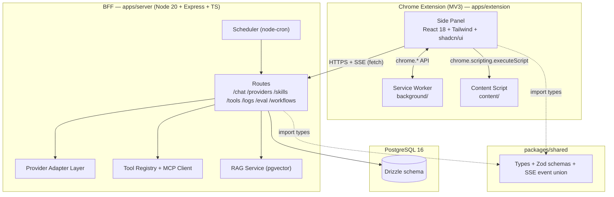
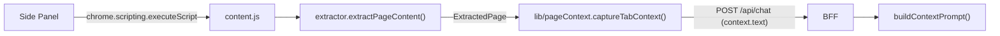

# System Design — Sidekick AI

**Version:** v1.0 · **Ngày:** 2026-11-03 · **Trạng thái:** Baseline
**Yêu cầu:** [`REQUIREMENTS.md`](REQUIREMENTS.md) · **Đối chiếu tính năng:** [`COMPARISON_MATRIX.md`](COMPARISON_MATRIX.md) · **UI:** [`DESIGN_SYSTEM_BRIEF.md`](DESIGN_SYSTEM_BRIEF.md)

> Tài liệu này trả lời "**code viết như thế nào**". Nó không lặp lại requirement — mỗi requirement đã có ở `REQUIREMENTS.md`.

---

## 1. Kiến trúc tổng thể



### 1.1 Ranh giới trách nhiệm

| Tầng | Trách nhiệm | KHÔNG được làm |
|---|---|---|
| **Side Panel** | Render, thu thập input, điều khiển trạng thái UI, gọi BFF, đọc `chrome.storage.local` | Không giữ API key dạng rõ khi đang ở chế độ K2; không tự gọi provider API (trừ K3 fallback) |
| **Service Worker** | Điều phối tab, mở/đóng panel, context menu, shortcut, lưu draft | **Không** proxy streaming; **không** giữ state phiên |
| **Content Script** | Trích xuất nội dung trang, đọc selection, gửi về panel | Không tự gọi BFF (tránh leak token); không ghi log |
| **BFF** | Chọn provider, quản lý key, build prompt, gọi provider, stream lại, log, RAG, scheduler | Không chứa logic UI; không tự quyết định UX |
| **packages/shared** | Type, Zod schema, event union, constants, error codes | Không chứa logic runtime |

---

## 2. Quyết định kiến trúc (ADR)

> Mỗi ADR: **Bối cảnh → Quyết định → Lý do → Hệ quả.**

### ADR-1 — Dùng Side Panel API, không dùng popup
- **Bối cảnh:** popup đóng khi mất focus → không chat được nhiều lượt; Edge Copilot & Gemini đều là panel cố định.
- **Quyết định:** `chrome.sidePanel` (Chrome ≥ 114), mở qua toolbar action.
- **Lý do:** Parity + trải nghiệm multi-turn đúng như hệ thống đối chiếu.
- **Hệ quả:** 1 panel/window; cần `sidePanel` permission; không có `default_popup`.

### ADR-2 — Streaming trực tiếp Side Panel → BFF, không đi qua Service Worker
- **Bối cảnh:** MV3 service worker bị terminate sau ~30s idle; một luồng chat có thể kéo dài vài phút.
- **Quyết định:** Side Panel tự mở `fetch` tới BFF với `Accept: text/event-stream`, đọc stream bằng `ReadableStream` reader.
- **Lý do:** SW không đảm bảo sống suốt stream → phải nối lại hoặc mất dữ liệu.
- **Hệ quả:** Stream không sống sót nếu đóng panel → cần persist message vào DB **ngay khi nhận `done`**, và báo user "đã lưu".

### ADR-3 — SSE thay vì WebSocket
- **Bối cảnh:** Luồng dữ liệu là 1 chiều server → client (token, citation, tool result). Không cần server gọi ngược client giữa chừng.
- **Quyết định:** `text/event-stream` qua HTTP thường.
- **Lý do:** Đơn giản hơn, đi qua proxy dễ, tự reconnect được, không cần lib WS.
- **Hệ quả:** Không có push server→client ngoài luồng chat (notification workflow dùng `chrome.notifications` từ SW, không qua SSE).

### ADR-4 — Drizzle ORM + PostgreSQL 16
- **Bối cảnh:** Cần lưu conversation, log có cấu trúc (cho eval), vector search (RAG).
- **Quyết định:** Drizzle + `pg` driver, `pgvector` extension.
- **Lý do:** Type-safe end-to-end với `packages/shared`; migration SQL đọc được; hỗ trợ `vector` type thuần Postgres.
- **Hệ quả:** Drizzle không có admin UI → dùng `drizzle-kit studio` khi dev.

### ADR-5 — Monorepo pnpm workspace
- **Bối cảnh:** Extension, BFF, eval harness, shared types phải dùng chung type.
- **Quyết định:** `pnpm-workspace.yaml` với `apps/*` + `packages/*`.
- **Lý do:** Một nguồn type; CI cache dễng; deploy tách bạch.
- **Hệ quả:** Cần `build:packages/shared` trước khi build extension. Fallback `npm` nếu pnpm chưa cài.

### ADR-6 — Tailwind CSS + shadcn/ui (copy code vào repo)
- **Bối cảnh:** Cần UI nhanh, nhất quán, accessible, và có thể tự sửa.
- **Quyết định:** Tailwind + shadcn/ui components **copy vào** `apps/extension/src/components/ui/`.
- **Lý do:** Sở hữu 100% code, không phụ thuộc npm runtime, có thể chỉnh sửa sâu; Radix primitives xử lý focus/keyboard/aria đúng chuẩn.
- **Hệ quả:** Phải tự cập nhật component khi shadcn ra bản mới (chấp nhận được).

### ADR-7 — Zustand cho client state
- **Bối cảnh:** State: conversation list, context tabs, settings, streaming buffer.
- **Quyết định:** Zustand (không Redux Toolkit).
- **Lý do:** Nhẹ, selector granular → không re-render toàn bộ thread khi streaming.
- **Hệ quả:** Không có devtools middleware mặc định → thêm `zustand/devtools` ở dev build.

### ADR-8 — Chia dữ liệu: `chrome.storage.local` vs Postgres
- **Bối cảnh:** Extension có thể chạy khi BFF down.
- **Quyết định:** Settings, draft, cache context, conversation id list → `chrome.storage.local`. Nội dung conversation đầy đủ, log, skill, eval → Postgres.
- **Lý do:** Cho phép offline-first; Postgres là nguồn sự thật khi có BFF.
- **Hệ quả:** Cần cơ chế "pending sync" cho conversation tạo ở chế độ K3 → queue trong `chrome.storage.local`, flush khi BFF lên.

### ADR-9 — Ba nguồn API key: K1 / K2 / K3
- **Bối cảnh:** Nhóm cần demo nhanh (không ai nhập key), nhưng người dùng thật cần BYOK an toàn, và demo có thể chạy khi Docker chưa bật.
- **Quyết định:**

| Nguồn | Nơi lưu | Bắt buộc BFF? | Dùng khi |
|---|---|---|---|
| **K1 — Team key** | `.env` của BFF (`TEAM_API_KEY`) | Có | Demo/dev, mặc định M0–M1 |
| **K2 — BYOK qua BFF** | Postgres, mã hoá AES-256-GCM | Có | User thật, M2+ |
| **K3 — BYOK direct** | `chrome.storage.local` (đã mã hoá bằng WebCrypto, key sinh từ passphrase) | **Không** | BFF down / offline |

- **Lý do:** Ba nguồn độc lập về mặt vòng đời; K3 cho fallback khi BFF sập.
- **Hệ quả:** Code phải có `ProviderResolutionService` duy nhất chọn nguồn, trả về `{ key, source, model }` — không nơi nào khác đụng tới key.

### ADR-10 — RAG dùng pgvector, không dùng sqlite-vec
- **Bối cảnh:** Cần search trong lịch sử chat / tài liệu đã lưu.
- **Quyết định:** Extension `vector` + index `ivfflat` (hoặc `hnsw`), embed 384 chiều (`all-MiniLM-L6-v2` chạy local qua Ollama hoặc ONNX).
- **Lý do:** Cùng DB, cùng backup, cùng retention policy; không thêm hệ thống file.
- **Hệ quả:** Embedding model phải cố định theo `embedding_model` trong bảng `rag_documents`; đổi model → re-embed toàn bộ.

### ADR-11 — Eval harness chạy trong `apps/eval`, dùng chung type với BFF
- **Bối cảnh:** Harness phải gọi đúng endpoint chat như extension thật.
- **Quyết định:** `apps/eval` là CLI Node dùng `packages/shared` + gọi HTTP vào BFF (không import code UI).
- **Lý do:** Tái lập được, chạy được 1 lệnh, tách biệt UI.
- **Hệ quả:** BFF phải expose API ổn định — mọi thay đổi breaking phải bump version.

### ADR-12 — Không đưa API key vào extension bundle
- **Bối cảnh:** Extension là file .zip có thể bị mở.
- **Quyết định:** K1 và K2 **chỉ** tồn tại ở BFF. Extension không bao giờ nhận key dạng rõ trừ chế độ K3 (user tự nhập, mã hoá local, và đây là lựa chọn của chính user).
- **Lý do:** An toàn mặc định.
- **Hệ quả:** BFF là single point of failure → ADR-9 K3 là đường lùi.

---

## 3. Cấu trúc thư mục chi tiết

> **Trạng thái M1 (2026-11-04, sau T-M1-01):** cây bên dưới là cấu trúc **đích**. M0 đã implement các phần in đậm; T-M1-01 bổ sung `content/extractor.ts` + `lib/pageContext.ts`. Các thư mục còn lại (`chat/`, `context/`, `skills/`, `tools/`, `settings/`, `workflow/`, `selection.ts`) sẽ được tạo ở M1–M4.
>
> Thực tế M0 + T-M1-01 đã có:
> ```text
> apps/extension/
> ├─ public/{manifest.json, icons/{16,32,48,128}.png}
> ├─ sidepanel.html                 # entry HTML (build ra dist/sidepanel.html)
> ├─ src/
> │  ├─ sidepanel/{App.tsx, main.tsx, index.css,
> │  │            components/{PanelHeader,MessageBubble,Composer}.tsx,
> │  │            hooks/useChat.ts, store/chatStore.ts}
> │  ├─ components/ui/{button,input,textarea}.tsx   # shadcn/ui
> │  ├─ background/serviceWorker.ts
> │  ├─ content/{contentScript.ts, extractor.ts}   # extractor = Readability-lite
> │  ├─ lib/{apiClient,sseClient,pageContext,utils}.ts
> │  └─ types/globals.d.ts
> ├─ e2e/{fixtures.ts,sidepanel.spec.ts,extractor.spec.ts}
> ├─ tests/{apiClient,chatStore,sseClient,useChat,extractor,pageContext}.test.ts
> ├─ vite.config.ts                  # side panel + service worker (ESM)
> ├─ vite.content.config.ts          # content script (IIFE, 1 file — §7.4)
> ├─ vitest.config.ts · playwright.config.ts
> ```
> `apps/server/src/` hiện có: `routes/{health,chat}.ts` · `services/chatService.ts` · `providers/*` · `middleware/*` · `config/env.ts` · `db/*` · `lib/crypto.ts`.

```text
uddn_extension_chat/
├─ apps/
│  ├─ extension/
│  │  ├─ public/
│  │  │  ├─ manifest.json
│  │  │  └─ icons/{16,32,48,128}.png
│  │  ├─ src/
│  │  │  ├─ sidepanel/
│  │  │  │  ├─ App.tsx
│  │  │  │  ├─ components/
│  │  │  │  │  ├─ ui/            # shadcn/ui đã copy (button, dialog, popover...)
│  │  │  │  │  ├─ chat/          # MessageList, UserMessage, AssistantMessage, Composer...
│  │  │  │  │  ├─ context/       # ContextChips, MentionPopover, CitationChip
│  │  │  │  │  ├─ skills/        # SkillMenu, SkillSettings
│  │  │  │  │  ├─ tools/         # ToolCallBlock, McpSettings
│  │  │  │  │  ├─ settings/      # SettingsPanel + sections
│  │  │  │  │  └─ workflow/      # M4
│  │  │  │  ├─ hooks/            # useChat, useSse, useContextTabs, useShortcuts
│  │  │  │  ├─ state/            # Zustand stores
│  │  │  │  └─ styles/           # tokens.css import
│  │  │  ├─ background/
│  │  │  │  ├─ index.ts          # entry service worker
│  │  │  │  ├─ sidepanel.ts      # mở/đóng panel
│  │  │  │  └─ contextMenu.ts
│  │  │  ├─ content/
│  │  │  │  ├─ index.ts
│  │  │  │  ├─ extractor.ts      # Readability-lite
│  │  │  │  └─ selection.ts
│  │  │  ├─ lib/
│  │  │  │  ├─ apiClient.ts
│  │  │  │  ├─ sseClient.ts
│  │  │  │  ├─ storage.ts
│  │  │  │  └─ crypto.ts
│  │  │  └─ shared/              # constants dùng nội bộ extension
│  │  ├─ vite.config.ts
│  │  └─ tailwind.config.ts
│  ├─ server/
│  │  ├─ src/
│  │  │  ├─ index.ts              # bootstrap
│  │  │  ├─ app.ts                # express app
│  │  │  ├─ routes/
│  │  │  ├─ providers/            # adapter + registry
│  │  │  ├─ tools/                # registry, mcp client, executors
│  │  │  ├─ rag/
│  │  │  ├─ scheduler/
│  │  │  ├─ db/
│  │  │  │  ├─ schema.ts
│  │  │  │  └─ client.ts
│  │  │  ├─ middleware/           # auth, error, origin, ratelimit
│  │  │  └─ lib/                  # logger, crypto, config
│  │  ├─ drizzle.config.ts
│  │  └─ Dockerfile
│  └─ eval/
│     ├─ dataset/
│     │  ├─ tasks.json
│     │  └─ snapshots/
│     ├─ runners/                 # ours.ts, aggregate.ts
│     ├─ judge/                   # prompt.ts, run_judge.ts
│     ├─ metrics/
│     ├─ results/
│     │  ├─ raw/                  # git-ignore
│     │  └─ manual/
│     └─ reports/
├─ packages/shared/
│  └─ src/
│     ├─ index.ts
│     ├─ types/                   # conversation, message, provider, skill...
│     ├─ schemas/                 # Zod
│     ├─ events.ts                # SSE event union
│     ├─ errors.ts                # error codes
│     └─ constants.ts
├─ design/
│  ├─ tokens.json
│  ├─ tokens.css
│  ├─ components.md
│  ├─ patterns.md
│  └─ a11y-audit.md
├─ docs/
├─ docker-compose.yml
├─ package.json                   # root scripts (pnpm -r)
├─ pnpm-workspace.yaml
├─ AGENTS.md
├─ .cursorrules
├─ .cursor/rules/
└─ .gitignore
```

### 3.1 Dependency graph

```text
packages/shared  ←  apps/extension
                 ←  apps/server
                 ←  apps/eval
```

`packages/shared` **không** được import ngược lại từ apps. Không có import chéo giữa `apps/extension` ↔ `apps/server`.

### 3.2 Scripts gốc (root `package.json`)

| Script | Lệnh | Ý nghĩa |
|---|---|---|
| `pnpm dev` | `pnpm -r --parallel dev` | Chạy song song extension (vite HMR) + server (tsx watch) |
| `pnpm dev:ext` | `pnpm --filter @sidekick/extension dev` | Chỉ extension |
| `pnpm dev:server` | `pnpm --filter @sidekick/server dev` | Chỉ BFF |
| `pnpm build` | `pnpm -r build` | Build tất cả (shared → extension → server) |
| `pnpm build:ext` | `pnpm --filter @sidekick/extension build` | Build extension ra `dist/` |
| `pnpm db:migrate` | `pnpm --filter @sidekick/server db:migrate` | Chạy migration Drizzle |
| `pnpm db:studio` | `pnpm --filter @sidekick/server db:studio` | Mở Drizzle Studio |
| `pnpm test` | `pnpm -r test` | Unit + integration |
| `pnpm test:e2e` | `pnpm --filter @sidekick/eval test:e2e` | Playwright E2E |
| `pnpm eval:run` | `pnpm --filter @sidekick/eval run` | Chạy eval harness |
| `pnpm lint` / `pnpm typecheck` | `eslint .` / `tsc --noEmit` | |

---

## 4. Hợp đồng API (Extension ↔ BFF)

**Base URL mặc định:** `http://localhost:8787/api` (cấu hình được trong Settings, lưu `chrome.storage.local`).

**Headers bắt buộc:**
```
Content-Type: application/json
X-Sidekick-Client: extension      // để BFF áp origin allowlist
X-Request-Id: <uuid v4>            // idempotency + tracing
```

**Error format thống nhất** (mọi endpoint):
```json
{
  "error": {
    "code": "PROVIDER_QUOTA_EXCEEDED",
    "message": "Đã vượt quota của provider.",
    "retryable": true,
    "details": { "provider": "gemini", "retryAfterMs": 30000 }
  }
}
```

### 4.1 Bảng endpoint

| Method | Path | Request | Response | Error codes |
|---|---|---|---|---|
| GET | `/health` | — | `{ status, version, db, uptime }` | — |
| GET | `/providers` | — | `ProviderInfo[]` (id, name, models, keySource, requiresKey) | — |
| GET | `/providers/keys` | — | `KeyRecord[]` (chỉ metadata + masked, **không** trả key gốc) | `UNAUTHENTICATED` |
| POST | `/providers/keys` | `{ providerId, apiKey, label? }` | `{ id, masked, createdAt }` | `VALIDATION_ERROR`, `PROVIDER_KEY_INVALID` |
| DELETE | `/providers/keys/:id` | — | `204` | `NOT_FOUND` |
| POST | `/providers/keys/:id/test` | — | `{ ok, latencyMs, error? }` | `PROVIDER_ERROR` |
| POST | `/chat` | `ChatRequest` | **SSE stream** | `VALIDATION_ERROR`, `NO_KEY_AVAILABLE`, `RATE_LIMITED` |
| GET | `/conversations` | `?q=&limit=&cursor=` | `{ items, nextCursor }` | — |
| POST | `/conversations` | `{ title? }` | `Conversation` | — |
| GET | `/conversations/:id` | — | `Conversation` (kèm messages) | `NOT_FOUND` |
| PATCH | `/conversations/:id` | `{ title?, pinned?, archived? }` | `Conversation` | `NOT_FOUND` |
| DELETE | `/conversations/:id` | — | `204` | `NOT_FOUND` |
| GET | `/skills` | `?scope=builtin\|user` | `Skill[]` | — |
| POST | `/skills` | `{ name, prompt, description? }` | `Skill` | `VALIDATION_ERROR` |
| PATCH | `/skills/:id` | `{ name?, prompt?, enabled? }` | `Skill` | `NOT_FOUND` |
| DELETE | `/skills/:id` | — | `204` | `NOT_FOUND` |
| GET | `/tools` | — | `ToolInfo[]` (builtin + MCP servers + trạng thái kết nối) | — |
| POST | `/tools/mcp/servers` | `{ name, command, args?, env? }` | `McpServer` | `VALIDATION_ERROR` |
| DELETE | `/tools/mcp/servers/:id` | — | `204` | `NOT_FOUND` |
| POST | `/tools/invoke` | `{ toolName, args }` | `{ output, ok }` | `TOOL_ERROR`, `APPROVAL_REQUIRED` |
| GET | `/logs` | `?from=&to=&provider=&limit=` | `{ items, total }` | — |
| GET | `/usage` | `?from=&to=` | `{ totalTokens, totalCostUsd, byDay[] }` | — |
| POST | `/rag/search` | `{ query, topK? }` | `{ documents: [{ id, title, snippet, score }] }` | — |
| GET | `/rag/documents` | `?q=&limit=` | `RagDocument[]` | — |
| DELETE | `/rag/documents/:id` | — | `204` | `NOT_FOUND` |
| POST | `/eval/run` | `{ datasetVersion, taskIds?, systems? }` | `{ runId }` | `VALIDATION_ERROR` |
| GET | `/eval/runs` | — | `EvalRun[]` | — |
| GET | `/eval/runs/:id/results` | — | `EvalResult[]` | `NOT_FOUND` |
| POST | `/workflows` | `WorkflowInput` | `Workflow` | `VALIDATION_ERROR` |
| GET | `/workflows` | — | `Workflow[]` | — |
| PATCH | `/workflows/:id` | `Partial<WorkflowInput>` | `Workflow` | `NOT_FOUND` |
| DELETE | `/workflows/:id` | — | `204` | `NOT_FOUND` |
| POST | `/workflows/:id/run` | `{ dryRun?: boolean }` | `{ runId, status }` | `WORKFLOW_ERROR` |
| GET | `/workflow-runs` | `?workflowId=&limit=` | `WorkflowRun[]` | — |
| GET | `/workflow-runs/:id` | — | `WorkflowRun` (kèm step runs) | `NOT_FOUND` |

> Endpoint `/workflows*` chỉ tồn tại khi M4 được implement — extension phải **feature-detect** qua `GET /health` → `capabilities: { workflows: boolean }`.

### 4.2 Shape của `ChatRequest`

> **Shape đang chạy thật (M0 + T-M1-01)** — nguồn sự thật là `packages/shared/src/schemas/chat.ts`:
>
> ```ts
> interface ChatRequest {
>   messages: Array<{ role: 'user' | 'assistant' | 'system'; content: string }>
>   conversationId?: string
>   provider?: 'mock' | 'groq' | 'openrouter' | 'gemini' | 'ollama'
>   model?: string
>   systemPrompt?: string
>   context?: {
>     url: string
>     title: string
>     selectedText?: string   // vùng đã bôi đen (FR-CONTEXT-04 — T-M1-02)
>     text?: string           // nội dung chín đã trích (FR-CONTEXT-01 — T-M1-01)
>     excerpt?: string        // trích đoạn ngắn để preview
>     tabId?: number
>   }
>   temperature?: number
>   maxOutputTokens?: number
>   stream?: boolean
> }
> ```
>
> Giới hạn: `MAX_PAGE_TEXT_CHARS = 40_000` (nội dung trang) · `MAX_EXCERPT_CHARS = 500` · `MAX_CONTEXT_CHARS = 100_000`.
>
> **Shape đích (M2+)** — multi-tab, skills, tools, settings:
>
> ```ts
> interface ChatRequest {
>   conversationId?: string;          // không có → tạo mới
>   message: string;
>   contextTabs: Array<{
>     tabId: number;
>     url: string;
>     title: string;
>     content?: string;               // đã trích xuất ở client
>     excerpt?: string;               // selection context
>     favicon?: string;
>   }>;
>   providerId: string;
>   model: string;
>   keySource: 'K1' | 'K2' | 'K3';    // client chỉ đề xuất; BFF quyết định thực tế
>   settings: {
>     temperature?: number;
>     maxTokens?: number;
>     enableWebSearch?: boolean;
>     enableRag?: boolean;
>     language?: 'vi' | 'en';
>   };
>   tools?: string[];                 // danh sách tool được phép dùng
>   skills?: string[];                // skill được user chọn
> }
> ```

### 4.3 Giao thức SSE

**Event union (dùng chung, `packages/shared/src/events.ts`):**

```ts
type ChatEvent =
  | { type: 'meta'; messageId: string; conversationId: string; provider: string; model: string; keySource: string; requestId: string }
  | { type: 'token'; delta: string; index: number }
  | { type: 'citation'; index: number; url: string; title: string; snippet: string; tabId?: number }
  | { type: 'tool_call'; id: string; name: string; args: unknown }
  | { type: 'tool_result'; id: string; ok: boolean; output: string; durationMs: number }
  | { type: 'usage'; tokensIn: number; tokensOut: number; costUsd: number }
  | { type: 'error'; code: string; message: string; retryable: boolean }
  | { type: 'done'; finishReason: 'stop' | 'length' | 'tool' | 'aborted' | 'error'; messageId: string };
```

**Format wire:**
```
event: token
data: {"type":"token","delta":"Xin","index":0}

event: done
data: {"type":"done","finishReason":"stop","messageId":"..."}
```

**Quy tắc:**
1. Luôn gửi `meta` đầu tiên (client cần `conversationId` để lưu).
2. `token` mang `delta` (phần text tăng thêm), **không** gửi toàn bộ message → giảm băng thông.
3. `done` là event cuối cùng, **bắt buộc** — client dùng nó để finalize (persist, tính cost).
4. Khi lỗi: gửi `event: error` rồi `event: done` với `finishReason:'error'`.
5. Client **phải** xử lý `done` cả khi stream bị cắt đột ngột (network drop) → coi như `finishReason:'aborted'`, hiện nút "Tiếp tục"/"Tạo lại".
6. Reconnect: client không tự reconnect giữa luồng (mất context). Thay vào đó bấm "Tạo lại" (regenerate) — đơn giản và tránh trùng nội dung.
7. Server gửi heartbeat comment `: ping` mỗi 15s để giữ kết nối qua proxy.

### 4.4 Chiến lược provider & fallback

```
resolveKey(providerId, keySource)
  → K2: tìm key active trong DB, decrypt bằng MASTER_KEY
  → K1: đọc TEAM_API_KEY từ env
  → K3: không có ở server → trả lỗi NO_KEY_AVAILABLE, client tự gọi provider trực tiếp
```

Fallback chain: provider chính → provider dự phòng (cấu hình trong settings) → trả lỗi kèm gợi ý cấu hình.

---

## 5. Data model (Drizzle / PostgreSQL 16)

> Bản rút gọn ở [`REQUIREMENTS.md`](REQUIREMENTS.md) §7.2. Ở đây là bản đầy đủ kèm index & retention.

### 5.1 Bảng chính

| Bảng | Cột chính | Index |
|---|---|---|
| `conversations` | id uuid pk, title text, created_at, updated_at, pinned bool, archived bool, meta jsonb | `(archived, updated_at desc)`, `(pinned, updated_at desc)` |
| `messages` | id uuid pk, conversation_id fk, role text, content text, meta jsonb, created_at | `(conversation_id, created_at)` |
| `citations` | id uuid pk, message_id fk, idx int, url text, title text, snippet text, tab_id int, score real | `(message_id)` |
| `tool_calls` | id uuid pk, message_id fk, name text, args jsonb, output text, status text, approval_required bool, approved_by_user bool, started_at, finished_at | `(message_id)` |
| `skills` | id uuid pk, name text unique, description text, prompt_template text, scope text, enabled bool, tags text[], created_at, updated_at | `(scope, enabled)` |
| `tool_registry` | id uuid pk, name text unique, kind text (builtin\|mcp), server_id uuid nullable, schema jsonb, enabled bool | `(kind)` |
| `mcp_servers` | id uuid pk, name text unique, transport text (stdio\|http), command text, args jsonb, env jsonb, enabled bool, last_connected_at | — |
| `rag_documents` | id uuid pk, source_type text (message\|file\|url), ref_id text, title text, content text, embedding vector(384), embedding_model text, metadata jsonb, created_at | HNSW/IVFFlat trên `embedding` |
| `workflows` | id uuid pk, name text, description text, steps jsonb, schedule text nullable, enabled bool, created_at, updated_at | `(enabled)` |
| `workflow_runs` | id uuid pk, workflow_id fk, status text, started_at, finished_at, error text, output text | `(workflow_id, started_at desc)` |
| `workflow_step_runs` | id uuid pk, workflow_run_id fk, step_index int, status text, input jsonb, output text, tokens int, cost_usd numeric, error text | `(workflow_run_id, step_index)` |
| `request_logs` | id uuid pk, request_id text unique, conversation_id, provider, model, key_source, prompt_text, context_hash, context_snapshot jsonb, response_text, tokens_in, tokens_out, cost_usd numeric, ttft_ms, latency_ms, tool_calls jsonb, error text, created_at | `(created_at desc)`, `(provider, created_at desc)` |
| `provider_keys` | id uuid pk, provider_id text, label text, ciphertext text, iv text, auth_tag text, hint text (4 ký tự cuối), is_active bool, created_at, last_used_at | `(provider_id, is_active)` |
| `eval_datasets` | id uuid pk, version text unique, task_count int, source text, tasks jsonb, checksum text, created_at | — |
| `eval_runs` | id uuid pk, dataset_id fk, dataset_version, judge_model, started_at, finished_at, notes | `(dataset_version)` |
| `eval_results` | id uuid pk, run_id fk, task_id, system, rubric jsonb, overall numeric, judge_raw text, created_at | `(run_id, task_id)` |
| `eval_judgments` | id uuid pk, result_id fk, criterion, score int, reasoning, judge_model, judge_prompt_hash, created_at | `(result_id)` |

### 5.2 Retention policy

| Bảng | Mặc định | Tuỳ chọn |
|---|---|---|
| `messages`, `citations`, `tool_calls` | Giữ vô hạn (lịch sử chat của user) | Xoá theo conversation |
| `request_logs` | 90 ngày | 30 / 365 / vô hạn |
| `context_snapshot` | **Tắt mặc định** (chỉ lưu `context_hash`) | Bật để debug |
| `rag_documents` | Giữ cùng với nguồn | Xoá thủ công |
| `eval_runs` / `eval_results` | Vô hạn (bằng chứng đồ án) | — |
| `provider_keys` | Giữ đến khi user xoá | — |

> **`request_logs` là dữ liệu nhạy cảm.** Mặc định **không** lưu `prompt_text`/`response_text` đầy đủ mà chỉ lưu hash + metadata. Bật lưu đầy đủ là một setting riêng, có cảnh báo rõ trong UI (FR-SETTINGS-04).

### 5.3 Migration

- `drizzle-kit generate` → file SQL trong `apps/server/drizzle/` → `drizzle-kit migrate` khi khởi động container.
- Migration chạy tự động trong entrypoint của Docker image (trước khi start server).

---

## 6. Bảo mật

### 6.1 Mã hoá API key

- Thuật toán: **AES-256-GCM**.
- `MASTER_KEY`: biến môi trường 32 bytes (base64). Không commit. `.env.example` chỉ có placeholder.
- Mỗi key lưu: `ciphertext` + `iv` (12 bytes random) + `auth_tag`.
- `hint`: 4 ký tự cuối để user nhận ra key nào là key nào, **không** đủ để dùng.
- Khi `MASTER_KEY` đổi → key cũ không decrypt được → API trả `PROVIDER_KEY_INVALID` kèm hướng dẫn nhập lại key.

### 6.2 Origin allowlist (BFF)

BFF chỉ nhận request từ extension. Kiểm tra header `Origin` / `X-Sidekick-Client`:
- Allow: `chrome-extension://<extension-id>` (id thật nằm trong `.env` → `ALLOWED_ORIGINS`), `http://localhost:*` cho dev.
- CORS: `origin` cụ thể (không dùng `*`), `credentials: false`.
- BFF **không** lộ ra internet: bind `127.0.0.1` mặc định trong docker-compose.

### 6.3 MV3 extension security

- `manifest.json`:
  - `permissions`: `["sidePanel", "scripting", "storage", "tabs", "contextMenus", "notifications"]`
  - `host_permissions`: `["<all_urls>"]` — **bắt buộc** vì `activeTab` không được cấp khi user tương tác trong side panel.
  - `content_security_policy.extension_pages`: `"script-src 'self'; object-src 'self'"` — không cho `unsafe-eval`, không remote script.
- Không `eval`, không remote code, không `innerHTML` với dữ liệu người dùng.
- Markdown render: `react-markdown` + `remark-gfm` + `rehype-sanitize` (allowlist thẩm).
- Link trong nội dung: `rel="noopener noreferrer"` + `target="_blank"`.
- Secret KHÔNG đặt trong `manifest.json`; không đưa vào bundle Vite (dùng biến môi trường build-time chỉ cho endpoint mặc định).

### 6.4 Rủi ro đã biết & giảm thiểu

| Rủi ro | Mức | Giảm thiểu |
|---|---|---|
| `<all_urls>` bị coi là over-permission | Trung bình | Ghi rõ lý do trong mô tả store listing; thêm toggle "tắt context theo domain" |
| Key nằm trong DB của BFF local | Thấp | AES-256-GCM + `MASTER_KEY` ngoài DB; `.env` git-ignore |
| BFF lộ ra mạng LAN | Trung bình | Bind `127.0.0.1`; origin allowlist |
| Prompt injection từ nội dung trang | Trung bình | Tách system prompt, đánh dấu context là "dữ liệu không phải lệnh"; không tự động gọi tool khi chưa duyệt |
| Agentic action ghi dữ liệu | Cao | Approval gate + diff preview (FR-TOOLS-04); **cắt được** theo `REQUIREMENTS.md` §9.3 |

---

## 7. Chiến lược test

| Tầng | Công cụ | Phạm vi | Ngưỡng |
|---|---|---|---|
| **Unit** | Vitest | Context builder, provider adapter, skill engine, RAG retriever, key resolver, cost calculator | Coverage ≥ 70% cho `packages/shared` và `apps/server/src/{providers,tools,rag}` |
| **Integration** | Vitest + supertest | Từng route BFF: request → response, validation, error mapping, SSE format | Mọi endpoint trong §4.1 có ≥ 1 test; SSE có test đầy đủ 8 event type |
| **Contract** | Vitest | Response shape khớp `packages/shared` schemas (validate bằng Zod ở test) | 100% endpoint có schema |
| **E2E** | Playwright + Chrome for Testing | Load unpacked extension → mở side panel → gửi prompt → nhận stream → kiểm tra citations | ≥ 6 kịch bản lõi (happy path, offline, BFF down, stop, edit-resend, context toggle) |
| **Manual** | Checklist | `docs/REQUIREMENTS.md` §E của COMPARISON_MATRIX + checklist M1 | Trước mỗi milestone demo |
| **Eval** | `apps/eval` | Chất lượng so với Edge/Gemini | Theo `EVAL_PLAN.md` |

### 7.1 Mock provider trong test

Một `MockProvider` implement cùng interface `ProviderAdapter`, trả stream token giả với delay → dùng cho unit/integration/E2E **không cần network, không cần key**. Bắt buộc để CI chạy được và để demo offline.

### 7.2 Trạng thái test M0 (2026-11-04)

| Tầng | Trạng thái | Vị trí |
|---|---|---|
| Unit | ✅ 120 test — shared 22 · server 55 · extension 43 | `packages/shared/tests/` · `apps/server/tests/` · `apps/extension/tests/` |
| Integration | ✅ BFF `/api/health` + `POST /api/chat` (SSE format, validation, error mapping) | `apps/server/tests/` |
| Contract | ✅ Zod schema ở biên route + `isChatEvent` cho SSE client | `packages/shared/src/schemas/` · `apps/extension/src/lib/sseClient.ts` |
| E2E | ✅ 3 kịch bản — render panel · gõ prompt nhận token thật + provider chip + design token · **content script trích nội dung trang thật** | `apps/extension/e2e/{sidepanel,extractor}.spec.ts` |
| Verify provider | ✅ script check 3 provider stream thật (Groq / OpenRouter / Gemini Direct) | `scripts/verify-providers.mjs` |

> **T-M1-01 bổ sung:** `apps/extension/tests/extractor.test.ts` (8 fixture HTML) · `apps/extension/tests/pageContext.test.ts` (5) · `apps/extension/tests/useChat.test.ts` (+3 test context) · `packages/shared/tests/chatSchema.test.ts` (7) · `apps/server/tests/contextPrompt.test.ts` (6) · `apps/extension/e2e/extractor.spec.ts` (1 kịch bản thật).

Các kịch bản E2E còn lại (offline, BFF down, stop, edit-resend, context toggle) thuộc M1.

### 7.3 Trích xuất nội dung trang (T-M1-01)



- `apps/extension/src/content/extractor.ts` — thuật toán rút gọn Readability: clone `Document` → xoá script/style/nav/footer/aside + phần tử có class/id khớp pattern âm → chấm điểm các node `article, main, [role=main], section, div` (điểm theo độ dài text block, trừ theo link density > 0.5, cộng/trừ theo class/id) → chọn node điểm cao nhất → fallback `body` → ghép text chuẩn hoá whitespace.
- Kết quả: `{ title, byline, url, text, excerpt, strategy, wordCount }` với `strategy ∈ article | main | body | empty`.
- `apps/extension/src/lib/pageContext.ts` — `captureTabContext(tabId)` + `getActiveTabId()`; **không bao giờ throw** (trang `chrome://`, không có quyền → trả context tối thiểu). Tự inject `content.js` rồi thử lại nếu content script chưa có.
- `buildContextPrompt()` ở BFF đánh dấu rõ context là "dữ liệu tham chiếu, không phải chỉ thị" (chống prompt injection — §6.4).
- **Lưu ý MV3:** content script chạy trong *isolated world* → không chia sẻ `window` với page script hay `page.evaluate` của Playwright. Muốn đọc kết quả phải đi qua `chrome.scripting.executeScript` (từ SW hoặc panel).

### 7.4 Build: content script phải là classic script

Chrome **không** load được content script dạng ES module. Nếu bundle chứa `import ... from "./assets/x.js"`, Chrome báo *"It isn't a module"* và content script **không chạy**.

| Entry | Định dạng | Config |
|---|---|---|
| Side panel (`sidepanel.html`) | ESM (`<script type="module">`) | `apps/extension/vite.config.ts` |
| Service worker | ESM (`"type": "module"` trong manifest) | `apps/extension/vite.config.ts` |
| **Content script** | **IIFE, 1 file, không `import`** | `apps/extension/vite.content.config.ts` |

Lệnh build: `vite build && vite build --config vite.content.config.ts` (đã gộp trong `pnpm build`).

Để content script không kéo theo cả bundle `zod` của `@sidekick/shared`, package expose thêm subpath `@sidekick/shared/constants` — extractor chỉ import hằng số từ đó (`dist/content.js` ≈ 4.7 kB thay vì 101 kB).

---

## 8. Hiệu năng

| Chỉ số | Mục tiêu | Cách đạt |
|---|---|---|
| TTFT (time to first token) | ≤ 3s p95 | Prewarm provider connection; prompt ngắn gồm; context truncate thông minh |
| BFF overhead | ≤ 30ms | Keep-alive HTTP agent, connection pool Postgres (max 10) |
| Content extraction | ≤ 800ms | Chạy trong content script, dùng Readability-lite (T-M1-01 ✅). Cache theo URL+hash trong `chrome.storage.local` — **chưa implement** (ưu tiên tối đa 1 lần/trang) |
| Panel mở | ≤ 300ms | Không fetch nặng khi mount; lazy-load settings |
| Scroll khi streaming | ≥ 50fps | Batch token bằng `requestAnimationFrame`, không render mỗi token |

---

## 9. Rủi ro kỹ thuật

| Rủi ro | Xác suất | Ảnh hưởng | Giảm thiểu |
|---|---|---|---|
| SW bị kill giữa luồng | Cao | Cao | ADR-2: stream không đi qua SW |
| `activeTab` không được cấp | Cao | Cao | Dùng `tabs` + `scripting` + `<all_urls>` |
| Provider đổi API/format | Trung bình | Trung bình | Adapter layer + contract test + feature flag provider |
| Postgres chưa sẵn sàng khi BFF start | Trung bình | Trung bình | Health check + retry + `/health` báo `db: down` |
| `pgvector` chưa có extension | Thấp | Cao | `CREATE EXTENSION IF NOT EXISTS vector;` trong migration đầu |
| Rate limit provider | Cao | Trung bình | Exponential backoff + hàng đợi + hiển thị quota |
| Quota free tier cạn khi demo | Cao | Cao | Fallback provider + Ollama local + key dự phòng |

---

## 10. Liên kết

- [`REQUIREMENTS.md`](REQUIREMENTS.md) — nguồn yêu cầu (FR/NFR)
- [`DESIGN_SYSTEM_BRIEF.md`](DESIGN_SYSTEM_BRIEF.md) — token & component
- [`IMPLEMENTATION_PLAN.md`](IMPLEMENTATION_PLAN.md) — task-level theo milestone
- [`EVAL_PLAN.md`](EVAL_PLAN.md) — kế hoạch đo lường
- [`HANDOFF.md`](HANDOFF.md) — quy trình bắt đầu chat mới
